# Yan 砚 架构设计

> 版本：v0.1 架构基线 · 日期：2026-10-09 · 状态：已决策，待 M0 Spike 验证
>
> 姊妹文档：[产品与交互设计 DESIGN.md](./DESIGN.md) · [决策记录 DECISIONS.md](./DECISIONS.md)
>
> 本文回答「怎么造」：分层、数据结构、并发、渲染、输入、各模块接口、测试与构建。「做什么、长什么样」见 DESIGN.md，「为什么这样选、放弃了什么」见 DECISIONS.md。

## 目录

- [0. 阅读指南](#0-阅读指南)
- [1. 架构总览](#1-架构总览)
- [2. 代码仓库布局](#2-代码仓库布局)
- [3. 核心数据结构（core/text、core/edit）](#3-核心数据结构coretextcoreedit)
- [4. 并发模型（core/app）](#4-并发模型coreapp)
- [5. 视图与渲染管线（core/view、ui/tui）](#5-视图与渲染管线coreviewuitui)
- [6. 输入管线（core/keymap、IME）](#6-输入管线corekeymapime)
- [7. 语法高亮引擎（core/syntax、core/style）](#7-语法高亮引擎coresyntaxcorestyle)
- [8. Markdown 管线（core/docs、core/view/mdlayout）](#8-markdown-管线coredocscoreviewmdlayout)
- [9. 工作区、索引与搜索（core/workspace、core/search）](#9-工作区索引与搜索coreworkspacecoresearch)
- [10. 配置与 keymap（core/config）](#10-配置与-keymapcoreconfig)
- [11. 演进：v0.2 Gio 前端与 v0.3 LSP/git](#11-演进v02-gio-前端与-v03-lspgit)
- [12. 关键 Go 接口](#12-关键-go-接口)
- [13. 测试、性能与可观测性](#13-测试性能与可观测性)
- [14. 构建与发布](#14-构建与发布)
- [15. 错误处理与日志](#15-错误处理与日志)
- [16. 待确认](#16-待确认)

**速览**（文档导读见 [README.md](./README.md)）

- 内核 `core/...` 是纯 Go、无 cgo、不认识 tcell 和 Gio；前端 `ui/tui`（v0.1）、`ui/gio`（v0.2）只翻译输入、实现 `LineLayouter`、画 `view.Frame`（§1、§5）。
- 所有可变状态归一个所有者 goroutine；后台 job 只拿不可变的 `text.Snapshot`，结果经唯一线程安全的 `Editor.Post` 送回，按「键 + 代号」丢弃过期结果（§4）。
- 文本是 2 KB 叶子的不可变 rope，坐标一律 UTF-8 字节；同一个 `ChangeSet` 喂给撤销、选区、高亮、搜索和 LSP（§3）。
- 键位：VS Code 形式的 `[keys]` 加只在终端加载的 `[tui_keys]`，按环境 `Compile`；legacy 编码撞车的组合在编译期丢弃并告警（§6.5）。
- 输入法：终端只收上屏文本、真实光标放在焦点输入框的插入点；Gio 用临时事务（§6.6）。
- 预算是测试：按键到帧字节交给 tty p99 ≤4 ms，TUI 二进制 ≤6 MB，空闲零唤醒（§13.4）。

---

## 0. 阅读指南

**一句话架构**：Yan 是一个**纯 Go 的无头（headless）编辑器内核**，外面套**很薄的前端**；内核的全部可变状态归**一个 goroutine** 所有，前端在这个 goroutine 上同步调用内核。v0.1 前端是终端界面（tcell v3，`CGO_ENABLED=0`），v0.2 是 Gio 原生 GUI，v0.3 加 LSP 和 git。

**约定**

| 记号 | 含义 |
|---|---|
| `core/text` | 包路径，相对模块根。完整导入路径是 `github.com/corn12138/yan-source/core/text`（模块路径可改，见 [§16](#16-待确认)） |
| **实测** | 2026-10-09 前在这台 M3 Max（macOS 27.2）上量出的数字，多数是在高负载下测的，偏保守 |
| **估算** | 尚未测量，只是设计目标或推算，会在对应里程碑里补测 |
| `M0`…`M8`、`v0.2`、`v0.3` | 里程碑编号，定义见 [DESIGN.md §10](./DESIGN.md#10-路线图与里程碑)，本文只引用 |
| 🧭 **Go 学习点** | 和本模块相关、值得借机学的 Go 知识 |
| 术语 | 与 [DESIGN.md 术语表](./DESIGN.md#附录-术语表)一致：唯一宽度来源（width oracle）、塑形（shaping）、组字 / 上屏（IME composition / commit）、金样测试（golden test） |

**里程碑速查**（名称与 DESIGN.md §10 一致，周数为业余时间估算）

| ID | 名称 | 周 | 本文相关章节 |
|---|---|---|---|
| M0 | Toolchain and de-risking spikes（工具链与去风险 Spike） | 2 | §6 IME、§14 |
| M1 | Text core (headless, pure Go)（文本内核：M1a 平铺叶子数组 → M1b B+ 树） | 4 | §3 |
| M2 | Seam and read-only viewer（接缝与只读查看器） | 3 | §4、§5 |
| M3 | Workspace and navigation（工作区与导航） | 3 | §9、§10 |
| M4 | Syntax highlighting（语法高亮） | 3 | §7 |
| M5 | Search（搜索） | 2 | §9 |
| M6 | Markdown reading（Markdown 阅读） | 3 | §8 |
| M7 | Editing and IME in production（编辑与 IME 投产） | 3 | §3、§6 |
| M8 | Hardening → v0.1（加固） | 2 | §13–§15 |
| v0.2 | Gio GUI frontend（由 M0 Spike B 决定是否开工） | 11 | §11 |
| v0.3 | LSP and git | 5.5 | §11 |

---

## 1. 架构总览

### 1.1 分层图

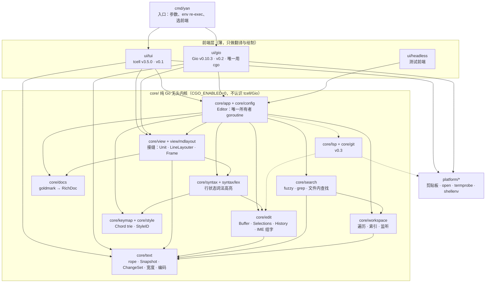

> 箭头表示「导入」。虚线是 v0.3 才加入的依赖。图里 `core/keymap` 和 `core/style` 画在一个框里只为省地方：`core/syntax` 实际只依赖 `core/style`；`core/view` 只依赖 `core/syntax/lex` 这个叶子包（词法器接口），不依赖高亮引擎。完整规则以 §2.2 为准。

### 1.2 核心思想：无头内核 + 薄前端 + 单一所有者 goroutine

Yan 把「编辑器」拆成两半。**内核**（`core/...`）负责一切与界面无关的事：文本存储、选择区、撤销、高亮、Markdown 解析、项目索引、搜索、命令和按键映射，最后把「这一帧该显示什么」算成一个与终端或像素无关的**显示模型 `view.Frame`**。**前端**（`ui/tui`、`ui/gio`）只做三件事：把平台事件翻译成内核的 `Input`；实现一个 `LineLayouter`，告诉内核一行字在本前端里有多宽、怎么折行；把 `Frame` 画出来。所有可变状态都归**一个 goroutine** 所有，也就是前端事件循环所在的那个。前端在这个 goroutine 上**同步**调用 `Handle → RunPending → Frame`，没有锁，没有消息往返。后台 goroutine（遍历、grep、高亮补全、Markdown 解析）只读不可变的 `Snapshot`，结果通过唯一的线程安全入口 `Editor.Post(func(*Editor))` 交回所有者。

**为什么不是 xi-editor 那种「内核进程 + 异步 RPC」**：xi 把前端和内核拆成两个进程、用 JSON-RPC 异步通信。作者 Raph Levien 在[回顾文章](https://raphlinus.github.io/xi/2020/06/27/xi-retrospective.html)里承认这个进程拆分是个错误：滚动花了几个月才做对，带自动换行的窗口缩放会撕裂，JSON 序列化也带来性能和代码膨胀问题。我们要的「前后端分离」是**包级分离**，不是**进程级分离**：`core` 和 `ui` 是两组 Go 包，直接函数调用，同一地址空间，零序列化。这样拿到了 xi 想要的好处（前端可替换、内核可无 UI 测试），又避开了异步视图同步这个坑。唯一的进程边界是本来就存在的那些：LSP 服务器、`git` 命令、`open` 命令。

### 1.3 三条铁律

| 铁律 | 内容 | 由谁保证 |
|---|---|---|
| **一个所有者** | 内核可变状态只在所有者 goroutine 上读写；`Post` 是唯一线程安全方法 | `-race` 测试；debug 构建的「重入检测」原子标志（§4.1） |
| **快照出，闭包进** | 后台只拿不可变值（`text.Snapshot`、按值拷贝的 `workspace.Index`、job 启动时建好的只读表）；结果用 `Post` 送回，带版本号，过期则丢弃 | `spawn[T]` / `spawnStream[T]` 封装（§4.3） |
| **按键到绘制之间不放任何慢东西** | 高亮超出 1 ms 预算就先画旧色再异步补；前端从不等待 job | 性能 HUD、CI 基准（§13） |

### 1.4 一个按键的旅程（俯视）


预算：按键 → 帧字节交给 tty（第一次 `Write` 开始），**p50 ≤ 1 ms，p99 ≤ 4 ms**（应用侧，不含终端渲染与终端背压，见 §5.6）。详细时序见 [§4.5](#45-时序一次按键)。

🧭 **Go 学习点**：Go 没有「主线程 UI 框架」包袱，`select` + channel 就是事件循环。本项目刻意**只用一个**跨 goroutine 通道（`Wake`，容量 1）加一个互斥锁保护的闭包队列，你会看到「共享内存通过通信」与「用小锁保护小数据」各自适合什么场景。

---

## 2. 代码仓库布局

### 2.1 目录树

包名与职责以本节为准（DESIGN.md 与 DECISIONS.md 引用这里，不另立分层表）。

```text
yan/                                  模块 github.com/corn12138/yan-source（可改）
├── go.mod                            go 1.27 · toolchain go1.27.2 · 依赖精确版本
├── Makefile                          构建/测试/尺寸门禁（§14）
├── cmd/
│   └── yan/                          入口：yan [path[:line]] · yan doctor · --ui=tui|gio
│       ├── main.go                   解析参数；cjk.ambiguous_width 与环境不符时 syscall.Exec(os.Executable()) 自身
│       ├── frontend_tui.go           默认编进 TUI 前端
│       └── frontend_gio.go           //go:build gio —— 仅 gio 标签时编进 Gio 前端
├── core/                             纯 Go 无头内核：禁止导入 tcell / gioui，禁止 cgo
│   ├── text/                         不可变分块 rope、Summary、Snapshot、ChangeSet、坐标换算、Load/Save、文件分级
│   │   ├── width/                    唯一宽度来源：displaywidth + uax29，与 tcell 同一套选项
│   │   └── encoding/                 UTF-8 / BOM / GB18030 / EOL 识别与原样回写
│   ├── edit/                         Buffer、Selections、Transaction(Origin)、History、IME 临时事务、移动语义
│   ├── style/                        语义 StyleID、Span、FaceID 与 Theme 类型（颜色由前端按主题映射）
│   ├── keymap/                       Chord 规范化、每上下文 trie、mod 别名、TOML 绑定解析
│   ├── syntax/                       行状态引擎（同步视口预算 + 后台 lexStates）
│   │   ├── lex/                      叶子包：State、Lexer 接口（只依赖 style；mdlayout 也用它）
│   │   └── lang/
│   │       ├── clike/                表驱动类 C 词法：Go、TS/JS、JSON/JSONC、CSS
│   │       ├── markdown/             Markdown（围栏代码委托给对应语言）
│   │       ├── yaml/
│   │       ├── toml/
│   │       └── shell/                bash/zsh，含 heredoc
│   ├── docs/                         goldmark(GFM+Footnote+CJK) → RichDoc、大纲、front matter、ExportHTML
│   ├── workspace/                    定位项目根、fastwalk 遍历、无指针索引、懒加载树、文件分级策略
│   │   ├── ignore/                   gitignore 匹配（go-git 的 gitignore 子包）
│   │   └── watch/                    目录级 fsnotify，50 ms 去抖
│   ├── search/                       文件内查找/替换（基于 Snapshot）
│   │   ├── fuzzy/                    sahilm/fuzzy 封装 + 增量收窄
│   │   └── grep/                     项目搜索流水线
│   ├── view/                         接缝：Unit、LineLayouter、Frame、布局 LRU、滚动锚点
│   │   └── mdlayout/                 RichDoc → 行（UAX#14 + 避头尾）
│   ├── app/                          Editor（所有者）、工作台状态（标签、焦点、浮层）、命令注册表、job 管理、性能 HUD
│   ├── config/                       TOML 配置（含项目 .yan.toml 的受限解码）、go:embed 默认值与键位预设、热重载、未知键告警
│   ├── lsp/                          v0.3：LSP 客户端
│   │   └── jsonrpc/                  v0.3：手写 JSON-RPC 基础协议
│   └── git/                          v0.3：git CLI + 行级 diff 槽
├── platform/                         与操作系统打交道的小工具（无 cgo）
│   ├── clipboard/                    pbcopy/pbpaste；SSH 下走 OSC 52
│   ├── open/                         /usr/bin/open 打开 URL、图片、HTML 预览
│   ├── termprobe/                    yan doctor：DSR-6n 宽度探测、TERM_PROGRAM、真彩色、键盘协议
│   └── shellenv/                     v0.2：登录 shell 环境解析（$SHELL -l -i -c 'env -0'，3 s 超时）
├── ui/
│   ├── ui.go                         Frontend 接口
│   ├── tui/                          v0.1：tcell 屏幕生命周期、事件循环、单元格 LineLayouter、Painter（帧变化时写可见单元格）、主题映射
│   ├── gio/                          v0.2：Gio 窗口循环、字形 LineLayouter、Painter、IME 粘合、.app 打包（cgo）
│   │   └── fonts/                    逐个 face 加载 SF Mono / PingFang SC / Hiragino Sans GB
│   └── headless/                     脚本化 Input → Frame 金样文本；比例字宽假布局器（拉丁 7u、CJK 13u）
├── internal/
│   └── archtest/                     导入边界测试（§2.3）
├── tools/
│   └── perfprobe/                    性能探针：pty 启动、等 READY、汇总 footprint/RSS，CI 失败即回归
├── testdata/                         金样（*.golden）、真实仓库片段、GB18030 样本、巨型文件生成器
├── spikes/                           M0 原型（codeview、pty 测量脚本、summary 基准），不进产品构建
└── docs/
    ├── DESIGN.md
    ├── ARCHITECTURE.md               本文
    └── DECISIONS.md
```

### 2.2 依赖规则

| 包 | 允许导入（项目内） | 禁止 |
|---|---|---|
| `core/text`（含 width、encoding） | 无（只用标准库、uax29、displaywidth、x/text） | 其他一切 core 包 |
| `core/edit` | `core/text` | view、app |
| `core/style`、`core/keymap` | 无 | — |
| `core/syntax/lex`（`State`、`Lexer` 接口） | `core/style` | 其他一切 core 包 |
| `core/syntax/lang/*` | `core/syntax/lex`、`core/style` | text、edit、view、app |
| `core/syntax`（引擎） | text、edit、style、`syntax/lex` | view、app |
| `core/docs` | 无（goldmark） | — |
| `core/workspace` | text | search、app、config |
| `core/search` | text、workspace | app |
| `core/view`（含 mdlayout） | text、style、docs、`syntax/lex` | app、edit、`core/syntax` 引擎（视图只认 Snapshot、Span 和注入的词法器） |
| `core/app`、`core/config` | 以上全部 core 包 | ui/*、platform/* |
| `core/lsp`、`core/git`（v0.3） | text、edit、workspace、platform | ui/* |
| `ui/tui`、`ui/gio` | app、view、style、keymap、text（含 `text/width`）、platform | 彼此 |
| `ui/headless` | app、view、style、keymap（解析脚本里的 `key ctrl+g`） | tcell、gioui |
| **所有 `core/...`** | — | `github.com/gdamore/tcell/...`、`gioui.org/...`、任何带 cgo 的非标准库包 |
| **`ui/tui`** | tcell | 任何带 cgo 的非标准库包 |

阅读视图里的围栏代码要「用同一套词法器高亮」，但 `core/view` 不能依赖高亮引擎（引擎依赖 `core/edit`）。所以 `State` 和 `Lexer` 接口单独放进叶子包 `core/syntax/lex`，`mdlayout` 只认这个接口，具体用哪个语言的词法器由 `core/app` 注入一个 `func(lang string) lex.Lexer`。主题类型 `style.Theme` 放在 `core/style`，由 `core/config` 负责加载，前端从 `app` 拿到当前主题，不需要导入 `core/config`。

> `core/app` 需要剪贴板、打开 URL 这类平台能力，但它**不导入** `platform/*`。做法是依赖倒置：`core/app` 定义一个很小的 `Host` 接口，由前端用 `platform/*` 实现后在 `app.New` 时注入（§12）。这样 `core` 在 headless 测试里可以注入假实现。

### 2.3 导入边界测试

DECISIONS.md 要求「`go list -deps ./core/...` 不得含 tcell 或 gioui」，再加一条「core 与 TUI 不含 cgo」。写成普通的 Go 测试，CI 每次跑：

```go
// internal/archtest/archtest_test.go
package archtest

import (
	"os"
	"os/exec"
	"strings"
	"testing"
)

const mod = "github.com/corn12138/yan-source"

// deps 返回给定包模式的全部传递依赖。每行格式："导入路径 [cgo]"，
// 只有带 cgo 源文件的非标准库包才会带 [cgo] 标记。
func deps(t *testing.T, patterns ...string) []string {
	t.Helper()
	args := append([]string{"list", "-deps", "-f",
		`{{.ImportPath}}{{if and (not .Standard) .CgoFiles}} [cgo]{{end}}`}, patterns...)
	cmd := exec.Command("go", args...)
	cmd.Env = append(os.Environ(), "CGO_ENABLED=1") // 用 1 才能看见「本来会用 cgo」的包
	out, err := cmd.Output()
	if err != nil {
		t.Fatalf("go list: %v", err)
	}
	return strings.Split(strings.TrimSpace(string(out)), "\n")
}

func TestCoreIsHeadless(t *testing.T) {
	for _, d := range deps(t, mod+"/core/...") {
		if strings.HasPrefix(d, "github.com/gdamore/tcell") || strings.HasPrefix(d, "gioui.org") {
			t.Errorf("core 依赖了 UI 工具包：%s", d)
		}
	}
}

func TestCoreAndTUIAreCgoFree(t *testing.T) {
	for _, d := range deps(t, mod+"/core/...", mod+"/ui/tui", mod+"/platform/...") {
		if strings.HasSuffix(d, " [cgo]") {
			t.Errorf("出现 cgo 依赖：%s", d)
		}
	}
}
```

此外 `make check` 还会真的用 `CGO_ENABLED=0` 构建一次 `./cmd/yan`（不带 `gio` 标签），双保险。

🧭 **Go 学习点**
- **`go list -deps -f`** 用 `text/template` 语法查询包元数据（`.Standard`、`.CgoFiles`、`.Imports`），是做架构约束的利器。
- **构建标签** `//go:build gio`：同一个 `cmd/yan`，默认构建不含 Gio（无 cgo、体积小），`-tags gio` 才编进 GUI。
- **`internal/`** 目录：只有模块内部能导入，防止外部依赖你的测试工具。

---

## 3. 核心数据结构（core/text、core/edit）

| | |
|---|---|
| **职责** | 存文本（rope）、给出不可变快照、描述修改（ChangeSet）、坐标换算、编码识别与原子保存；在其上维护选择区、事务、撤销历史和 IME 组字状态 |
| **关键类型** | `text.Summary`、`text.Snapshot`、`text.ChangeSet`、`text.FileInfo`；`edit.Buffer`、`edit.Selections`、`edit.Transaction`、`edit.History`、`edit.LineInput` |
| **依赖** | `core/text`：标准库 + `clipperhouse/uax29/v2 v2.7.0` + `clipperhouse/displaywidth v0.11.0` + `golang.org/x/text v0.42.0`；`core/edit`：`core/text` |
| **里程碑** | M1a（平铺叶子数组）→ M1b（持久化 B+ 树，可选）；M7 投产 |

### 3.1 Rope：不可变分块字节串

**为什么不用「每行一个对象」**：研究阶段实测，在 100 MB / 326 万行的文件上，类 micro 的行数组占 257 MB 堆，每次完整 GC 约 104 ms CPU，因为 GC 要扫描几百万个指针；同样内容用一整块 `[]byte` 加 `[]uint32` 行首表只要 116 MB，每次 GC 约 1 ms。Go 的 GC 会跳过**不含指针**的内存，所以文本必须放在大块的、无指针的 `[]byte` 里。

**叶子（leaf）规则**

- 目标 2 KB，最小 512 B，最大 4 KB；只在 UTF-8 边界切分，优先切在最后 256 B 里的 `'\n'` 之后（让大多数行不跨叶子，绘制时可零拷贝别名）。
- 打开文件时**只读一次**进一个 `[]byte`，叶子是它的子切片（零拷贝）。之后的编辑只为改动处分配新叶子，旧叶子永不修改。
- **硬规则：切叶子一律用三下标切片 `buf[lo:hi:hi]`**，对外交出的切片（`Chunks`、`seekLine` 的结果、`RowFrame.Text`）也一样把容量限制到长度。普通的 `buf[lo:hi]` 容量一直延伸到读缓冲末尾：调用方（词法器、搜索、LSP、绘制器）只要对它 `append` 一次，就会原地写坏相邻的叶子，而所有历史快照和后台 job 共享这块内存，「不可变快照」的前提就塌了，`-race` 还未必报得出来。本机验证：`buf := []byte("hello world"); a := buf[0:5]; b := buf[5:11]; _ = append(a, '!')` 之后 `b` 变成 `"!world"`。
- 每个叶子对应一个 `Summary{Bytes, Newlines, Runes, UTF16}`（类型定义见 [§12](#12-关键-go-接口)）：`Bytes` 是内部唯一坐标，`Newlines` 用于行号 ↔ 偏移，`Runes` 服务 Gio IME（`key.Range` 以 rune 计），`UTF16` 服务 LSP（gopls v0.22.0 只讲 UTF-16）。摘要可加，父节点的摘要就是子节点之和：

```go
// summarize 计算一个叶子的摘要。热路径：bytes.Count 在 arm64 上走 NEON 汇编。
func summarize(b []byte) Summary {
	s := Summary{Bytes: len(b), Newlines: bytes.Count(b, []byte{'\n'})}
	if isASCII(b) { // 每次检查 8 字节：binary.LittleEndian.Uint64(w)&0x8080808080808080 == 0
		s.Runes, s.UTF16 = len(b), len(b)
		return s
	}
	for _, c := range b {
		if c&0xC0 != 0x80 { // 非续字节 = 一个码点的开头
			s.Runes++
		}
		if c >= 0xF0 { // 4 字节序列 = 增补平面字符，UTF-16 里占 2 个码元
			s.UTF16++
		}
	}
	s.UTF16 += s.Runes
	return s
}
```

**实测**（100 MB）：ASCII 为主的代码 36–41 ms CPU；纯中文 190 ms CPU（单线程）；按 16 核并行切块计算，高负载下 37–97 ms 墙钟。所以 `text.Load` 对大文件**并行**算摘要，预算 ≤ 200 ms 墙钟。

### 3.2 两步走的存储：M1a 平铺数组 → M1b B+ 树

两种存储藏在同一个**未导出**接口 `tree`（`summary`、`apply`、`seekByte`、`seekLine`、`chunks`，见 §12）后面，API 从第一天起不变，模糊测试守护切换。

**`apply` 一次吃下整个 ChangeSet**，而不是「每个 Change 调一次单区间替换」：单趟遍历叶子，未改动的叶子只复制切片头，改动区间重新切叶，代价是 O(叶数 + 改动字节)。否则全部替换 1 万处或 1,000 个光标同时按 Enter 时，M1a 每个 Change 都要复制一遍整个叶数组，8 MB 文件全部替换 1 万处要复制约 1.6 GB、耗时约 0.28 s（按下表的 28 µs/次推算）。

**存储布局要和实测对得上**。M1a 的实测（下表）是按「每叶每版本约 40 B」量出来的。如果照直写成 `leaf{b []byte; sum Summary}` 再加 `prefix []Summary`（`Summary` 四个 `int`），本机 `unsafe.Sizeof` 是 24 + 32 + 32 = 88 B/叶，8 MB 文件每次编辑就是约 352 KB，超出 200 KB 预算。所以存储层和 API 分开：

```go
// M1a：平铺叶子数组 + 前缀和（等价于高度为 1 的 B+ 树）。
type flat struct {
	leaves [][]byte    // 每个叶子都是 buf[lo:hi:hi]，内容永不修改；24 B/叶
	prefix []summary32 // prefix[i] = leaves[:i] 的累计，len = len(leaves)+1；16 B/叶
}

// summary32 只在存储里用：256 MB 档的上限在 uint32 范围内。
// 单个叶子的摘要不单独存，用 prefix[i+1] 减 prefix[i] 得到。
type summary32 struct{ Bytes, Newlines, Runes, UTF16 uint32 }
```

每叶 24 + 16 = 40 B，与实测一致；公开 API（`Len`、`LineStart`、`Summary`……）仍然用 `int`。配一个断言测试 `unsafe.Sizeof(summary32{}) == 16`，防止有人顺手把字段改回 `int`。

| 文件大小 | 叶子数 | M1a 每次编辑 CPU（**实测**） | M1a 每次编辑分配（**实测**） | M1b（**估算**） |
|---|---|---|---|---|
| 100 KB | 50 | 1.1 µs | 3 KB | 2–6 KB |
| 8 MB | 4,096 | 28 µs | 162 KB | 2–6 KB |
| 100 MB | 51,200 | 415 µs | 2 MB | 2–6 KB |

M1a 每次编辑要复制整个 `leaves`/`prefix` 数组（每个叶子 40 B），所以文件越大越贵，撤销历史里每个版本也越占内存。结论：

- **普通档（≤ 8 MB）用 M1a 完全够**：按键分配 ≤ 8 KB（≤ 200 KB 文件），8 MB 时 ≤ 200 KB。
- **大文件档（8–256 MB）在 M1b 落地前只读**，见 [§3.11](#311-文件分级)。
- **M1b** 是扇出 16–32、带子节点摘要的持久化 B+ 树：一次编辑只复制「根到叶」路径（约 2–6 KB），新旧版本共享其余节点：

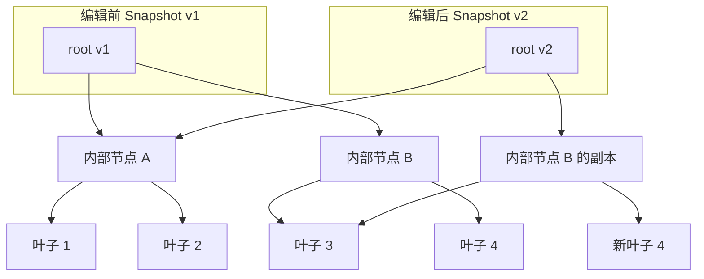

M1b 只有在 M1a 第 3 周末全绿时才做；若 B+ 树拖期超过 2 周，按回退计划直接用 M1a 发布 v0.1（DECISIONS.md §5.1 回退第 4 条）。

**两个基准**（M1 退出前加上）：8 MB 文件上全部替换 1 万处 ≤ 50 ms；100 个光标同时打字，每键 ≤ 1 ms。

### 3.3 Snapshot：不可变文档版本

`Snapshot` 只有两个字段：`{t tree; version uint64}`（§12）。它只描述「内容的某个版本」。

**文件的状态不放进快照**。路径、编码（`EncUTF8` / `EncUTF8BOM` / `EncGB18030`）、主流换行（`EOLLF` / `EOLCRLF`）、是否混合换行、修改时间、档位（`TierNormal` / `TierLarge`）和保存时预期的 `(size, mtime)` 是「这个文件」的状态，记在 `text.FileInfo` 里，由 `edit.Buffer` 持有，**不进撤销历史**。如果把它们放进快照，撤销会把它们一起带回去：另存为之后按 Ctrl+Z，路径会退回旧路径；保存后修改时间变了，还得为此造一个新快照，版本号就乱了。后台 job 需要路径或编码时，在启动时按值捕获一份 `FileInfo`。

`Snapshot` 是**值类型**，字段全部未导出，外部只能通过方法读取：`Len`、`LineCount`、`LineStart`、`LineAt`、`LineEnd`（去掉行尾 `\r\n` 或 `\n` 之后的偏移）、`Chunks(from, to) iter.Seq[[]byte]`（别名叶子内存，容量已限制）、`AppendRange(dst, from, to)`（拷到调用方的缓冲里）、`ByteToRune`、`RuneToByte`、`UTF16Col`。「复制即快照」：后台 job 收到的是值拷贝，内核之后怎么编辑都不会影响它。

**版本号永不复用**：`version` 来自 `core/text` 包级的 `atomic.Uint64` 自增计数器，全局唯一。撤销会恢复旧快照（连同旧版本号，内容也完全相同，所以旧版本的后台结果依然有效）；撤销之后的新编辑一定拿到新号。这样「结果版本 == 当前版本」就等价于「内容相同」，不会出现撤销后又编辑、版本号撞车的情况。

### 3.4 坐标系统

**唯一规范坐标是 UTF-8 字节偏移。** Go 的 `string`、`regexp` 的匹配下标、goldmark 的 segment 都是字节偏移，所以内部统一用字节，只在边界处换算。

| 坐标 | 谁用 | 怎么换算 | 复杂度 |
|---|---|---|---|
| 字节偏移 | 内核一切：选择区、ChangeSet、Span、搜索命中 | — | — |
| 行号（0 基） | 行号槽、跳转、滚动锚点 | `Newlines` 摘要二分 + 叶内 `bytes.IndexByte` | O(log n) + ≤ 4 KB 扫描 |
| rune 偏移 | Gio IME（`key.Range` 以 rune 计） | `Runes` 摘要 + 叶内扫描 | O(log n) + ≤ 4 KB |
| UTF-16 列 | LSP `Position.character` | 行首定位后用 `UTF16` 摘要 / 行内扫描 | O(log n) + 行长 |
| 字素（grapheme）列 | 状态栏「行/列」里的「列」 | uax29 遍历本行；超长行从最近的列检查点开始 | 普通行 O(行长)；超长行 ≤ 4 KB 扫描 |
| 显示 x（`view.Unit`） | 渲染、点击命中、上下移动的目标列 | 布局缓存里的 `Stops`（§5.2）；超长行用列检查点 | 命中 LRU 时 O(log 行宽) |

**超长行（> 10 KB）的列检查点**：压缩过的 JS、JSON 一行就有几 MB，每次移动光标都从行首做 uax29 遍历，或者为了「只布局可见列窗口」从行首累加宽度，都会让 p99 ≤ 4 ms 失效。所以 `core/view` 为超长行惰性建立一张稀疏检查点表：每 4 KB 记一项 `(byte, graphemeCol, displayX)`，按行内容哈希放进 LRU。查询列号、把可见窗口的 x 换算成字节、横向滚动，都从最近的检查点往后扫，最多扫 4 KB。

### 3.5 ChangeSet：一份修改描述，喂给所有订阅者

`ChangeSet` 是 `[]Change{Start, End int; Text string}`：有序、互不重叠，所有偏移都相对**同一个旧快照**，每个 `Change` 表示「把旧快照的 `[Start, End)` 换成 `Text`」。四个方法：

| 方法 | 作用 |
|---|---|
| `Apply(s) Snapshot` | 产生新快照（`version` 取自包级原子计数器）；内部调用一次 `tree.apply(cs)` |
| `Invert(old) ChangeSet` | 生成反向修改；需要旧快照才能找回被删掉的文本 |
| `MapPos(pos, assoc) int` | 旧偏移 → 新偏移 |
| `Compose(next) ChangeSet` | 先自己后 `next`，合成一个相对最初快照的 ChangeSet |

**同一个 ChangeSet 值**被以下所有人消费，这是整个内核最重要的设计统一点：撤销（`Invert`）、选择区映射（`MapPos`）、高亮 Span 平移、搜索命中锚点平移、Markdown 重解析触发、v0.3 的 LSP `didChange` 与诊断锚点。

`Assoc` 决定「恰好落在插入点上」的位置往哪边走：`AssocBefore` 留在插入文本之前（书签、诊断起点），`AssocAfter` 跟到插入文本之后（光标默认如此）。

```go
// MapPos 把旧快照中的偏移映射到新快照。
func (cs ChangeSet) MapPos(pos int, assoc Assoc) int {
	delta := 0
	for _, c := range cs {
		if pos < c.Start || (pos == c.Start && assoc == AssocBefore) {
			return pos + delta
		}
		if pos < c.End || pos == c.Start { // 落在被替换区间内，或在插入点且 AssocAfter
			if assoc == AssocBefore {
				return c.Start + delta
			}
			return c.Start + delta + len(c.Text)
		}
		delta += len(c.Text) - (c.End - c.Start)
	}
	return pos + delta
}
```

例：旧文本 `你好world`（`你`、`好` 各 3 字节，共 11 字节），ChangeSet `{Start: 6, End: 6, Text: "，"}`（在 `w` 前插入 3 字节的全角逗号）：

| 旧位置 | `AssocBefore` | `AssocAfter` | 说明 |
|---|---|---|---|
| 3 | 3 | 3 | 在改动之前，不动 |
| 6 | 6 | 9 | 恰在插入点：光标跟到逗号后，书签留在逗号前 |
| 8 | 11 | 11 | 在改动之后，整体后移 3 |

`MapPos` 单独映射一个位置是 O(changes)。要映射**很多**位置时（选择区、搜索标记），不要对每个位置调一次 `MapPos`，而是把排好序的位置和 ChangeSet 做一趟归并，总代价 O(位置数 + changes)。

`Compose` 只有两处用途：IME 上屏时把组字期间的多次临时编辑合成一步（§3.9）；History 在同一个撤销组里累积 `Before → After` 的修改（§3.8）。v0.1 不做「过期结果重定位」（§4.4），所以不需要保留近期 ChangeSet 的环。

### 3.6 Selections：选择区优先的编辑模型

`Selections` 是一组按起点排序、互不重叠的 `Range{Anchor, Head int; GoalX int32}`，外加一个 `Primary` 下标。`Anchor == Head` 就是光标；`GoalX` 记住上下移动时的目标 x（`view.Unit`，-1 表示未设）；`Primary` 是主光标，真实终端光标和 IME 候选窗锚点都放在这里。`Selections.Map(cs)` 用一趟归并（§3.5）以 `AssocAfter` 映射每个端点，再合并重叠、修正 `Primary`。

和 Helix 一样，「光标」只是长度为 0 的选择区，**多光标就是列表操作**：Ctrl+D / Cmd+D「添加下一个匹配」= 在当前主选择之后搜索同样的文本，追加一个 Range。将来想加列选择、Option+点击加光标，都不需要第二套编辑模型。

### 3.7 Transaction、Edit 与 Buffer

- `Transaction{Changes, After, Origin, Provisional}` 是一次原子修改。`After` 为空时由 `Changes` 映射得出；`Provisional` 表示 IME 标记文本（不入撤销、不发 LSP、不触发自动保存）。
- `Origin` 记录来源：`OriginTyping`、`OriginPaste`、`OriginIME`、`OriginCommand`、`OriginReplaceAll`、`OriginReload`、`OriginUndo`。它决定撤销分组方式。
- `Edit{Before, After, Changes, Origin, Provisional}` 是订阅者（高亮器、搜索标记、文档重解析、v0.3 的 LSP）收到的通知。
- `Buffer` 是一个文档当前快照的**唯一所有者**，持有快照、`FileInfo`、选择区、历史、组字状态和订阅者列表。
- `LineInput` 是快速打开、命令面板、查找框、替换框、项目搜索框这些**单行输入框**的小模型：`[]byte` 文本、一个选择区、组字状态。它和 `Buffer` 共用按字素移动、按词移动和组字逻辑，但没有 rope、没有 History（单行框的撤销只记最近几步），所以 Gio 的输入法在浮层里也能用同一套规则（§6.6）。

`Buffer.Apply(tx)` 的步骤固定：校验 ChangeSet（debug 构建）→ `after := tx.Changes.Apply(before)` → 选择区映射 → 非临时事务写入 History → **按注册顺序**通知订阅者（高亮器先平移 Span 并从首个改动行起作废行状态；再平移搜索标记；再调度 Markdown 重解析）。所有修改都走这一条路，包括全部替换、外部变更后重新加载、v0.3 的格式化结果，所以它们**都可撤销**、都会通知 LSP。订阅者一律按「一个 Edit 可能含多个 Change」来写，单趟处理整个 ChangeSet。

几条编辑语义：

- **从磁盘重载**不生成「整篇替换」：先裁掉新旧内容的公共前缀和公共后缀（`bytes` 比较，memcmp 速度，O(n)），只剩一个最小的 `Change`。这样改动区域之外的光标、书签和滚动位置都不动，撤销历史里也不用多存一整份文件。
- **行尾**：`LineEnd(line)` 返回去掉 `\r\n` 或 `\n` 之后的偏移；End 键、选到行尾、在行尾删除都用它，所以 CRLF 文件里 `\r\n` 被当作一个整体。
- **换行风格**：粘贴和 `TextInput` 插入多行文本时，如果文件本身不是混合换行，就把插入文本的换行统一成 `FileInfo.EOL`（VS Code 也这样做），免得悄悄制造混合换行。

### 3.8 History：快照式撤销、按字节封顶

`History` 是一串 `Revision{Before, After, Changes, SelBefore, SelAfter, Origin, At}`，加上当前位置 `cur`、估算的保留字节 `estBytes` 和上限 `maxBytes`（§12）。

> 设计说明：`Revision` 带 `Changes` 字段（`Before → After`，组内合并时用 `Compose` 累积）。撤销本质上是「恢复 `Before` 快照」（O(1)），但高亮器和 LSP 需要知道「改了哪里」，所以撤销时发出 `Changes.Invert(Before)`。

**「已保存」用版本号记，不用历史下标**。`Buffer` 记 `savedVersion uint64`，`Dirty() = snap.Version() != savedVersion`；保存完成时设为「当时写进磁盘的那个快照」的版本。版本号全局唯一、撤销会恢复原版本（§3.3），所以撤销回到保存点时自然变回干净；保存是异步的（§3.10），保存期间新打的字不会被误标成已保存；历史按 64 MB 上限丢弃最旧的组、或撤销后再编辑截断重做分支，也都不会让这个标记失效。组字中的 buffer 一律视为 dirty（§3.9）。

**从磁盘重新加载也要更新这个标记**。重新加载（外部修改后静默重载，或用户选了「重新加载」，§9.6）是一个走 `Apply` 的 `OriginReload` 事务，会产生新版本；之后内存内容和磁盘一致，所以所有者紧接着调用 `Buffer.MarkSaved(after.Version(), fi)`：`savedVersion` 设为重载后的版本，`FileInfo` 换成这次读盘时的修改时间和「预期的 (size, mtime)」。否则每个被 `git checkout` 静默重载的文件都会显示 ●、关闭时还要弹确认。反过来，重载后再按 `Ctrl+Z` 回到旧版本时，内容与磁盘不同，`Dirty()` 为真，正好符合事实。headless 金样 `reload_clean.txt` 覆盖：外部修改 → 重载 → 不 dirty；`ctrl+z` → dirty。

**分组规则**

| 情况 | 处理 |
|---|---|
| 含任何非 ASCII rune 的 `TextInput`（在终端里实际上就是一次 IME 上屏），以及 Gio 的 `OriginIME` 上屏 | **总是单独成组**，并结束当前组：一个上屏词组恰好一个撤销步，哪怕 1 s 内连续上屏「你好」和「的」也是两步 |
| 纯 ASCII 的 `TextInput`，不论长度 | 按「1 s 内同一字符类（字母数字 / 标点 / 空白）」与当前组合并，等同逐键输入：快速打的 `abc` 被排空合并成一个 `TextInput`，撤销结果也和逐键打的完全相同 |
| 粘贴、全部替换、重新加载、格式化 | 各自独立成组 |
| 光标跳转（点击、搜索跳转、Ctrl+G） | 断开当前组 |
| IME 组字中的临时编辑 | 不入历史；上屏时合成**恰好一个** `OriginIME` 组 |

终端里分不清「一次 IME 上屏」和「快速连打的一批」，所以规则按内容判断（有没有非 ASCII），不按事件批次判断，撤销步数就不会取决于打字速度。

撤销 = 把 `cur` 回退并恢复快照，O(1)。内存按「保留字节估算」封顶：M1a 每个保留版本约 `40 B × 叶子数` + 新叶子字节，默认上限 64 MB / buffer（单元测试：在 100 KB 和 8 MB 文件上脚本化 1 万次编辑后检查 `estBytes`）。

### 3.9 IME 临时事务（为 Gio 准备，TUI 中永不激活）

`Buffer`（以及 `LineInput`）内部的 `composition` 记录：是否激活、当前组字区间（字节）、第一次临时编辑之前的 `base` 快照与选择区、以及 `base → 当前` 用 `Compose` 累积的 ChangeSet。

- 组字期间的编辑标记为 `Provisional`：不写撤销、不发 LSP、不自动保存，高亮只重做组字所在行。
- `CommitComposition()` 把 `base → 当前` 的全部修改压成**一个** `OriginIME` 修订。
- **不变式**：组字激活时，任何**非临时**事务（后台 Post 回来的格式化、重载等）和任何命令执行之前，先 `CommitComposition()`（或取消组字），并发布变化后的 `SelectionCmd`，让 Gio 结束它本地的标记文本。否则「base → 当前」的合成会把这些非输入法修改一起压进 `OriginIME` 修订。组字中的 buffer 一律视为 dirty，外部修改的静默重载推迟到上屏之后。
- **TUI 中它永远不会激活**：终端自己管组字，只把最终上屏的 UTF-8 发给程序。完整状态机见 [§6.6](#66-ime两种模型一个内核)。

### 3.10 编码、换行与原子保存

**识别流程**（在 `core/text/encoding`）。先按大小定档，再读文件，不能反过来：先 `os.ReadFile` 再判断大小，打开一个几 GB 的日志就会先分配几 GB 内存，「超过 256 MB 拒绝」形同虚设。

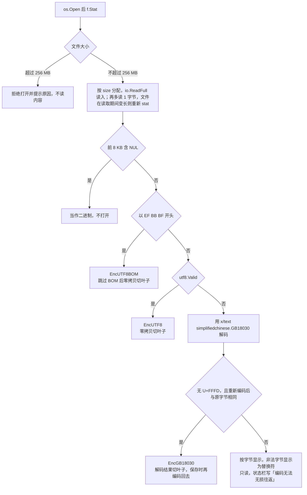

**为什么 GB18030 要做往返检查**：「解码结果里没有 U+FFFD」不保证能原样存回去。x/text v0.42.0 的解码器把单字节 0x80（CP936/GBK 里的欧元符号）解成 `€`，编码器却把 `€` 写成 `A2 E3`（`encoding/simplifiedchinese/gbk.go`，只有 GBK 编码器才把 € 写回 0x80）。本机实测：`C4 E3 BA C3 80 31 30` 解码为「你好€10」且没有 U+FFFD，重新编码却得到 `C4 E3 BA C3 A2 E3 31 30`。不做检查，保存时连没改过的地方都会被悄悄改写。普通档 ≤ 8 MB 多编码一次只要几毫秒；`testdata` 放一个含 0x80 的 GBK 金样做往返测试。

**换行**：rope 里**原样保存**文件字节（包括 `\r\n`），这样零拷贝和「原样回写」都自然成立。`Newlines` 只数 `\n`，因此 CRLF 文件的行号同样正确；视图和词法器拿到的行内容会去掉行尾的 `\r`；在 CRLF 文件里按 Enter 插入的是 `FileInfo.EOL` 对应的序列（编辑语义见 §3.7）。混合换行的文件不做任何规范化，只在状态栏提示「混合换行」。

**原子保存**是一个后台 job（键为 `("save", bufID)`，§4.3），不在所有者上做 I/O：本机实测 100 KB 文件一次 `f.Sync()`（darwin 上是 `F_FULLFSYNC`）就要 4.4–5.8 ms，单这一项就超过按键 p99 4 ms 的预算。

1. 所有者上：按值捕获当前 `Snapshot` 和 `FileInfo`，启动 job，状态栏显示「保存中」；
2. 解析符号链接（`filepath.EvalSymlinks`），在**目标文件所在目录**操作，避免把链接替换成普通文件；
3. 按 `FileInfo.Encoding` 编码：UTF-8 直写；`EncUTF8BOM` 先写 BOM；`EncGB18030` 用 x/text 编码器转回（GB18030 覆盖全部 Unicode，emoji 也能编码；只有缓冲区里出现非法 UTF-8 时编码器才会报错，这时中止并询问是否另存为 UTF-8）；
4. `os.CreateTemp(dir, ".yan-save-*")` → 写入 → `f.Sync()`（Go 在 darwin 上用 `F_FULLFSYNC`，见 `internal/poll/fd_fsync_darwin.go`）→ 恢复原文件权限 → `Close`；目录不可写时退回原地写入，并在状态栏说明「这次保存不是原子的」；
5. `os.Rename(tmp, target)`：同一文件系统内是原子的，崩溃时磁盘上要么是旧文件、要么是新文件；
6. 结果 `Post` 回所有者：`savedVersion` 设为第 1 步捕获的快照版本（§3.8），`FileInfo` 记下新的修改时间和「预期的 (size, mtime)」，让文件监听器忽略这次自己引起的事件；监听器也按前缀忽略 `.yan-save-*` 临时文件（§9.6）。关闭标签和退出都会等到这一步完成才继续（§4.3），保存 job 不会被退出取消。

M7 验收：保存过程中 `kill -9`，原文件或新文件总有一个完整。已知限制：`rename` 会断开硬链接。

### 3.11 文件分级

| 档位 | 大小 | 行为 |
|---|---|---|
| 普通 `TierNormal` | ≤ 8 MB | 全部功能 |
| 大文件 `TierLarge` | 8–256 MB | v0.1 只读；不高亮、不折行；首屏 ≤ 100 ms；M1b 落地后开放编辑 |
| 超大 | > 256 MB | 拒绝并给出明确提示（`f.Stat` 之后就拒绝，不读内容）；分页只读查看器是后续功能 |
| 超长行（任意档） | 单行 > 10 KB | 该行不折行、不高亮，只布局可见的列窗口；列号和横向滚动用 §3.4 的列检查点 |

**大文件的首屏**：先在 M0/M2 的空闲机上实测「读文件 + 并行摘要」。按研究阶段的数字（高负载下并行摘要 37–97 ms），空闲时很可能本来就在 100 ms 以内，那就**不做两阶段加载**，`Load` 返回的就是完整快照。真的超了，才只对 `TierLarge`（本来就只读）加一步：用前 64 KB 构造一个独立的只读预览快照先显示，完整快照到达后用 `Buffer.replaceReadOnly(s)` 整体替换。这一步不走 `Apply`、不进撤销，状态栏显示「索引中…」。不能先给一个「部分快照」，因为 M1a 的前缀和要等所有叶子都算完才有意义，`LineCount`、`Len`、滚动条在部分快照上都是错的。

🧭 **Go 学习点**
- **用值类型 + 未导出字段实现不可变性**：`Snapshot` 没有任何可写方法，拷贝即快照，天然可跨 goroutine 共享，比加锁简单得多。
- **三下标切片 `s[lo:hi:max]`**（full slice expression）：第三个下标限制容量。`append` 在容量够时会原地写进底层数组，容量被限制到长度后，`append` 一定分配新数组，别名就安全了。这是「共享底层数组」最容易踩的坑，模糊测试里专门加一条性质：对 `Chunks` 返回的每个 chunk 做 `append` 之后，快照内容不变。
- **未导出接口做内部可替换实现**：`tree` 接口让 M1a → M1b 的替换对外完全不可见。
- **`iter.Seq[[]byte]`**（Go 1.23 起）：`for chunk := range snap.Chunks(a, b)` 写起来很顺手，但通过接口返回的闭包编译器无法内联，闭包和它捕获的变量会逃逸到堆上，每次 range 一般分配 1–3 次（本机最小复现：`testing.AllocsPerRun` 测得 3 次）。所以热路径（绘制、词法）用 `seekLine` / `AppendRange` 直接拿切片，`Chunks` 只用于搜索、保存这类批量路径。用 `go build -gcflags=-m ./core/text` 可以看到逃逸分析的报告。
- **`unsafe.Sizeof`**：不用 `unsafe` 做任何指针运算，只用它在测试里断言结构体大小，把「每叶 40 B」这种内存预算钉死。
- **GC 与无指针内存**：`[]byte` 背后的数组不含指针，GC 不扫描；对比 `[]*Line` 你会在 `GODEBUG=gctrace=1` 里看到天壤之别。
- **模糊测试**：`ChangeSet` 和 rope 是最适合 `go test -fuzz` 的代码，见 [§13.2](#132-模糊测试与性质测试)。

---

## 4. 并发模型（core/app）

| | |
|---|---|
| **职责** | 定义「谁能改状态」：单一所有者 goroutine、唯一线程安全入口 `Post`、带键取消的后台 job、版本号与过期结果的处理 |
| **关键类型** | `app.Editor`、`app.Input`、`jobKey`、`jobManager`、`spawn[T]`、`spawnStream[T]` |
| **依赖** | 标准库 `context`、`sync`、`sync/atomic`、`time`；全部 core 包 |
| **里程碑** | M2（Handle/RunPending/Frame/Post/Wake/NextDeadline/keyed jobs） |

### 4.1 规则一：一个所有者

所有可变的编辑器状态（buffer、选择区、历史、缓存、文件树、浮层）都属于**运行前端事件循环的那个 goroutine**：TUI 中是 `main`，Gio 中是窗口事件 goroutine。内核方法是同步的、**不是**线程安全的，状态本身不带任何互斥锁。

为了尽早发现误用，debug 构建（`-tags debug`）在每个入口方法上做重入检测：

```go
//go:build debug

package app

// enter 在并发进入时立刻 panic。非 debug 构建里它是空函数，零开销。
func (e *Editor) enter() (leave func()) {
	if !e.inside.CompareAndSwap(false, true) { // e.inside 是 atomic.Bool
		panic("app.Editor 被并发调用：只有 Post 是线程安全的")
	}
	return func() { e.inside.Store(false) }
}
```

### 4.2 规则二：唯一线程安全入口 `Post`

```go
// Post 是 Editor 唯一可以在任意 goroutine 调用的方法。
// 它只往受锁保护的切片里追加闭包，因此永不阻塞；所有者给自己 Post 也不会死锁。
func (e *Editor) Post(fn func(*Editor)) {
	e.mu.Lock()
	e.pending = append(e.pending, fn)
	e.mu.Unlock()
	select {
	case e.wake <- struct{}{}: // 容量 1：多次唤醒自然合并成一次
	default:
	}
}

// Wake 让前端在 select 里等待「有待处理的闭包」。
func (e *Editor) Wake() <-chan struct{} { return e.wake }

// RunPending 在所有者 goroutine 上执行积压的闭包；两个切片轮换使用，稳态零分配。
func (e *Editor) RunPending() {
	e.mu.Lock()
	q := e.pending
	e.pending = e.spare[:0]
	e.mu.Unlock()
	for _, fn := range q {
		fn(e)
	}
	clear(q) // 释放闭包引用，让 GC 回收它们捕获的结果
	e.spare = q[:0]
}
```

**为什么是「锁 + 切片」而不是 `chan func(*Editor)`**：有界 channel 满了会阻塞发送方，而所有者在处理一个闭包时可能再 `Post` 给自己，造成死锁；无界 channel 在 Go 里不存在。锁只保护一次 `append`，临界区是纳秒级。`wake` 容量为 1，1000 个后台批次只会唤醒循环一次，循环醒来后一次性 `RunPending`。

### 4.3 规则三：快照出，闭包进；带键取消的 job

```go
type jobKey struct {
	kind   string // "load" "save" "walk" "readdir" "grep" "highlight" "mdparse" "fuzzy" "clipboard"
	target uint64 // buffer id；工作区级 job 为 0
}

type jobManager struct {
	root   context.Context // Editor 的根 ctx：Quit 时取消，除 save 外的 job 一起停
	cancel map[jobKey]context.CancelFunc
	gen    map[jobKey]uint64 // 代号：start 与 cancelTarget 时加一；项从不删除，代号不会重复
}

// start 取消同键的旧 job，返回新 ctx 与新代号。只在所有者 goroutine 调用。
func (m *jobManager) start(k jobKey) (context.Context, uint64) {
	if c, ok := m.cancel[k]; ok {
		c() // 新 job 取代同键旧 job
	}
	parent := m.root
	if k.kind == "save" {
		parent = context.WithoutCancel(m.root) // 保存不随退出取消（§3.10）
	}
	ctx, c := context.WithCancel(parent)
	m.cancel[k] = c
	m.gen[k]++
	return ctx, m.gen[k]
}

// finish 在 job 的最后一个结果被所有者接收后调用：代号仍匹配才清理，避免删掉新 job 的项。
// cancel 项可能已被 cancelTarget 删掉，所以先查再调，绝不调用 nil 函数。
func (m *jobManager) finish(k jobKey, gen uint64) {
	if m.gen[k] != gen {
		return
	}
	if c, ok := m.cancel[k]; ok {
		c()
		delete(m.cancel, k)
	}
}

// cancelTarget 取消某个 buffer 除 save 外的全部 job（关闭 buffer 时调用）。
// 先把代号加一：已经 Post、尚未执行的结果在所有者侧比对代号时被丢弃。
func (m *jobManager) cancelTarget(id uint64) {
	for k, c := range m.cancel {
		// clipboard 的 target 是自增序号而不是 buffer id，不能按 id 匹配
		if k.target == id && k.kind != "save" && k.kind != "clipboard" {
			m.gen[k]++
			c()
			delete(m.cancel, k) // range 中删除当前项是安全的
		}
	}
}

// savesInFlight 报告是否还有保存没回来；关闭标签和退出都要等它变成 false（见下文）。
func (m *jobManager) savesInFlight() bool {
	for k := range m.cancel {
		if k.kind == "save" {
			return true
		}
	}
	return false
}

// spawn 在后台运行 work，结果用 Post 送回；若已被取代则丢弃。
func spawn[T any](e *Editor, k jobKey,
	work func(context.Context) (T, error),
	done func(*Editor, T, error)) {
	ctx, gen := e.jobs.start(k)
	go func() {
		v, err := runRecovered(ctx, work) // 把 panic 转成 error，见 §15
		if ctx.Err() != nil {
			return
		}
		e.Post(func(e *Editor) {
			if e.jobs.gen[k] != gen {
				return // 在 Post 之后、RunPending 之前被更新的 job 取代
			}
			e.jobs.finish(k, gen)
			done(e, v, err)
		})
	}()
}

// spawnStream 用于分批回送的 job（walk、grep）：work 每产出一批就调用 emit，
// emit 就是「带代号检查的 Post」；done 在 work 返回后调用一次。
func spawnStream[T any](e *Editor, k jobKey,
	work func(ctx context.Context, emit func(T)) error,
	apply func(*Editor, T),
	done func(*Editor, error)) {
	ctx, gen := e.jobs.start(k)
	emit := func(batch T) {
		if ctx.Err() != nil {
			return
		}
		e.Post(func(e *Editor) {
			if e.jobs.gen[k] == gen {
				apply(e, batch)
			}
		})
	}
	go func() {
		err := runRecoveredStream(ctx, work, emit)
		e.Post(func(e *Editor) {
			if e.jobs.gen[k] == gen {
				e.jobs.finish(k, gen)
				done(e, err)
			}
		})
	}()
}
```

> 设计说明：除了 ctx，还要比对「代号」。`ctx.Err()` 只能挡住「Post 之前」就被取消的结果，而「已经 Post、尚未执行」的旧结果要靠所有者侧比对代号丢弃。所以 `cancelTarget` 除了调用 cancel，还要把代号加一：否则一个已经通过 `ctx.Err()` 检查、排在队列里的高亮或加载结果，会在 buffer 关闭之后照样执行 `done`，旧写法里 `finish` 还会调用已被删掉的 nil cancel 函数，让所有者 goroutine panic。`gen` 的项从不删除（每个键一个 `uint64`，关闭的 buffer 只留下几项），因为删掉后代号会从 1 重新数，排队中的旧结果就可能和新 job 撞号。除 save 外，所有 job 的父 ctx 是 `Editor` 的根 ctx，退出时统一取消；关闭 buffer 时 `cancelTarget` 取消这个 buffer 除 save 外的全部 job；job 完成后 `finish` 释放 cancel 函数并删掉 map 项。高亮的后台补全也走同一套 `spawn`（§7.2），不另起一套 job 系统。单元测试 `TestCloseDiscardsQueuedResult`：高亮结果和加载结果已 `Post`、尚未 `RunPending` 时关闭 buffer，`RunPending` 不 panic，`done` 不执行。

**保存与关闭、退出的顺序**。保存 job 的 ctx 用 `context.WithoutCancel(root)` 派生，`cancelTarget` 也跳过它：半途取消只会留下 `.yan-save-*` 临时文件，还丢掉用户明确要保存的内容。但光不取消还不够，`main` 一返回，进程里所有 goroutine 都会直接消失，所以**关闭和退出必须等保存回来**：

1. 关闭标签或退出时，确认浮层里选了「保存」（或之前按过 `Ctrl+S` 的保存还没回来），所有者启动保存 job，进入「正在保存…」状态（状态栏显示，期间只接受 `Esc` 取消这次关闭或退出，不取消保存本身）；
2. 每个保存结果 `Post` 回来时检查：失败 → 退出「正在保存…」状态，标签保持打开，状态栏显示错误，关闭或退出就此作罢；成功、且 `jobs.savesInFlight()` 为假、也没有「待保存」标记 → 才真正关闭标签（`cancelTarget`），或调用 `Quit()` 取消根 ctx 并结束前端事件循环（`Quit` 怎样通知 `Frontend.Run` 返回在 M2 定稿）；
3. headless 金样 `close_dirty.txt` 含「保存后退出」一例：buffer 有修改 → `ctrl+q` → 选「保存」→ 断言进程退出前磁盘文件已是新内容，且目录里没有残留的 `.yan-save-*`。

**job 种类与批处理参数**

| kind | 工作方式 | 回送节奏 | 取消时机 |
|---|---|---|---|
| `load` | 打开文件：stat、读入、按 GOMAXPROCS 并行算 Summary | 一次（§3.11） | 关闭 buffer |
| `save` | 编码、写临时文件、`Sync`、`Rename`（§3.10） | 一次 | 从不取消：ctx 由 `context.WithoutCancel` 派生，`cancelTarget` 跳过它，关闭与退出都等它回来（见上文）；保存进行中又按了保存，所有者记一个「待保存」标记，等这一次的结果回来再启动下一次 |
| `walk` | `spawnStream`：fastwalk 回调追加到批次 | 每 2k 条路径或 16 ms | 换项目根 |
| `readdir` | 展开大目录时的 `os.ReadDir` | 一次 | 折叠该目录 |
| `fuzzy` | 在按值拷贝的索引（或上次结果）上打分 | 一次 | 查询框再输入 |
| `grep` | `spawnStream`：GOMAXPROCS-1 个 worker（`sync.WaitGroup.Go`） | 每 200 条命中或 30 ms，总上限 1 万 | 搜索框再输入 |
| `highlight` | 每个 buffer 的后台补全：纯函数 `lexStates` 一次跑完（§7.2） | 一次；越过视口下沿时可以多回送一次 | 该 buffer 再编辑 |
| `mdparse` | 每个 buffer，停止输入 50 ms 后解析 | 一次 | 再编辑（去抖重启） |
| `clipboard` | `pbcopy` / `pbpaste`（fork + exec，不能在所有者上等） | 一次 | 不取消：每次操作用一个自增序号当 `target`，连按两次粘贴就是两个互不取代的 job |
| `watcher` | 单个 goroutine，50 ms 去抖 | 去抖后一次 | 退出 |
| v0.3 `lsp` | 每个服务器：1 个 stdout 读、1 个有序 stdin 写、1 个 stderr 环形缓冲；只有「挂起请求表」用互斥锁 | 每条消息 | 服务器关闭 |

### 4.4 版本号与过期结果

每个结果都带着它基于的 `snapshot.Version()`。所有者应用结果时：

- **版本等于当前**：直接用；
- **版本已过期**：v0.1 一律丢弃，必要时按当前快照重新调度。高亮的过期状态数组直接丢（§7.2），Markdown 的 `RichDoc` 过期等去抖后的新解析（文档小，重解析便宜），grep 命中是一份近似列表，用户重新输入就会重跑；搜索标记和 Span 已经在 `Apply` 的订阅者里同步平移了，不需要异步重定位。
- **v0.3 的诊断**是唯一真正需要「过期结果重定位」的：到时候 buffer 保留从诊断版本到当前版本的 Edit 列表，按顺序对每个诊断位置做 `MapPos`，不用 `Compose`（撤销会让版本号回到旧值，按版本建的环反而容易出错）。

这条规则是从 Inkstone 方案嫁接来的：**按键与绘制之间不放任何慢东西，前端从不等待 job**。

### 4.5 时序：一次按键

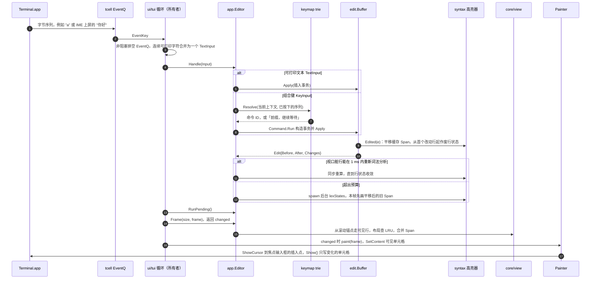

### 4.6 时序：项目搜索流式返回

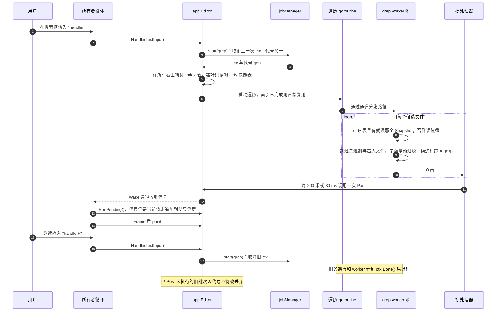

### 4.7 TUI 事件循环

没有 ticker，没有固定帧率。唯一的定时器只为真实截止时间而设：1 s 的组合键前缀超时、各种去抖、状态栏消息过期。光标闪烁交给终端，所以**空闲时 Yan 零唤醒、零 CPU**（单元测试断言空闲时 `NextDeadline()` 返回 `false`）。

```go
func (t *TUI) Run(ctx context.Context, ed *app.Editor) error {
	var frame view.Frame
	timer := time.NewTimer(time.Hour)
	timer.Stop()
	for {
		if d, ok := ed.NextDeadline(); ok {
			timer.Reset(time.Until(d))
		} else {
			timer.Stop()
		}
		select {
		case <-ctx.Done():
			return ctx.Err()
		case ev := <-t.scr.EventQ():
			t.translate(ed, ev)
		case <-ed.Wake():
		case now := <-timer.C:
			ed.Tick(now)
		}
	drain: // 把已经排队的事件一次吃完，最后只画一帧
		for {
			select {
			case ev := <-t.scr.EventQ():
				t.translate(ed, ev)
			default:
				break drain
			}
		}
		t.flush(ed) // 合并的可打印字符 → 一个 TextInput；粘贴进行中不提交
		ed.RunPending()
		w, h := t.scr.Size()
		if !ed.Frame(view.Size{W: view.Unit(w), H: view.Unit(h)}, &frame) {
			continue // 画面没变（例如折叠目录里的遍历批次）：不碰屏幕，不调用 Show
		}
		t.paint(&frame)
		if c := frame.Caret; c.Visible {
			t.scr.ShowCursor(int(c.X), int(c.Y)) // 真实光标 = IME 候选窗锚点；TUI 中 Y 就是行顶
		} else {
			t.scr.HideCursor()
		}
		t.scr.Show() // tcell 只写变化的单元格，并包在 DEC 2026 同步输出里
	}
}
```

`Editor.Frame` 返回 `changed`：自上一帧以来，任何影响显示的状态（编辑、滚动、焦点、浮层、合并进来的 job 结果、状态消息、终端尺寸）有没有变。宁可多报 `true`，不能漏报。只在真的变化时才 `Show()`，有两个理由：省 CPU；更重要的是 tcell 每次 `draw()` 开头都会先把真实光标移开再隐藏，最后才移回插入点，Terminal.app 如果不遵守 DEC 2026，这个瞬间正好被输入法查询光标位置时，候选窗就会闪一下（§6.6）。

**排空时的合并规则**：一串可打印字符（包括一次完整的 IME 上屏）→ 一个 `TextInput`，即一个事务、一次重新词法分析；它算几个撤销步由 §3.8 的分组规则按内容决定（含非 ASCII 就单独成组，纯 ASCII 按逐键规则合并），与排空批次无关。滚轮与触控板增量相加；只保留最后一次窗口尺寸变化；bracketed paste 的全部内容 → 一个 `TextInput{Paste: true}`。粘贴可能很长（tcell 的事件队列容量只有 128，一次大粘贴一定跨越多次排空），所以 `translate` 维护跨排空的 `inPaste` 状态：收到粘贴开始事件后，`flush` 不提交、也不产生 `TextInput`，照常绘制，直到收到粘贴结束事件才提交一次。这些规则正是 micro 的问题 [#2344](https://github.com/micro-editor/micro/issues/2344)（松开方向键后还在一行行滚）的解法。

**Gio 循环（v0.2）**：一个小 goroutine 把 `ed.Wake()` 转发成 `window.Invalidate()`；窗口事件 goroutine 依旧按 `Handle → RunPending → Frame` 调用，所有权不变。光标在最后一次输入 10 s 后停止闪烁，空闲时同样零唤醒。

### 4.8 GC 卫生

- 按键路径只分配 rope 的写时复制：M1a 下 ≤ 200 KB 文件 ≤ 8 KB；M1b 约 2–6 KB。目标：输入时 GC CPU < 1%。
- `Frame`、Span、行 arena 每帧复用（双缓冲）。
- 绘制路径上不做逐行 `string(...)` 转换；布局 LRU 的键用 `maphash.Bytes`。
- HUD 读取 `runtime/metrics` 的 `/sched/pauses/total/gc:seconds`（旧名 `/gc/pauses:seconds` 已弃用）和 `/cpu/classes/gc/mark/assist:cpu-seconds`。
- `GOGC` 保持默认、不设 `GOMEMLIMIT`，直到测量证明需要。

🧭 **Go 学习点**
- **`select` + 非阻塞 `default`**：「阻塞等第一个事件，再非阻塞排空其余」是事件循环的标准写法，带标签的 `break drain` 跳出外层 `for`。
- **容量为 1 的 channel 当「门铃」**：只表达「有事」而不搬运数据，天然合并重复通知。
- **`context.Context` 取消**：job 内部循环要周期性检查 `ctx.Err()`；`exec.CommandContext` 等标准库 API 也接受它。
- **泛型函数 `spawn[T]` / `spawnStream[T]`**：一次写好「后台跑、回送、防过期」的样板，所有 job 复用；类型参数 `T` 让每种 job 的结果类型都是静态检查的。
- **`context` 树**：所有 job 的 ctx 都派生自 `Editor` 的根 ctx，取消父 ctx 会自动取消全部子 ctx，退出时一行代码就能停下所有后台工作。例外用 `context.WithoutCancel`（Go 1.21 起）：它保留父 ctx 的值，但不继承取消，保存 job 就靠它不被退出打断。注意 ctx 只是「请求停下」的信号，`main` 返回时其他 goroutine 不会被等待，所以「等保存写完」要由所有者显式等结果回来，而不是指望 ctx。
- **`sync.WaitGroup.Go`**（Go 1.25）替代手写 `wg.Add(1); go func(){ defer wg.Done() ... }()`。
- **`testing/synctest`**（Go 1.25 正式版）：在假时钟「气泡」里测试去抖、1 s 组合键超时和取消，测试瞬间完成且确定，见 [§13.3](#133-并发与时间确定性测试)。

---

## 5. 视图与渲染管线（core/view、ui/tui）

| | |
|---|---|
| **职责** | `core/view`：与单元格/像素无关的布局抽象和每帧显示模型；`ui/tui`：单元格布局器 + 绘制器；`ui/gio`（v0.2）：字形布局器 + GPU 绘制器 |
| **关键类型** | `view.Unit`、`view.LineLayouter`、`view.StyledRun`、`view.LineLayout`（`Rows` + `Stops`）、`view.Frame`、`view.RowFrame`、`view.Caret` |
| **依赖** | `core/view`：text、style、docs、`syntax/lex`；`ui/tui`：`github.com/gdamore/tcell/v3 v3.5.0`、`core/text/width` |
| **里程碑** | M2（接缝、单元格布局器、绘制器、headless 金样）；v0.2（Gio 布局器与绘制器） |

### 5.1 接缝：内核不知道「格子」还是「像素」

`view.Unit`（`int32`）在 TUI 里是单元格，在 Gio 里是 1/64 像素，内核从不假设是哪一种。一行逻辑文本的布局结果 `LineLayout` 包含：

- `Rows`：若干视觉行，每行有本行在逻辑行内的字节区间、续行缩进 `X0` 和行高 `Height`（TUI 恒为 1；Gio 中标题更高）；
- `Stops`：每个字素边界的 `{Byte, X}`，用于字节 ↔ x 的换算：光标定位、点击命中、上下移动。

布局器的输入不是「一整行字节 + 一个全行样式」，而是**按样式切好的 run**。v0.2 的 Gio 阅读视图里，标题是 2.0 倍字号的 Semibold，行内代码用等宽字体，同一行里字体和字号会变；如果接缝只收一整行字节，到 v0.2 就得回头改 M2 就冻结的 `core/view` 和 `mdlayout`。所以 M2 就把接缝定成：

```go
// StyledRun 是一行里样式一致的一段。TUI 忽略 Face 和 Scale（终端里只有一种字体、一种字号）。
type StyledRun struct {
	Text  []byte
	Face  style.FaceID // FaceCode、FaceProse、FaceProseBold……由前端映射到真实字体
	Scale uint8        // 字号倍数 × 10：10 = 正文，20 = 一级标题
}

// LineLayouter 由每个前端实现：单元格、字形塑形、以及 headless 测试里的比例字宽假实现。
type LineLayouter interface {
	Layout(dst *LineLayout, runs []StyledRun, st LayoutStyle) // st：tab 宽度、折行宽度、是否按散文排版
	Epoch() uint64                                            // 字体、字号、歧义宽度设置变化时递增，使布局缓存失效
}
```

**接缝防泄漏**：`ui/headless` 用一个故意的**比例字宽**假布局器（拉丁 7u、CJK 13u），金样测试同时用单元格布局器和假布局器跑。只要内核里有人偷偷假设「一个字 = 1 格」，假布局器下的测试就会挂。假布局器还要尊重 `Scale`：给它一个 `Scale = 20` 的标题 run，`Row.Height` 必须大于正文行，用来防止「每行一样高」的假设泄漏进内核。宽度计算只允许出现在 `core/text/width` 和各个布局器里，`RowFrame.Height` 从第一天起就支持可变行高。

### 5.2 布局 LRU 与滚动锚点

- **布局 LRU**：4k 条，键为 `(maphash(行字节与 run 样式), 折行宽度, tab 宽度, 布局器 Epoch)`，值为 `*LineLayout`。编辑一行只让这一行的键变化；滚动回来的行直接命中。
- **滚动锚点**是 `(逻辑行, 子行, 行内偏移)`，偏移的单位是 `view.Unit`：上方插入或删除文本时，锚点行号经 ChangeSet 映射后视口内容保持不动；窗口变宽导致上方行的折行数变化，也不会让视口跳动。TUI 里偏移恒为 0（只能按行滚）；Gio 的触控板滚动需要像素级偏移，偏移取整到设备像素（§5.8）。
- 把光标滚进视野时，用布局器给出的折行行数计算，不做任何 O(文件) 的工作。

### 5.3 构建一帧：`Editor.Frame(size, &frame) (changed bool)`

对每个窗格：

1. 从滚动锚点向下**只走可见行**，布局从 LRU 取；
2. `RowFrame.Text` 直接别名快照的叶子内存（容量已限制，§3.1）；跨叶子的行才拷进本帧的 arena；
3. 合并 Span，层次从下到上：**语法 → 当前行 → 选择区 → 搜索命中 → 括号匹配 → 副光标 →（Gio）IME 下划线**；当前行高亮和副光标也作为 Span 层由 `core/view` 输出，这样一行的全部显示内容都在 `RowFrame` 里；
4. 行号槽；
5. 加浮层：快速打开、命令面板、查找小部件、搜索结果、确认框；
6. `Caret` 设为**当前获得焦点的文字输入框**的主光标：编辑器、快速打开、命令面板、查找框、替换框、项目搜索框、include/exclude 框。多光标的其余光标放进 `Secondary`（Gio 画成细线；TUI 已经在第 3 步画成反色格子）；
7. 返回 `changed`：有没有任何影响显示的状态在上一帧之后变过（§4.7）。

Markdown 阅读窗格由 `mdlayout` 产出同样的 `RowFrame`，所以绘制器里**没有任何 Markdown 专用代码**。

`Frame`（§12）由 `Tabs`（一行标签栏，M3 加入）、`Panes`（代码 / 阅读 / 文件树窗格，各含若干 `RowFrame`）、`Overlays`、`Status`、唯一的 `Caret` 和多光标的 `Secondary` 组成。每个 `RowFrame` 带逻辑行号与子行号、y 与行高、只读的 `Text` 和合并后的 `Spans`。整个 `Frame` 每帧复用。各部分在 TUI 中的位置（VS Code 式布局，产品层面的完整线框图见 DESIGN.md §5.1；git 分支 v0.3 才出现在状态栏）：

```text
┌──────────────────┬────────────────────────────────────────────────────┐
│ EXPLORER         │ main.go ●  README.md                               │ ← Frame.Tabs
│ v yan            │  1  package main                                   │
│   v core         │  2                                                 │
│     > text       │  3  import "fmt"     ┌────────────────────────┐    │
│     > edit       │  4                   │ > buf█                 │    │ ← Overlay(Finder)，Caret 在此
│   > ui           │  5  func main() {    │   core/edit/buffer.go  │    │
│   README.md      │  6      fmt.Println()│   ui/tui/paint.go      │    │
│                  │  7  }                └────────────────────────┘    │
├──────────────────┴────────────────────────────────────────────────────┤
│ main.go               行 7，列 2   UTF-8   LF   Go      p99 1.8 ms    │ ← Frame.Status
└───────────────────────────────────────────────────────────────────────┘
  PaneTree           PaneCode (Gutter = 4)
```

### 5.4 唯一宽度来源（core/text/width）

东亚「歧义宽度」字符（`“ ” … — · ① ○`）在不同终端里占 1 格或 2 格。只要程序算的宽度与终端画的宽度差一格，光标就会漂、IME 候选窗就会偏。解法是**全程序只有一个宽度来源，而且与 tcell 完全一致**：

- tcell v3.5.0 自己用 `clipperhouse/displaywidth v0.11.0` + `uax29/v2 v2.7.0`，并在**包初始化时**按 `RUNEWIDTH_EASTASIAN` 环境变量生成选项（已在源码 `internal/widthutil/widthutil.go`、`eastasian.go` 中核实）。
- `core/text/width` 用**一模一样**的规则构造选项，所以我们算的列数 == tcell `Put` 的列数：

```go
package width

import (
	"os"
	"strings"

	"github.com/clipperhouse/displaywidth"
)

// Options 必须与 tcell v3.5.0 internal/widthutil.Options() 逐字一致。
func Options() displaywidth.Options {
	if v := strings.ToLower(os.Getenv("RUNEWIDTH_EASTASIAN")); v == "1" || v == "true" || v == "yes" {
		return displaywidth.Options{EastAsianWidth: true}
	}
	return displaywidth.Options{}
}
```

- 配置项 `cjk.ambiguous_width = "narrow" | "wide"`，默认 `narrow`（与 Terminal.app、Ghostty 默认一致）。配置与环境不一致时，`cmd/yan` 设置环境变量后用 `syscall.Exec(exe, os.Args, env)` 重新执行自己（几毫秒），其中 `exe` 来自 `os.Executable()`：execve 不查 PATH，从 PATH 启动时 `os.Args[0]` 只是 `yan`。启动后再 `os.Setenv` 已经太晚，因为 tcell 在 init 时就读完了。
- 渲染、光标列、折行、表格列宽、鼠标命中**全部**走这个唯一宽度来源。
- `yan doctor` 在 raw 模式下打印 `“ … — ① ○ 中 👨‍👩‍👧 🇨🇳`，用 DSR-6n 读回光标位置，量出终端的真实宽度并推荐设置。
- **一致性测试**（`ui/tui`，允许导入 tcell）：用 tcell 自带的 `vt.NewMockTerm` 加 `tcell.NewTerminfoScreenFromTty` 建一个模拟终端，绘制混排文本后逐格比对 `GetCell` 与我们布局器的 `Stops`，并检查 `Pos()` 处的光标位置。

### 5.5 单元格布局器（ui/tui）与软折行

单元格布局器按字素簇迭代（displaywidth 的 grapheme 迭代器给出每簇宽度，tcell 自己在 `cell.go` 里用的就是 `StringGraphemes`），规则：

- tab 展开到下一个 tab stop；
- 开启折行时，一个 2 格宽的簇放不下行尾的最后 1 格，就把它整个挪到下一行，并在行尾留一个**填充格**（与终端行为一致，避免错位）；
- 关闭折行时，被左侧滚动边界切掉一半的宽字符显示为 `›`；
- 每个字素边界写一个 `Stop{Byte, X}`，供光标定位与命中测试；
- 超过 10 KB 的行只布局可见列窗口，不折行、不高亮；窗口起点的「列 ↔ 字节」换算用 §3.4 的列检查点，最多扫 4 KB。

### 5.6 TUI 绘制器

- **M2 不做行哈希层**：`Frame` 返回 `changed == true` 时，对可见区域的每个单元格 `SetContent` 一遍（200×60 只有 1.2 万个单元格），由 tcell 的单元格缓冲做差分。行哈希看起来能省 CPU，但它必须把一行的**全部**显示输入都算进去（副光标、当前行、窗格的 x 原点、盖在上面的浮层），漏一样就留残影：浮层关闭后被它盖住的行内容没变、哈希没变，绘制器跳过它们，浮层的格子就留在屏幕上。这正是「简」该砍掉的复杂度。等 HUD 证明 `SetContent` 超预算，再加行哈希层，届时规则是：哈希纳入该行全部显示输入，浮层集合或任何窗格的 `Bounds` 一变就清空哈希缓存。
- tcell 的 `Show()` 对单元格缓冲做差分，只输出变化的单元格，并包在 **DEC 2026 同步输出**里（已在 `tscreen.go` 的 `startBuffering` 核实，无条件发送）。Ghostty 支持 mode 2026；**Terminal.app 是否遵守未经验证**：tcell 对 `Apple_Terminal` 跳过一切启动查询，Terminal.app 也不回答 DECRQM（参见 tcell 作者的说明 https://garrett.damore.org/2025/12/macos-terminal-still-missing-mark-apple.html ）。M0 Spike A 发 `CSI ? 2026 $ p` 记录回应，并做组字压力测试（§6.6）。
- 只在 `changed` 时调用 `Show()`（§4.7）：没变就不碰屏幕。
- `StyleID → tcell.Style` 经主题（`style.Theme`）映射；`Colors() < 1<<24` 时降采样到 256 色。tcell 只在 `COLORTERM` 是 `truecolor` / `24bit` / `direct`（或 `TERM` 以 `-direct` / `-truecolor` 结尾）时才开真彩（`tscreen.go` 的 `Init`），它的 `Apple_Terminal` 特判不管颜色。Terminal.app 从 macOS 26 起支持 24 位色，但是否导出 `COLORTERM` 未核实，所以：若 `TERM_PROGRAM=Apple_Terminal`、`TERM_PROGRAM_VERSION` 对应 macOS 26 或更新、且 `COLORTERM` 为空，`cmd/yan` 在创建 tcell 屏幕之前 `os.Setenv("COLORTERM", "truecolor")`。tcell 是在 `Init()` 里读这个变量的，不是在包初始化时，所以这里不需要重新 exec（对比 §5.4 的 `RUNEWIDTH_EASTASIAN`）。
- 链接用 tcell 的 OSC 8 超链接样式，只在 M0 列入白名单的终端启用（Terminal.app 对未知 OSC 处理不佳）。
- `ShowCursor(caret)` + `SetCursorStyle`（竖线光标）。

**预算**（应用侧，事件到达 → 帧字节交给 tty，完整列表见 [§13.4](#134-性能预算总表)）：按键 p50 ≤ 1 ms、p99 ≤ 4 ms；200×60 整屏滚动 p50 ≤ 3 ms 且每帧输出 ≤ 150 KB；冷启动到首帧 ≤ 50 ms。

**为什么终点不是「`Show()` 返回」**：tcell 的 `Show()` 持锁调用 `draw()`，`draw()` 最后把整帧 `WriteTo` 进 tty，是同步写。macOS 的 pty 缓冲只有约 1 KB（本机实测：写满 1024 B 后非阻塞写返回 EAGAIN），超过 1 KB 的帧（整屏滚动最多 150 KB）要等 Terminal.app 读走才返回。所以「`Show()` 返回」里混着终端的消费速度，和「应用侧」的定义矛盾，HUD 会把终端的背压显示成 Yan 超预算，CI 里的 perfprobe 也会随读端速度抖动。做法：用 `tcell.NewTerminfoScreenFromTty` 创建屏幕，传入一个包了一层的 `tcell.Tty`（嵌入 `tcell.NewDevTty()` 的结果，只覆盖 `Write` 打点）。应用侧时间 = 事件到达 → 本帧第一次 `Write` 开始；`Write` 本身的耗时单独记为「终端背压」，HUD 分开显示。perfprobe 的 pty 读端要尽快读空。终端自身的渲染耗时同样不在预算内，单独报告（研究阶段引用 [Dan Luu 的测量](https://danluu.com/term-latency/)：终端本身的延迟尾巴可达数十毫秒）。

### 5.7 渲染管线总图

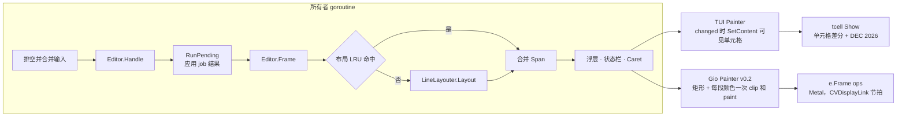

### 5.8 Gio 前端如何接入（v0.2）

同一个 `Frame` 喂给 `ui/gio`，换的只是布局器和绘制器：

- **字形 LineLayouter**：每个 `StyledRun`（长 run 按 2 KB 分段）按它的 `Face` 和 `Scale` 调用 Gio `text.Shaper` 的 `LayoutString`，用 `NextGlyph` 拿到簇与真实字宽，`Stops` 来自真实 advance，绝不用固定格宽：**实测** CJK 字宽是 SF Mono 的 1.61 倍，不是 2 倍。LRU 键加上字体 Epoch；空闲帧沿滚动方向预塑形一屏。
- **Gio 布局器不是线程安全的**（`text.Shaper` 不能并发用），所以 Gio 下所有布局都在窗口 goroutine 上做；单元格布局器是纯函数，可以在后台 job 里用（例如 Markdown 全文高度预计算，§8.3）。
- **绘制器**：背景与当前行矩形 → 选择/搜索矩形（来自 `Stops`）→ 每段连续同色文字一次 `clip.Outline(shaper.Shape(glyphs[a:b]))` + `ColorOp` + `PaintOp`。
- **光标与输入法**：`view.Caret` 带 `Ascent`、`Descent`（§12），Gio 前端据此填 `key.Caret{Pos: 基线点, Ascent, Descent}` 和 `CompositionBounds`，候选窗才贴得准。
- **像素对齐**：每条基线和滚动偏移都取整到设备像素。**实测**：小数基线时 `e.Frame` 约 6 ms，取整后 1.0–1.8 ms，因为 Gio 的路径缓存按「整数偏移 + 小数部分」分键，小数偏移会让缓存全部失效。
- **预算**：帧 CPU p50 ≤ 2 ms、p99 ≤ 4 ms（120 Hz）；跳到冷文本时允许掉 1–2 帧。

🧭 **Go 学习点**
- **接口由使用方定义**：`LineLayouter` 定义在 `core/view`（使用方），实现散落在 `ui/tui`、`ui/gio`、`ui/headless`。这是 Go 的惯用法，与 Java「先有接口库」相反。
- **`hash/maphash`**：`maphash.Bytes(seed, b)` 快、无分配，适合做缓存键；种子每次进程随机，不能持久化。
- **复用切片**：`dst *LineLayout` 由调用方提供，布局器 `dst.Rows = dst.Rows[:0]` 后追加，稳态零分配。用 `testing.AllocsPerRun` 断言它。

---

## 6. 输入管线（core/keymap、IME）

| | |
|---|---|
| **职责** | 把平台事件变成内核 `Input`；按「当前焦点上下文」在 trie 中解析组合键序列；调用命令注册表；处理鼠标、粘贴、焦点与 IME |
| **关键类型** | `app.Input`（`KeyInput`、`TextInput`、`ReplaceInput`、`CompositionInput`、`SelectionInput`、`SnippetInput`、`MouseInput`、`ScrollInput`、`FocusInput`）、`keymap.Chord`、`keymap.Keymap`、`app.Command`、`app.IMEState` |
| **依赖** | `core/keymap`：无；翻译层在 `ui/tui`（tcell）与 `ui/gio`（`gioui.org/io/key`） |
| **里程碑** | M2（鼠标、滚动）、M3（keymap trie、命令面板）、M7（编辑、粘贴、IME 矩阵）、v0.2（Gio IME） |

### 6.1 总流程

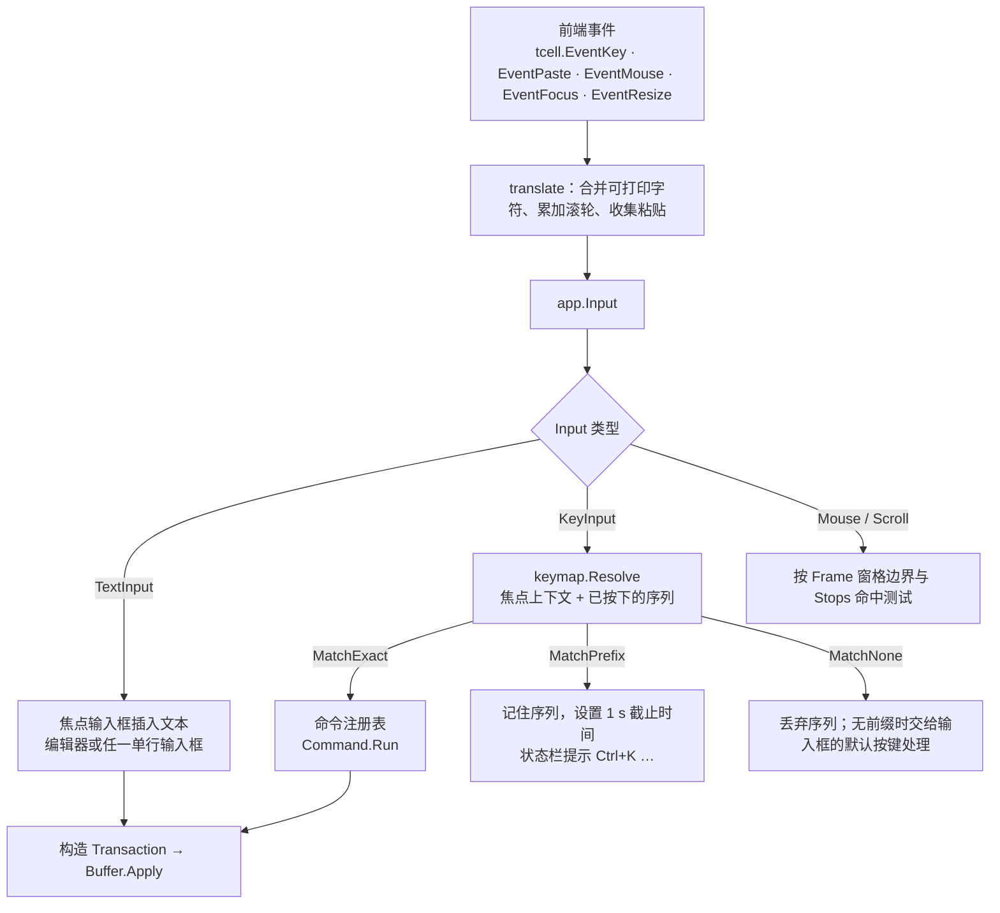

**每个功能都必须是注册过的命令**，否则不发布：命令面板、快捷键、鼠标菜单（如有）调用的是同一个 `Command.Run`。这也是 Yan 唯一的扩展点（后续的「选区通过 shell 命令管道处理」也只是一条命令）。

### 6.2 Input 类型

`app.Input` 是一个「封闭」接口（只有本包的类型能实现，定义见 §12），共九种：

| 类型 | 来源 | 说明 |
|---|---|---|
| `KeyInput{Chord}` | 组合键 | 交给 keymap 解析 |
| `TextInput{Text, Paste}` | 普通按键、终端里的 IME 上屏、bracketed paste | `Paste` 为真时独立成撤销组，且**不触发自动缩进**（否则粘贴的代码会层层缩进） |
| `ReplaceInput{Start, End, Text}` | Gio `key.EditEvent` | `Start`、`End` 是 **rune** 偏移，原样来自 Gio；内核按当前焦点输入框换算成字节 |
| `CompositionInput{Start, End}` | Gio `key.CompositionEvent` | rune 偏移；`Start < 0` 表示结束并上屏 |
| `SelectionInput{Start, End}` | Gio `key.SelectionEvent` | 输入法移动了光标（例如在拼音里按 ←），rune 偏移 |
| `SnippetInput{Start, End}` | Gio `key.SnippetEvent` | 输入法想看更大一段上下文，rune 偏移；内核更新要发布的 snippet 区间 |
| `MouseInput{X, Y, Button, Mods, Kind, Clicks}` | 鼠标 | `Kind`：按下 / 拖动 / 释放；按下时 `Clicks` = 1、2、3（单击、双击、三击）。tcell 不报告点击次数，`ui/tui` 自己按「同一格、400 ms 内」计数 |
| `ScrollInput{DX, DY}` | 滚轮、触控板 | 一次排空内的增量已累加 |
| `FocusInput{Gained}` | 终端焦点 | 焦点回来时重新 stat 打开的文件（需要终端支持 mode 1004；Terminal.app 是否发送由 M0 核实） |

### 6.3 TUI 翻译规则（ui/tui）

| tcell 事件 | 翻译为 | 说明 |
|---|---|---|
| `*EventKey`，`Key()==KeyRune`，无 Ctrl/Alt/Meta | 追加 `Str()` 到本轮缓冲 | 排空结束时 `flush` 成一个 `TextInput`（撤销分组按 §3.8 的内容规则） |
| 其他 `*EventKey` | 先 `flush`，再 `KeyInput` | 保持顺序：`ab` 后跟 Ctrl+S，先插入再保存 |
| `*EventPaste`（Start）… 按键 …（End） | 一个 `TextInput{Paste: true}` | 中间的 Enter/Tab 作为 `\n`/`\t` 收进文本，不触发任何快捷键；`inPaste` 状态跨越多次排空，收到 End 才提交（§4.7） |
| `*EventMouse` 的 `WheelUp/Down/Left/Right` | 累加进一个 `ScrollInput` | 触控板一次甩动可能产生几十个事件 |
| `*EventMouse` 的 `Button1` | `MouseInput`（按下/拖动/释放由前后状态推断，`Clicks` 自己数） | 点击定位、拖选、双击选词、三击选行、点文件树、点标签 |
| `*EventResize` | 只保留最后一次 | 帧构建时用 `Size()` |
| `*EventFocus` | `FocusInput` | 需 `EnableFocus()`；用于外部修改检测和索引刷新（§9.2） |

tcell 在 raw 模式下运行（`term.MakeRaw`），所以 Ctrl+C、Ctrl+S、Ctrl+Z、Ctrl+Y 都作为普通按键送达，不会触发 SIGINT、流控或挂起。

### 6.4 Chord 规范化与 keymap trie

`Chord{Mods, Key, Rune}` 表示一次按键：`Mods` 是 `ModShift | ModCtrl | ModAlt | ModSuper` 的位集合（`ModSuper` 就是 Cmd，tcell v3 把 kitty 协议里的 super 报告为 `ModMeta`，见其 `input.go:874`），`Key` 是 `KeyRune`、`KeyEnter`、`KeyTab`、`KeyUp`、`KeyF1` 等，`Rune` 在 `Key == KeyRune` 时有效。

**规范化**（在 `ui/tui` 的 `translate` 里做，`core/keymap` 只认规范化后的 `Chord`）：

- 字母一律小写；tcell 把 Shift+a 报成 `'A'` 且不带 `ModShift`，规范化时改写为 `ModShift + 'a'`。
- **Ctrl+字母**：Yan 用 tcell v3 的**默认模式**创建屏幕（不传 `OptAdvancedKeys`）。这个模式下，legacy 编码的 Ctrl+字母到达时是旧式的 `KeyCtrlA`…`KeyCtrlZ`，`Str()` 为空、带 `ModCtrl`（tcell v3.5.0 `input.go` 的 `postControlKey` 与 `key.go` 的 `newEventKey`：只有 advanced 模式才报成 `KeyRune + ModCtrl`）。所以 `translate` 必须把 `KeyCtrlA + n` 规范化为 `Chord{Mods: ModCtrl, Key: KeyRune, Rune: 'a' + n}`，否则 `ctrl+p` 这类绑定在 Terminal.app 里一个都匹配不上。0x1F 这类非字母控制字节，tcell 报成 `KeyRune` 加 `ModCtrl`、`Str()` 为 `"_"`，即 `Ctrl+_`（§5.5 ⑥）。默认模式下 Shift+Tab 是 `KeyBacktab`，规范化为 `ModShift + KeyTab`。
- 为什么不开 `OptAdvancedKeys(true)`：开了以后 Ctrl+字母会直接是 `KeyRune + ModCtrl`，但 tcell 会对 kitty 终端推送 flags 31（`CSI =31u`，含按键松开事件），`translate` 就必须丢掉 `Pressed() == false` 的事件，否则每个键执行两次。默认模式在 kitty 终端上推送 flags 1（只消歧义），已经够区分 Cmd 和 Ctrl+Shift。
- **单元测试**：用 `tcell.NewEventKey(tcell.KeyCtrlP, "", tcell.ModCtrl)` 和 `tcell.NewEventKey(tcell.KeyRune, "P", tcell.ModCtrl)`（默认模式下构造出来也是 `KeyCtrlP`）喂给 `translate`，断言结果都是 `ctrl+p`；再用 tcell 的 `vt.NewMockTerm` 建一个模拟终端，`SendRaw([]byte{0x10})` 向输入端送字节 0x10，断言收到同一个 `Chord`。
- **全角标点别名**：`Ctrl+K` 前缀等待期间，如果到达的是一个单 rune 的 `TextInput`，而且是 `【 】 、 《 》`（中文输入法在中文标点模式下直接上屏的），先换成 `[ ] / < >` 再查前缀树（DESIGN.md §5.5 ①）。

**每个上下文一棵 trie**：`CtxEditor`、`CtxTree`、`CtxFinder`、`CtxPalette`、`CtxFind`、`CtxSearch`、`CtxReading`。配置里的 `[keys.global]` 在编译期合并进每棵树，上下文自己的绑定优先。

```go
func (k *Keymap) Resolve(ctx Context, seq []Chord) (string, Match) {
	n := k.roots[ctx]
	for _, c := range seq {
		if n == nil {
			return "", MatchNone
		}
		n = n.next[c]
	}
	switch {
	case n == nil:
		return "", MatchNone
	case n.cmd != "":
		return n.cmd, MatchExact
	case len(n.next) > 0:
		return "", MatchPrefix
	}
	return "", MatchNone
}
```

`Bind` 拒绝「既是完整绑定又是前缀」的冲突（例如同时绑 `ctrl+k` 和 `ctrl+k v`），这样 `MatchExact` 永远不需要等待歧义超时。前缀状态下 1 s 内没有下一个键就放弃序列，状态栏像 VS Code 一样提示「已按下 Ctrl+K，等待第二个键…」。

### 6.5 `mod` 别名与终端能力

默认 keymap 只写一份（`core/config/defaults/keymap-vscode.toml`，`[keys] preset = "vscode"`），用 `mod` 表示「Mac 上的主修饰键」：

| 运行环境 | `mod` 解析为 | 判定依据 |
|---|---|---|
| Gio GUI（v0.2） | Super（Cmd） | 原生事件 |
| 终端，tcell `KeyboardProtocol() == KittyKeyboard`，且 M0 已验证 Cmd 组合以 `ModMeta` 到达（Ghostty） | Super（Cmd） | 协商结果 + M0 结论 |
| 其他终端（Terminal.app 为 `LegacyKeyboard`） | Ctrl | 兜底 |
| 配置 `[keys] mod = "ctrl" \| "cmd"` | 强制 | 默认 `"auto"` |

**legacy 编码的硬限制**（Terminal.app，零配置基线）：

- Terminal.app **从不**把 Cmd 组合键交给程序（Cmd+V 例外：终端自己粘贴，程序收到 bracketed paste，所以 Cmd+V 在任何终端都能用）。
- Ctrl+Shift+字母与 Ctrl+字母**无法区分**；Ctrl+Tab、Ctrl+Enter 等也无法与 Tab、Enter 区分。
- 「将 Option 键用作 Meta 键」是 Terminal.app 描述文件里的设置。关闭时 Option+字母产生的是字符（如 `π`），会作为 `TextInput` 到达，所以默认 keymap **不把关键功能绑在 Alt+字母上**。

**两组表**（与 DESIGN.md §5.8 相同）：`[keys.<上下文>]` 是 VS Code 形式（`mod+p`、`mod+shift+p`），所有前端都加载；`[tui_keys.<上下文>]` 是显式写死的终端回退键（`ctrl+k p`、`ctrl+k ctrl+p`、`ctrl+a`），**只在终端前端加载**，Terminal.app 和 Ghostty 都生效。Gio 不加载 `[tui_keys]`：在 VS Code macOS 里 `Ctrl+K` 是删除到行尾、`Ctrl+A/E/P/N/B/F` 是光标移动，GUI 里应该完全是 VS Code macOS 的键。回退和弦一律写成 `ctrl+k x`，不写 `mod+k x`：后者在 Gio 里会变成 `Cmd+K P`（VS Code 里是「复制当前文件路径」），违反「VS Code 的键，VS Code 的意思」。

**按环境编译 keymap**：`keymap.Compile(b Bindings, p Profile)`（§12），`Profile` 记录 `mod` 解析成什么、是否只有 legacy 编码、是不是终端前端。规则：

1. `p.Terminal` 为假时不加载 `b.TUIKeys`。
2. `p.Legacy` 时：丢掉所有 `mod+shift+X`（会坍缩成 Ctrl+X，例如 `mod+shift+p` 与快速打开撞车）和 `mod+alt+…`（Option 不可靠）；丢掉会编码成 Tab、Backspace、Enter、Esc 的组合（`mod+i`、`mod+h`、`mod+m`、`mod+[`）；成对的命令（缩进 / 减少缩进）只要一半不可达就一起丢。
3. 某条 `mod+X` 编码后与另一条**不同命令**的显式绑定（任何上下文的 `ctrl+…`，或 `[tui_keys]` 里的键，含 global）落到同一个序列：显式的赢，`mod+X` 丢弃并返回告警。例如 `mod+g`（查找下一个）撞 `ctrl+g`（跳转到行），`mod+a`（全选）撞 `ctrl+a`（行首）。
4. 同一命令的重复绑定去重。

命令面板经 `[tui_keys]` 的 `ctrl+k p` 和 `f1` 到达。**组合键审计**写成单元测试 `TestLegacyChordsDistinct`：对 legacy Profile 编译全部默认绑定，在**编译结果**上断言没有两个不同命令落到同一个序列、没有命令完全不可达；具名用例包括 `mod+g` 对 `ctrl+g`、`mod+a` 对 `ctrl+a`、`mod+[` 对 Esc、`mod+alt+f` 对 `ctrl+f`（对应 M0 Spike A「每个默认绑定在 Terminal.app 中都可区分」）。

**核心快捷键对照**（以下几行逐字摘自 DESIGN.md §5.5；**完整且唯一的键位表**，包括光标移动、资源管理器、降级说明 ①–⑬ 和 Ghostty 的 † 清单，见 [DESIGN.md §5.5](./DESIGN.md#55-键位映射总表)）：

| 命令（command ID） | VS Code（macOS） | Yan · Ghostty（kitty 协议，Cmd 可用） | Yan · Terminal.app（回退） | Yan · Gio GUI（v0.2） |
|---|---|---|---|---|
| 快速打开 `workbench.action.quickOpen` | Cmd+P | Cmd+P | Ctrl+P | Cmd+P |
| 命令面板 `workbench.action.showCommands` | Cmd+Shift+P、F1 | Cmd+Shift+P†、F1 | Ctrl+K P、F1 ① | Cmd+Shift+P、F1 |
| 文件内查找 `actions.find` | Cmd+F | Cmd+F† | Ctrl+F | Cmd+F |
| 项目搜索 `workbench.action.findInFiles` | Cmd+Shift+F | Cmd+Shift+F | Ctrl+K F ① | Cmd+Shift+F |
| 重做 `redo` | Cmd+Shift+Z | Cmd+Shift+Z | Ctrl+Y ① | Cmd+Shift+Z |
| 全选 `editor.action.selectAll` | Cmd+A | Cmd+A† | Ctrl+K A ⑪ | Cmd+A |
| Markdown 阅读视图 `markdown.showPreview` | Cmd+Shift+V | Cmd+Shift+V† | Ctrl+K V ① | Cmd+Shift+V |
| 在浏览器中打开 `yan.markdown.openInBrowser` | 无默认 | Ctrl+K B | Ctrl+K B | Cmd+K B |
| 行首 / 行尾 `cursorHome` / `cursorEnd` | Cmd+← / Cmd+→ | Cmd+← / Cmd+→（Ghostty 改写为 Ctrl+A / Ctrl+E，照样有效） | Ctrl+A / Ctrl+E ⑪；Home / End | Cmd+← / Cmd+→ |

- `Ctrl+K X` 回退在终端（Terminal.app 与 Ghostty）中有效，而且同时接受 `Ctrl+K Ctrl+X`（中文输入法处于中文模式时用）；Gio 只加载 VS Code macOS 键位（DESIGN.md §5.8）。
- † 是 Ghostty v1.3.1 默认占用、到不了 Yan 的 Cmd 组合（清单取自它的 `src/config/Config.zig`，见 DESIGN.md §5.5）。`yan doctor` 会生成一段可选的 Ghostty 配置，把需要的键转发成 kitty 序列，例如 `keybind = cmd+p=csi:112;9u`（`112` 是 `p` 的码点，`9` = 1 + Super 位 8）。Ghostty **没有绑定**的 Cmd 组合会不会直接透传，是 **M0 Spike A 的实测项**。

### 6.6 IME：两种模型，一个内核

**v0.1 终端：只收「已上屏文本」。** 终端自己运行输入法、绘制预编辑文本，程序只收到最终的 UTF-8。Yan 只负责几何，而且必须精确：

1. **真实光标纪律**：每次 `Show()` 前都把真实终端光标 `ShowCursor` 到 `Frame.Caret`（当前焦点文字输入框的主光标：编辑器、快速打开、命令面板、查找框、替换框、项目搜索框、include/exclude 框）。有输入框获得焦点时**绝不隐藏光标**；多光标的其余光标用反色单元格画。macOS 输入法按真实光标位置放候选窗，这是候选窗不乱跑的唯一前提（Bubble Tea v1 等隐藏真实光标的程序因此把候选窗放到了左下角，见 [bubbletea#874](https://github.com/charmbracelet/bubbletea/issues/874)）。
2. **不按定时器重绘，画面没变就不 `Show()`**：没有任何定时重绘会覆盖终端画的预编辑文本。异步重绘（高亮结果、遍历批次）在支持 mode 2026 的终端（如 Ghostty）里是原子的；**Terminal.app 是否支持待 M0 Spike A 验证**。这一点要紧：tcell 每次 `draw()` 开头先把真实光标移到右下角再隐藏，结尾才移回插入点；终端不支持 2026、帧又被 pty 拆成多段读取时，输入法恰好在中间查询光标矩形，候选窗就会闪到右下角。所以 Terminal.app 下的主要保障是：没有定时重绘；只在 `Frame` 报告 `changed` 时才 `Show()`（§4.7）；tcell 只写变化的单元格；每帧最后才定位真实光标。Spike A 用「组字时每 16 ms 触发一次后台重绘」做压力测试，真出问题就把终端下「只有后台结果、没有输入」的帧限制到 ≤ 10 Hz。
3. **组字对 Yan 不可见，这反而是好事**：组字期间 Enter、Esc、方向键被终端吃掉，keymap 不会误触发，经典的「回车上屏同时又插入换行」不可能发生。
4. **已接受的限制**：预编辑文本由终端画在后续单元格之上，会暂时盖住后面的字。

**v0.2 Gio：临时事务。** 在 Gio v0.10.3 源码中核实：`app/os_macos.go` 的 `gio_setMarkedText` 调用 `w.w.EditorReplace(rng, str)`，也就是说**标记文本会进入文档**；`key.CompositionEvent` 只标记一个范围。此外，`setMarkedText` 和 `insertText` 之后 Gio 还会调 `SetEditorSelection` 发出 `key.SelectionEvent`，输入法想扩大上下文时发 `key.SnippetEvent`；Gio 在 `app/ime.go` 里比较应用发布的选区、snippet 和它本地的状态，不一致就 `discardMarkedText` 取消组字（Gio 自带的 `widget.Editor` 也处理了这两种事件）。所以：

- 前端**不做** rune → 字节换算，把 rune 偏移原样放进 `ReplaceInput`、`CompositionInput`、`SelectionInput`、`SnippetInput`。内核以**当前焦点输入框**的文本为准换算：编辑区用 rope 的 `Runes` 摘要（O(log n)），快速打开、命令面板、查找框等单行输入框用 `edit.LineInput`（§3.7）。如果前端拿「焦点 buffer 的快照」来换算，焦点在快速打开时就会把组字写进隐藏的编辑器 buffer。
- 前端发布 `SnippetCmd` / `SelectionCmd` 所需的一切都来自 `Editor.IMEState()`（§12）：snippet 文本与区间、选区、组字区间（都以 rune 计），以及插入点的 `Caret`。
- 处理输入法事件时**禁止任何自动变换**（自动缩进、自动配对、换行风格统一），保证内核发布的选区与 Gio 本地状态逐 rune 一致。

```go
// ui/gio：输入法事件原样转给内核，偏移单位是焦点输入框里的 rune。
func imeEvent(ed *yapp.Editor, ev any) {
	switch ev := ev.(type) {
	case key.EditEvent:
		ed.Handle(yapp.ReplaceInput{Start: ev.Range.Start, End: ev.Range.End, Text: ev.Text})
	case key.CompositionEvent:
		if ev.Start < 0 || ev.Start == ev.End {
			ed.Handle(yapp.CompositionInput{Start: -1, End: -1}) // 结束：恰好一个撤销步
			return
		}
		ed.Handle(yapp.CompositionInput{Start: ev.Start, End: ev.End})
	case key.SelectionEvent:
		ed.Handle(yapp.SelectionInput{Start: ev.Start, End: ev.End})
	case key.SnippetEvent:
		ed.Handle(yapp.SnippetInput{Start: ev.Start, End: ev.End})
	}
}
```

（`yapp` 是 `core/app` 的导入别名，避免与 Gio 的 `gioui.org/app` 重名。这个接缝在 M3 做浮层输入框时就定下来，v0.2 不用回头改。）

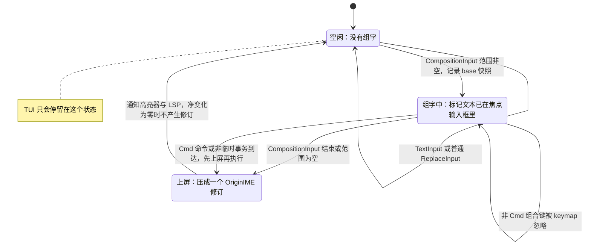

- 组字期间 Gio 只吞掉命令键（Enter、Esc、方向键经 `doCommandBySelector`），字母和 Ctrl+字母的 `key.Event` 仍会到达，所以 **keymap 在组字期间忽略一切非 Cmd 组合键**。Cmd 组合（`Cmd+S`、`Cmd+Z`、`Cmd+P`）照常执行，但执行前先 `CommitComposition()` 并发布新的 `SelectionCmd`（§3.9 的不变式）；否则撤销会退到 base 之前，输入法却还以为自己持有标记文本。
- 多光标时预编辑只显示在主光标处，上屏后的文本再复制到每个光标。
- 前端在光标、版本或滚动变化时发布 `key.SnippetCmd`（光标前后约 ±256 rune）和 `key.SelectionCmd`（含 `CompositionBounds`），仅在变化时发送。
- 组字范围画 1 px 下划线（`style.Composing` Span）。

**IME 验收矩阵**：唯一的完整矩阵（用例、覆盖清单、升级冒烟子集）在 [DESIGN.md §6.4](./DESIGN.md#64-输入法验收矩阵)。输入法：系统自带拼音（简体拼音）、系统自带双拼、微信输入法（WeType）、搜狗输入法（Sogou）、Rime / 鼠须管（Squirrel）；环境：Terminal.app、Ghostty（若安装）、v0.2 的 Gio 窗口。和架构直接相关的几条：候选窗位置要在**每一种**焦点输入框里测；「组字时有异步重绘」要做每 16 ms 一次的压力版；Gio 的「组字时按 Cmd+S」验证上面的不变式。

### 6.7 工作台状态：焦点、标签与浮层

VS Code 式的交互（DESIGN.md §4.6、§5.3）需要一小块状态模型，归 `core/app` 所有（类型草图，M3 实现）：

```go
type (
	BufID      uint64
	FocusArea  uint8 // FocusEditor、FocusTree、FocusFinder、FocusPalette、FocusFind、FocusSearch、FocusReading
	FinderMode uint8 // FinderFiles、FinderCommands（前缀 >）、FinderLine（前缀 :）、FinderSymbol（前缀 @）
)

// Tab 是标签栏里的一项。Preview 为真时名字用斜体，下一次单击打开别的文件会替换它；
// 双击或开始编辑后固定（Preview = false）。
type Tab struct {
	Buf     BufID
	Preview bool
}

type workbench struct {
	tabs   []Tab
	active int     // tabs 的下标
	mru    []BufID // 最近使用顺序，空查询的快速打开先列它
	focus  FocusArea
	ret    []FocusArea // 「Esc 永远往外走」的返回栈：打开浮层时压入，Esc 时弹出
	finder struct {
		mode  FinderMode
		input edit.LineInput // 与查找框、命令面板共用的单行输入模型（§3.7）
	}
}

// context 由焦点推出 keymap 上下文：FocusEditor → CtxEditor（阅读视图时 CtxReading），FocusTree → CtxTree……
func (e *Editor) context() keymap.Context { panic("M3") }
```

- **快速打开的模式**由查询前缀决定（`>`、`:`、`@`，以及中文标点 `》`、`：`、`＠` 等别名，DESIGN.md §5.2），模式变了就换数据源，输入框不变。
- **Esc 的顺序**：有浮层先关浮层并弹出 `ret`；在编辑区里先去掉副光标，再清除选区；在资源管理器里回到编辑区。
- **关闭标签**：buffer 有未保存修改时先弹 `OverlayConfirm`（保存 / 不保存 / 取消，DESIGN.md §5.2）；选了「保存」或这个 buffer 还有保存没回来时，先进入「正在保存…」状态，等保存成功回来才关闭，保存失败则标签保持打开并显示错误（§4.3）；真正关闭时 `jobs.cancelTarget(buf)` 取消它除 save 外的全部 job。退出走同一流程，等全部保存回来才调用 `Quit()`。
- headless 金样测试覆盖：预览标签被下一次单击替换、编辑后固定；连续按 Esc 的焦点序列；关闭未保存标签的三种选择。

🧭 **Go 学习点**
- **用「封闭接口」模拟和类型**：`Input` 接口带一个未导出方法 `isInput()`，外部包无法实现它；处理时用 `switch in := in.(type)` 穷举。
- **位标志**：`ModShift Mod = 1 << iota` 是 Go 里表达修饰键集合的惯用法，`m&ModCtrl != 0` 判断。
- **可比较的结构体当 map 键**：`map[Chord]*node` 直接用结构体做键，无需拼字符串。
- **导入别名**：`yapp "github.com/corn12138/yan-source/core/app"` 解决包名冲突。

---

## 7. 语法高亮引擎（core/syntax、core/style）

| | |
|---|---|
| **职责** | 手写的行状态词法器 + 增量引擎：按键时只重算改动行直到状态收敛；视口同步预算 ≤ 1 ms，其余后台补全；编辑时平移旧 Span 保证不闪烁 |
| **关键类型** | `lex.State`、`lex.Lexer`（叶子包 `core/syntax/lex`）、`syntax.Highlighter`、`syntax.LexStates`、`style.ID`、`style.Span` |
| **依赖** | `core/syntax`：`core/text`、`core/edit`、`core/style`、`core/syntax/lex`；`core/syntax/lex` 只依赖 `core/style`；只用标准库，零二进制体积成本 |
| **里程碑** | M4 |

**为什么手写词法器**：chroma v2.27.0 会让二进制增加约 4.3 MB，用回溯式的 `regexp2`，把整个文档拷成 `[]rune`，而且不支持增量（**实测** 131 KB 的 `server.go` 约 230 ms）；纯 Go 的 gotreesitter v0.55.1 增加约 8.5 MB，**实测**它的增量重解析（约 300 ms）并不比全量解析（约 180 ms）快；官方 tree-sitter 绑定需要 cgo。行状态词法器则是 O(改动行)、零分配、零依赖，也是很好的 Go 练习。

### 7.1 接口

两个接口和一个纯函数（定义见 §12）：

- `lex.Lexer.LexLine(line []byte, in State, emit func(style.Span)) (out State)`：输入一行（不含行尾 `\n` 与 `\r`）和上一行的结束状态，边扫描边 `emit` Span，返回本行结束状态。**不得分配内存，必须 O(len(line)) 且不回溯。** 它放在叶子包 `core/syntax/lex` 里，所以 `core/view/mdlayout` 给阅读视图里的围栏代码着色时也能用，不必依赖高亮引擎（§2.2）。
- `Highlighter`：`Edited(e)` 平移缓存的 Span 并作废行状态；`Spans(snap, line, …)` 返回某行的 Span 以及「是否精确」；`Pending()` 告诉 `core/app` 是否需要后台补全、从哪一行开始；`Merge(version, from, states)` 合并后台结果。它**自己不起 goroutine**。
- `LexStates(ctx, lx, snap, from, in, upTo) []State`：后台补全用的纯函数，自带 scratch 缓冲，每 1,000 行检查一次 `ctx`。由 `core/app` 用 `spawn` 调度（§4.3），所以整个程序只有一套 job 系统。

`lex.State` 是 `uint32`，位布局由各词法器自定（设计草案，以 clike 为例）：

```text
 31        24 23        16 15         8 7          0
┌────────────┬────────────┬────────────┬────────────┐
│ 嵌套语言 ID │ heredoc 标签│ 嵌套深度    │ 模式        │
│ (md 围栏)   │ 8 位哈希    │ (模板字面量)│ (注释/字符串)│
└────────────┴────────────┴────────────┴────────────┘
```

### 7.2 引擎：行状态数组 + 收敛即停

- 每个 buffer 一个 `endState []uint32`（每行一个）加两条水位线：`validUpTo`（此前的状态确定有效）和 `computedUpTo`（曾经算到哪一行，随增删行平移，用来做收敛比较）；普通档才有，大文件档关闭高亮。
- 编辑时 `Edited` 用 ChangeSet 平移缓存 Span；增删行时调整 `endState`：一个 Edit 可能含很多个 Change（全部替换 1 万处、1,000 个光标同时按 Enter），所以**单趟**重建 `endState`（按段 `copy` 未改动的部分），而不是每个 Change 做一次 `slices.Insert` / `slices.Delete`（那样 20 万行最坏约 50 µs × 1 万次 = 0.5 s，**估算**）；`validUpTo` 降到首个改动行。
- **收敛即停**（借鉴 micro 的 `ReHighlightStates`）：从首个改动行开始重新词法分析，越过最后一个改动行后，一旦某行新算出的结束状态等于缓存值，后面所有行都不会变，立即停止。
- Span 缓存只覆盖「视口 ± 1 屏」，键为行号、值为 `{version, []style.Span}`，切片来自对象池。

```go
// relex 从 from 行起重新分析，直到收敛、到达 limit 或预算用完。
// 它读写 h.endState、h.scratch 等所有者独占的字段，只能在所有者 goroutine 上调用；
// 后台补全用下面的纯函数 LexStates。
func (h *engine) relex(s text.Snapshot, from, limit int, deadline time.Time) (next int, converged bool) {
	st := h.stateBefore(from)
	for l := from; l < limit; l++ {
		h.scratch = h.lineBytes(s, l, h.scratch[:0]) // 复用缓冲，跨叶子的行才拷贝
		out := h.lex.LexLine(h.scratch, st, h.emit)  // h.emit 每次分析只创建一次，避免逃逸分配
		if l >= h.dirtyEnd && l < h.computedUpTo && out == h.endState[l] {
			h.validUpTo = h.computedUpTo // 收敛：后续缓存的状态重新有效
			return l + 1, true
		}
		h.endState[l] = out
		h.validUpTo = l + 1
		st = out
		if l&15 == 15 && time.Now().After(deadline) { // 每 16 行看一次表，摊薄 time.Now 的开销
			return l + 1, false
		}
	}
	return limit, true
}
```

后台补全 job 调用纯函数 `LexStates`，在 `Snapshot` 上运行，**只产出结束状态数组**（每行 4 字节），不产出 Span，也不碰 `engine` 的任何字段。它**一次跑完**再 `Post` 一次（最多在越过视口下沿时多 `Post` 一次，让屏幕上的颜色先对），版本仍当前就 `Merge` 进 `endState`，再画一帧。不切成「2 ms 一片」：那是单线程编辑器的协作式调度思路，在 Go 里后台 goroutine 本来就不占所有者的时间；8 MB 文件按 ≥ 50 MB/s 约 160 ms，切片只会带来几十次唤醒和帧重建，连续打字时每片结果都已过期，也省不下任何工作。可见行的 Span 总是在所有者上按需从状态重算（视口级别，≤ 1 ms），所以后台结果不需要 Span 重定位；过期的状态数组直接丢弃，下一轮补全从 `validUpTo` 重来。

```go
// LexStates 从 from 行起、以 in 为初始状态，算到 upTo 行，返回每行的结束状态。
// 纯函数：只读 Snapshot，自带 scratch，可以在任何 goroutine 上运行。
func LexStates(ctx context.Context, lx lex.Lexer, s text.Snapshot, from int, in lex.State, upTo int) []lex.State {
	out := make([]lex.State, 0, upTo-from)
	var scratch []byte
	discard := func(style.Span) {} // 后台只要状态，不要 Span
	st := in
	for l := from; l < upTo; l++ {
		if (l-from)%1000 == 0 && ctx.Err() != nil {
			return nil // 被新的编辑取代
		}
		scratch = s.AppendRange(scratch[:0], s.LineStart(l), s.LineEnd(l))
		st = lx.LexLine(scratch, st, discard)
		out = append(out, st)
	}
	return out
}
```

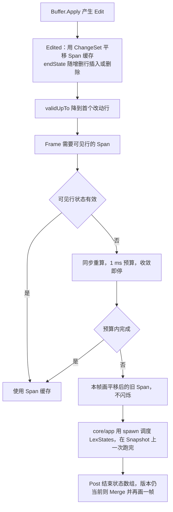

### 7.3 v0.1 语言

| 词法器包 | 覆盖 | 备注 |
|---|---|---|
| `lang/clike` | Go、TypeScript/JavaScript（含基础 JSX 标签着色）、JSON/JSONC、CSS | 表驱动：关键字表、注释/字符串定界符表、数字规则 |
| `lang/markdown` | Markdown | 标题加粗、行内代码着色、URL 变暗；围栏代码按语言名**委托**给对应词法器（嵌套语言 ID 存在 State 高 8 位） |
| `lang/yaml` | YAML | 块标量是已知难点，靠金样兜底 |
| `lang/toml` | TOML | 也用于 Yan 自己的配置与主题文件 |
| `lang/shell` | bash / zsh | heredoc 标签哈希存进 State |
| （内置） | 纯文本兜底 | 不着色 |

这份清单是按「最常读的语言」暂定的，见 [§16 待确认](#16-待确认)。

### 7.4 StyleID 与主题

内核只输出**语义** StyleID（约 20 个：`Text`、`Keyword`、`Type`、`Function`、`String`、`Number`、`Comment`、`Punct`、`Heading`、`Link`、`CodeSpan`、`Selection`、`SearchHit`、`Composing`、`Gutter`、`Dim` 等），颜色由前端按主题映射。内置深色、浅色两套，近似 VS Code Dark+ / Light+，让老用户一眼熟悉：

```toml
# 内嵌默认主题 themes/dark.toml（节选）
name = "dark"

[styles]
text     = { fg = "#D4D4D4", bg = "#1E1E1E" }
keyword  = { fg = "#569CD6" }
type     = { fg = "#4EC9B0" }
function = { fg = "#DCDCAA" }
string   = { fg = "#CE9178" }
number   = { fg = "#B5CEA8" }
comment  = { fg = "#6A9955", italic = true }
heading  = { fg = "#569CD6", bold = true }
link     = { fg = "#4FC1FF", underline = true }
dim      = { fg = "#808080" }
```

主题类型是 `style.Theme`（`map[ID]Attr`），由 `core/config` 加载，前端从 `app` 拿当前主题。TUI 在 `Colors() < 1<<24` 时把十六进制色降采样到 256 色；Terminal.app 自 macOS 26 起支持 24 位色，`COLORTERM` 的处理见 §5.6。

### 7.5 质量门禁与预算

| 指标 | 目标 | 方式 |
|---|---|---|
| 重新分析一个被编辑的行 | ≤ 50 µs | 每个词法器的 `go test -bench`，样本取自真实仓库 |
| 冷启动 60 行视口 | ≤ 1 ms | 同上 |
| 后台补全吞吐 | ≥ 50 MB/s | 同上 |
| 正确性 | 金样全部通过 | `testdata/*.golden`，取自真实仓库（优先用你自己的仓库） |
| 健壮性 | 不 panic，Span 有序且不越界 | `go test -fuzz` |
| 自愈 | 未闭合的块注释在下一个收敛行后恢复正确着色 | 专门的金样 |

### 7.6 可选构建标签（不在 MVP 内）

- `-tags chroma`：chroma v2.27.0 处理长尾语言，**只在视口上**、从视口上方至少 200 行的同步点开始在后台 job 里运行。只有在 TUI 二进制仍 ≤ 10 MB 时才默认打包。预计将来要迁移到 chroma v3（`iter.Seq` 风格 API）。
- `-tags gts`：gotreesitter v0.55.1（配合 `grammar_subset` 标签只嵌入需要的语法），**只用于结构**：折叠、扩展选择、大纲，限 ≤ 512 KB 的文件；永远不用于着色。

```go
//go:build chroma

package syntax

// 只有带 -tags chroma 构建时这个文件才参与编译，注册长尾语言的兜底高亮器。
func init() { registerFallback(newChromaHighlighter()) }
```

🧭 **Go 学习点**
- **逃逸分析**：把闭包作为接口方法参数传递时，编译器往往无法证明它不逃逸，于是每次调用都在堆上分配。用 `go build -gcflags=-m ./core/syntax/...` 看报告；把 `emit` 做成每轮只创建一次的字段，`b.ReportAllocs()` 应显示 `0 allocs/op`。
- **基准测试**：Go 1.24 起推荐 `for b.Loop() { ... }` 写法；用 `benchstat` 比较前后两次结果。
- **构建标签 + `init()` 注册**：可选功能做成「编进来就自动注册」，默认构建完全不含其代码。

---

## 8. Markdown 管线（core/docs、core/view/mdlayout）

| | |
|---|---|
| **职责** | `core/docs`：goldmark AST → 与前端无关的 `RichDoc`（块、行内 Run、源码行区间、大纲、front matter），以及「在浏览器中打开」的 `ExportHTML`；`core/view/mdlayout`：把 RichDoc 排成行（UAX#14 断行 + 避头尾） |
| **关键类型** | `docs.RichDoc`、`docs.Block`、`docs.Run`、`docs.Heading`、`docs.TableData` |
| **依赖** | `github.com/yuin/goldmark v1.8.6`（`extension.GFM`、`extension.Footnote`、`extension.CJK`）；`github.com/go-text/typesetting v0.3.5` 的 `segmenter` 包；`core/text/width`；`core/syntax/lex`（围栏代码着色，词法器由 `core/app` 注入） |
| **里程碑** | M6（TUI 阅读视图 + 浏览器导出）；v0.2（Gio 排版） |

### 8.1 管线总图

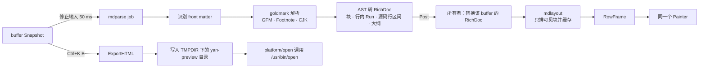

### 8.2 解析：goldmark → RichDoc

```go
import (
	"github.com/yuin/goldmark"
	"github.com/yuin/goldmark/extension"
	gmtext "github.com/yuin/goldmark/text"
)

var md = goldmark.New(
	goldmark.WithExtensions(extension.GFM, extension.Footnote, extension.CJK),
)

// Parse 在后台 job 中运行；src 来自 Snapshot.AppendRange，文档通常很小。
func Parse(src []byte) (*RichDoc, error) {
	body, front := splitFrontMatter(src) // 开头的 --- … --- 变成一个变暗的键值块
	root := md.Parser().Parse(gmtext.NewReader(body))
	return convert(root, body, front) // 遍历 AST；块节点的 Lines() 给出源码区间 → 行号
}
```

**一个容易踩的坑（已核对 goldmark v1.8.6 源码）**：`extension.CJK` 的 `EastAsianLineBreaks` 选项**只作用于 goldmark 的 HTML 渲染器**（`Extend` 里调用的是 `m.Renderer().AddOptions(html.WithEastAsianLineBreaks(...))`），解析器只多了 `WithEscapedSpace`。所以 `ExportHTML` 自动获得「中文段落软换行不产生空格」的效果，而我们自己的 `RichDoc` 转换器必须**照同样的规则**处理 `ast.Text.SoftLineBreak()`：换行两侧都是东亚宽字符时什么也不插，否则插一个空格。M6 验收标准「软换行处没有多余空格」同时检查两条路径。

**RichDoc**（与前端无关，TUI、HTML 导出、v0.2 Gio 共用）：

```go
type Block struct {
	Kind     BlockKind // Paragraph、HeadingBlock、CodeBlock、Quote、List、ListItem、TableBlock、ThematicBreak、FrontMatter、HTMLBlock
	Level    int8      // 标题级别或列表深度
	Lang     string    // 围栏代码的语言
	Task     int8      // -1 非任务，0 未勾选，1 已勾选
	Runs     []Run     // 行内：文本 + 样式位（粗/斜/删除线/代码/链接/图片）+ Href
	Children []Block
	Table    *TableData
	Src      [2]int32 // 源码行区间：源码 ↔ 阅读视图滚动映射、阅读视图内查找
}

type RichDoc struct {
	Blocks  []Block
	Outline []Heading // 标题 + 保留中文的 GitHub 风格 slug，用于 #锚点 跳转与 Ctrl+K O 大纲
}
```

slug 规则仿 GitHub：转小写、去掉除 `-`、`_` 外的标点、空白变 `-`、**保留汉字**、重名追加 `-1`、`-2`。

### 8.3 TUI 阅读视图：mdlayout

- **模式**：`.md` 默认以源码模式打开（用 Markdown 词法器着色）；Ctrl+K V（Gio 中 Cmd+Shift+V；Ghostty 把 Cmd+Shift+V 留给自己，所以也用 Ctrl+K V）在**同一窗格**原地切换源码/阅读视图，滚动位置经块的 `Src` 行区间互相映射。`yan <目录>` 且没有指定文件时自动以阅读视图打开 `README.md`。
- **断行**：散文按 UAX#14 断行机会切分，用 go-text 的 `segmenter`（`Segmenter.InitWithBytes` + `LineIterator`，`Line` 带 `OffsetInBytes` 和 `IsMandatoryBreak`，已在 v0.3.5 源码核实），宽度用唯一宽度来源测量。这个模块也是 Gio 的依赖，v0.2 免费复用。
- **避头尾（基础版）**：行首不出现 `，。、；：！？）」』》`，行尾不出现 `（「『《`；违反时把断点前移一个断行机会。拉丁单词永不拆开。
- **版心**：阅读栏最宽 88 格并居中。
- **样式**：H1 粗体强调色 + `━` 分隔线；H2 粗体强调色 + `─`；H3–H6 粗体加暗色 `###` 前缀；行内代码带底色；围栏代码是带底色的块，用同一套词法器高亮（`mdlayout` 只认 `lex.Lexer` 接口，具体词法器由 `core/app` 注入的 `func(lang string) lex.Lexer` 提供），语言名右对齐；引用左侧 `▎`；列表悬挂缩进 `• ◦ ▪` 与编号；任务 `☐ / ☑`；GFM 表格用制表符边框，列宽按唯一宽度来源计算（中英混排对齐），单元格在列内折行，超过最小宽度后表格可横向滚动。
- **链接与媒体**：链接带下划线；在相对 `.md` 链接上按 Enter 在 Yan 内打开并支持 `#锚点`，Alt+← / Alt+→ 或 `[` / `]`（阅读视图不接收文字，裸键可用）后退前进；`http(s)` 链接交给 `open`。图片显示为 `▣ 图片 alt — path`，Enter 用「预览」打开。Mermaid 和数学公式显示为代码并提示用浏览器查看；原始 HTML 变暗显示。
- **布局策略**：只排可见块加一点余量，块布局按 `(块内容哈希, 宽度, 布局器 Epoch)` 缓存。TUI 的单元格布局器是纯函数，可以在后台 job 里顺带算出全文行高（用于滚动条与跳转）；Gio 的塑形器不是线程安全的，v0.2 改为在窗口 goroutine 上增量计算。
- **预算**：100 KB 中文 README 解析 + 布局 ≤ 30 ms，在所有者 goroutine 之外完成（**估算**，置信度低，M6 实测）。

### 8.4 在浏览器中打开（ExportHTML，v0.1 的排版逃生口）

终端画不出真正的标题字号、比例字体和图片。M6 的「在浏览器中打开」（Ctrl+K B）零二进制成本地补上这一块：

1. goldmark 的 HTML 渲染器（GFM + Footnote + CJK）渲染正文；**从不设置 `html.WithUnsafe()`**，原始 HTML 一律转义。
2. 通过 AST 变换把相对图片路径改写为绝对 `file://` URL。
3. 套上约 150 行用 `go:embed` 内嵌的 CSS：`<html lang="zh-Hans">`；正文字体 `-apple-system, "PingFang SC", "Hiragino Sans GB", sans-serif`，代码 `"SF Mono", Menlo`；行高 1.75、版心 70ch；`line-break: strict; word-break: normal`；GitHub 风格表格与代码块；跟随系统深浅色。
4. 一个 CSP `<meta>` 默认禁止脚本和远程图片（例如 `default-src 'none'; img-src file: data:; style-src 'unsafe-inline'`）；配置 `md.remote_images = true` 时放开 `https:` 图片。
5. 写到 `$TMPDIR/yan-preview/<hash>.html`（hash 取源文件绝对路径，重复导出覆盖同一文件，浏览器刷新即可看到新内容），再用 `/usr/bin/open` 打开。

预算：导出 ≤ 50 ms（**估算**），不增加二进制体积。

### 8.5 v0.2 Gio 阅读视图

同一个 `RichDoc`，换成真排版：PingFang SC 正文 16 px、行高 1.7、版心约 46 em；标题字号 2.0 / 1.6 / 1.3 / 1.15 / 1.0 / 0.9 倍，用懒加载的 Semibold 字重（+15 MB）；表格按自然列宽、不超过视图宽度；本地 png/jpeg/gif/webp 在后台解码进 64 MB 的 LRU；可变行高仍走同一个 `Frame`。

**非目标**：应用内渲染 Mermaid、数学公式、远程图片；所见即所得编辑。

🧭 **Go 学习点**
- **`go:embed`**：`//go:embed preview.css` 把静态资源编进二进制，无需运行时找文件。
- **AST 遍历**：goldmark 的 `ast.Walk(root, func(n ast.Node, entering bool) (ast.WalkStatus, error))` 是典型的访问者模式；`entering` 区分进入和离开节点，正好用来压栈/出栈样式。
- **安全默认值**：渲染不受信任的 Markdown 时，「默认转义 + CSP」比事后过滤可靠得多。

---

## 9. 工作区、索引与搜索（core/workspace、core/search）

| | |
|---|---|
| **职责** | 项目根与遍历、gitignore 规则、无指针文件索引（流式构建）、懒加载文件树、目录级文件监听；模糊找文件、文件内查找替换、项目 grep 流水线 |
| **关键类型** | `workspace.Index`、`ignore.Tree`、`watch.Watcher`；`grep.Query`、`grep.Hit`、`grep.Grep` |
| **依赖** | `github.com/charlievieth/fastwalk v1.0.14`、`github.com/go-git/go-git/v5 v5.19.3`（**只用** `plumbing/format/gitignore` 子包，约 +0.45 MB）、`github.com/sahilm/fuzzy v0.1.3`、`github.com/fsnotify/fsnotify v1.10.1`、标准库 `regexp` |
| **里程碑** | M3（遍历、索引、树、快速打开、监听）、M5（查找替换与项目搜索） |

### 9.1 遍历：fastwalk + gitignore，边走边发

研究阶段**实测**（warm cache）：1.5 万个文件 fastwalk 69 ms，`filepath.WalkDir` 231 ms；7 万个文件 0.63 s 对 4.1 s。fastwalk 的回调会被**多个 goroutine 并发调用**，所以回调里只做很少的事：

```go
// 回调签名就是标准库的 fs.WalkDirFunc；注意它会被并发调用。
err := fastwalk.Walk(&fastwalk.Config{Follow: false}, root,
	func(path string, d fs.DirEntry, err error) error {
		if err != nil {
			return nil // 无权限等：跳过这一项，不中断整个遍历
		}
		if ctx.Err() != nil {
			return ctx.Err() // 换了项目根：尽快停
		}
		if d.IsDir() && (d.Name() == ".git" || d.Name() == "node_modules") {
			return fs.SkipDir // 默认总是跳过，可在配置中显式开启
		}
		rel := relative(root, path)
		if ign.Match(rel, d.IsDir()) { // 用祖先目录的规则判断
			if d.IsDir() {
				return fs.SkipDir // 被忽略的目录不进入索引，也不再深入
			}
			return nil
		}
		if d.IsDir() {
			ign.LoadDir(rel) // 读取该目录的 .gitignore；fastwalk 保证这发生在访问其子项之前
		}
		b.add(rel, d) // 加锁追加到当前批次；满 2k 条或距上次超过 16 ms 就 Post 一批
		return nil
	})
```

- **gitignore**：用 go-git 的 `gitignore.ParsePattern(line, domain)` 和 `gitignore.NewMatcher(patterns)`（已在 v5.19.3 源码核实）。`.gitignore` 文件由我们自己读，所以用不到 go-git 的 billy 文件系统 API；不过这个子包的 `dir.go` 导入了 `go-billy/v5`，billy 仍会被编译进来（已计入 +0.45 MB），go-git 的 `go.mod` 也要求 Go ≥ 1.26。fastwalk 保证目录自己的回调先于其子项，于是可以在目录回调里读它的 `.gitignore`，把「祖先规则 + 本目录规则」编成一个不可变的 matcher，存进 `sync.Map`（一次写、多次读）。go-git 的 matcher 从后往前匹配，所以规则必须按「父目录在前、子目录在后」排列，子目录规则才能覆盖父目录。
- **批次**：最初设想每个 worker 一个批次切片；fastwalk 的回调拿不到 worker 编号，v0.1 先用「一个加锁的共享批次」（临界区只有一次 `append`），等 M3 的 profile 显示锁竞争再优化。批次经 `spawnStream` 的 `emit` 送回所有者（§4.3）。
- **文件树**是懒加载的：展开目录时才读目录，被 gitignore 的条目**变暗显示**而不是隐藏（`.git` 和 `node_modules` 例外，直接隐藏），展开的目录加入监听（有上限，§9.6）。读目录是一个 `readdir` job（§4.3），不在所有者上做：几千个条目的目录一次 `os.ReadDir` 就可能超过按键预算。结果回来之前，目录先显示「…」。

### 9.2 无指针索引

```go
const (
	FlagDir uint8 = 1 << iota
	FlagIgnored
	FlagBinary
)

// Index 不含指针：10 万条路径约 6 MB，GC 从不扫描。
type Index struct {
	arena []byte   // 以 NUL 结尾的工作区相对路径，首尾相接
	offs  []uint32 // 每条路径在 arena 中的起点
	flags []uint8
}

// 值接收者：Index 按值传给后台 job，job 手里那份就是快照（见下文）。
func (ix Index) Len() int { return len(ix.offs) }

func (ix Index) PathBytes(i int) []byte {
	end := len(ix.arena) - 1 // 每条路径后面都跟一个 NUL
	if i+1 < len(ix.offs) {
		end = int(ix.offs[i+1]) - 1
	}
	return ix.arena[ix.offs[i]:end:end] // 三下标切片：调用方 append 也写不进 arena
}
```

- 所有者在 `RunPending` 里把遍历批次追加进来，追加只写 `len` 之后的内存、从不改写已有字节。因此**把 `Index` 值拷贝给后台 job 就等于一个快照**：job 只读自己那份切片头 `len` 以内的数据，与所有者后续追加的内存不重叠，`-race` 也不会报。这和 `text.Snapshot` 是同一个思路。为了在类型层面就杜绝误用，接收 `Index` 的后台 API（`grep.Grep`、fuzzy job）一律**按值**收，方法也都是值接收者；传 `&e.index` 就会和所有者的追加构成数据竞争。
- **刷新**：索引只追加，没有展开的目录也不监听，所以要定义什么时候重新遍历。触发条件：终端重新获得焦点（`FocusInput`，距上次遍历超过 30 s 时）、`.git/HEAD` 或 `.git/index` 变化（`git checkout`、`git pull` 之后）、命令「重新索引」（`yan.workspace.reindex`）。每次都跑一遍新的遍历，生成一个**全新的** `Index`（新数组）后整体替换旧的；删除和改名就靠整体替换来体现，与「只追加的快照」规则不冲突。
- 快速打开在遍历完成前就能用：搜到哪算哪。新批次到达时**只对新增的路径打分**，再与已有的 top-K 合并；整体重跑当前查询最多每 100 ms 一次。否则 10 万条路径时一次查询约 40 ms，比批次间隔（16 ms）还长，每个新批次都取消上一次查询，遍历结束前永远出不来结果。

### 9.3 快速打开（模糊找文件）

- `sahilm/fuzzy v0.1.3`：零依赖，Sublime 风格打分。它的 `FindFrom(pattern string, data Source)` 接受任意实现了 `String(i int) string` 与 `Len() int` 的数据源，`Index`（或「上一次结果的子集」）直接实现这个接口。
- **增量收窄**：新查询以旧查询为前缀时，只在上一次的结果里搜。
- **实测** 1.5 万条路径每次查询 8.5–11.5 ms，这比按键预算（p99 ≤ 4 ms）大，所以打分作为 `fuzzy` job 在后台跑（按值拿 `Index`），输入框本身立即更新。
- **分配**：sahilm/fuzzy 的 `Source.String(i) string` 让每个候选每次按键都做一次 `string(PathBytes)` 分配，返回的 `Matches`（含 `MatchedIndexes`）也是新分配的，对「打字时 GC CPU < 1%」不友好。v0.1 先用 `unsafe.String` 零拷贝地指向 arena（arena 只追加、从不改写，在注释里写明这个不变式），结果转存成可复用的 `[]int32` 下标 + 分数；HUD 显示 GC 压力仍大时，自己移植一个直接对 `[]byte` 打分、结果写进复用缓冲的匹配器（这本身也是很好的 Go 练习）。
- 预算：1.5 万路径 ≤ 12 ms/次；10 万路径 ≤ 40 ms/次（按 GOMAXPROCS 分片后合并）。
- 后续：移植 fzf 的 FuzzyMatchV2 打分；中文文件名拼音首字母匹配。

### 9.4 文件内查找与替换

- 在 `Snapshot` 上查找：字面量跨叶子边界时用「上一块末尾 `len(pattern)-1` 字节 + 下一块」的重叠窗口；正则按行做，行内容用 `AppendRange` 拷进复用的缓冲。
- 命中是字节区间，编辑时经 `ChangeSet.MapPos` 平移，查找栏显示「第 3 / 共 17 个」。
- 选项：字面量 / 正则、智能大小写（模式里有大写字母才区分大小写）、全词。
- **全部替换 = 一个 `OriginReplaceAll` 事务**：一次撤销即可逐字节恢复（M5 验收标准）。

### 9.5 项目搜索流水线

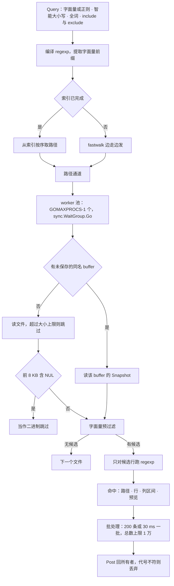

**为什么一定要字面量预过滤**（研究阶段**实测**）：`bytes.Index` 扫 100 MB 只要 6.8 ms；带字面量前缀的正则约 520 MB/s；而单独的 `(?i)handler` 只有约 21 MB/s。所以：

- 字面量查询：`bytes.Index`；智能大小写且模式是 ASCII 时用 ASCII 大小写折叠扫描。
- 正则查询：预过滤用的字面量从用户的**原始模式**里取，不从加了 `(?i)` 或 `\b` 的最终正则里取。本机 Go 1.26.3 实测：`regexp.MustCompile("handler").LiteralPrefix()` 是 `"handler"`，而 `\bhandler\b` 和 `(?i)handler` 的 `LiteralPrefix()` 都是空串，预过滤会整个失效，退回约 21 MB/s 的全文正则。做法：对未包装、区分大小写的原始模式取 `LiteralPrefix()`；拿不到时遍历 `regexp/syntax` 的语法树找一个必然出现的字面量。用它（必要时做 ASCII 大小写折叠）预过滤，只有命中预过滤的行才交给真正的（可能带 `(?i)`、`\b` 的）正则。中文没有大小写，CJK 字面量直接 `bytes.Index`。
- 全词：字面量 + 全词**完全不用正则**：`bytes.Index`（或 ASCII 折叠扫描）命中后，检查命中两侧是不是单词边界即可。正则 + 全词才给正则外包 `\b`（预过滤照上一条）。RE2 的 `\b` 只认 ASCII 单词字符，对中文没有意义，中文查询忽略该选项。
- Go 的 `regexp` 是 RE2 引擎，**保证线性时间**，任何输入都不会因回溯卡死。

入口是 `grep.Grep(ctx, root, ix, q, dirty, emit)`（签名见 §12）。签名本身就排除了数据竞争：`ix` 是**按值**传入的 `workspace.Index`；`dirty` 是 `map[string]text.Snapshot`，在所有者上于 job 启动时建好（路径 → 未保存 buffer 的快照），之后只读，worker 不会去碰所有者的 `bufs`。`emit` 接收一批批 `Hit`。加一个 `-race` 测试：Grep 运行期间，所有者不断追加遍历批次、编辑脏 buffer。

预算：GOROOT 规模（约 1.5 万文件）首批结果 ≤ 100 ms，全部完成 ≤ 600 ms；再次输入时，上一轮搜索在一帧之内被取消（M5 验收）。

### 9.6 文件监听与外部修改

- fsnotify v1.10.1 在 macOS 上用 kqueue，没有递归监听，而且**监听一个目录等于逐个打开它里面的每个条目**：添加监听时它会 `ReadDir`、`lstat`，再对每个条目 `open`（`O_EVTONLY`），有 N 个文件的目录占 N+1 个 fd（fsnotify README：「watching a directory with five files then that's six file descriptors」；`backend_kqueue.go` 的 `watchDirectoryFiles`）。打开 `~/Downloads`（上万个文件）里的一个文件就会产生上万次 `open`。真正的瓶颈是这些系统调用和内核对象，而不是 fd 上限（Go 启动时已把软上限提到 `min(硬上限, kern.maxfilesperproc)`，本机是 184320）。
- 所以**从不监听整棵树**，只监听：打开文件的父目录、展开的树目录、配置目录、项目根下的 `.git` 目录（git 用「写锁文件再改名」的方式更新 `HEAD` 与 `index`，单独监听这两个文件会在第一次更新后失效，所以监听目录再按文件名过滤）。而且只监听条目数 ≤ 1,000（可配置）的目录；超过上限的目录不监听，改为在 `FocusInput` 时重新读一次。折叠目录或关闭文件时 `Remove` 对应的监听。
- 事件 50 ms 去抖；终端重新获得焦点时（`FocusInput`）再对所有打开的文件 `os.Stat` 一遍，兜住 kqueue 漏掉的情况。Terminal.app 是否发送焦点事件（mode 1004）由 M0 核实；不发送时外部修改只靠 fsnotify。
- 外部修改：buffer 干净 → 静默重新加载（`OriginReload` 事务，只含裁掉公共前后缀后的最小改动，可撤销，§3.7）；buffer 有修改或正在组字 → 弹出确认浮层「保留我的修改 / 重新加载」（组字时先等上屏）。两种重新加载之后，所有者都调用 `Buffer.MarkSaved(after.Version(), fi)`，把 `savedVersion` 和 `FileInfo`（修改时间、预期的 (size, mtime)）更新为刚读到的磁盘状态，buffer 因此是干净的（§3.8）。
- 自己保存引起的事件：按 §3.10 记录的预期 `(size, mtime)` 忽略；`.yan-save-*` 临时文件按前缀忽略。
- 不用 FSEvents：fsnotify 在 macOS 上只有 kqueue 后端；FSEvents 要用单独的 `github.com/fsnotify/fsevents`，那是 cgo 绑定，违反 §2.2。

🧭 **Go 学习点**
- **`fs.WalkDirFunc` 与 `fs.SkipDir`**：fastwalk 复用标准库的回调签名，返回 `fs.SkipDir` 就不进入该目录。
- **`append` 的别名陷阱**：`child := append(parent, own...)` 可能写进 `parent` 的剩余容量，多个子目录互相覆盖规则。拼规则请用 `slices.Concat(parent, own)`，它总是分配新切片。
- **`sync.Map`** 适合「写一次、读很多次、键不重叠」的场景，例如按目录缓存 matcher；其他情况普通 `map + Mutex` 更清楚。
- **RE2 与回溯引擎**：Go 的 `regexp` 不支持反向引用，换来的是线性时间保证，这正是编辑器搜索需要的。

---

## 10. 配置与 keymap（core/config）

| | |
|---|---|
| **职责** | 加载并合并「内嵌默认 → 用户配置 → 项目 `.yan.toml`」，未知键告警，热重载；加载主题文件；把 keymap 绑定交给 `core/keymap` 编译。`.yan.toml` 只由本包读取，`core/workspace` 只负责找到项目根 |
| **关键类型** | `config.Config`、`config.ProjectConfig`、`config.Warning`；主题类型 `style.Theme` 定义在 `core/style` |
| **依赖** | `github.com/BurntSushi/toml v1.6.0`（约 +0.39 MB，支持注释）；标准库 `embed` |
| **里程碑** | M3 |

### 10.1 分层与位置

| 层 | 位置 | 说明 |
|---|---|---|
| 内嵌默认 | `core/config/defaults/*.toml`，`//go:embed` | 零配置即可用：默认设置、「VS Code 交互」keymap 预设 `keymap-vscode.toml`、深浅两套主题 |
| 用户 | `~/.config/yan/config.toml`（设置了 `XDG_CONFIG_HOME` 则用它） | 可选；主题放在同目录的 `themes/*.toml` |
| 项目 | 项目根的 `.yan.toml` | 可选；例如项目专用的 tab 宽度、额外忽略目录。**不能**设置任何可执行文件路径（见 §10.2） |

后一层覆盖前一层；keymap 按上下文合并，绑定值写成空字符串 `""` 表示解绑。

```toml
# ~/.config/yan/config.toml —— 所有项都可省略
[ui]
language = "system"         # system | zh-Hans | en；只在用户配置里有效，设置里选过的（state.json）优先
theme = "dark"              # dark | light | themes/ 下的自定义主题名
mouse = true                # false：不捕获鼠标，恢复终端原生的选中复制

[editor]
tab_width = 4
soft_wrap = false

[cjk]
ambiguous_width = "narrow"  # narrow | wide；与终端不一致时 yan 会带着环境变量重启自己

[md]
remote_images = false       # 浏览器导出时是否允许远程图片

[keys]
preset = "vscode"           # v0.x 唯一的预设
mod = "auto"                # auto | ctrl | cmd

[keys.global]
"mod+p"       = "workbench.action.quickOpen"
"mod+shift+v" = "markdown.showPreview"
"mod+k b"     = "yan.markdown.openInBrowser"

[keys.editor]
"mod+d" = "editor.action.addSelectionToNextFindMatch"

[tui_keys.global]           # 只在终端里加载（§6.5）
"ctrl+o" = "workbench.action.quickOpen"

[tui_keys.editor]
"ctrl+k k" = ""             # 空字符串表示解绑
```

命令 ID 直接沿用 VS Code 的 command ID；Yan 独有的命令用 `yan.<领域>.<动作>`（ADR-012）。项目还没有用户，所以不保留任何历史别名；以后真要改名，旧 ID 作为告警别名保留（DESIGN.md §5.9）。命令面板对中文标题和英文 ID 都做模糊匹配。完整的默认 keymap 与命令清单见 [DESIGN.md §5.5](./DESIGN.md#55-键位映射总表)。

### 10.2 加载、校验与热重载

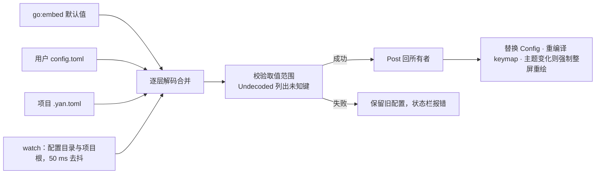

- **项目层受限解码**：`.yan.toml` 解码进一个受限的 `ProjectConfig`，它根本没有可执行文件路径的字段（`[lsp.*] command`、`[git] path` 之类）。这些键出现在 `.yan.toml` 里时只告警并忽略，配一个单元测试。否则打开一个陌生仓库，就可能被它指定的「语言服务器」执行任意程序（DESIGN.md §9.2）。
- **未知键**：`toml.Decode` 返回的 `MetaData.Undecoded()` 列出没有对应字段的键，例如把 `ui.mouse` 写成 `ui.mous`。只告警（附「你是不是想写 `ui.mouse`」的编辑距离建议），**从不因配置错误拒绝启动**。
- **热重载**：解析在 watcher job 里做，成功后 `Post`。主题变化时 `Frame` 报告 `changed`，整屏重绘一次（如果以后加了行哈希层，还要清空哈希缓存，因为哈希只包含 StyleID 不包含颜色）。
- **不能热生效的项**：`cjk.ambiguous_width` 由 tcell 在包初始化时读取，修改后状态栏提示「重启生效」。
- **界面语言**：`core/i18n` 以英文原文为键，带一份简体中文目录；缺译文时显示英文，`core/i18n` 的测试扫描源码，
  保证每条用到的文字都有译文、目录里没有没人用的条目。偏好的优先级是「设置里选的（`state.json` 的 `language`）→
  用户 `config.toml` 的 `[ui] language` → 跟随系统」，项目的 `.yan.toml` 不能设置它。`main` 在建任何窗口、菜单、
  更新窗口之前用 `config.StartLocale` 解析一次（系统语言由 `platform/locale` 给出：macOS 读
  `NSLocale.preferredLanguages`，终端版读 POSIX 的语言环境变量），整个进程不再改变；之后保存的选择和配置热重载只更新
  设置里的「已保存」和重启提示。

🧭 **Go 学习点**
- **`embed.FS`**：`//go:embed defaults/*.toml` 把整个目录编进二进制，`fs.ReadFile(defaultsFS, "defaults/keymap-vscode.toml")` 读取。
- **结构体标签**：``AmbiguousWidth string `toml:"ambiguous_width"` ``；Go 的零值语义让「没写就用默认值」很自然。
- **把配置当不可变值**：每次重载生成一个新的 `*Config` 整体替换，而不是逐字段修改，避免半新半旧的状态。

---

## 11. 演进：v0.2 Gio 前端与 v0.3 LSP/git

### 11.1 v0.2：Gio 前端接入点

| | |
|---|---|
| **职责** | 原生窗口、Metal 渲染、真排版（PingFang SC）、原生 IME、原生 Cmd 快捷键、文件夹选择器、`.app` 打包 |
| **关键类型** | `gio.GUI`（实现 `ui.Frontend`）、字形 `LineLayouter`、Painter、IME 粘合、`fonts` 包 |
| **依赖** | `gioui.org v0.10.3`、`gioui.org/x v0.10.3`（explorer 文件夹选择器），**精确锁版本**，只允许 `ui/gio` 导入；需要 cgo，构建时导出 `DEVELOPER_DIR=/Library/Developer/CommandLineTools` |
| **门槛** | M0 Spike B（4 天，严格限时）通过，结果写入 DECISIONS.md 的 ADR-002b；否则按回退计划 v0.2 改做 LSP 与 git |

接缝早在 M2 就固定了，v0.2 只是给同一组接口写第二套实现：

| 接缝 | `ui/tui`（v0.1） | `ui/gio`（v0.2） |
|---|---|---|
| `Frontend.Run` | tcell 事件循环（§4.7） | Gio 窗口事件循环 + 一个转发 `Wake` 的 goroutine |
| `LineLayouter` | 单元格：displaywidth 字素宽度 | 字形：`text.Shaper`，LRU + 2 KB 分段 + 预塑形 + 像素对齐 |
| Painter | 帧变化时 `SetContent` 可见单元格 | 矩形 + 每段颜色一次 `clip.Outline` / `ColorOp` / `PaintOp` |
| IME | 只收已上屏文本 | `ReplaceInput`、`CompositionInput`、`SelectionInput`、`SnippetInput`（rune 偏移，内核换算）；按 `IMEState()` 发布 `SnippetCmd` / `SelectionCmd` |
| 按键 | tcell 事件 → `Chord`（`mod` = Ctrl 或 Cmd） | `key.Event` → `Chord`（`mod` = Cmd） |
| 截止时间 | `time.Timer` | `gtx.Execute(op.InvalidateCmd{At: deadline})` |
| 环境变量 | 继承 shell 的 PATH | `platform/shellenv` 解析登录 shell 环境（Finder 启动时 PATH 只有系统目录，看不到 `~/go/bin/gopls`） |

```go
// ui/gio/loop.go（v0.2 草图；API 已对照 gioui.org v0.10.3 源码）
func (g *GUI) Run(ctx context.Context, ed *yapp.Editor) error {
	w := new(gioapp.Window)
	go func() { // 唯一的辅助 goroutine：把内核的「门铃」转成 Gio 的重绘请求
		for {
			select {
			case <-ctx.Done():
				return
			case <-ed.Wake():
				w.Invalidate()
			}
		}
	}()
	var ops op.Ops
	var frame view.Frame
	for {
		switch e := w.Event().(type) {
		case gioapp.DestroyEvent:
			return e.Err
		case gioapp.FrameEvent:
			gtx := gioapp.NewContext(&ops, e)
			g.handleInput(gtx, ed) // key.Event、EditEvent、CompositionEvent、指针 → ed.Handle
			ed.RunPending()
			ed.Frame(g.size(gtx), &frame) // Unit = 1/64 像素
			g.paint(gtx, &frame)          // 基线与滚动偏移取整到设备像素
			g.publishIME(gtx, ed)         // 仅在变化时发送 SnippetCmd / SelectionCmd
			if d, ok := ed.NextDeadline(); ok {
				gtx.Execute(op.InvalidateCmd{At: d})
			}
			e.Frame(gtx.Ops)
		}
	}
}
```

macOS 上 Gio 要求 `main` goroutine 调用 `gioapp.Main()`，所以 `cmd/yan` 在 `gio` 构建里把 `Frontend.Run` 放进另一个 goroutine；所有者 goroutine 就是这个窗口事件 goroutine，规则不变。

**字体（从青简方案嫁接，均为实测）**：`text.NoSystemFonts()` + 逐个加载 face，起我们自己的别名：代码字体 SF Mono（`/System/Library/Fonts/SFNSMono.ttf`，文件约 0.2 MB，实测；加载后内存约 1 MB，估算）或 Menlo；中文 PingFang SC Regular，用 glob 在 `/System/Library/AssetsV2/com_apple_MobileAsset_Font*/*/AssetData/PingFang.ttc` 里找，再按 face 描述挑出 SC Regular（约 15 MB、18–34 ms），找不到时退回 Hiragino Sans GB。**绝不整体解析字体集合**：整个 PingFang.ttc 解析下来要 369 MB。行高 = max(代码字体, 中文字体) 的 ascent+descent × 1.35，混排行不跳动。**emoji 默认关闭**（ADR-011）：一个 Apple Color Emoji face 即便内存映射也要 193 MB 堆。

**v0.2 预算**：帧 CPU p50 ≤ 2 ms、p99 ≤ 4 ms（120 Hz）；空闲 footprint ≤ 80 MB（加载 PingFang SC、emoji 关闭）；冷启动 ≤ 400 ms；二进制 ≤ 14 MB。启动期间 430–520 MB 的瞬时 footprint 峰值原因未明，Spike B 用 Instruments 调查。

### 11.2 v0.3：LSP 客户端（core/lsp、core/lsp/jsonrpc）

| | |
|---|---|
| **职责** | 手写 JSON-RPC 基础协议（约 300 行）+ 约 25 个手写结构体；按 (语言, 工作区根) 管理服务器进程；把 ChangeSet 翻译成增量 `didChange`；诊断、跳转、悬停、符号、补全、保存时格式化 |
| **依赖** | 标准库 `encoding/json`、`os/exec`；`go.lsp.dev/protocol v1.0.1` 只作参考，不作依赖（作为依赖要 +2.1 MB） |
| **服务器** | 先 gopls，再 typescript-language-server（其位置编码需先验证） |

**传输层**：LSP 基础协议是「若干行头部 + 空行 + `Content-Length` 字节的 JSON」，用 `bufio.Reader` 逐行读头、`io.ReadFull` 读正文即可，`core/lsp/jsonrpc` 全部约 300 行。

- 每个服务器三个 goroutine：一个读 stdout 并分发（响应 → 按 id 找到等待的 channel；通知与服务器请求 → `Post` 回所有者）、一个**按顺序**写 stdin、一个把 stderr 收进 64 KB 环形缓冲。只有「id → chan」的挂起表用互斥锁保护。
- **请求永远不在所有者 goroutine 上阻塞**：悬停、补全等请求用 `spawn` 发起（键如 `{kind: "lsp.hover", target: bufID}`），新请求自动取消旧请求的 ctx，客户端在 ctx 取消时发 `$/cancelRequest`。一套机制同时解决了「过期请求」和「不阻塞界面」。
- 处理的服务器请求：`workspace/configuration`、`window/showMessage`、`window/logMessage`（进日志窗格）。

**位置编码**：`initialize` 时声明 `general.positionEncodings: ["utf-8", "utf-16"]`，以服务器的回答为准，缺省是 UTF-16。研究阶段**实测** gopls v0.22.0 没有返回 `positionEncoding`，所以用 UTF-16；换算走 rope 的 `UTF16` 摘要，O(log n)。

**增量同步**：

```go
// contentChanges 把一个 ChangeSet 转成 LSP 的 contentChanges。
// LSP 按数组顺序逐个应用，每个 range 都相对「前面变更已应用」后的文档。
// 我们从后往前发：后面的修改不会移动前面的偏移，于是所有 range 都能直接按旧快照计算。
func contentChanges(old text.Snapshot, cs text.ChangeSet, enc posEncoding) []ContentChange {
	out := make([]ContentChange, 0, len(cs))
	for i := len(cs) - 1; i >= 0; i-- {
		c := cs[i]
		out = append(out, ContentChange{
			Range: Range{Start: enc.pos(old, c.Start), End: enc.pos(old, c.End)},
			Text:  c.Text,
		})
	}
	return out
}
```

- 版本号严格递增；一次循环迭代内的多个 Edit 合并成一条 `didChange`（数组按编辑顺序拼接）。
- **先 didChange，后请求**：LSP 客户端在把任何请求（悬停、补全、定义）放进 stdin 写队列之前，先在所有者上同步刷出待发的 `didChange`；否则同一次迭代里先触发的请求会排在 `didChange` 前面，服务器按旧文本作答，补全会插错位置。每个请求带上发起时的文档版本，响应回来时版本已不是当前的就丢弃。
- **临时（IME 组字中）的编辑永不发送**；上屏时发送一次 `base → 最终` 的合成变更。
- `didSave`、`didClose` 照常发送。
- 验收：模糊测试证明「增量同步得到的服务器端文本」与「全量同步」逐字节相同。

**功能顺序**：① `publishDiagnostics`（行号槽标记、波浪线 Span 层、状态栏计数、命令面板里的问题列表）② 定义与引用（跳转 + 结果浮层）③ 悬停（浮层）④ `documentSymbol`（并入 Ctrl+K O 大纲）⑤ 补全（触发字符或快捷键弹出浮层，过期请求取消）⑥ 保存时格式化（返回的 TextEdits 作为一个可撤销的 `OriginCommand` 事务应用）。

**进程管理**：`exec.CommandContext` + `SysProcAttr{Setpgid: true}`；自定义 `Cmd.Cancel` 依次发送 `shutdown`、`exit`，最后 SIGTERM；`WaitDelay` 2 s；崩溃后指数退避重启。命令来自**用户配置**的 `[lsp.go] command = "..."`，或者 PATH；项目的 `.yan.toml` 不能设置它（§10.2）。

### 11.3 v0.3：git（core/git）

- `git status --porcelain=v2 -z` 驱动文件树颜色和状态栏里的分支名。
- 一个常驻的 `git cat-file --batch` 进程按 `:路径` 取暂存区 blob 并缓存；用 `znkr.io/diff v1.1.2`（Myers 算法，通常 < 1 ms）对比 blob 与当前 Snapshot，得到行号槽的新增/修改/删除标记；`.git/index` 变化时刷新（验收：`git add` 后 200 ms 内刷新）。
- git 路径解析为 Homebrew 的 `/opt/homebrew/bin/git`（2.45.2）：在 Xcode 许可协议被接受之前，`/usr/bin/git` 会直接失败（**实测**）。`[git] path` 只读用户配置，`.yan.toml` 不能设置它。
- 不做暂存、提交、blame、历史视图（非目标）。

🧭 **Go 学习点**
- **`bufio.Reader` + `io.ReadFull`**：解析「头部 + 定长正文」协议的标准做法。
- **id → channel 的请求表**：每个请求一个容量 1 的 channel，读 goroutine 把响应投递进去；`select` 同时等待响应和 `ctx.Done()`。
- **`exec.Cmd.Cancel` 与 `WaitDelay`**（Go 1.20）：让 ctx 取消时先礼貌地关闭子进程，超时再强杀，并保证管道不会把 `Wait` 卡住。

---

## 12. 关键 Go 接口

这里是全文类型定义的**唯一出处**（正文各节只讲用法）。写法约定：用真实模块路径；未实现的函数体写成 `panic("M1a")` 这类形式，标明它在哪个里程碑实现；只用到类型名的枚举把取值写在注释里。这样每个包都是合法的 Go。

几处容易看漏的设计点，正文都有解释：`Snapshot` 只有内容、文件状态在 `FileInfo`（§3.3）；存储用 `summary32`、每叶 40 B（§3.2）；`tree.apply` 一次吃下整个 ChangeSet（§3.2）；`Revision.Changes` 与 `savedVersion`（§3.8）；job 代号、`spawnStream` 与根 ctx（§4.3）；`Frame` 返回 `changed`（§4.7）；`StyledRun`、带 `Ascent` / `Descent` 的 `Caret`、带行内偏移的滚动锚点（§5.1–§5.2）；IME 输入以 rune 计、`IMEState`（§6.6）；`keymap.Bindings` 与 `Profile.Terminal`（§6.5）；`app.Host` 与 `Frontend.Host`（§2.2）；`Grep` 放在子包 `core/search/grep`，按值收 `Index`（§9.5）。

```go
// ===== core/text =====

// Package text 提供不可变分块 rope、快照与修改集。所有偏移都是 UTF-8 字节偏移。
package text

import (
	"iter"
	"time"
)

// Summary 是公开 API 用的摘要；只含 int，GC 不扫描。存储层用更紧凑的 summary32（§3.2）。
type Summary struct{ Bytes, Newlines, Runes, UTF16 int }

func (a Summary) Add(b Summary) Summary {
	return Summary{a.Bytes + b.Bytes, a.Newlines + b.Newlines, a.Runes + b.Runes, a.UTF16 + b.UTF16}
}

// summary32 只在存储里用：每叶 16 B；单叶摘要由前缀和相减得到。测试断言 unsafe.Sizeof == 16。
type summary32 struct{ Bytes, Newlines, Runes, UTF16 uint32 }

type (
	Encoding uint8 // EncUTF8、EncUTF8BOM、EncGB18030：保存时原样写回
	EOL      uint8 // EOLLF、EOLCRLF：主流换行风格
	Tier     uint8 // TierNormal（≤ 8 MB）、TierLarge（8–256 MB，v0.1 只读）
)

// FileInfo 描述「这个文件」，由 edit.Buffer 持有，不进撤销历史（§3.3）。
type FileInfo struct {
	Path        string
	Encoding    Encoding
	EOL         EOL
	MixedEOL    bool
	ModTime     time.Time
	Tier        Tier
	ExpectSize  int64     // 自己保存后预期的大小与修改时间，
	ExpectMTime time.Time // 让文件监听器忽略这次自己引起的事件（§9.6）
}

// tree 隐藏存储：M1a 平铺叶子数组 + 前缀和，M1b 持久化 B+ 树。实现方绝不修改接收者，
// 交出去的切片一律用三下标切片限制容量（§3.1）。
type tree interface {
	summary() Summary
	apply(cs ChangeSet) tree // 单趟遍历叶子，代价 O(叶数 + 改动字节)
	seekByte(off int) (leaf []byte, leafStart int, before Summary)
	seekLine(line int) (leaf []byte, leafStart int, before Summary)
	chunks(from, to int) iter.Seq[[]byte]
}

// Snapshot 是不可变的文档版本；复制为 O(1)，可无锁地交给任意 goroutine。
type Snapshot struct {
	t       tree
	version uint64 // 包级 atomic 计数器分配：全局唯一，永不复用
}

// Load 先 stat、按大小定档（超过 maxBytes 不读、直接返回错误），再一次读入，
// 识别编码与换行，切成 2 KB 叶子并行计算摘要（§3.10）。
func Load(path string, maxBytes int64) (Snapshot, FileInfo, error) { panic("M1a") }

func (s Snapshot) Version() uint64                             { return s.version }
func (s Snapshot) Len() int                                    { return s.t.summary().Bytes }
func (s Snapshot) LineCount() int                              { return s.t.summary().Newlines + 1 }
func (s Snapshot) Chunks(from, to int) iter.Seq[[]byte]        { return s.t.chunks(from, to) } // 批量路径用；热路径用 AppendRange
func (s Snapshot) LineStart(line int) int                      { panic("M1a") }
func (s Snapshot) LineEnd(line int) int                        { panic("M1a") } // 去掉 \r\n 或 \n 之后
func (s Snapshot) LineAt(off int) int                          { panic("M1a") }
func (s Snapshot) AppendRange(dst []byte, from, to int) []byte { panic("M1a") }
func (s Snapshot) ByteToRune(off int) int                      { panic("M1a") } // Gio IME
func (s Snapshot) RuneToByte(r int) int                        { panic("M1a") } // Gio IME
func (s Snapshot) UTF16Col(off int) int                        { panic("M1a") } // LSP

// Change 用 Text 替换旧快照的字节区间 [Start, End)；ChangeSet 有序、互不重叠、都相对同一个旧快照。
type (
	Change struct {
		Start, End int
		Text       string
	}
	ChangeSet []Change
	Assoc     int8
)

const (
	AssocBefore Assoc = -1 // 留在插入文本之前
	AssocAfter  Assoc = 1  // 跟到插入文本之后（光标默认）
)

func (cs ChangeSet) Apply(s Snapshot) Snapshot        { panic("M1a") } // 内部调用一次 tree.apply
func (cs ChangeSet) Invert(old Snapshot) ChangeSet    { panic("M1a") }
func (cs ChangeSet) Compose(next ChangeSet) ChangeSet { panic("M1a") } // 只用于 History 组内与 IME 上屏
func (cs ChangeSet) MapPos(pos int, a Assoc) int      { panic("M1a：实现见 §3.5") }

// ===== core/edit =====

// Package edit 在 text 之上维护选择区、事务、撤销历史与 IME 组字状态。
package edit

import (
	"time"

	"github.com/corn12138/yan-source/core/text"
)

type (
	// Range 是一个选择区；Anchor == Head 时就是光标。GoalX 为上下移动的目标 x，-1 表示未设。
	Range struct {
		Anchor, Head int
		GoalX        int32
	}
	// Selections 按起点排序且互不重叠；Primary 是真实光标所在的那一个。
	Selections struct {
		Ranges  []Range
		Primary int
	}
	// Origin：OriginTyping、OriginPaste、OriginIME、OriginCommand、OriginReplaceAll、OriginReload、OriginUndo。
	Origin uint8
)

// Map 用一趟归并映射全部端点：O(端点数 + changes)。
func (s Selections) Map(cs text.ChangeSet) Selections { panic("M1a") }

// Transaction 是一次原子修改；Provisional 表示 IME 标记文本（不入撤销、不发 LSP、不自动保存）。
type Transaction struct {
	Changes     text.ChangeSet
	After       Selections // 为空则由 Changes 映射
	Origin      Origin
	Provisional bool
}

// Edit 是发给订阅者（高亮、搜索标记、文档重解析、LSP）的通知；一个 Edit 可能含很多个 Change。
type Edit struct {
	Before, After text.Snapshot
	Changes       text.ChangeSet
	Origin        Origin
	Provisional   bool
}

// Revision 是撤销历史中的一组；History 按估算的保留字节数封顶（默认 64 MB）。
type (
	Revision struct {
		Before, After       text.Snapshot
		Changes             text.ChangeSet // Before → After，组内用 Compose 累积
		SelBefore, SelAfter Selections
		Origin              Origin
		At                  time.Time
	}
	History struct {
		revs                    []Revision
		cur, estBytes, maxBytes int
	}
)

// Buffer 是一个文档当前快照的唯一所有者；所有修改都经过 Apply。
type Buffer struct {
	snap         text.Snapshot
	file         text.FileInfo // 文件状态，不进撤销（§3.3）
	sels         Selections
	hist         History
	savedVersion uint64 // 最近一次成功保存的快照版本（§3.8）
	subs         []func(Edit)
	// 另有 IME 组字状态：active、组字区间、base 快照与选择区、base → 当前的 ChangeSet（§3.9）
}

func (b *Buffer) Snapshot() text.Snapshot         { return b.snap }
func (b *Buffer) File() text.FileInfo             { return b.file }
func (b *Buffer) Selections() Selections          { return b.sels }
func (b *Buffer) Dirty() bool                     { return b.snap.Version() != b.savedVersion } // 组字中另算 dirty
func (b *Buffer) OnEdit(fn func(Edit))            { b.subs = append(b.subs, fn) }
func (b *Buffer) Apply(tx Transaction) Edit       { panic("M1a") }
func (b *Buffer) SetComposition(start, end int)   { panic("M1a") } // start < 0：结束并上屏
func (b *Buffer) CommitComposition() (Edit, bool) { panic("M1a") } // 压成一个 OriginIME 修订
func (b *Buffer) Undo() (Edit, bool)              { panic("M1a") }
func (b *Buffer) Redo() (Edit, bool)              { panic("M1a") }

// MarkSaved 在保存 job 成功后、以及从磁盘重新加载之后（§9.6）由所有者调用：
// v 是写进或读自磁盘的那个快照的版本，fi 带新的修改时间与预期的 (size, mtime)。
func (b *Buffer) MarkSaved(v uint64, fi text.FileInfo) { b.savedVersion, b.file = v, fi }

// LineInput 是单行输入框（快速打开、命令面板、查找、替换、项目搜索）的模型，
// 与 Buffer 共用按字素移动和组字逻辑（§3.7）。
type LineInput struct {
	Text []byte
	Sel  Range
	// 另有组字状态，规则与 Buffer 相同
}

// ===== core/style =====

// Package style 定义语义样式；颜色由前端按主题映射。
package style

// ID 是语义样式（Text、Keyword、Type、Function、String、Number、Comment、Punct、Heading、
// Link、CodeSpan、Selection、SearchHit、CurrentLine、SecondaryCursor、Composing、Gutter、Dim 等约 20 个），按 iota 编号。
type ID uint8

// FaceID 是字体角色：FaceCode、FaceProse、FaceProseBold 等；TUI 忽略，Gio 映射到真实字体。
type FaceID uint8

// Span 是行内字节区间上的一个样式。
type Span struct {
	Start, End int32
	Style      ID
}

// Attr 是一个样式的外观；Theme 由 core/config 从 TOML 加载，前端只读。
type (
	Attr struct {
		FG, BG                           uint32 // 0xRRGGBB；0 表示继承
		Bold, Italic, Underline, Reverse bool
	}
	Theme map[ID]Attr
)

// ===== core/keymap =====

// Package keymap 负责组合键规范化与按上下文的序列 trie。
package keymap

type Mod uint8

const (
	ModShift Mod = 1 << iota
	ModCtrl
	ModAlt
	ModSuper // Cmd
)

type (
	Key     uint16 // KeyRune、KeyEnter、KeyEsc、KeyTab、KeyBackspace、方向键、Home/End、PgUp/PgDn、F1……
	Context uint8  // CtxEditor、CtxTree、CtxFinder、CtxPalette、CtxFind、CtxSearch、CtxReading
	Match   uint8  // MatchNone、MatchPrefix、MatchExact
)

// Chord 是一次按键（含修饰键）；可比较，可直接做 map 键。Rune 在 Key == KeyRune 时有效，统一小写。
type Chord struct {
	Mods Mod
	Key  Key
	Rune rune
}

// Profile 描述当前环境（§6.5）。
type Profile struct {
	Mod      Mod  // mod 解析成 ModSuper 还是 ModCtrl
	Legacy   bool // 只有 legacy 编码（Terminal.app）
	Terminal bool // 终端前端：加载 TUIKeys；Gio 为 false
}

// Bindings 是配置里的两组表：[keys.<上下文>] 与只在终端加载的 [tui_keys.<上下文>]；
// 值是命令 ID，空字符串表示解绑。
type Bindings struct {
	Keys, TUIKeys map[Context]map[string]string
}

// Keymap 每个上下文一棵 trie（结构见 §6.4）。
type Keymap struct{ roots map[Context]*node }

type node struct {
	next map[Chord]*node
	cmd  string
}

func Parse(seq string, mod Mod) ([]Chord, error)                   { panic("M3") } // "mod+k b"、"ctrl+k ctrl+p"、"f1"
func Compile(b Bindings, p Profile) (*Keymap, []string)            { panic("M3") } // 按 §6.5 的四条规则编译，返回告警
func (k *Keymap) Bind(ctx Context, seq, cmd string) error          { panic("M3") } // 拒绝「既是绑定又是前缀」
func (k *Keymap) Resolve(ctx Context, seq []Chord) (string, Match) { panic("M3：实现见 §6.4") }

// ===== core/syntax/lex =====

// Package lex 是词法器的叶子包：只依赖 core/style，core/view/mdlayout 也能用。
package lex

import "github.com/corn12138/yan-source/core/style"

// State 是一行结束时的词法状态。
type State uint32

// Lexer 必须零分配、O(len(line))、不回溯；line 不含行尾换行符。
type Lexer interface {
	LexLine(line []byte, in State, emit func(style.Span)) (out State)
}

// ===== core/syntax =====

// Package syntax 是行状态增量高亮引擎；它自己不起 goroutine，后台补全由 core/app 调度。
package syntax

import (
	"context"

	"github.com/corn12138/yan-source/core/edit"
	"github.com/corn12138/yan-source/core/style"
	"github.com/corn12138/yan-source/core/syntax/lex"
	"github.com/corn12138/yan-source/core/text"
)

// Highlighter 由引擎实现，只在所有者 goroutine 上调用。
type Highlighter interface {
	Edited(e edit.Edit) // 单趟处理整个 ChangeSet
	Spans(s text.Snapshot, line int, scratch []byte, dst []style.Span) (spans []style.Span, exact bool)
	Pending() (from int, in lex.State, ok bool) // 是否需要后台补全、从哪一行开始
	Merge(version uint64, from int, states []lex.State)
}

// LexStates 是后台补全用的纯函数（实现见 §7.2）。
func LexStates(ctx context.Context, lx lex.Lexer, s text.Snapshot, from int, in lex.State, upTo int) []lex.State {
	panic("M4：实现见 §7.2")
}

// ===== core/view =====

// Package view 是内核与前端之间的接缝：不含任何单元格或像素假设。
package view

import "github.com/corn12138/yan-source/core/style"

type (
	Unit        int32 // TUI：单元格；Gio：1/64 像素
	Size        struct{ W, H Unit }
	Rect        struct{ X, Y, W, H Unit }
	PaneKind    uint8 // PaneCode、PaneReading、PaneTree
	OverlayKind uint8 // OverlayFinder、OverlayPalette、OverlayFind、OverlaySearchResults、OverlayConfirm
)

type LayoutStyle struct {
	TabWidth int
	Wrap     Unit // 0 = 不折行
	Prose    bool // UAX#14 + 避头尾
}

// StyledRun 是一行里样式一致的一段（§5.1）。TUI 忽略 Face 和 Scale。
type StyledRun struct {
	Text  []byte
	Face  style.FaceID
	Scale uint8 // 字号倍数 × 10：10 = 正文
}

type (
	Row struct { // 一个视觉行：逻辑行内的字节区间、续行缩进、行高
		Start, End int32
		X0, Height Unit
	}
	Stop struct {
		Byte int32
		X    Unit
	} // 字素边界 ↔ x
	LineLayout struct {
		Rows  []Row
		Stops []Stop
	}
	// Anchor 是滚动锚点：逻辑行、子行、行内偏移（TUI 恒为 0）。
	Anchor struct {
		Line, Sub int32
		Offset    Unit
	}
)

// LineLayouter 由各前端实现；实现必须复用 dst 中的切片。
type LineLayouter interface {
	Layout(dst *LineLayout, runs []StyledRun, st LayoutStyle)
	Epoch() uint64
}

type RowFrame struct {
	Line, Sub int32
	Y, Height Unit
	Text      []byte       // 只读：别名快照叶子（容量已限制）或本帧 arena
	Spans     []style.Span // 已合并的各层样式，含当前行与副光标
}

type (
	PaneFrame struct {
		Kind   PaneKind
		Bounds Rect
		Gutter Unit
		Rows   []RowFrame
	}
	Overlay struct {
		Kind     OverlayKind
		Bounds   Rect
		Prompt   string
		Input    []byte // 单行输入框的文本（来自 edit.LineInput）
		Items    []RowFrame
		Selected int
	}
	// Caret：Y 是行顶，基线 = Y + Ascent。TUI 中 Ascent = 1、Descent = 0，ShowCursor(X, Y)；
	// Gio 据此填 key.Caret{Pos: 基线点, Ascent, Descent}。
	Caret struct {
		X, Y, Ascent, Descent Unit
		Visible               bool
	}
)

// Frame 是一帧的完整显示模型，每帧复用。
type Frame struct {
	Version   uint64
	Tabs      RowFrame
	Panes     []PaneFrame
	Overlays  []Overlay
	Status    RowFrame
	Caret     Caret   // 唯一的真实光标 / IME 锚点
	Secondary []Caret // 多光标的其余光标
}

// ===== core/app =====

// Package app 是编辑器的所有者：输入、命令、job、工作台状态、帧构建。
package app

import (
	"context"
	"sync"
	"sync/atomic"
	"time"

	"github.com/corn12138/yan-source/core/config"
	"github.com/corn12138/yan-source/core/edit"
	"github.com/corn12138/yan-source/core/keymap"
	"github.com/corn12138/yan-source/core/style"
	"github.com/corn12138/yan-source/core/view"
)

// Input 是前端送进内核的事件；isInput 未导出，外部包无法新增实现。
type Input interface{ isInput() }

type (
	KeyInput  struct{ Chord keymap.Chord }
	TextInput struct {
		Text  string
		Paste bool
	}
	// 以下四种来自 Gio 输入法，偏移都是焦点输入框里的 rune，内核负责换算（§6.6）。
	ReplaceInput struct {
		Start, End int
		Text       string
	}
	CompositionInput struct{ Start, End int } // Start < 0：结束并上屏
	SelectionInput   struct{ Start, End int }
	SnippetInput     struct{ Start, End int }
	MouseInput       struct {
		X, Y   view.Unit
		Button MouseButton // 左 / 中 / 右
		Mods   keymap.Mod
		Kind   MouseKind // 按下 / 拖动 / 释放
		Clicks uint8     // 按下时：1、2、3（ui/tui 按「同一格、400 ms 内」自己数）
	}
	ScrollInput struct{ DX, DY view.Unit }
	FocusInput  struct{ Gained bool }
	MouseButton uint8
	MouseKind   uint8
)

func (KeyInput) isInput()         {}
func (TextInput) isInput()        {}
func (ReplaceInput) isInput()     {}
func (CompositionInput) isInput() {}
func (SelectionInput) isInput()   {}
func (SnippetInput) isInput()     {}
func (MouseInput) isInput()       {}
func (ScrollInput) isInput()      {}
func (FocusInput) isInput()       {}

// IMEState 是 Gio 前端发布 SnippetCmd / SelectionCmd 所需的全部信息，偏移以 rune 计。
type IMEState struct {
	SnippetStart int
	Snippet      string
	SelStart     int
	SelEnd       int
	CompStart    int // 没有组字时为 -1
	CompEnd      int
	Caret        view.Caret
}

// Command 是唯一的功能入口：快捷键、命令面板、鼠标都调用 Run。
type Command struct {
	ID    string // "workbench.action.quickOpen"、"editor.action.addSelectionToNextFindMatch"、"markdown.showPreview"、"yan.markdown.openInBrowser"
	Title string // 命令面板标题，可以是中文
	Run   func(e *Editor, args []string) error
}

// Host 是内核需要、由前端用 platform/* 实现的平台能力。它们都可能 fork 进程或做 I/O，
// 所以 core/app 只在后台 job 里调用（§4.3 的 clipboard job）。
type Host interface {
	SetClipboard(text string) error
	Clipboard() (string, error)
	Open(target string) error // URL、图片、HTML 预览
}

type (
	jobKey struct {
		kind   string // "load" "save" "walk" "readdir" "fuzzy" "grep" "highlight" "mdparse" "clipboard"
		target uint64 // buffer id；工作区级 job 为 0
	}
	jobManager struct {
		root   context.Context
		cancel map[jobKey]context.CancelFunc
		gen    map[jobKey]uint64
	}
)

// Editor 归一个 goroutine 所有；只有 Post 是线程安全的。
type Editor struct {
	mu      sync.Mutex // 只保护 pending
	pending []func(*Editor)
	spare   []func(*Editor)
	wake    chan struct{} // 容量 1
	inside  atomic.Bool   // debug 构建的重入检测

	cfg      *config.Config
	theme    style.Theme
	host     Host
	lay      view.LineLayouter
	keys     *keymap.Keymap
	commands map[string]Command
	bufs     map[BufID]*edit.Buffer
	wb       workbench // 标签、焦点、返回栈、快速打开（§6.7）
	jobs     jobManager
	stop     context.CancelFunc // 取消 jobs.root
}

func New(cfg *config.Config, lay view.LineLayouter, host Host) *Editor { panic("M2") }

func (e *Editor) Post(fn func(*Editor))                                { panic("M2：实现见 §4.2") }
func (e *Editor) Wake() <-chan struct{}                                { return e.wake }
func (e *Editor) RunPending()                                          { panic("M2：实现见 §4.2") }
func (e *Editor) Handle(in Input)                                      { panic("M2") } // 仅所有者调用
func (e *Editor) Frame(size view.Size, dst *view.Frame) (changed bool) { panic("M2") } // 填充可复用的显示模型
func (e *Editor) NextDeadline() (time.Time, bool)                      { panic("M2") } // 只有真实截止时间
func (e *Editor) Tick(now time.Time)                                   { panic("M2") }
func (e *Editor) IMEState() IMEState                                   { panic("M3") } // 焦点输入框的输入法状态
func (e *Editor) Theme() style.Theme                                   { return e.theme }
func (e *Editor) Register(c Command)                                   { e.commands[c.ID] = c }
func (e *Editor) Quit()                                                { e.stop() } // 取消根 ctx；调用前须等全部保存回来（§4.3）

// spawn / spawnStream 在后台运行 work，结果经 Post 送回；被同键新 job 取代时丢弃（§4.3）。
func spawn[T any](e *Editor, k jobKey, work func(context.Context) (T, error), done func(*Editor, T, error)) {
	panic("M2：实现见 §4.3")
}

func spawnStream[T any](e *Editor, k jobKey, work func(ctx context.Context, emit func(T)) error,
	apply func(*Editor, T), done func(*Editor, error)) {
	panic("M3：实现见 §4.3")
}

// ===== core/search/grep =====

// Package grep 是项目级搜索流水线。
package grep

import (
	"context"

	"github.com/corn12138/yan-source/core/text"
	"github.com/corn12138/yan-source/core/workspace"
)

type (
	Query struct {
		Pattern                         string
		Regex, CaseSensitive, WholeWord bool // CaseSensitive 为 false 时用智能大小写
		Include, Exclude                []string
	}
	Hit struct {
		Path       string
		Line       int
		Start, End int // 行内字节列
		Preview    string
	}
)

// Grep 分批流式返回。ix 按值传入（就是快照）；dirty 是 job 启动时在所有者上建好的只读表：
// 未保存 buffer 的路径 → 它的快照，命中时从快照读而不是从磁盘读（§9.5）。
func Grep(ctx context.Context, root string, ix workspace.Index, q Query,
	dirty map[string]text.Snapshot, emit func([]Hit)) error {
	panic("M5")
}

// ===== core/docs（RichDoc 等类型见 §8.2） =====

package docs

import "io"

func Parse(src []byte) (*RichDoc, error)                       { panic("M6") } // goldmark → RichDoc
func ExportHTML(w io.Writer, src []byte, baseDir string) error { panic("M6") } // 在浏览器中打开

// ===== ui =====

// Package ui 定义前端契约。
package ui

import (
	"context"

	"github.com/corn12138/yan-source/core/app"
	"github.com/corn12138/yan-source/core/view"
)

// Frontend 拥有事件循环；Run 在所有者 goroutine 上调用 Editor 的方法。
type Frontend interface {
	Layouter() view.LineLayouter
	Host() app.Host
	Run(ctx context.Context, ed *app.Editor) error
}
```

（`BufID` 与 `workbench` 的定义见 §6.7。）

🧭 **Go 学习点**：每个包第一个文件开头的 `// Package xxx ...` 注释就是 `go doc` 显示的包说明；导出标识符的注释以标识符名开头，这是 `go vet` 和 `staticcheck` 会检查的约定。`type ( ... )` 分组声明和 `struct{ W, H Unit }` 单行结构体都是合法、常见的写法。

---

## 13. 测试、性能与可观测性

| | |
|---|---|
| **职责** | 让「轻、快、简」可度量：无 UI 的金样测试、模糊测试、竞态与时间确定性测试、基准与预算门禁、性能探针、HUD 与 pprof |
| **关键位置** | `ui/headless`、各包的 `*_test.go`、`internal/archtest`、`tools/perfprobe`、`testdata/` |
| **里程碑** | 从 M1 起每个里程碑的退出标准都落成测试；M8 把全部性能预算接入 CI |

### 13.1 Headless 金样测试

`ui/headless` 接收脚本化的 `Input` 序列，把每一帧的 `Frame` 渲染成纯文本，与 `testdata/*.golden` 比较（`go test -update` 重写金样）。同一套脚本跑两遍：`ui/headless` 里用**比例字宽假布局器**（拉丁 7u、CJK 13u），`ui/tui` 里用真正的单元格布局器。前者专门抓「内核偷偷假设等宽」的泄漏，后者保证终端效果。

```text
# testdata/scripts/ime_commit.txt —— 一行一个输入
open   testdata/files/hello.go
key    ctrl+g
text   12
key    enter
text   你好，世界        # 终端里一次 IME 上屏 = 一个 TextInput
key    ctrl+z            # 应恰好撤销整个词组
frame                    # 把当前 Frame 追加到输出
```

同一格式的其他必备脚本：`ime_two_commits.txt`（1 s 内先上屏「你好」再上屏「的」，`ctrl+z` 只撤销「的」）；`ascii_batch.txt`（`text abc` 一次输入与 `text a`、`text b`、`text c` 三次输入，撤销结果相同）；`preview_tab.txt`（单击打开的预览标签被下一次单击替换，编辑后固定）；`esc_chain.txt`（浮层、副光标、选区，连续按 Esc 的焦点序列）；`close_dirty.txt`（关闭未保存标签时选保存 / 不保存 / 取消；另含「保存后退出」：退出前磁盘文件已是新内容、无残留 `.yan-save-*`，§4.3）；`reload_clean.txt`（外部修改 → 静默重载 → 不 dirty；`ctrl+z` → dirty，§3.8）；`gbk_euro.txt`（打开含 0x80 的 GBK 金样，应只读并提示「编码无法无损往返」）。

### 13.2 模糊测试与性质测试

ChangeSet 和 rope 有一个现成的「标准答案」：朴素的 `[]byte` 模型。模糊测试随机生成文档和修改，对比两者：

```go
// core/text/changeset_fuzz_test.go（包内测试，可使用未导出的构造函数）
func FuzzApplyInvert(f *testing.F) {
	f.Add([]byte("你好world\n第二行"), uint16(6), uint16(6), "，")
	f.Fuzz(func(t *testing.T, doc []byte, a, b uint16, ins string) {
		if !utf8.Valid(doc) || !utf8.ValidString(ins) {
			t.Skip()
		}
		s := fromBytes(doc)
		start, end := clampToRuneBoundaries(doc, int(a), int(b))
		cs := ChangeSet{{Start: start, End: end, Text: ins}}

		after := cs.Apply(s)
		want := naiveReplace(doc, start, end, ins) // 朴素模型
		if got := after.AppendRange(nil, 0, after.Len()); !bytes.Equal(got, want) {
			t.Fatalf("Apply 结果不一致")
		}
		if got := summarize(want); after.t.summary() != got {
			t.Fatalf("Summary 不一致：%+v != %+v", after.t.summary(), got)
		}
		back := cs.Invert(s).Apply(after)
		if got := back.AppendRange(nil, 0, back.Len()); !bytes.Equal(got, doc) {
			t.Fatalf("Invert 没能还原原文")
		}
	})
}
```

| 模糊目标 | 性质 |
|---|---|
| `FuzzApplyInvert` | `Apply` 与朴素模型一致；`Invert` 还原原文；摘要与重新计算一致 |
| `FuzzMapPos` | 映射结果单调不减、不越界；`AssocBefore ≤ AssocAfter` |
| `FuzzCompose` | `Compose(a, b).Apply(s) == b.Apply(a.Apply(s))` |
| `FuzzRopeEdits` | 随机编辑序列下 M1a 与 M1b 的内容、摘要、行定位完全一致（M1b 替换的安全网）；对 `Chunks` 返回的每个 chunk 做 `append` 之后，快照内容不变（§3.1 的三下标切片规则） |
| `FuzzMultiChange` | 含多个 Change 的 ChangeSet 一次 `apply` 与逐个应用的结果相同；`Selections.Map` 的归并结果与逐个 `MapPos` 相同 |
| `FuzzGB18030` | 解码 → 编码往返：通过 §3.10 检查的输入必须逐字节还原；含 emoji 的文本编码后能解回原文 |
| `FuzzLexer*` | 任意输入不 panic；Span 有序、不重叠、不越界 |
| `FuzzDidChange`（v0.3） | 增量同步得到的服务器端文本与全量同步逐字节相同 |

M1 退出标准：`Apply`、`Invert`、`MapPos` 各跑 10 分钟 `go test -fuzz` 无失败。

### 13.3 并发与时间确定性测试

- **`-race`**：CI 对 `core/...`、`ui/headless`、`ui/tui` 全部开启。专门的竞态测试：`grep.Grep` 运行期间所有者不断追加遍历批次、编辑脏 buffer（§9.5）。在 darwin 上竞态检测器不依赖 cgo，所以 `CGO_ENABLED=0 go test -race` 可以直接跑，不受 Xcode 许可影响（本机 go1.26.3 **实测**通过）。
- **`testing/synctest`**：去抖、1 s 组合键超时、job 取消都依赖时间。放进 synctest 的「气泡」后，`time.Sleep` 推进的是假时钟，测试瞬间完成且结果确定：

```go
func TestChordPrefixTimeout(t *testing.T) {
	synctest.Test(t, func(t *testing.T) {
		ed := newTestEditor(t)
		ed.Handle(app.KeyInput{Chord: keymap.Chord{Mods: keymap.ModCtrl, Key: keymap.KeyRune, Rune: 'k'}})
		d, ok := ed.NextDeadline()
		if !ok {
			t.Fatal("前缀状态下应有截止时间")
		}
		time.Sleep(time.Until(d)) // 假时钟：立即返回
		ed.Tick(time.Now())
		if _, ok := ed.NextDeadline(); ok {
			t.Fatal("超时后不应再有截止时间：空闲必须零唤醒")
		}
	})
}
```

- **空闲零唤醒**：单元测试断言没有待处理事项时 `NextDeadline()` 返回 `false`；perfprobe 再在真实进程上验证 60 s 内 CPU 时间不变。

### 13.4 性能预算总表

全部预算在 CI 中有对应的门禁或基准（`benchstat` 比较，回退 > 20% 即失败）。

| 指标 | 目标 | 测量方式 | 现状 |
|---|---|---|---|
| 冷启动到首帧（应用侧，热磁盘） | `yan file.go` ≤ 50 ms；`yan .` ≤ 80 ms（树根已列出，遍历在后台继续） | pty 测 10 次取中位与最大 | **实测** tcell v3.5.0 hello：14–36 ms（Apple_Terminal）、14–20 ms（ghostty），负载 10–26 |
| 按键 → 帧字节交给 tty（第一次 `Write` 开始） | p50 ≤ 1 ms，p99 ≤ 4 ms；终端背压另列，不计入 | HUD 1024 样本环；headless `Handle+Frame` 基准 | 估算 |
| 整屏滚动 200×60 | p50 ≤ 3 ms；每帧输出 ≤ 150 KB | HUD + tty 写字节计数；20 万行文件基准 | 估算 |
| 空闲 CPU 与唤醒 | TUI 0% CPU、0 次定时唤醒；Gio 在 10 s 闪烁窗口后为 0 | `ps -o time` 60 s 不变；`NextDeadline` 单测 | 设计保证 |
| 空闲内存（仅应用；1.5 万文件项目已索引、10 个普通 buffer） | ≤ 25 MB RSS / ≤ 20 MB phys_footprint | perfprobe | 估算；终端单独报告：Terminal.app 本身**实测** 49 MB footprint（峰值 324 MB） |
| 二进制（stripped，darwin/arm64） | TUI ≤ 6 MB；Gio ≤ 14 MB | `make size` | **实测** tcell hello 2.17 MB；加全部 MVP 依赖 3.20 MB |
| 打开 100 MB 文件 | 首屏 ≤ 100 ms；摘要 ≤ 200 ms 墙钟；内存 ≤ 1.3× 文件大小 | Go 基准 + `footprint` | **实测** 摘要 36–41 ms CPU（ASCII）、190 ms CPU（纯中文单线程）、37–97 ms 墙钟（16 路并行） |
| 每次按键分配 | ≤ 200 KB 文件 ≤ 8 KB；8 MB 时 M1a ≤ 200 KB；M1b 后任意大小 ≤ 8 KB；输入时 GC CPU < 1% | `testing.AllocsPerRun`、`b.ReportAllocs()`、HUD；`unsafe.Sizeof` 断言每叶 40 B（§3.2） | **实测** M1a：50 叶子 3 KB、4,096 叶子 162 KB |
| 多处编辑 | 8 MB 文件全部替换 1 万处 ≤ 50 ms；100 个光标打字每键 ≤ 1 ms | Go 基准（§3.2） | 估算 |
| 撤销历史内存 | 每 buffer ≤ 64 MB | 1 万次脚本编辑后检查 `estBytes` | 估算 |
| 快速打开 | 1.5 万路径 ≤ 12 ms/次；10 万 ≤ 40 ms/次 | GOROOT 路径表（14,953 条）基准 | **实测** 8.5–11.5 ms |
| 项目搜索（字面量，热缓存） | 首批 ≤ 100 ms；1.5 万文件 ≤ 600 ms | GOROOT/src 全流水线基准 | 估算 |
| 高亮 | 单行重算 ≤ 50 µs；冷视口 ≤ 1 ms；补全 ≥ 50 MB/s | 各词法器基准 | 估算 |
| Markdown（100 KB 中文） | 解析 + 布局 ≤ 30 ms（后台）；HTML 导出 ≤ 50 ms | M6 基准 | 估算（低置信） |
| Gio（v0.2） | 帧 p50 ≤ 2 ms / p99 ≤ 4 ms（120 Hz）；空闲 ≤ 80 MB；冷启动 ≤ 400 ms | Spike B、HUD、`footprint -p`、Metal HUD | 部分**实测**：原型像素对齐后 `e.Frame` 1.0–1.8 ms |

### 13.5 性能探针 tools/perfprobe

从 Inkstone 方案嫁接：在 pty 里启动 `yan`（pty 的读端要尽快读空，免得终端背压混进测量），等它报告 READY（首次 `Show()` 之后），然后对它派生的**所有**进程汇总 `footprint -p` 与 `ps` 的 RSS，与预算比较，超标即让 CI 失败。READY 不能写到终端屏幕上，所以约定由环境变量指定一个额外的 fd（例如 `YAN_READY_FD=3`），`yan` 只往那里写一行。

### 13.6 运行时可观测性

- **性能 HUD**（一条命令开关）：状态栏右侧显示按键 → 帧的 p50/p99（1024 样本环，事件到达时打点、本帧第一次 `Write` 开始时打点）、终端背压（`Write` 本身的耗时，§5.6），以及 `runtime/metrics` 的 `/sched/pauses/total/gc:seconds` 与 `/cpu/classes/gc/mark/assist:cpu-seconds`。
- **pprof / trace**：`yan --cpuprofile=FILE`、`--memprofile=FILE`、`--trace=FILE`，用标准库 `runtime/pprof` 与 `runtime/trace` 写文件，再用 `go tool pprof` / `go tool trace` 分析。
- **卡顿现场（建议）**：Go 1.25 的 `runtime/trace.FlightRecorder` 在内存里滚动保留最近几秒的 trace；某一帧超过 16 ms 时把它写进日志目录，事后就能看到那一帧到底在干什么。

### 13.7 CI 流水线

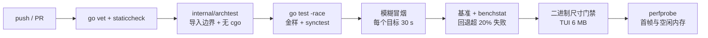

IME 验收矩阵（§6.6）需要真人用真输入法操作，不进 CI，在 M0、M7、v0.2 和每次升级 tcell/Gio 时手动执行并记录。

🧭 **Go 学习点**
- **`go test -fuzz`**：语料自动保存在 `testdata/fuzz/`，失败用例会成为永久回归测试。
- **`testing.AllocsPerRun` 与 `b.ReportAllocs()`**：把「零分配」写成断言，而不是口头约定。
- **`go tool pprof -http=:0 cpu.prof`**：火焰图是学习「Go 程序时间花在哪」最直观的方式。

---

## 14. 构建与发布

### 14.1 工具链与依赖锁定

- `go.mod` 写 `go 1.27` 并加 `toolchain go1.27.2`（决策记录推荐的当前稳定版；本机现装 1.26.3，落后于 1.26.9 补丁）。Homebrew 的 Go 默认 `GOTOOLCHAIN=auto`：本地版本低于 `toolchain` 行时，`go` 命令会自动下载对应工具链。是否升级见 [§16](#16-待确认)。
- 所有依赖精确锁版本（`go.mod` + `go.sum`），**每次发版只升级一个依赖**，升级后重跑金样测试和 IME 矩阵。
- 默认构建 `CGO_ENABLED=0`；只有 `-tags gio` 的目标需要 cgo，并导出 `DEVELOPER_DIR=/Library/Developer/CommandLineTools` 绕过尚未接受的 Xcode 许可。

| 依赖 | 版本 | 使用方 | 体积 / 备注 |
|---|---|---|---|
| `github.com/gdamore/tcell/v3` | v3.5.0 | `ui/tui` | tcell hello stripped 2.17 MB（实测） |
| `github.com/clipperhouse/displaywidth` | v0.11.0 | `core/text/width` | 与 tcell 要求的版本相同 |
| `github.com/clipperhouse/uax29/v2` | v2.7.0 | `core/text`、`core/edit` | 与 tcell 相同 |
| `github.com/go-text/typesetting` | v0.3.5 | `core/view/mdlayout`（segmenter） | Gio 也依赖它 |
| `github.com/yuin/goldmark` | v1.8.6 | `core/docs` | |
| `github.com/charlievieth/fastwalk` | v1.0.14 | `core/workspace` | |
| `github.com/go-git/go-git/v5`（仅 gitignore 子包） | v5.19.3 | `core/workspace/ignore` | 约 +0.45 MB |
| `github.com/sahilm/fuzzy` | v0.1.3 | `core/search/fuzzy` | 零依赖 |
| `github.com/fsnotify/fsnotify` | v1.10.1 | `core/workspace/watch` | kqueue，无 cgo |
| `github.com/BurntSushi/toml` | v1.6.0 | `core/config` | 约 +0.39 MB |
| `golang.org/x/text` | v0.42.0 | `core/text/encoding` | GB18030；本身也是 tcell 的依赖 |
| `gioui.org`、`gioui.org/x` | v0.10.3 | `ui/gio`（v0.2，cgo） | Gio hello stripped 6.35 MB（实测） |
| `znkr.io/diff` | v1.1.2 | `core/git`（v0.3） | |

以上 MVP 依赖全部加上，stripped 二进制**实测** 3.20 MB，离 6 MB 门禁还有很大余量。

### 14.2 Makefile

```make
PKG      := github.com/corn12138/yan-source
LDFLAGS  := -s -w
GIO_ENV  := DEVELOPER_DIR=/Library/Developer/CommandLineTools CGO_ENABLED=1
TUI_MAX  := 6291456     # 6 MB
GIO_MAX  := 14680064    # 14 MB

.PHONY: build build-gio test race fuzz bench size check

build:                  ## v0.1 TUI：纯 Go，无 cgo
	CGO_ENABLED=0 go build -trimpath -ldflags '$(LDFLAGS)' -o bin/yan ./cmd/yan

build-gio:              ## v0.2 GUI：唯一需要 cgo 的目标
	$(GIO_ENV) go build -tags gio -trimpath -ldflags '$(LDFLAGS)' -o bin/yan-gio ./cmd/yan

test:
	CGO_ENABLED=0 go test ./...

race:                   ## darwin 上 -race 不需要 cgo
	CGO_ENABLED=0 go test -race ./core/... ./ui/headless/... ./ui/tui/...

fuzz:
	go test -run='^$$' -fuzz=FuzzApplyInvert -fuzztime=10m ./core/text

bench:
	go test -run='^$$' -bench=. -benchmem -count=10 ./core/... | tee bench.txt

size: build
	@sz=$$(stat -f %z bin/yan); test $$sz -le $(TUI_MAX) || { echo "TUI 二进制 $$sz 字节，超过 6 MB"; exit 1; }

check:                  ## CI 入口
	go vet ./... && staticcheck ./... && $(MAKE) test race size
```

**版本信息**不用 `-ldflags -X`：`yan --version` 读 `runtime/debug.ReadBuildInfo()`，里面有模块版本与 `vcs.revision`、`vcs.modified`。

**一个本机特有的坑（可能遇到）**：`go build` 默认会调用 `git` 把 VCS 信息嵌入二进制。如果 PATH 里 `/usr/bin/git` 排在 Homebrew 的 `/opt/homebrew/bin/git` 前面，而 Xcode 许可尚未接受，`/usr/bin/git` 会失败，构建随之报「error obtaining VCS status」。解决办法：保证 `/opt/homebrew/bin` 在 PATH 前面，或临时加 `-buildvcs=false`。

### 14.3 发布物

| 产物 | 平台 | 构建方式 |
|---|---|---|
| `yan`（TUI） | darwin/arm64（主力）、darwin/amd64、linux/amd64、linux/arm64 | `CGO_ENABLED=0 GOOS=… GOARCH=… make build`，交叉编译零成本 |
| `Yan.app`（Gio，v0.2） | darwin/arm64 | 本机 `make build-gio` 后打包，`codesign --force --sign - Yan.app` 做 ad-hoc 签名（不做公证；从网上下载后首次打开，需要到「系统设置 → 隐私与安全性」点「仍要打开」，或执行 `xattr -d com.apple.quarantine Yan.app`。macOS 15 起右键「打开」已经绕不过 Gatekeeper；本机自己构建的不受影响） |
| 校验和 | — | `shasum -a 256` |

发布渠道：GitHub Releases，附中英文 README 与快捷键速查表（M8）。README 里写明：下载的 `yan` 二进制同样带隔离属性，第一次运行被拦时用同样的办法放行，或 `xattr -d com.apple.quarantine yan`。

🧭 **Go 学习点**
- **交叉编译**：纯 Go 程序只要设 `GOOS`/`GOARCH` 就能在 Mac 上产出 Linux 二进制，这是「核心与 TUI 不用 cgo」带来的直接红利。
- **`-trimpath`**：去掉二进制里的本机绝对路径，可复现构建、也不泄露用户名。
- **`runtime/debug.ReadBuildInfo`**：程序运行时读到自己的依赖列表与 VCS 信息，`go version -m bin/yan` 在命令行看同样的内容。

---

## 15. 错误处理与日志

### 15.1 日志：只写文件，绝不写终端

TUI 运行时 tcell 接管了终端（raw 模式 + 备用屏幕），任何写到 stdout/stderr 的字节都会弄花屏幕。所以：

- 日志用标准库 `log/slog`，写到 `~/Library/Logs/yan/yan.log`（可以用「控制台」App 查看）；启动时超过 5 MB 就轮转为 `yan.log.1`。级别由环境变量 `YAN_LOG=debug|info|warn` 控制，默认 `info`。
- `slog.SetDefault(...)` 之后，标准库 `log` 包的输出也会经过同一个 handler，第三方库的 `log.Printf` 不会漏到屏幕上。
- `debug.SetCrashOutput(f, debug.CrashOptions{})`（Go 1.23）让致命错误与未恢复的 panic 额外写一份到日志文件，终端恢复后也能事后查看。
- 结构化字段约定：`buf`（buffer id）、`path`、`job`、`version`、`dur`。

```go
func setupLog(dir string) (*os.File, error) {
	if err := os.MkdirAll(dir, 0o755); err != nil {
		return nil, err
	}
	f, err := os.OpenFile(filepath.Join(dir, "yan.log"), os.O_CREATE|os.O_APPEND|os.O_WRONLY, 0o644)
	if err != nil {
		return nil, err
	}
	slog.SetDefault(slog.New(slog.NewTextHandler(f, &slog.HandlerOptions{Level: levelFromEnv()})))
	_ = debug.SetCrashOutput(f, debug.CrashOptions{})
	return f, nil
}
```

### 15.2 错误分层

| 层 | 策略 |
|---|---|
| 可预期的错误（文件无权限、编码无法识别、保存失败、LSP 服务器找不到） | 作为普通 `error` 返回；`errors.Is(err, fs.ErrPermission)` 之类判断后降级（例如只读打开）；状态栏显示可过期的提示（过期时间进 `NextDeadline`） |
| 配置错误 | 不阻止启动；未知键与非法值合并成告警列表（`errors.Join`），状态栏提示，详细写日志 |
| 命令执行中的 panic | `runCommand` 用 `defer recover()` 兜住，记录 `debug.Stack()`，状态栏提示「命令 X 出错，已记录日志」。因为 `Buffer.Apply` 在最后一步才换上新快照，半途 panic 不会留下半改的文档 |
| 后台 job 中的 panic | `runRecovered` 把 panic 转成 `error`，经 `done` 回调报告，不拖垮进程 |
| 所有者循环外层的 panic | `main` 里的 `defer`：先 `scr.Fini()` 恢复终端，再尝试应急转储，最后重新 panic，让堆栈打印在已恢复的终端上 |

保存失败时 buffer 保持「已修改」状态，提示原因（权限、磁盘满、编码无法表示），**绝不丢失用户文本**。

### 15.3 崩溃恢复

- **v0.1（建议，M8 评估）**：所有者 goroutine 发生致命 panic 时，在恢复终端之后，把每个未保存 buffer 的当前 `Snapshot`（不可变，panic 时读取也安全）写到 `~/Library/Application Support/yan/recovery/`；下次启动在状态栏提示「发现 N 个恢复文件」。
- **后续功能**：会话恢复（每个项目打开的文件与滚动位置）与 hot-exit 日志：按去抖节奏把快照写盘，进程被 `kill -9` 也能找回。

🧭 **Go 学习点**
- **错误是值**：`fmt.Errorf("保存 %s: %w", path, err)` 包装，`errors.Is` / `errors.As` 判断；只在真正「不该发生」的地方用 panic。
- **`recover` 只在 `defer` 里有效**，而且只能捕获**同一个 goroutine** 的 panic，所以每个后台 goroutine 都需要自己的 `defer recover()`。
- **`log/slog`**：结构化日志的键值对比拼字符串更容易检索，`slog.Group` 还能分组字段。

---

## 16. 待确认

以下问题需要你拍板；表中给出当前默认假设，以及答案会如何影响架构。编号与 [DESIGN.md §12](./DESIGN.md#12-待确认问题)、DECISIONS.md §7 相同。

| # | 待确认 | 当前默认 | 对架构的影响 |
|---|---|---|---|
| 1 | 是否把 Go 从 1.26.3 升级到 1.27.2 | 升级；`go.mod` 写 `go 1.27` + `toolchain go1.27.2` | 不升级也能做：文中用到的 `sync.WaitGroup.Go`、`testing/synctest`、`trace.FlightRecorder` 都是 Go 1.25 就有；但 go-git v5.19.3 要求 Go ≥ 1.26，所以 `go.mod` 至少写 `go 1.26`，且建议先升到 1.26.9 补丁 |
| 2 | 接受 Xcode 许可（`sudo xcodebuild -license accept`），还是继续用 `DEVELOPER_DIR` 绕过 | 不要求接受；Gio 目标导出 `DEVELOPER_DIR` | 对 core 与 TUI 无影响。接受后 `/usr/bin/git` 恢复可用，§14.2 的 VCS 嵌入问题也随之消失 |
| 3 | 是否还需要打开 GBK/GB18030 文件 | 需要（M1a 范围内） | 不需要的话 `core/text/encoding` 不再导入 `x/text/encoding/simplifiedchinese`（约省 0.2 MB），也少了 §3.10 的往返检查；`golang.org/x/text` 模块仍作为 tcell 的依赖存在 |
| 4 | 最常读的语言 | Go、TS/JS、JSON、CSS、Markdown、YAML、TOML、shell | 决定 M4 的词法器顺序；Python、Rust、HTML、SQL 排在后续 |
| 5 | 模块路径与名字 | `github.com/corn12138/yan-source`，名「砚 / yan」 | 只影响导入路径与二进制名；应在 M0 `go mod init` 之前定下 |
| 6 | 是否愿意安装 Ghostty | 不要求；Terminal.app 是零配置基线，Ghostty 可选 | 影响 `mod` 的默认解析结果，以及 M0 Spike A 是否测 Cmd 透传与 `yan doctor` 的 Ghostty 配置片段 |
| 7 | GUI 阶段 emoji 显示为占位符是否可以接受 | 默认关闭（ADR-011），可在配置中打开 | 打开会让单个 emoji 字体占 193 MB 堆，直接突破 v0.2 的 80 MB 空闲预算 |
| 8 | Gio 文字在 13–14 px 下是否太细 | Spike B 中由你目测 | 决定 `ui/gio` 是否开工（ADR-002b） |

**M0 需要实测、不需要你决定的技术项**（记录在此，免得遗忘；完整的审计清单见 DESIGN.md §5.6）：

- Ghostty 下**没有被它绑定**的 Cmd 组合能否直接透传为 `ModMeta`，`Cmd+K` 在备用屏幕下是否透传；它默认占用的键已从 v1.3.1 源码查明（DESIGN.md §5.5 †）；
- Terminal.app：是否遵守 DEC 2026（DECRQM 回应 + 组字压力测试）、是否发送焦点事件（mode 1004）、是否导出 `COLORTERM`；`Shift+F3` 是否与 `F3` 不同；Home/End/PgUp/PgDn 加 Shift 时送到程序的是什么（`Option+←/→` = `ESC b` / `ESC f` 已从内置键盘映射确认）；
- 中文输入法处于中文模式时，`Ctrl+K` 的第二键（裸字母、按住 Ctrl 的字母、`[`、`/`）实际送达什么；
- 空闲机上「读文件 + 并行摘要」打开 100 MB 文件要多久，决定要不要做大文件的只读预览（§3.11）；
- v0.3 的补全快捷键：VS Code 默认的 Ctrl+Space 在 macOS 上常被系统用来切换输入法，对中文用户冲突概率高，届时再定替代绑定。

---

*相关文档*：[DESIGN.md](./DESIGN.md)（产品形态、交互与完整快捷键表）· [DECISIONS.md](./DECISIONS.md)（ADR、评审打分、风险与回退计划）
