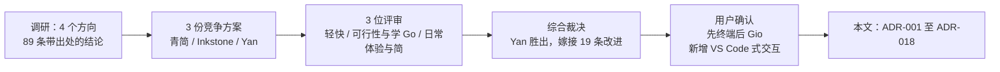
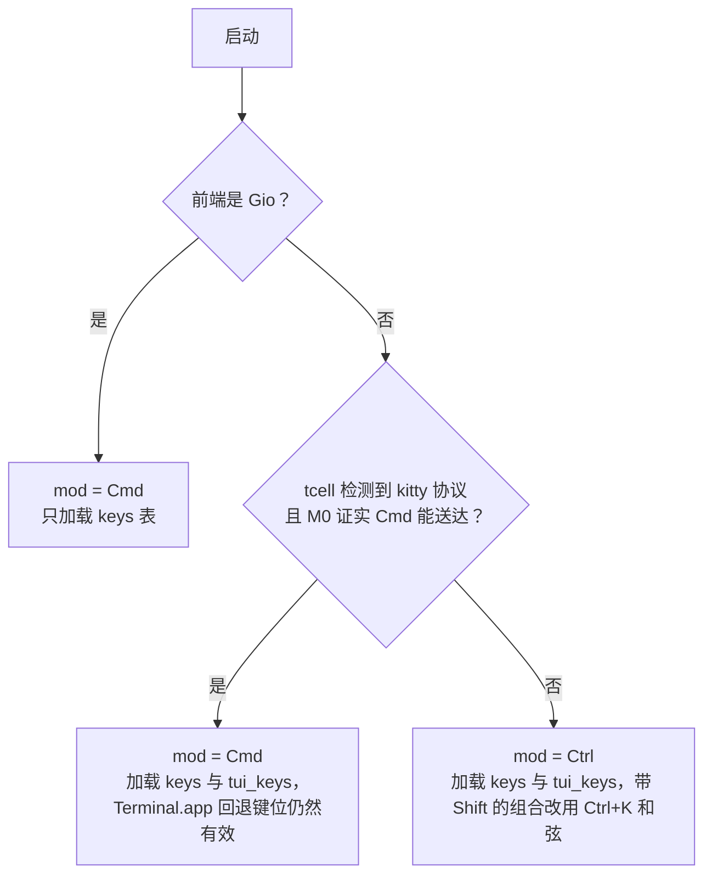
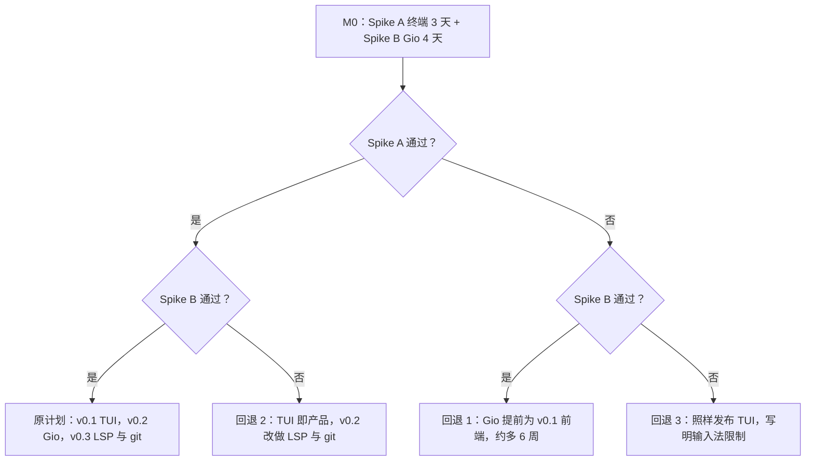

# Yan 砚 · 技术选型与架构决策记录（ADR）

> **状态**：定稿 v1（2026-10-09），用户已确认路线：先终端（v0.1），再 Gio GUI（v0.2），最后 LSP 与 git（v0.3）。
> **姊妹文档**：[DESIGN.md](./DESIGN.md)（产品与交互设计）· [ARCHITECTURE.md](./ARCHITECTURE.md)（架构与实现）· 本文 [DECISIONS.md](./DECISIONS.md)（为什么这样选）。
> 三份文档中的包名、里程碑、性能预算和键位保持一致；如有出入，包与层级以 ARCHITECTURE.md 为准，键位以 DESIGN.md 的完整键位表为准。

## 目录

- [0. 阅读说明](#0-阅读说明)
- [1. 选型过程概述](#1-选型过程概述)
- [2. 三个候选方案对比](#2-三个候选方案对比)
- [3. 关键事实与被纠正的说法](#3-关键事实与被纠正的说法)
- [4. ADR 列表](#4-adr-列表)
- [5. 备选与回退方案](#5-备选与回退方案)
- [6. 依赖清单](#6-依赖清单)
- [7. 待确认事项](#7-待确认事项)

---

## 0. 阅读说明

- **实测**：在这台 Mac（Apple M3 Max，16 核，48 GB，macOS 27.2，Go 1.26.3）上实际跑出来的数字。调研期间机器负载很高（load average 46–470），所以早期的**时间类**实测只能当作上限。2026-10-09 在负载 10–26 时重测了一部分，文中会注明。
- **估算**：设计目标或推算值，必须在对应里程碑用基准测试兑现。
- **包路径**：下文一律相对模块根书写，例如 `core/text`、`ui/tui`。模块路径建议用 `github.com/corn12138/yan-source`，可以改（见 [§7](#7-待确认事项)）。
- **v0.1 / v0.2 / v0.3**：分别是终端版、Gio GUI 版、LSP 与 git 版。里程碑 M0–M8 合计约 25 个兼职周，到 v0.1 为止。

> **Go 学习点**：一份 ADR（Architecture Decision Record）只回答一个问题：当时知道什么，决定了什么，代价是什么。Go 社区自己也是这么做的，Go 的 proposal 流程（go.dev/s/proposal）就是同样的思路。以后想推翻某个决定时，先读对应的 ADR，看看它的「背景」还成不成立。

---

## 1. 选型过程概述

为什么要绕这么大一圈？因为三个核心价值「轻、快、简」和「用 Go 当主语言」之间有真实的冲突：最好的中文排版和输入法在 WebView 里，最省资源的方案是终端，而最能学到 Go 的是自己写编辑器内核。如果不先量一量，就只能凭感觉选。



| 阶段 | 做了什么 | 关键产出 |
|---|---|---|
| 调研 | 4 个方向：纯 Go 原生 GUI 工具包、WebView 与终端外壳、编辑器引擎内部（缓冲区、坐标、高亮、搜索、配置）、参考编辑器的架构教训（Zed、xi、Helix、micro、lite、Sublime 等）。在本机构建了 Gio、Fyne、Wails、tcell 的 hello 程序并测了体积、内存、启动时间 | 89 条结论，每条带证据和置信度 |
| 方案 | 三个独立「架构师」各写一份完整方案：**青简 Qingjian**（纯 Go，Gio GUI）、**Inkstone**（Go 引擎 + Wails v3 WKWebView + CodeMirror 6）、**Yan 砚**（无头 Go 内核 + 先终端后 Gio） | 3 份方案，各含栈、数据结构、并发模型、预算、里程碑 |
| 评审 | 三位评审各持一个视角打分，并亲自复测了一部分数字：①轻 + 快（性能怀疑论者）②可行性 + Go 学习价值 ③日常体验 + 简 | 分数、致命缺陷、可嫁接的点子 |
| 综合 | 首席架构师采纳 Yan 的架构，改了 5 处，嫁接了 19 条来自另两份方案和评审的点子，纠正了 16 条说法 | ADR-001 至 ADR-011、风险表、回退方案 |
| 用户确认 | 确认「先终端，再 Gio」；**新增需求**：交互要像 VS Code，但极简且快；给出实际使用的输入法 | ADR-012，以及扩充后的输入法验收矩阵 |

作为参照：这台 Mac 上正在运行的 VS Code 有 22 个进程，RSS 合计约 5.2 GB（共享页被重复计算，偏高）；VS Code.app 磁盘占用 1.4 GB，Cursor.app 887 MB（实测）。这就是「太重」的具体含义。

---

## 2. 三个候选方案对比

### 2.1 总览

| 维度 | 青简 Qingjian | Inkstone | **Yan 砚（胜出）** |
|---|---|---|---|
| 技术栈 | Gio v0.10.3（Metal，需 cgo）+ 自写 rope、代码视图、词法器 + goldmark | Wails v3.0.0-beta.28 + 系统 WKWebView + CodeMirror 6（TypeScript），Go 做文件、搜索、Markdown、LSP | 无头纯 Go 内核 + tcell v3.5.0 终端前端（CGO_ENABLED=0）；v0.2 再加 Gio 前端 |
| 自写代码中 Go 占比 | 约 98%（估算） | 自称 72%；按其自身行数估算为 79%；同类 Wails 编辑器实测只有 5–23% | 约 97%（估算） |
| 二进制（stripped） | Gio hello 6.35 MB（实测）；整体 10–12 MB（估算） | spike 10.8 MB（实测） | tcell hello 2.17 MB；加上 MVP 主要依赖 3.20 MB（实测） |
| 空闲内存 | Gio + 单字体 37 MB footprint，PingFang 一个 face 再加约 15 MB（实测）；目标 60–80 MB（估算）；启动瞬时峰值 430–520 MB，原因未明（实测） | 4 个进程合计 100–120 MB；打开 5 MB 文件后 205–210 MB（实测） | tcell hello 9.7 MB RSS / 7.7 MB footprint（实测）；目标 ≤25 MB RSS，仅应用（估算）；Terminal.app 自身另计 49 MB（实测） |
| 冷启动 | Gio hello 1.07 s 墙钟 / 0.39 s CPU（负载下实测，上限）；自称 ≤300 ms 未验证 | spike 3.7–5.9 s（负载下实测，上限）；首个 WKWebView 1.46–1.97 s（实测） | 首帧 14–36 ms（pty 中模拟 Terminal.app）/ 14–20 ms（模拟 ghostty），负载 10–26 时重测（实测） |
| 中文输入法 | Gio 实现了 NSTextInputClient，但只读过源码、没用真拼音测过；需要自写约 150 行胶水 | 最好：WKWebView 原生内联预编辑 + CodeMirror 的组字处理 | 终端负责组字，应用只负责把真实光标放对位置；预编辑会盖住后面的字；搜狗、微信输入法在 Terminal.app 下未测 |
| Markdown 阅读质量 | 自写 Gio 排版，最后才做（约第 24 周）；文字是未 hinting 的灰度轮廓，偏细 | 最好：真正的 HTML/CSS 排版，PingFang、表格、图片 | v0.1 终端内等宽阅读视图 +「在浏览器中打开」；v0.2 Gio 真排版 |
| 击键到画面 | 原型帧 1.0–1.8 ms，负载下 83–95 fps（实测） | 击键→帧 p50 17–21 ms、p99 67–110 ms（负载下实测）；WKWebView 约 60 fps 上限 | 应用侧目标 p50 ≤1 ms、p99 ≤4 ms（估算）；终端渲染部分不受控 |
| 首个可日用版本 | 单文件查看器约第 8 周，带输入法的轻编辑约第 20 周 | 单文件编辑器约第 3 周，完整 MVP 约第 15 周 | 查看器约第 9 周，项目阅读约第 12 周，v0.1 约第 25 周 |
| 主要风险 | 三个手写、未验证的子系统串联（GPU 代码视图、输入法胶水、富文本排版）；输入法失败时只能改 Gio 的 Objective-C；emoji 193 MB | 内存底线是结构性的；60 fps 上限；Wails v3 仍是 beta；两套工具链；编辑器核心算法交给了 TS，学不到 Go | 终端里读中文 Markdown 体验差，用户可能不愿天天用；Terminal.app 没有 Cmd 快捷键 |

### 2.2 评分

三位评审的权重和各自分数（满分 100，各项满分 10）：

| 视角与权重 | 青简 | Inkstone | Yan |
|---|---|---|---|
| **① 轻 + 快**（性能说法可信度 30、启动与内存 30、延迟与滚动 25、大文件 15） | 72.5（7 / 6 / 8 / 9） | 44.5（5 / 4 / 4 / 5） | **78**（8 / 9 / 6 / 8） |
| **② 可行性 + 学 Go**（首个可日用 25、卡死风险 25、Go 学习深度 25、依赖风险 15、范围纪律 10） | 56（4 / 4 / 9 / 5 / 6） | 68.5（9 / 7 / 5 / 6 / 7） | **73**（6 / 7 / 9 / 8 / 6） |
| **③ 日常体验 + 简**（阅读舒适 30、中文输入法 25、macOS 手感 20、简洁 25） | 68（6 / 7 / 6 / 8） | **79**（9 / 8.5 / 8 / 6） | 48（4.5 / 5 / 3 / 6.5） |
| **平均** | 65.50 | 64.00 | **66.33** |

### 2.3 为什么 Yan 胜出

平均分只领先 0.8 分，所以真正起决定作用的是视角 ②（可行性）：Yan 73、Inkstone 68.5、青简 56，Yan 同样第一。具体说，Yan 是唯一同时满足下面四点的方案：

1. 难而有教育意义的部分是纯 Go：rope、ChangeSet、单 owner 并发、增量词法器、grep 流水线、LSP 客户端。
2. 这部分今天就能在这台 Mac 上以 `CGO_ENABLED=0` 构建，即使 Xcode license 还没接受。
3. 这部分被所有前端复用（终端、Gio，甚至最后手段的 WebView）。
4. 用户能很早拿到可用的工具（约第 9 周）。

但最终方案**不是**原样的 Yan。视角 ③ 给 Yan 48 分是对的：用等宽终端读中文 Markdown、Terminal.app 里没有 Cmd 快捷键，满足不了这位用户最主要的用法。所以保留 Yan 的架构，改了五处：

| # | 改动 | 原因 |
|---|---|---|
| 1 | Gio GUI 提前到 v0.2（在 LSP 之前），预算 11 周而不是 6 周，由 M0 的 4 天 Spike B 把关 | 中文 Markdown 阅读需要真排版 |
| 2 | 输入法改为「临时事务」模型 | 核实 Gio v0.10.3 源码：`gio_setMarkedText` 调用 `EditorReplace`，标记文本会进入文档，原方案的覆盖层行不通 |
| 3 | v0.1 增加「在浏览器中打开」（goldmark 导出 HTML，zh-Hans + PingFang SC） | 零体积成本补上排版缺口 |
| 4 | 里程碑改为阅读优先：查看器 → 项目导航 → 配色 → 搜索 → Markdown → 编辑 | 与主要用法一致，每个里程碑都产出能天天用的东西 |
| 5 | M1 分两步建 rope：先平铺叶数组（高度为 1 的 B+tree），再完整 B+tree；大文件档在 B+tree 完成前只读 | 降低 Go 初学者卡死的风险 |

### 2.4 从落选方案嫁接了什么

| 来源 | 嫁接内容 | 落点 |
|---|---|---|
| 青简 | 临时输入法事务：标记文本进入缓冲区，但不产生撤销记录、不发 LSP、不自动保存，上屏时合并为一个 `OriginIME` 撤销步 | `core/edit`，ADR-004 |
| 青简 | rope 摘要带 `Runes` 计数，Gio 的 rune 区间可在 O(log n) 内换算成字节偏移 | `core/text` |
| 青简 | 基线与滚动偏移对齐整像素，e.Frame 从约 6 ms 降到 1.0–1.8 ms（实测） | `ui/gio` |
| 青简 | 逐个 face 加载字体并配合 `text.NoSystemFonts`：SF Mono 或 Menlo，PingFang SC 通过 AssetsV2 路径通配找到（约 15 MB），Hiragino Sans GB 兜底；从不解析整个 TTC | `ui/gio/fonts` |
| 青简 | 按内容哈希的已塑形行 LRU，长行按 2 KB 分段塑形，空闲时预塑形下一屏 | `ui/gio` |
| 青简 | 连续同类文字（汉字串）算一个词，用于按词移动 | `core/edit` |
| 青简 | GUI 中 10 s 无输入后停止光标闪烁，空闲时零唤醒 | `ui/gio` |
| 青简 | 书面的输入法验收矩阵，在 M0 和每次升级时跑 | [§5](#5-备选与回退方案) |
| 青简 | 打开文件夹且未指定文件时，自动以阅读视图打开 README.md | `core/app` |
| 青简 | 性能 HUD：击键→帧 p50/p99 加 `runtime/metrics` 的 GC 指标 | `core/app` |
| Inkstone | 硬规则：击键和绘制之间不放任何慢操作，前端从不等待后台任务 | ADR-001 |
| Inkstone | Go 发起的编辑（全部替换、从磁盘重载、格式化）也是普通的可撤销事务 | `core/edit` |
| Inkstone | 一份变更列表同时喂给撤销、选区映射、搜索标记平移、Markdown 重解析和 LSP didChange；临时编辑永不发给 LSP | `core/text`，`core/edit` |
| Inkstone | `tools/perfprobe`：CI 中启动应用、等 READY、汇总所有子进程的 phys_footprint，超预算就失败 | M0 CI |
| Inkstone | 安全的 Markdown HTML：不开 goldmark `WithUnsafe`，CSP 禁脚本和远程图片，`lang=zh-Hans`，`line-break: strict` | `core/docs`，ADR-007 |
| Inkstone（延后） | 超大文件分页只读查看器、热退出日志、常驻单实例 GUI | 后续功能 |
| 评审 | Gio 默认关闭 emoji；Gio 前端预算改为 11 周；Gio spike 提前并行跑 | ADR-011、ADR-002 |
| 首席架构师 | M1 两步建 rope；阅读优先的里程碑顺序；分屏移出 MVP | ADR-003、ADR-008 |

---

## 3. 关键事实与被纠正的说法

### 3.1 被纠正的说法

三份方案都有「乐观」的地方。下表是综合阶段逐条核实后的结论，文档中的预算一律以「现行口径」为准。

| # | 原说法（出处） | 核实结果 | 现行口径 |
|---|---|---|---|
| 1 | Yan：冷启动 ≤50 ms | 原依据是负载 100–200 时 0.08–0.31 s 的 pty 测量。负载 10–26 时用同一套 pty 工具重测 tcell v3.5.0 hello：首帧 14–36 ms（`TERM_PROGRAM=Apple_Terminal`）、14–20 ms（ghostty），含 kitty 键盘查询（实测） | ≤50 ms 应用侧目标成立，终端自身启动时间不计入 |
| 2 | Yan：空闲 ≤25 MB | 漏算了终端。Terminal.app 本身 49 MB phys_footprint，峰值 324 MB（实测）。Ghostty 未安装，未测 | 预算标注「仅应用」，终端单独报告 |
| 3 | Yan：Gio 前端 6 个兼职周 | 同等工作（代码视图、输入法胶水、字体、富文本排版）青简估 10 周以上 | 11 个兼职周 |
| 4 | Yan：预编辑是一个永不进入 rope 的覆盖层 | 与 Gio v0.10.3 不符：`app/os_macos.go` 中 `gio_setMarkedText` 先调 `w.w.EditorReplace(rng, str)` 再调 `SetComposingRegion`；`widget/editor.go` 把 `key.EditEvent` 当替换应用，`key.CompositionEvent` 只记录区间（源码核实） | 内核改用 `ReplaceInput` + `CompositionInput` + 临时事务（ADR-004） |
| 5 | Yan：tcell 在包初始化时读取 `RUNEWIDTH_EASTASIAN` | 属实：tcell v3.5.0 的 `eastasian.go` 和 `vt/width.go` 都在包级写 `var textWidthOptions = widthutil.Options()` | 必须用环境变量 + 重新 exec，启动后 `os.Setenv` 太晚（ADR-005） |
| 6 | Yan：Cmd 键可经 Ghostty 的 `csi:`/`performable:` 片段送达应用 | ghostty.org 只记录了 `csi:`（发送不带 CSI 头的序列）和 `performable:`（仅当动作可执行时才消费按键），没说未绑定的 super 键会被转发。Ghostty 最新 tag 是 v1.3.1（2026-03-13）。它默认占用和改写哪些 Cmd 组合，可以直接从 v1.3.1 的 `src/config/Config.zig` 读出来（清单见 DESIGN.md §5.5 的 †） | 默认占用清单已查明；未绑定的 Cmd 键是否透传列为 M0 测试项 |
| 7 | Yan：每个撤销组 ≤8 KB | 只对 B+tree 成立。M1a 平铺叶数组每个保留版本约 40 B/叶：100 KB 文件每次编辑 3 KB，8 MB 文件 162 KB，100 MB 文件 2 MB（实测） | 历史按字节封顶（64 MB/缓冲区），大档在 v0.1 只读 |
| 8 | 青简：100 MB 全量索引 ≤100 ms CPU（同时维护 Runes 与 UTF16 摘要） | ASCII 为主的代码 36–41 ms CPU（有 ASCII 快速路径），全中文文本单线程 190 ms CPU；16 路并行在负载下墙钟 37–97 ms（实测） | ≤200 ms 墙钟，并行构建 |
| 9 | 青简：emoji 单 strike 缓存后 ≤30 MB | 未验证。单个 Apple Color Emoji face 即使从 mmap 文件读取也占 193 MB 堆（评审复测） | Gio 默认关闭 emoji（ADR-011） |
| 10 | 青简：稳定 120 fps；冷启动 ≤300 ms | 都没演示过。原型在负载下 83–95 fps；Gio hello 1.07 s 墙钟 / 0.39 s CPU | M0 Spike B 在空闲机重测；v0.2 冷启动预算暂定 ≤400 ms |
| 11 | 青简：组字期间 keymap 收不到按键 | 只对命令键成立（Enter、Esc、方向键经 `doCommandBySelector` 被吞）。字母和 Ctrl+字母的 `key.Event` 仍会到达 | 组字期间 keymap 忽略所有非 Cmd 组合 |
| 12 | Inkstone：击键 p50 ≤2 ms（dispatch p50 4 ms） | 自己的 spike 日志显示击键→帧 p50 17–21 ms、p99 67–110 ms，方案里没提。WKWebView 渲染被限制在约 60 fps（WebKit bug 294338，仍开放） | 120 Hz 帧预算达不到 |
| 13 | Inkstone：Go 约占 72% | 按其自身行数估算（12.6k Go 对 3.3k TS）是 79%；同类 Wails 编辑器实测 5–23% | 行数门槛说明不了工程重心在哪 |
| 14 | Inkstone：冷启动 ≤1.0 s，热启动 ≤0.6 s | 未验证。spike 负载下 3.7–5.9 s（MAIN→READY 2.3–4.4 s）；JXA 工具测首个 WKWebView 1.46–1.97 s | — |
| 15 | 调研摘要：最新 Go 为 1.27.2 | 属实：go.dev/dl/?mode=json 显示 go1.27.2 与 go1.26.9 是当前稳定版；本机 1.26.3 落后好几个补丁 | 建议升级（[§7](#7-待确认事项)） |
| 16 | 所有库版本 | 2026-10-09 对 proxy.golang.org @latest 逐一复核。go-git 的 gitignore 子包暴露 `ParsePattern` 和 `NewMatcher`，Yan 自己读 `.gitignore`，只调用这两个函数，不用 billy 的文件系统 API；但这个子包的 `dir.go` 导入了 `go-billy/v5`，所以 billy 仍会作为依赖编译进来（已计入实测的 +0.45 MB），而且 go-git 的 `go.mod` 要求 Go ≥ 1.26（v5.19.3 源码核实）；goldmark v1.8.6 含 `extension/cjk.go` 与 `EastAsianLineBreaks` | 见 [§6](#6-依赖清单) |

### 3.2 必须记住的已核实事实

**① Gio / go-text 的中文字体回退会出错。** 用 Typeface "Menlo" 时，连续的汉字会混用 Arial Unicode MS 和日文字体 Hiragino Sans，例如「们这说为简」走 Arial Unicode，「个门骨直体」走 Hiragino Sans，结果出现日文字形；`SetScript(language.Han)` 也救不回来。原因是 go-text 只扫描 `/Library/Fonts`、`/System/Library/Fonts`、`~/Library/Fonts` 和旧的 MobileAsset 路径，而 PingFang 如今在 `/System/Library/AssetsV2/com_apple_MobileAsset_Font8/<hash>.asset/` 下，根本没被索引；SF Mono 只能用隐藏族名 `.SF NS Mono` 找到。显式写 `"Menlo, Hiragino Sans GB, Apple Color Emoji"` 就能让所有汉字走同一个简体字体。Yan v0.2 的做法更进一步：`text.NoSystemFonts()`，逐个 face 加载 SF Mono（文件约 0.2 MB）、PingFang SC Regular（通过路径通配找到 PingFang.ttc 再用 `font.Describe` 挑 face，约 15 MB，18–34 ms），Hiragino Sans GB 兜底。**不要**解析整个 PingFang.ttc（369 MB）。另外，默认的 `text.NewShaper()` 会扫描系统字体：冷索引 4.5 s，空闲 footprint 127–139 MB（实测）。

**② Emoji 很贵。** go-text 会复制每个 sbix strike：一个 Apple Color Emoji face 占 193 MB 堆（phys_footprint 204 MB，加载 162 ms），mmap 也没用（评审复测）。终端里 emoji 由终端绘制，没有这个问题。

**③ WKWebView 被限制在约 60 fps。** WebKit bug 294338（https://bugs.webkit.org/show_bug.cgi?id=294338，截至 2026-09-17 仍开放）：在 ProMotion 屏幕上页面渲染约 60 fps，且没有公开 API 解除。所以任何 WebView 方案都达不到 120 Hz 的 8.33 ms 帧预算。

**④ 这台 Mac 上 cgo 目前构建不了。** 所有 cgo 构建都报错 `You have not agreed to the Xcode license agreements`，因为 `xcode-select` 指向 `/Applications/Xcode.app`。设置 `DEVELOPER_DIR=/Library/Developer/CommandLineTools` 即可构建，不需要 sudo。`/usr/bin/git` 也因同一原因失败，Homebrew git 2.45.2（`/opt/homebrew/bin/git`）正常。接受 license 只能由用户本人执行 `sudo xcodebuild -license accept`。

**⑤ Terminal.app 的键盘限制**（决定了 ADR-009 和 ADR-012 的回退键位）：

| 按键 | Terminal.app 实际送给应用的是什么 | 对键位设计的影响 |
|---|---|---|
| Cmd + 任意键 | 由 Terminal.app 自己处理，**永远**到不了应用 | 默认键位不能依赖 Cmd |
| Ctrl+Shift+字母 | legacy 编码下与 Ctrl+字母是同一个字节（如 Ctrl+P 和 Ctrl+Shift+P 都是 0x10） | VS Code 中带 Shift 的组合改用 Ctrl+K 和弦 |
| Ctrl+I / Ctrl+H / Ctrl+M / Ctrl+[ | 与 Tab / Backspace / Enter / Esc 字节相同（tcell v3.5.0 `input.go` 核实） | 这四个不能当命令键 |
| Ctrl+Tab、Ctrl+Enter | 与 Tab、Enter 无法区分 | 标签切换等改用 Ctrl+K 和弦 |
| Option+字母 | 默认输入特殊字符（如 Option+F 得到 ƒ）。「将 Option 键用作 Meta 键」是 Terminal.app 描述文件 → 键盘里的设置，默认关闭 | 回退键位不依赖 Option+字母 |
| Option+← / Option+→ | 内置键盘映射（`keyMappings.plist` 的 `~F702` / `~F703`）发 `ESC b` / `ESC f`，不需要 Meta 设置（本机核实） | 可以用来按词移动 |
| Home/End/PgUp/PgDn、Shift+↑/↓、Shift+F1–F4 | 内置键盘映射里没有这些条目（本机 macOS 27.2 核实）；前四个由 Terminal.app 自己拿去滚动回滚缓冲区 | 行首行尾用 Ctrl+A / Ctrl+E，文件首尾用 Ctrl+K < / >，查找上一个用 Ctrl+K Shift+G |
| 键盘协议 | 只有 legacy，不支持 kitty 键盘协议；tcell 对 `TERM_PROGRAM=Apple_Terminal` 有特判：跳过启动查询，直接启用 SGR 鼠标（`tscreen.go` 核实） | 鼠标可用；修饰键信息有限 |
| Cmd+V 粘贴 | Terminal.app 自己粘贴，以 bracketed paste 发给应用 | Cmd+V 在任何终端里都「能用」 |
| 颜色 | macOS 26 起支持 24 位色；但 tcell 只看 `COLORTERM`（或 `TERM` 后缀）决定是否用真彩，Terminal.app 是否导出 `COLORTERM` 未核实 | 没有导出时 Yan 在创建屏幕前补上 `COLORTERM=truecolor`（M0 核实）；必要时降到 256 色 |

**⑥ 其他影响设计的事实**（实测或源码核实）：

- Gio 自带 `widget.Editor` 是 gap buffer，每次改动都重新塑形整篇文档：4,073 行时单字符插入 165 ms CPU，40.7k 行时 4.45 s。所以代码视图必须自己写。
- 一行一个堆对象（micro 的做法）在 Go 里很贵：100 MB 文件用 257 MB 堆，每次 GC 约 104 ms CPU；连续 `[]byte` 加 `[]uint32` 行首表只要 116 MB，GC 约 1 ms。
- Fyne v2.8.1 的输入法问题 #618 仍开放，用 OpenGL；Cogent Core v0.3.45 走 GLFW，没有预编辑处理。
- gopls v0.22.0 不协商位置编码，所以用 UTF-16（实测 initialize）。
- `bytes.Count` 在 100 MB 上 27 ms CPU（NEON），`bytes.Index` 6.8 ms；带字面前缀的正则约 520 MB/s，单独的 `(?i)` 只有约 21 MB/s。

---

## 4. ADR 列表

| ADR | 标题 | 状态 |
|---|---|---|
| [ADR-001](#adr-001-无头-go-内核与单一所有者-goroutine) | 无头 Go 内核，同步进程内 API，单一 owner goroutine | 已接受 |
| [ADR-002](#adr-002-前端顺序先终端再-gio-最后-lsp-与-git) | 前端顺序：TUI（v0.1）→ Gio（v0.2）→ LSP 与 git（v0.3） | 已接受，用户已确认 |
| [ADR-002b](#adr-002b-gio-可行性验证结果) | Gio 可行性验证结果 | 待 M0 Spike B 填写 |
| [ADR-003](#adr-003-不可变分块-rope-分两步建成) | 不可变分块 rope，UTF-8 字节坐标，分两步建成 | 已接受 |
| [ADR-004](#adr-004-输入法模型终端收上屏文本而-gio-用临时事务) | 输入法模型：终端收上屏文本，Gio 用临时事务 | 已接受 |
| [ADR-005](#adr-005-与-tcell-共用唯一的宽度来源) | 与 tcell 共用唯一的宽度来源 | 已接受 |
| [ADR-006](#adr-006-手写行状态词法器做语法高亮) | 手写行状态词法器做语法高亮 | 被 ADR-016 取代 |
| [ADR-007](#adr-007-markdown-解析为前端无关的-richdoc-并保留浏览器出口) | Markdown 解析为前端无关的 RichDoc，保留浏览器出口 | 已接受 |
| [ADR-008](#adr-008-大文件分档且大档在首版只读) | 大文件分档，大档在 v0.1 只读 | 已接受 |
| [ADR-009](#adr-009-以-ctrl-为基础的默认键位与-mod-别名) | 以 Ctrl 为基础的默认键位与 `mod` 别名 | 已接受，由 ADR-012 扩展 |
| [ADR-010](#adr-010-内核与-tui-不使用-cgo) | 内核与 TUI 不使用 cgo | 已接受，ADR-014 扩展到 GUI |
| [ADR-011](#adr-011-gio-前端默认关闭-emoji) | Gio 前端默认关闭 emoji | 已接受，占位策略待确认 |
| [ADR-012](#adr-012-交互模型vs-code-式布局与键位预设) | 交互模型：VS Code 式布局与键位预设 | 已接受（用户新增需求） |
| [ADR-013](#adr-013-终端v01-切到-shellv02-内嵌面板) | 终端：v0.1 切到 shell，v0.2 内嵌面板 | 已接受；GUI 面板由 ADR-014 提供 |
| [ADR-014](#adr-014-gui-前端改用-mygo取代-gio) | GUI 前端改用 MyGo，取代 Gio | 已接受（2026-10-12，用户选择路线 2） |
| [ADR-015](#adr-015-并入-mayoi-的交互与特色功能) | 并入 Mayoi 的交互与特色功能 | 已接受（2026-10-12） |
| [ADR-016](#adr-016-语法高亮改用-chroma终端版体积门禁放宽到-10-mb) | 语法高亮改用 Chroma，终端版体积门禁放宽到 10 MB | 已接受，取代 ADR-006；待用户确认体积 |
| [ADR-017](#adr-017-自动保存与状态文件) | 自动保存与状态文件 | 已接受，默认值待用户确认；ADR-018 补上冲突保护 |
| [ADR-018](#adr-018-macos-预览版的发布方式) | macOS 预览版的发布方式 | 已接受（v0.1.0-alpha.1） |

### ADR-001 无头 Go 内核与单一所有者 goroutine

- **状态**：已接受（2026-10-09）。
- **背景**：xi-editor 的复盘（https://raphlinus.github.io/xi/2020/06/27/xi-retrospective.html）说明，把前端和内核拆成两个进程、用异步 RPC 通信，导致滚动和窗口缩放的 bug 拖了好几个月。用户要以 Go 为主语言，以后还要 GUI，所以内核不能依赖任何前端。
- **决策**：`core/...` 是纯 Go 库，永不导入 tcell 或 gioui（有测试强制）。前端在拥有编辑器的 goroutine 上调用 `Handle(Input)`、`RunPending()`、`Frame(size, *Frame)`。后台 goroutine 只读不可变的 `Snapshot`，结果通过 `Post(func(*Editor))` 送回，这是唯一并发安全的方法。没有序列化，没有第二个进程。
- **后果**：内核是确定性的，不需要 UI 就能测（golden Frame 测试、fuzz），在 `-race` 下安全。加一个前端只需写新的 painter 和 layouter，不用重写编辑器。代价：前端事件循环绝不能阻塞，这一条要靠代码审查守住。
- **备选方案**：xi 式内核进程 + RPC（否决：异步视图同步问题）；Inkstone 让 CodeMirror 持有文本、Go 保留镜像（否决：两份缓冲区要同步，Go 沦为配角）；以 Bubble Tea 的 Elm 架构做内核（否决：状态会重复一份）。

> **Go 学习点**：Go 的格言是「不要通过共享内存来通信，而要通过通信来共享内存」。`Post` 把闭包追加到受 mutex 保护的切片，再对容量为 1 的 `Wake` channel 做非阻塞发送：`select { case wake <- struct{}{}: default: }`。多次唤醒自动合并成一次，owner 也可以安全地给自己 Post。

### ADR-002 前端顺序先终端再 Gio 最后 LSP 与 git

- **状态**：已接受；用户于 2026-10-09 确认「先终端，再 Gio」。Gio 部分的最终放行见 ADR-002b。
- **背景**：评审平均分 Yan 66.3、青简 65.5、Inkstone 64.0。视角 ③ 表明，在等宽终端、没有 Cmd 键的 Terminal.app 里读中文 Markdown，满足不了这位用户；视角 ② 表明，GUI 优先会让三个未经验证的手写子系统挡在任何日常使用之前。
- **决策**：v0.1 是基于 tcell v3.5.0、无 cgo 的 TUI，在 Terminal.app 中零配置可用，排版缺口用「在浏览器中打开」补上。v0.2 做 Gio 前端，排在 LSP 之前，预算 11 周（不是原方案的 6 周），前提是 M0 的 4 天 Spike B 通过。v0.3 做 LSP 与 git（约 5.5 周）。
- **后果**：内核从约第 9 周起就有人天天用。v0.1 在应用内读 Markdown 是等宽的，完整排版去浏览器看。最终要维护两个前端，但它们共享全部内核逻辑。如果 v0.1 之后用户觉得 LSP 比 GUI 更重要，v0.2 和 v0.3 可以对调。
- **备选方案**：Gio 优先（青简；因卡死风险否决）；Wails v3 + CodeMirror 6（Inkstone；因 4 进程 100–120 MB 底线、约 60 fps 上限、自身 spike 击键→帧 p99 67–110 ms、Go 占比低而否决）；永远只做 TUI（否决：不符合用户的首要用法）。

### ADR-002b Gio 可行性验证结果

- **状态**：待填写。M0 Spike B 结束时，把通过/不通过及所有数字记在这里。
- **要记录的内容**：输入法矩阵逐项结果（含 Sidecar）、用户对 13–14 px 文字质量的判断、空闲 footprint（SF Mono + PingFang SC，emoji 关闭）、空闲机冷启动、滚动帧 p50/p99、430–520 MB 启动峰值的 Instruments 结论。通过标准见 [§5.2](#52-m0-的两个早期-spike)。
- **影响范围**：只决定 v0.2，永远不影响 v0.1。

### ADR-003 不可变分块 rope 分两步建成

- **状态**：已接受。
- **背景**：一行一个对象的行数组在 100 MB 文件上要 257 MB 堆、每次 GC 约 104 ms。Go 里没有成熟的持久化 rope。对 Go 初学者来说，持久化 B+tree 是整个项目里最难的数据结构。
- **决策**：叶子是 2 KB、不含指针的 `[]byte` 块，零拷贝地切自文件读缓冲区，每片叶子带 `{Bytes, Newlines, Runes, UTF16}` 摘要。存储藏在一个未导出的接口后面。M1a 用平铺叶数组加前缀和（高度为 1 的 B+tree）；M1b 再加内部节点。内部坐标一律是 UTF-8 字节偏移，rune 和 UTF-16 偏移只在 Gio 输入法和 LSP 边界换算。
- **后果**：API 从第一天就稳定，换成 B+tree 时由 fuzz 测试兜底。M1a 实测代价：100 KB 文件每次编辑 3 KB，8 MB 文件 162 KB，所以历史按字节封顶，大档在 M1b 之前只读。100 MB 的摘要计算 ASCII 为主 36–41 ms CPU、全中文单线程 190 ms CPU，因此并行计算。
- **备选方案**：gap buffer（Gio `widget.Editor`；没有廉价快照，实测每击键 O(文档) 的重排）；piece table（复杂度相近，快照更难）；行数组（micro；GC 代价高）。

> **Go 学习点**：`chunks(from, to int) iter.Seq[[]byte]` 是 Go 1.23 引入的迭代器，调用方可以直接 `for chunk := range snap.Chunks(a, b)`。fuzz 测试 `func FuzzApply(f *testing.F)` 把随机编辑同时施加到 rope 和一个朴素的 `[]byte` 模型上，结果必须一致；M1 的退出条件是 `go test -fuzz` 连续跑 10 分钟无失败。

### ADR-004 输入法模型终端收上屏文本而 Gio 用临时事务

- **状态**：已接受。
- **背景**：在终端里，应用只会收到已上屏的文本。在 Gio v0.10.3 里，`gio_setMarkedText` 调用 `EditorReplace`，标记文本会进入文档，`CompositionEvent` 只标记区间（源码核实）。原方案「预编辑覆盖层永不进入 rope」在 Gio 上行不通。
- **决策**：内核接受 `TextInput`、`ReplaceInput{Start, End, Text}`、`CompositionInput{Start, End}`，以及 Gio 输入法移动光标、请求上下文时的 `SelectionInput`、`SnippetInput`。Gio 给的区间是 rune 偏移，前端原样交给内核，由内核按当前焦点输入框（编辑区或单行输入框）换算成字节。组字期间的编辑是「临时」的：不进撤销、不发 LSP didChange、不自动保存，只重新词法分析正在组字的那一行。组字结束时，`CommitComposition` 把它们合并成恰好一个 `OriginIME` 修订。TUI 中，真实终端光标始终放在获得焦点的插入点上。
- **后果**：组字期间 Gio 的排版、换行和点击测试都自然正确，撤销和 LSP 保持干净。有了 `Runes` 摘要，超大文件里 rune→字节换算也是 O(log n)。keymap 在组字时必须忽略非 Cmd 组合，因为 Gio 仍会投递字母按键。验收矩阵覆盖用户实际使用的全部输入法：系统自带拼音与双拼、微信输入法（WeType）、搜狗输入法，以及 Rime/鼠须管（见 [§5.2](#52-m0-的两个早期-spike)）。
- **备选方案**：永不进入缓冲区的覆盖层（否决：与 Gio 的模型矛盾）；把标记文本当普通编辑（否决：每敲一个拼音字母都会产生撤销记录、LSP 消息和重新高亮）。

### ADR-005 与 tcell 共用唯一的宽度来源

- **状态**：已接受。
- **背景**：东亚「歧义宽度」标点（“ ” … — ①）在不同终端里宽度不同。tcell v3.5.0 在包初始化时根据 `RUNEWIDTH_EASTASIAN` 构建宽度选项（核实）。如果应用和 tcell 各算各的，光标就会漂移。
- **决策**：`core/text/width` 用与 tcell 完全相同的选项封装 displaywidth v0.11.0 和 uax29 v2.7.0。配置项 `cjk.ambiguous_width` 默认 `narrow`。配置与环境不一致时，`cmd/yan` 设置环境变量后重新 exec 自己。`yan doctor` 用 DSR-6n 光标位置报告实测终端的真实宽度。Gio 的 layouter 改用塑形后的真实 advance：CJK 字形实测为代码单元格宽度的 1.61 倍，不是 2 倍。
- **后果**：渲染、插入点、换行、表格和点击测试永远一致，不会漂移。只有配置与环境不一致时，启动多花几毫秒。
- **备选方案**：go-runewidth（第二个宽度来源，可能与 tcell 不一致）；启动后再设环境变量（太晚，tcell 在 init 时已读取）。

> **Go 学习点**：包级变量在 `main()` 之前、按依赖顺序初始化。tcell 的 `var textWidthOptions = widthutil.Options()` 在你的代码运行前就已求值，所以只能先 `exe, err := os.Executable()`，再用 `syscall.Exec(exe, os.Args, newEnv)` 带着新环境把自己重启一遍。注意 `syscall.Exec` 直接调用 execve，**不查 PATH**：从 PATH 里以 `yan` 启动时 `os.Args[0]` 只是 `"yan"`，拿它去 exec 会报 ENOENT，所以必须用 `os.Executable()` 取绝对路径。

### ADR-006 手写行状态词法器做语法高亮

- **状态**：已接受。
- **背景**：chroma 增加 4.3 MB，用回溯正则，不支持增量（131 KB 文件约 230 ms）。gotreesitter 增加 8.5 MB，实测其增量重解析并不比全量快。官方 tree-sitter 需要 cgo。
- **决策**：每行存一个 `uint32` 结束状态，重新词法分析一旦状态收敛就提前停止。同步预算 1 ms 覆盖可视区，后台填充任务处理其余部分。MVP 语言：Go、TS/JS、JSON、CSS（共用表驱动的 clike 扫描器）、Markdown、YAML、TOML、shell。chroma 和 gotreesitter 以后作为可选 build tag。
- **后果**：零体积成本，每次击键 O(变化的行数)，也是很好的 Go 练习。代价是边角情况不够精确（TSX 泛型、YAML 块标量），由 golden 测试控制，出错会在下一个收敛行自愈。
- **备选方案**：chroma、gotreesitter、官方 tree-sitter、WebView 里的 Lezer（Inkstone）。

> **Go 学习点**：基准测试里加 `b.ReportAllocs()`，用 `testing.AllocsPerRun` 断言热路径零分配，再用 benchstat 比较前后两次结果。M4 的门槛：单行重扫 ≤50 µs，60 行冷视口 ≤1 ms。

### ADR-007 Markdown 解析为前端无关的 RichDoc 并保留浏览器出口

- **状态**：已接受。
- **背景**：读中文文档是首要用法之一。终端画不出真正的标题字号、比例字体正文和图片。
- **决策**：内核把 goldmark 的输出（GFM、Footnote、带 `EastAsianLineBreaks` 的 CJK 扩展）转成 RichDoc。v0.1 在 TUI 里用 UAX#14 断行加避头尾规则渲染，并提供 `ExportHTML`（「在浏览器中打开」）：`lang=zh-Hans`、PingFang SC、`line-break: strict`、CSP、原始 HTML 转义。v0.2 用 Gio 以真排版渲染同一个 RichDoc。
- **后果**：第一天就有完整排版，零体积成本，代价是要切到浏览器。Gio 到来时 Markdown 工作一点不浪费。Mermaid 和数学公式 Yan 不渲染：导出页的 CSP 禁止脚本，所以它们在导出页里同样显示为代码块，要看渲染结果得去 GitHub 这类自带渲染器的网站（DESIGN.md §7.4）。
- **备选方案**：Glamour v2（输出 ANSI 字符串，没有源码映射）；gio-x/markdown（没有表格和图片）；嵌入 WebView（太重）。

### ADR-008 大文件分档且大档在首版只读

- **状态**：已接受。
- **背景**：「快」要求大文件也能秒开。用 M1a 平铺数组时，100 MB 文件每次编辑约分配 2 MB，撤销内存涨得很快。
- **决策**：≤8 MB：全部功能。8–256 MB：只读，不高亮不换行，首屏 ≤100 ms（读文件与摘要并行；M2 实测超过 100 ms 才加前 64 KB 的只读预览）。>256 MB：拒绝并给出说明，以后再做分页查看器。超过 10 KB 的单行关闭换行和高亮。M1b 的 B+tree 完成后，大档开放编辑。
- **后果**：打开大文件又快又安全。超大文件的编辑要等到 M1b，这位用户很少有这种需求。
- **备选方案**：从第一天起全部可编辑（要求在任何 UI 之前完成 B+tree）；mmap（文件被外部截断时触发 SIGBUS）。

### ADR-009 以 Ctrl 为基础的默认键位与 mod 别名

- **状态**：已接受；交互层由 ADR-012 扩展。本 ADR 定下的 Ctrl 键位就是 ADR-012 键位表中的「Terminal.app 回退」列。
- **背景**：Terminal.app 只有 legacy 键盘编码，Ctrl+Shift+P 与 Ctrl+P 无法区分，Cmd 键永远到不了应用。Ghostty 能通过 kitty 键盘协议转发 Cmd，但未绑定的 Cmd 键会不会透传，文档没有说明。
- **决策**：默认键位：Ctrl+P 快速打开，Ctrl+K P 或 F1 命令面板，Ctrl+F 查找，Ctrl+K F 项目搜索，Ctrl+S 保存，Ctrl+Z / Ctrl+Y 撤销/重做，Ctrl+D 选中下一个匹配，Ctrl+B 文件树，Ctrl+G 跳转到行，Ctrl+K V 阅读视图，Ctrl+K B 在浏览器中打开，Ctrl+K O 大纲。`mod` 只在 tcell 报告 kitty 协议、且 M0 测试证实 Cmd 组合能送达时才解析为 Super；Gio 中始终是 Cmd。每个上下文有自己的前缀树（trie），每个功能都必须是注册过的命令。
- **后果**：Terminal.app 中零配置可用。想在终端里用 Cmd 快捷键要装 Ghostty（可选）。v0.2 GUI 中 VS Code 的肌肉记忆完全通用。
- **备选方案**：强制要求 Ghostty 加 keybind 片段（破坏零配置）；Vim 式模态键位（用户不熟悉）。

### ADR-010 内核与 TUI 不使用 cgo

- **状态**：已接受。
- **背景**：在用户接受 Xcode license 之前，这台 Mac 上所有 cgo 构建都失败；`DEVELOPER_DIR=/Library/Developer/CommandLineTools` 可以绕过。Gio 必须用 cgo。
- **决策**：`core/...` 和 `ui/tui` 以 `CGO_ENABLED=0` 构建。只有 `ui/gio` 以及带 `gio` 标签构建的 `cmd/yan` 使用 cgo，通过导出 `DEVELOPER_DIR` 的 Makefile 目标构建。任何 cgo 依赖（tree-sitter、FSEvents）都不许进入内核。
- **后果**：前 25 周的工作不会被工具链问题卡住。构建快，交叉编译简单。Gio 构建需要 Command Line Tools。
- **备选方案**：先让用户执行 `sudo xcodebuild -license accept`（仍然推荐，但不是前提）。

> **Go 学习点**：`//go:build gio` 让 `ui/gio` 只在 `go build -tags gio` 时参与编译；`CGO_ENABLED=0` 时，任何 `import "C"` 的文件都会被排除。CI 中的导入边界测试就是一行 `go list -deps ./core/...`，输出里出现 tcell 或 gioui 就失败。

### ADR-011 Gio 前端默认关闭 emoji

- **状态**：已接受。GUI 阶段 emoji 是否可以先显示为占位符，待用户确认（[§7](#7-待确认事项)）。
- **背景**：go-text 会复制每个 sbix strike：一个 Apple Color Emoji face 即使 mmap 也占 193 MB 堆（评审核实）。「单 strike 缓存 <30 MB」未经验证。TUI 中 emoji 由终端绘制，不存在这个问题。
- **决策**：Gio 中 `fonts.emoji` 默认 `"off"`：emoji 退化为符号字形或方框。`"on"` 需显式开启，状态栏显示其内存代价。只有当某个 spike 证明子集缓存 ≤30 MB 时，默认值才改为懒加载。
- **后果**：打开满是 emoji 的 README 不会凭空多出 193 MB。在缓存方案完成前，GUI 中的 emoji 显示是降级的。
- **备选方案**：默认懒加载（青简；会打破内存预算）；用 purego 调 CoreText 把 emoji 渲染进图集（更复杂，留作以后的选项）。

### ADR-012 交互模型：VS Code 式布局与键位预设

- **状态**：已接受（2026-10-09，用户新增需求「交互像 VS Code 这类的，但是极简且快」）。扩展 ADR-009，不改变 ADR-001 至 ADR-011。
- **背景**：用户每天用 VS Code / Cursor，肌肉记忆是 Cmd+P、Cmd+Shift+P、侧边栏、标签、状态栏。但终端有硬限制（见 [§3.2 ⑤](#32-必须记住的已核实事实)）：Terminal.app 不送 Cmd；legacy 编码下 Ctrl+Shift+字母等于 Ctrl+字母，Ctrl+Tab、Ctrl+Enter 也分不出来；Option 当 Meta 用要改描述文件设置。Ghostty 能发 Cmd，但它自己也占用了一些 Cmd 组合。中文输入法处于中文模式时，还会把裸字母拿去组字、把标点变成全角。目标是：布局和命令名照搬 VS Code，键位在每个环境里尽可能接近 VS Code，并且从不假装做得到环境做不到的事。
- **决策**：
  1. **布局**照 VS Code 的骨架：左侧资源管理器侧边栏（可隐藏），一行编辑器标签栏，编辑区，底部状态栏（行/列、编码、换行符、语言、未保存标记；v0.3 起加 git 分支和诊断计数）。快速打开、命令面板、查找小部件（编辑区右上角）、项目搜索结果都是浮层。MVP 不做分屏，以后最多两栏；不做 minimap、面包屑、粘性滚动和动画（非目标）。
  2. **命令名**：每个功能都是注册过的命令。VS Code 有同名功能的，直接沿用 VS Code 的 command ID（如 `workbench.action.quickOpen`、`workbench.action.showCommands`、`workbench.action.findInFiles`）；Yan 独有的用 `yan.<领域>.<动作>`（如 `yan.markdown.openInBrowser`）。命令面板同时显示中文标题和英文 ID，两者都能搜索。
  3. **键位预设**：`[keys] preset = "vscode"` 是默认值，也是 v0.x 唯一的预设。它是一份用 `go:embed` 编进二进制的 TOML（`core/config/defaults/keymap-vscode.toml`），分两组表：`[keys.<上下文>]` 是 VS Code 形式、所有前端都加载；`[tui_keys.<上下文>]` 是显式的 Ctrl 回退键、只在终端前端加载（Gio 不加载，因为那些 Ctrl 键在 VS Code macOS 里另有含义）。用户可在自己的 TOML 里覆盖单个键位，没有设置界面。
  4. **`mod` 的解析**：Gio 中 `mod` = Cmd。终端中，只有 tcell 检测到 kitty 键盘协议且 M0 证实 Cmd 能送达时，`mod` = Cmd；否则 `mod` = Ctrl，需要 Shift 的组合改用 Ctrl+K 和弦。终端中 Terminal.app 列的回退键位**始终有效**，Ghostty 里也一样。
  5. **终端回退规则**：不用 Cmd；不用 Ctrl+Shift+字母（改用 Ctrl+K + 字母，如 Ctrl+K P 命令面板、Ctrl+K F 项目搜索）；`mod+X` 编译成 Ctrl+X 后与别的显式 Ctrl 键撞车时，显式的赢，该命令同样改用 Ctrl+K 和弦（如 Ctrl+K G 查找下一个、Ctrl+K A 全选）；不用 Ctrl+I/H/M/[；不用 Ctrl+Tab、Ctrl+Enter；不依赖 Option+字母（Option+← / → 例外：Terminal.app 默认就把它们发成 ESC b / ESC f）；F1 也能打开命令面板（Mac 键盘上默认要按 fn+F1）。**中文输入法**：Ctrl+K 的第二键同时接受按住 Ctrl 的形式（Ctrl+K Ctrl+P）和全角标点（【 】 、 《 》）。按下 Ctrl+K 后等待第二个键，1 s 超时，状态栏提示正在等待。Terminal.app 回退列沿用 VS Code Windows/Linux 的 Ctrl 键义，唯一取 VS Code macOS 键义的是 Ctrl+A / Ctrl+E（行首、行尾）。M0 的 chord audit 在 Terminal.app 中逐个验证所有默认键位（编译后）都能区分。
  6. **推荐 Ghostty，但不要求**：装了 Ghostty v1.3.1 能得到最像 VS Code 的手感。`yan doctor` 会输出一段可选的 Ghostty keybind 片段，把 Yan 需要、而 Ghostty 默认自用的 Cmd 组合转发给 Yan。Terminal.app 是零配置基线。
  7. **鼠标**：点击定位、拖动选择、滚轮与触控板滚动、点击文件树和标签。`ui.mouse = false` 可以关掉鼠标捕获，恢复终端原生的文本选择。
  8. **v0.x 不做 Vim/模态键位**。内核以选区为中心（每个光标就是一个 anchor/head 区间），以后要加模态层也不需要第二套编辑模型。
- **核心键位**（下面各行逐字摘自 DESIGN.md §5.5；**完整且唯一的键位表**，包括光标移动、资源管理器、降级说明 ①–⑬，见 [DESIGN.md §5.5](./DESIGN.md#55-键位映射总表)）：

| 命令（command ID） | VS Code（macOS） | Yan · Ghostty（kitty 协议，Cmd 可用） | Yan · Terminal.app（回退） | Yan · Gio GUI（v0.2） |
|---|---|---|---|---|
| 快速打开 `workbench.action.quickOpen` | Cmd+P | Cmd+P | Ctrl+P | Cmd+P |
| 命令面板 `workbench.action.showCommands` | Cmd+Shift+P、F1 | Cmd+Shift+P†、F1 | Ctrl+K P、F1 ① | Cmd+Shift+P、F1 |
| 文件内查找 `actions.find` | Cmd+F | Cmd+F† | Ctrl+F | Cmd+F |
| 项目搜索 `workbench.action.findInFiles` | Cmd+Shift+F | Cmd+Shift+F | Ctrl+K F ① | Cmd+Shift+F |
| 显示/隐藏侧边栏 `workbench.action.toggleSidebarVisibility` | Cmd+B | Cmd+B | Ctrl+B | Cmd+B |
| 保存 `workbench.action.files.save` | Cmd+S | Cmd+S | Ctrl+S ④ | Cmd+S |
| 撤销 `undo` | Cmd+Z | Cmd+Z | Ctrl+Z ④ | Cmd+Z |
| 重做 `redo` | Cmd+Shift+Z | Cmd+Shift+Z | Ctrl+Y ① | Cmd+Shift+Z |
| 选中下一个匹配 `editor.action.addSelectionToNextFindMatch` | Cmd+D | Cmd+D† | Ctrl+D | Cmd+D |
| 全选 `editor.action.selectAll` | Cmd+A | Cmd+A† | Ctrl+K A ⑪ | Cmd+A |
| 跳转到行 `workbench.action.gotoLine` | Ctrl+G | Ctrl+G | Ctrl+G | Ctrl+G |
| 大纲 `workbench.action.gotoSymbol` | Cmd+Shift+O | Cmd+Shift+O | Ctrl+K O ① | Cmd+Shift+O |
| 关闭标签 `workbench.action.closeActiveEditor` | Cmd+W | Cmd+W† | Ctrl+W | Cmd+W |
| Markdown 阅读视图 `markdown.showPreview` | Cmd+Shift+V | Cmd+Shift+V† | Ctrl+K V ① | Cmd+Shift+V |
| 在浏览器中打开 `yan.markdown.openInBrowser` | 无默认 | Ctrl+K B | Ctrl+K B | Cmd+K B |
| 行首 / 行尾 `cursorHome` / `cursorEnd` | Cmd+← / Cmd+→ | Cmd+← / Cmd+→（Ghostty 改写为 Ctrl+A / Ctrl+E，照样有效） | Ctrl+A / Ctrl+E ⑪；Home / End | Cmd+← / Cmd+→ |
| 粘贴 `editor.action.clipboardPasteAction` | Cmd+V | Cmd+V（bracketed paste） | Cmd+V（bracketed paste）或 Ctrl+V | Cmd+V |

† Ghostty v1.3.1 的默认键位（`src/config/Config.zig`）始终占用 Cmd+F、Cmd+Shift+V、Cmd+D、Cmd+W、Option+Cmd+W、Cmd+A、Cmd+Shift+P 等，这些键到不了 Yan，在 Ghostty 里改按 Terminal.app 列的键，或用 `yan doctor` 片段转发。完整清单（含「改写后发给程序」和「能执行才占用」两类）见 DESIGN.md §5.5。圈号 ①④⑪ 是 DESIGN.md §5.5 的降级说明。



```text
+-- EXPLORER ------+-- main.go * --+-- README.md --+------------------------+
| v yan            |  12  func main() {                                     |
|   > core         |  13      ed := app.New(cfg)      +-[ Snapshot  3/17 ]-+ |
|   > ui           |  14      ...                     +--------------------+ |
|   v docs         |  15  }                                                 |
|     DECISIONS.md |                                                        |
+------------------+--------------------------------------------------------+
| cmd/yan/main.go         行 13，列 9   UTF-8   LF   Go                     |
+---------------------------------------------------------------------------+
```

- **后果**：Gio 中 VS Code 的肌肉记忆几乎全部通用；Ghostty 中大部分通用（被 Ghostty 占用的几个 Cmd 键改按 Ctrl 键）；Terminal.app 中要额外记住约 20 个 Ctrl+K 和弦，但它们几乎都遵循「VS Code 的 Cmd+Shift+X → Ctrl+K X」这一条规则，命令面板会显示当前环境里真正能按的键，README 附一张速查表（M8）。代价是一份预设要服务三种环境，由同一个 TOML 里的 `mod` 别名、`[tui_keys]` 回退表和 `Compile` 的编译规则来控制复杂度，并用单元测试保证编译后的终端键位里没有 legacy 编码表示不了或互相撞车的组合。
- **备选方案**：只用 Ctrl 键位、不沿用 VS Code 命令名（即原 ADR-009；否决：命令面板里搜不到熟悉的名字）；强制安装 Ghostty（否决：破坏零配置）；用 Option/Alt 做回退（否决：需要改 Terminal.app 描述文件）；Emacs 或 micro 风格键位（否决：不是用户的肌肉记忆）；Vim 模态（否决：非目标）。

> **Go 学习点**：在 `core/config` 里写 `//go:embed defaults/keymap-vscode.toml` 配合 `var defaultKeymap []byte`，把默认键位编进二进制，零配置也能运行。再写一个表驱动测试：对每种环境调用 `keymap.Compile`，遍历**编译结果**里的每个终端键位，断言它不含 Cmd、Ctrl+Shift+字母、Ctrl+I/H/M/[，并且没有两个不同命令落在同一个按键序列上。这样回退规则就不只是写在文档里，而是由测试保证。

---

### ADR-013 终端：v0.1 切到 shell，v0.2 内嵌面板

- **状态**：已接受（2026-10-09，用户要求「像 VS Code 那样打开终端运行项目」）
- **背景**：原设计把集成终端列为不做，理由是「你已经有终端了」。用户希望在编辑器里直接运行项目，这是 VS Code 交互模型的一部分（ADR-012）。
- **决策**：v0.1 用「切到 shell」：命令 `workbench.action.terminal.toggleTerminal`（`` Ctrl+` ``，备用 `Ctrl+K T`）调用 `app.Host.Shell(dir)`，TUI 前端 `Suspend()` tcell 屏幕、在项目根运行 `$SHELL -i`，退出后 `Resume()`。v0.2 再做底部内嵌终端面板：tcell v3 的 `vt` 模拟器 + 纯 Go pty，作为新的 `PaneTerminal` 进入 `view.Frame`。
- **后果**：v0.1 零新依赖、零 cgo，终端里的输入法、颜色、快捷键全是原生的；代价是运行时看不到代码。`core` 不碰进程与 pty，平台能力仍经 `Host` 注入，导入边界测试不变。内嵌面板约 +2 兼职周，排在 Gio 之后。
- **备选**：直接做内嵌面板（工作量大、输入法在嵌套终端里更难）；只做「运行任务」的输出面板（不能交互，`npm run dev` 这类需要 Ctrl+C 的场景不好用）。

### ADR-014 GUI 前端改用 MyGo，取代 Gio

- **状态**：已接受（2026-10-12）。用户看到 Mayoi（https://github.com/sorrycc/Mayoi）后选择「保留砚的内核，用 MyGo 做 GUI」。取代 ADR-002 里的 Gio 部分，ADR-002b、ADR-011 不再适用。
- **背景**：Mayoi 是同样用 Go 写的极简编辑器，它的窗口层 MyGo（https://github.com/egoist/mygo，MIT）已经解决了 Gio Spike B 要验证的大部分问题：原生 AppKit 窗口与菜单、Core Text 排版、输入法（NSTextInputClient）、剪贴板、文件对话框、打包成 .app/.dmg，并且经 purego 调系统 API，**不需要 cgo**。
- **决策**：
  1. 新前端 `ui/gui`，入口 `cmd/yan-app`，锁定 `github.com/egoist/mygo v0.4.1`（与 Mayoi v0.5.1 同版本；2026-10-13 跟着 Mayoi v0.7.0 升到 v0.4.8，重跑了原生自测；2026-10-14 为了终端选中即复制，升到 MyGo main 上合进 egoist/mygo#290 的那个提交 `d1641fc`；同一天改成和 Mayoi v0.8.2 一样，
     用 `replace` 换成 `github.com/sorrycc/mygo`（Mayoi 作者的分支）的 `a816c16`：它就是 MyGo v0.4.8 加上只改 `plugins/terminal` 的三个提交——
     #290、#344（剪贴板里只有图片时发空的括起来的粘贴，给 Claude Code 读截图）、#345（全选也复制、开着的终端里能改）。
     比 `d1641fc` 少了 Windows 菜单的深色和自定义 scheme 两个砚没用到的提交。终端不告诉外面程序有没有打开括起来的粘贴，砚自己发会在别的程序里打出乱码，
     所以只能靠 MyGo 这一处改。#344、#345 合进 MyGo 发布之后去掉 `replace`，回到 egoist/mygo）。`go.mod` 里用 `tool` 指令引入 `mygo` 命令，`make bundle` 调 `go tool mygo build` 打包（配置在 `mygo.json`）。
  2. `view.Frame` 改成**语义化**的：侧边栏（资源管理器/搜索/源代码管理）、多栏（每栏有标签、面包屑和一个代码窗格）、状态栏、浮层、查找框都是数据，前端自己决定怎么画。代码窗格仍按单元格计：GUI 里一个单元格是字符「0」的宽度、一行是行高，所以 `core/view/cell` 的布局两个前端共用。
  3. 前端只调用语义动作（`ClickTab`、`ClickTree`、`ChooseOverlay`、`SetFindQuery`、`SCMClick` 等），不碰内核内部状态。
  4. 架构测试：`core` 不得导入 mygo/tcell/ui/platform，`ui/tui` 与 `ui/gui` 互不导入，`core`、`ui`、`platform`、`cmd` 全部 cgo-free（`internal/archtest`）。
- **后果**：GUI 不再需要接受 Xcode 许可或 cgo 工具链；GUI 测试用 MyGo 的无头 `ui.Tester`，可截图。代价：MyGo 是 v0.x，API 会变，所以锁版本；内嵌终端面板依赖 libghostty-vt，第一次打开时 MyGo 会下载它（本仓库还没在本机验证过这一步）。stripped GUI 二进制约 18 MB。
- **备选方案**：继续 Gio（cgo、输入法与文字质量都还要 spike）；直接 fork Mayoi（得到的是另一个项目，砚的 rope、多选区内核和终端版都要丢掉）。

### ADR-015 并入 Mayoi 的交互与特色功能

- **状态**：已接受（2026-10-12，用户要求「把 Mayoi 的交互和特色功能并进来」）。修改 ADR-012 第 1、8 条：面包屑、粘性滚动、分栏和 Vim 模式现在都做；修改 ADR-002：git 暂存与提交提前进入范围。
- **决策**：能整包搬的（高亮、符号、git CLI 封装、行 diff、glob）原样移植并保留测试；其余照着 Mayoi 的行为在砚的内核上重写，两个前端共享。对照表见 [MAYOI.md](./MAYOI.md)。所有移植的文件开头注明出处，许可声明在仓库根的 `THIRD_PARTY_NOTICES.md`。
- **后果**：`core/app` 从约 2 千行长到约 1 万行；新增的行为都有内核测试（不需要 UI）。Vim 模式默认关闭，命令面板或 `[editor] vim = true` 打开。

### ADR-016 语法高亮改用 Chroma，终端版体积门禁放宽到 10 MB

- **状态**：已接受，取代 ADR-006。体积是否可以接受**待用户确认**。
- **背景**：Mayoi 的高亮建立在 Chroma v2（纯 Go，约 250 种语言）上，带增量、按可视区高亮和括号着色。手写词法器只覆盖 8 种语言，还要花 M4 整段时间。
- **决策**：`core/syntax/highlight` 直接移植 Mayoi 的实现，`github.com/alecthomas/chroma/v2 v2.27.0`。终端版 stripped 二进制从约 3.6 MB 变成约 8.4 MB（Chroma 的词法规则约占 4.7 MB），`make check` 的门禁从 6 MB 改成 10 MB。
- **回退**：如果体积比语言覆盖面更重要，可以把 Chroma 放到 `-tags chroma` 后面，终端版默认只认少数几种语言（约一周工作）。

### ADR-017 自动保存与状态文件

- **状态**：已接受；默认值**待用户确认**。
- **决策**：
  1. 照 Mayoi：切走标签、关标签、失去焦点时自动保存，编辑停下约 1 秒后也保存。GUI 默认开，终端版默认关（终端里随时会切到 shell 跑命令，按 Ctrl+S 的习惯更常见）。`[editor] auto_save` 可以覆盖。
  2. 应用自己改的设置（主题、明暗、字号、自动保存、Vim）和会话（每个文件夹开着的标签与分栏）、最近打开的文件夹写在 `~/.config/yan/state.json`；用户手写的 `config.toml` 应用从不改写。保存配置文件后立即重新加载。
- **后果**：重新打开文件夹会恢复上次的标签；在 state.json 里改的值优先于 config.toml 里同名的值，这一点在 DESIGN.md 的配置一节需要说明。
- **补充（ADR-018）**：保存前比对文件在磁盘上的版本（修改时间和大小）。磁盘上的文件在编辑器上次读写之后被别的程序改过时，
  自动保存和普通保存都不写，编辑器里的修改和磁盘上的文件都留着；用户用「文件：覆盖磁盘上的版本」或「文件：还原为磁盘上的版本」（可撤销）明确选择。

### ADR-018 macOS 预览版的发布方式

- **状态**：已接受（v0.1.0-alpha.1）。
- **背景**：要先有一个能下载、安装、日常试用的版本，而不是等功能和 Mayoi 完全对齐。发布前的审查找出了几处会丢数据或越界的问题
  （自动保存覆盖外部修改、换文件夹后旧搜索结果能改到新文件夹、过时的单处替换、窗口焦点没有传到内核），以及隐藏竞态检测失败的门禁和没随包附带的第三方声明。
- **决策**：
  1. 先修掉上面这些问题，每个都有回归测试；之后才发布。窗口版的自动保存在有冲突保护之后保持默认开（ADR-017）。
  2. 只发 Apple Silicon（darwin/arm64）的窗口版：`yan-<版本>-macos-arm64.dmg`（拖进「应用程序」安装）和同一个 `yan.app` 的 zip，
     附 `SHA256SUMS` 和 `THIRD_PARTY_LICENSES.txt`。Intel 和通用二进制以后再说；终端版暂不单独发包。
  3. 没有 Developer ID 证书时发 **ad-hoc 签名、未公证** 的预览版，安装说明写明第一次打开要在「系统设置 › 隐私与安全性」里点「仍要打开」。
     不让用户关 Gatekeeper，也不把递归删除隔离属性当作默认办法。
  4. 版本号来自 git 标签：Go 把标签和提交号记进二进制，`yan --version`、`yan-app --version` 和窗口版「帮助 › 关于砚」都显示它。
     `Info.plist` 的 `CFBundleShortVersionString` 只能是数字，所以写 `0.1.0`。
  5. 发布包只从打了标签、工作区干净的提交做（`scripts/release-macos.sh`）；第三方声明按包里二进制实际链接的模块生成，
     libghostty-vt 及其静态链接的 simdutf、Highway、uucode、Zig 标准库的许可放在 `packaging/licenses/`。
  6. `make check` 里竞态检测失败就失败；编不了 `-race` 的机器单独报「没跑」，同样失败。
- **后果**：第一次打开多一步；Gatekeeper 的评估（`spctl`）会拒绝这个包，这是 ad-hoc 签名的预期结果。
  有了 Developer ID 和公证凭据之后，签名、公证、装订再换掉这一步。

## 5. 备选与回退方案

### 5.1 回退路径

不论走哪条回退路径，内核（text、edit、syntax、docs、workspace、search、view、app）都完全不变，变的只是前端或存储这一步。这正是 ADR-001 的价值所在。



| 触发条件 | 回退方案 |
|---|---|
| **1. Spike A 失败**（终端输入法候选窗位置或宽度漂移在 Terminal.app 里修不好，装了 Ghostty 也不行） | Gio 改为 v0.1 前端，采用青简的视图方案；TUI 只保留为开发与无头测试前端；v0.1 约推迟 6 周。前提是 Spike B 通过 |
| **2. Spike B 失败**（Gio 输入法矩阵、文字质量或内存不达标），Spike A 通过 | TUI 就是产品；v0.2 改做 LSP 与 git；Markdown 排版靠「在浏览器中打开」；Gio 的问题报给上游，每个 Gio 次版本复测。v0.3 之后若仍想要 GUI，最后手段是 Inkstone 的外壳：Wails v2.16.0 稳定版或锁定版本的 v3 beta，CodeMirror 6 只做同一套 Go 服务之上的薄视图，接受 100–120 MB 和更低的 Go 占比 |
| **3. 两个 spike 都失败** | 照样发布 TUI：Ctrl 键位，只收上屏文本，文档写明输入法限制，读文档用浏览器导出 |
| **4. M1 rope 卡住**（B+tree 延误超过 2 周） | 发布已经能用、经过 fuzz 测试的 M1a 平铺叶数组；大档保持只读，历史保持 64 MB 字节上限；B+tree 移入后续功能 |
| **5. 手写词法器延误** | 先发 Go、Markdown、JSON；其余语言启用 `-tags chroma`，仅对可视区高亮 |

### 5.2 M0 的两个早期 spike

两个 spike 并行跑，时间严格封顶。它们的作用是在投入几个月之前，用几天时间把最大的两个未知数变成数字。

| | Spike A：终端（3 天） | Spike B：Gio（4 天，严格限时） |
|---|---|---|
| 验证内容 | tcell v3.5.0 真实光标 + 输入法矩阵，在 Terminal.app（以及装了的话 Ghostty）中；DSR-6n 歧义宽度探测；chord audit：所有默认键位（编译后）在 Terminal.app 中都能区分，中文模式下 Ctrl+K 的第二键能送达；Terminal.app 是否支持 DEC 2026、焦点事件、`COLORTERM`；kitty 协议下 Cmd 组合是否以 `ModMeta` 到达；空闲机上的首帧时间和 RSS | 在调研阶段的 `codeview` 原型（放进 `spikes/`；丢失则预算 +2 天重建）上补约 150 行输入法胶水（Snippet、Selection、Edit、Composition）；跑输入法矩阵；用户目测 13–14 px 文字质量；SF Mono + PingFang SC、emoji 关闭时的空闲 footprint；空闲机冷启动；用 Instruments 查 430–520 MB 启动瞬时峰值 |
| 通过标准 | 候选窗在编辑器和至少一个输入框（查找栏或快速打开）中、在所有矩阵用例下都出现在插入点；在同一行输入 “”…— 后，按选定的歧义宽度设置光标不漂移；每个默认键位在 Terminal.app 中可区分；首帧 ≤50 ms | 输入法矩阵在 Gio 窗口中全部通过（含 Sidecar）；用户认可文字质量；空闲 footprint ≤80 MB；冷启动 ≤400 ms；滚动帧 p50 ≤2 ms、p99 ≤4 ms；启动峰值原因查明或证明无害。数字写入 ADR-002b |
| 不通过时 | 回退 1 或 3 | 回退 2 或 3 |

**输入法验收矩阵**：唯一的完整矩阵（用例、覆盖清单、升级冒烟子集）在 [DESIGN.md §6.4](./DESIGN.md#64-输入法验收矩阵)，这里只列它的维度。全量矩阵在 M0 两个 spike、M7 和 v0.2 退出时跑；每次升级 tcell 或 Gio 时跑约 10 分钟的冒烟子集。

| 维度 | 取值 |
|---|---|
| 输入法 | 系统自带简体拼音、系统自带双拼、微信输入法（WeType）、搜狗输入法、Rime/鼠须管；其他输入法尽力而为 |
| 环境 | Terminal.app；Ghostty（若安装）；v0.2 起加 Gio 窗口（内置 Retina 屏，以及 60 Hz 的 Sidecar 屏） |
| 输入框 | 编辑器、快速打开、命令面板、查找框、替换框、项目搜索框、include/exclude 框 |
| 位置与时机 | 行尾右边缘；软换行后的行；同一行有 “”…— 之后；组字时有后台重绘（含每 16 ms 一次的压力版）；刚滚动之后 |
| 操作 | 全角标点 ，。“”…—；Shift 切换英文；Esc 取消；用 Enter 选候选；多光标上屏；上屏后立刻 Cmd/Ctrl+Z 正好撤销一个词组；中文模式（未组字）下按 Ctrl+P、Ctrl+K 及 Ctrl+K 的第二键；中文标点模式下输入快速打开前缀；（Gio）在 100 MB 文件深处组字、组字时按 Cmd+S |

> **Go 学习点**：spike 里量内存时，Go 堆用 `runtime/metrics`（如 `/gc/heap/live:bytes`、`/sched/pauses/total/gc:seconds`；旧名 `/gc/pauses:seconds` 已弃用）读，非 Go 部分（Metal、AppKit 初始化）用 Instruments 和 `footprint -p` 看。Go 侧的热点用 `go tool pprof` 分析 CPU 和堆 profile。两边都要看，才知道 430–520 MB 的峰值是谁的。

---

## 6. 依赖清单

版本均以 2026-10-09 的 proxy.golang.org @latest 为准；体积影响指 stripped（`-ldflags='-s -w'`）darwin/arm64 二进制的增量，基线是只用标准库的 hello，1.66 MB（实测，Go 1.26.3）。

### 6.1 v0.1 直接依赖（TUI 二进制，预算 ≤6 MB）

| 依赖 | 版本 | cgo | 用途 | 体积影响 |
|---|---|---|---|---|
| Go 工具链与标准库 | go1.27.2（建议；本机 1.26.3） | 否 | `regexp`（RE2）、`bytes`、`iter`、`os/exec`、`runtime/metrics`、`testing/synctest` 等 | 基线 1.66 MB（实测） |
| `github.com/gdamore/tcell/v3` | v3.5.0（2026-09-11） | 否 | 终端屏幕、`EventQ`、`ShowCursor`、鼠标、bracketed paste、OSC 52、同步输出 | tcell hello 共 2.17 MB（实测） |
| `github.com/clipperhouse/displaywidth` | v0.11.0（2026-02-17） | 否 | 唯一的宽度来源（与 tcell 相同） | 随 tcell 引入，增量约为 0 |
| `github.com/clipperhouse/uax29/v2` | v2.7.0（2026-02-16） | 否 | 字素簇边界（光标移动与删除） | 随 tcell 引入，增量约为 0 |
| `github.com/go-text/typesetting`（仅 `segmenter`） | v0.3.5（2026-09-04） | 否 | UAX#14 断行；v0.2 中 Gio 也依赖它 | 已计入下方 3.20 MB 构建（实测） |
| `github.com/yuin/goldmark` | v1.8.6（2026-09-03） | 否 | Markdown：GFM、Footnote、CJK，HTML 导出 | goldmark + GFM 约 +1.09 MB（实测） |
| `github.com/charlievieth/fastwalk` | v1.0.14（2025-09-09） | 否 | 并行遍历项目（1.5 万文件 69 ms，WalkDir 231 ms，实测） | 未单独测量 |
| `github.com/go-git/go-git/v5`（仅 `plumbing/format/gitignore`） | v5.19.3（2026-10-04） | 否 | gitignore 匹配，只用 `ParsePattern` 和 `NewMatcher`；`go-billy/v5` 随这个子包一起编译进来；go-git 要求 Go ≥ 1.26 | 约 +0.45 MB（实测，含 billy；完整 go-git 是 +4.2 MB） |
| `github.com/sahilm/fuzzy` | v0.1.3（2026-06-11） | 否 | 快速打开的模糊匹配（1.5 万路径 8.5–11.5 ms，实测） | 约 +0.03 MB（实测） |
| `github.com/fsnotify/fsnotify` | v1.10.1（2026-05-04） | 否 | 按目录的 kqueue 监听 | 约 +0.12 MB（实测） |
| `github.com/BurntSushi/toml` | v1.6.0（2025-12-18） | 否 | 配置与键位文件 | 约 +0.39 MB（实测） |
| `golang.org/x/text`（`encoding/simplifiedchinese`） | v0.42.0（2026-09-08） | 否 | GB18030 解码与回写（打开时检查字节往返，见 DESIGN.md §6.5） | GB18030 + uax29 约 +0.2 MB（实测）；x/text 模块本身是 tcell 的依赖，去掉 GB18030 也还在 |

合计：tcell + goldmark（GFM + CJK）+ segmenter + toml + fsnotify + fuzzy 的 stripped 二进制为 **3.20 MB**（实测），离 6 MB 预算还有余量。

**传递依赖**（来自 tcell v3.5.0 的 go.mod，已核实，全部无 cgo）：`github.com/gdamore/encoding` v1.0.1、`github.com/lucasb-eyer/go-colorful` v1.4.1、`golang.org/x/sys` v0.47.0、`golang.org/x/term` v0.45.0、`golang.org/x/text`（tcell 要求 v0.41.0，我们直接依赖 v0.42.0，最终取 v0.42.0）。

> **Go 学习点**：Go 模块用「最小版本选择」（MVS）：对每个模块，取所有 `require` 中出现的最高版本，而不是网上的最新版。所以 tcell 要 x/text v0.41.0、我们要 v0.42.0 时，结果是 v0.42.0。`go mod graph` 看依赖图，`go mod why -m golang.org/x/term` 看某个模块为什么被引入，`go version -m ./yan` 列出二进制里实际编进去的模块版本。

### 6.2 v0.2 与 v0.3 新增依赖

| 依赖 | 版本 | cgo | 用途 | 阶段 | 体积影响 |
|---|---|---|---|---|---|
| `gioui.org` | v0.10.3（2026-09-28） | **是**（Objective-C，链接 AppKit、QuartzCore、Metal、CoreVideo） | 窗口、Metal 渲染、输入与 IME、文字塑形 | v0.2 | Gio hello 6.35 MB（不含 gofont，实测）；Gio 构建预算 ≤14 MB |
| `gioui.org/x`（仅 `explorer`） | v0.10.3（2026-09-28） | **是** | 文件夹选择器 | v0.2 | 未单独测量 |
| `znkr.io/diff` | v1.1.2（2026-10-04） | 否 | git 变更槽的行 diff（Myers，通常 <1 ms） | v0.3 | 未单独测量 |

Gio 的传递依赖在 M0 Spike B 中用 `go.sum` 锁定。只有 `ui/gio` 能导入 gioui，只有 `ui/tui` 能导入 tcell。

### 6.3 外部工具（不链接进二进制）

| 工具 | 版本 | 用途 | 备注 |
|---|---|---|---|
| git CLI | Homebrew git 2.45.2 | `status --porcelain=v2 -z`、`cat-file --batch`（v0.3） | `/usr/bin/git` 在接受 Xcode license 前不可用，需解析到 `/opt/homebrew/bin/git` |
| gopls | v0.22.0（已装在 `~/go/bin`） | Go 语言服务器（v0.3） | 只用 UTF-16 位置；从 Finder 启动的 .app 看不到 `~/go/bin`，需登录 shell 环境解析 |
| typescript-language-server | 待定 | TS/JS 语言服务器（v0.3） | 依赖其位置编码前先验证 |
| Ghostty | v1.3.1（2026-03-13，最新 tag） | 可选终端，提供 kitty 键盘协议 | 不是依赖；见 ADR-012 |
| Terminal.app | macOS 27.2 自带 | 零配置基线终端 | — |
| macOS 自带命令 | — | `pbcopy`/`pbpaste`、`open`、`footprint` | OSC 52 只在 SSH 下使用 |

### 6.4 可选 build tag、参考与回退

| 依赖 | 版本 | cgo | 定位 | 体积影响 |
|---|---|---|---|---|
| `github.com/alecthomas/chroma/v2` | v2.27.0（2026-06-17） | 否 | 以后的 `-tags chroma`，长尾语言，只高亮可视区 | +4.3 MB（实测） |
| `github.com/odvcencio/gotreesitter` | v0.55.1（2026-09-26） | 否 | 以后的 `-tags gts`，仅用于折叠、扩展选区、大纲，文件 ≤512 KB | 运行时约 +8.5 MB（实测） |
| `github.com/mozillazg/go-pinyin` | v0.21.0 | 否 | 以后：中文文件名的拼音首字母匹配 | 未测量 |
| `go.lsp.dev/protocol` | v1.0.1（2026-06-27） | 否 | 只作参考；LSP 自己手写约 300 行 | 若依赖则 +2.1 MB（实测） |
| Wails v2 / v3 + CodeMirror 6 | v2.16.0 / v3.0.0-beta.28；`@codemirror/view` 6.43.14 | 是 | 仅作最后手段的 GUI 回退（§5.1 回退 2） | spike 10.8 MB，100–120 MB 内存（实测） |

**明确不用的**：Bubble Tea v2.1.0（Elm 循环会复制一份内核状态）、tview 与 micro 的 tcell 分支（仍在 tcell v2）、go-runewidth v0.0.31（第二个宽度来源）、rivo/uniseg v0.4.7（最后发布于 2024-02）、Glamour v2.0.1（只输出 ANSI）、官方 go-tree-sitter v0.25.0（cgo）、完整 go-git（+4.2 MB）、fsnotify/fsevents v0.2.0（cgo，维护不佳）、pelletier/go-toml/v2 v2.4.3（+0.5 MB）、sourcegraph/jsonrpc2 v0.2.3（AsyncHandler 可能乱序）、coregex（pre-1.0，SIMD 只有 amd64）、Fyne v2.8.1、Cogent Core v0.3.45、giu v0.15.0。

---

## 7. 待确认事项

下面这些问题由用户决定。在得到回答之前，项目按「当前默认」推进，所以没有一个问题会阻塞 M0。

| # | 待确认 | 当前默认 | 为什么重要 |
|---|---|---|---|
| 1 | 是否把 Go 从 1.26.3 升级到 1.27.2 | 升级，作为 M0 第一步；go.mod 写 `go 1.27` 并锁定 toolchain | 补丁修复、Unicode 17、json v2；tcell v3 只支持当前和上一个 Go 版本 |
| 2 | 自己接受 Xcode license（`sudo xcodebuild -license accept`），还是继续用 `DEVELOPER_DIR` 绕过 | 不要求；Gio 目标导出 `DEVELOPER_DIR=/Library/Developer/CommandLineTools` | 接受后 `/usr/bin/git` 恢复正常，Gio 构建更简单；这一步只能由用户本人执行 |
| 3 | 是否还会打开 GBK/GB18030 文件 | MVP 包含（约 +0.2 MB） | 不需要的话可移出 MVP，少一个解码分支 |
| 4 | 最常读哪些语言 | Go、TS/JS、JSON、CSS、Markdown、YAML、TOML、shell | 决定 M4 词法器的顺序 |
| 5 | 模块路径和名称 | `github.com/corn12138/yan-source`，名称「砚」/ `yan` | `go mod init` 之后再改要全局替换 import 路径 |
| 6 | 是否愿意安装 Ghostty v1.3.1 | 不要求；Terminal.app 是基线 | 装了才能在终端里用 Cmd 快捷键（ADR-012） |
| 7 | GUI 阶段 emoji 先显示为占位符是否可以接受 | 可以（ADR-011，默认关闭） | 加载完整 emoji 字体要 193 MB |
| 8 | ~~Gio 文字在 13–14 px 下是否太细 | 在 Spike B 中由用户在内置 Retina 屏（及外接屏或 Sidecar）上目测 | 决定 v0.2 是否放行（ADR-002b）~~ 已由 ADR-014 改用 MyGo |
| 9 | 砚自己用什么许可证 | MIT（2026-10-28 确认），见根目录 `LICENSE` | 第三方代码保留各自版权与许可；发布二进制继续随附完整第三方声明（`THIRD_PARTY_LICENSES.txt`） |
| 10 | 终端版 8.4 MB（Chroma 约占 4.7 MB）是否可以接受 | 可以，门禁 10 MB（ADR-016） | 不接受就把 Chroma 放到 build tag 后面 |
| 11 | 自动保存默认值 | 窗口版开、终端版关（ADR-017）；有了冲突保护（ADR-018） | 影响「未保存」提示和撤销后的磁盘状态 |
| 12 | ~~是否允许 MyGo 下载 libghostty-vt~~ | 已随 `make bundle` 打进 .app（ADR-018），内嵌终端在打包的应用里验证过 | — |
| 13 | 是否申请 Apple Developer ID（年费）用于签名和公证 | 不申请；预览版 ad-hoc 签名 | 有了才能免去第一次打开时的「仍要打开」 |

**已经回答的问题**：路线是先终端、后 Gio GUI（已确认）；GUI 排在 LSP 之前（已确认）；实际使用的输入法是系统自带拼音/双拼、微信输入法、搜狗输入法，以及 Rime/鼠须管等（已并入 [§5.2](#52-m0-的两个早期-spike) 的验收矩阵）；交互要像 VS Code 但极简且快（已形成 ADR-012）。
