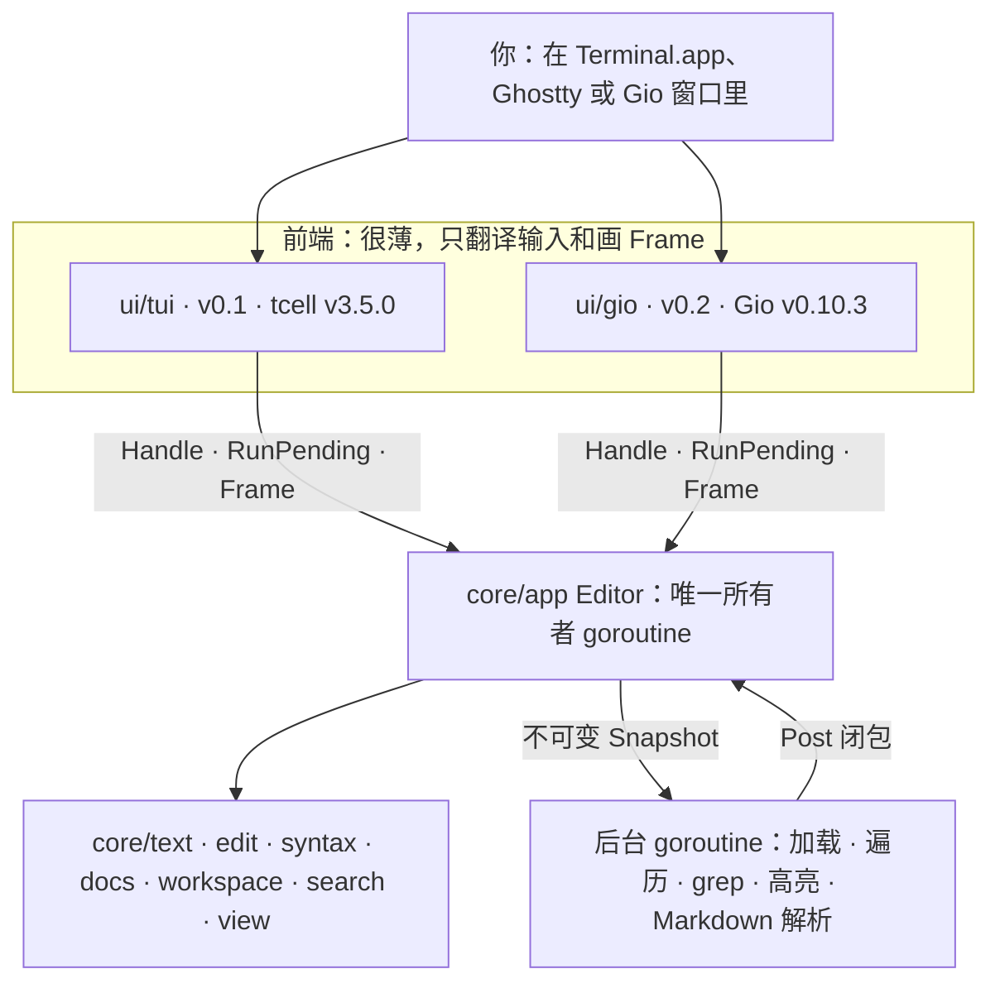
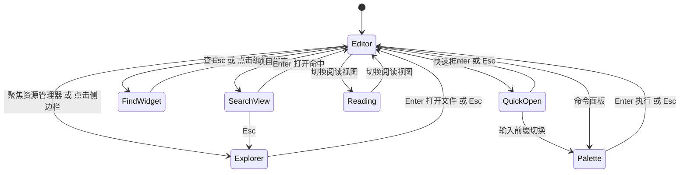
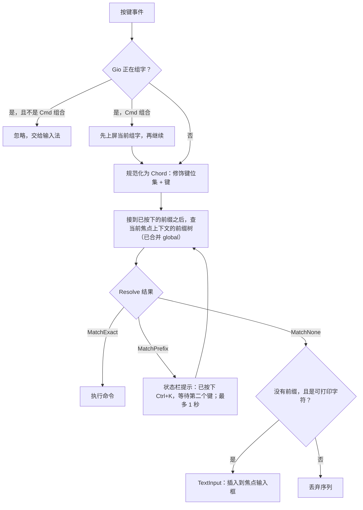
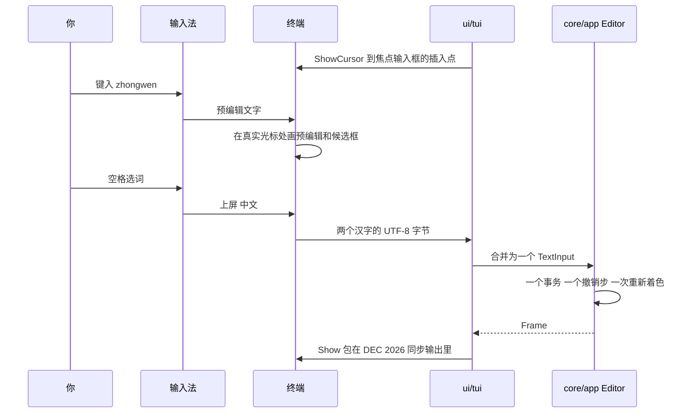
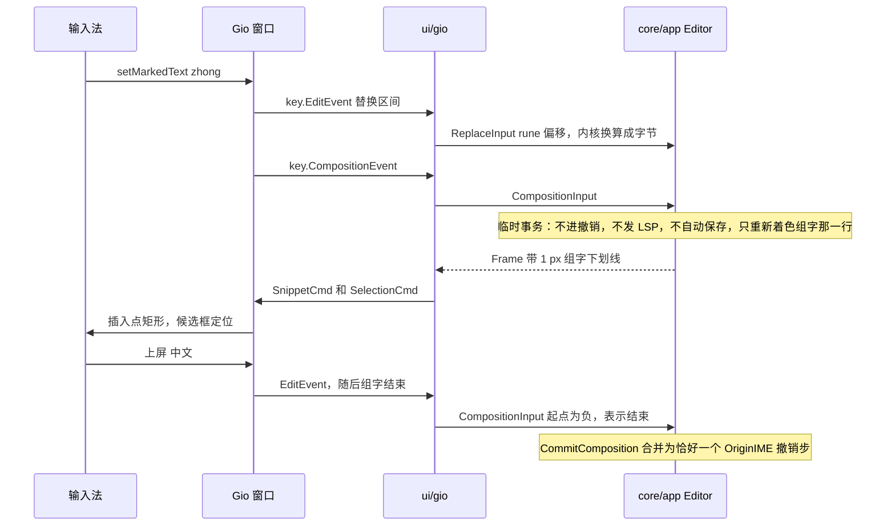
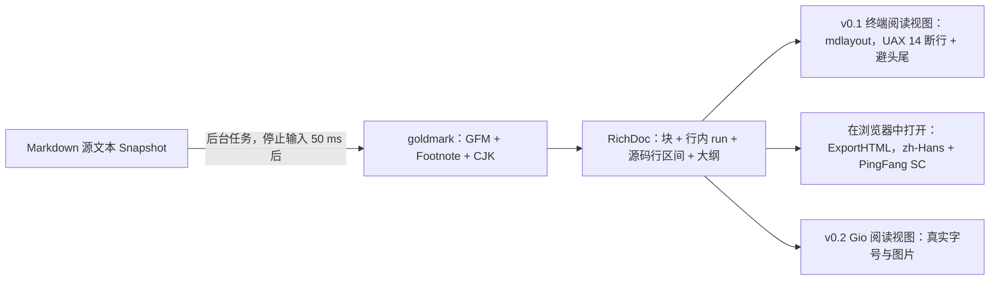
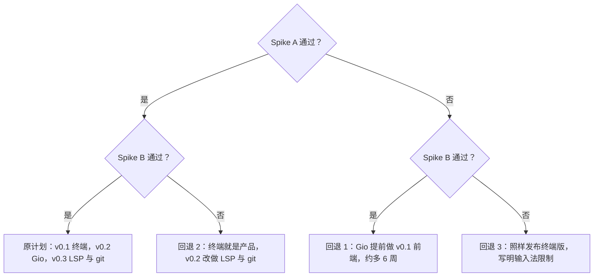

# Yan 砚 设计文档

> 产品与交互设计 · 草案 v1 · 2026-10-09 · 路线已由用户确认：先终端（v0.1），再 Gio GUI（v0.2），最后 LSP 与 git（v0.3）
>
> 姊妹文档：[ARCHITECTURE.md](./ARCHITECTURE.md)（怎么造）· [DECISIONS.md](./DECISIONS.md)（为什么这样选）· 本文 DESIGN.md（做什么、长什么样、怎么用）
>
> 三份文档的包名、里程碑、性能预算和键位保持一致。**键位以本文 [§5.5 完整键位表](#55-键位映射总表) 为准**，包与分层以 ARCHITECTURE.md 为准。

**约定**

| 记号 | 含义 |
|---|---|
| `core/text` | 包路径，相对模块根。模块路径建议用 `github.com/corn12138/yan-source`（可改，见 [§12](#12-待确认问题)） |
| **实测** | 2026-10-09 前在这台 Mac（Apple M3 Max，macOS 27.2，Go 1.26.3）上量出的数字。调研时机器负载很高，时间类数字偏保守 |
| **估算** | 设计目标或推算，要在对应里程碑用基准测试兑现 |
| `Cmd` `Ctrl` `Shift` `Option` | 按键名。VS Code 文档里的 ⌘ ⌃ ⇧ ⌥ 在本文一律写成英文单词，免得和 Ctrl 混淆 |
| **Go 学习点** | 和该设计相关、值得借机学的 Go 知识 |

## 目录

- [1. 一句话定位与背景](#1-一句话定位与背景)
- [2. 设计原则](#2-设计原则)
- [3. 目标用户与核心场景](#3-目标用户与核心场景)
- [4. 功能范围](#4-功能范围)
- [5. 交互设计 VS Code 式但极简](#5-交互设计-vs-code-式但极简)
  - [5.5 键位映射总表](#55-键位映射总表)
  - [5.6 Terminal.app 的降级与原因](#56-terminalapp-的降级与原因)
  - [5.8 mod 别名与按键解析](#58-mod-别名与按键解析)
- [6. 中文与输入法体验](#6-中文与输入法体验)
  - [6.4 输入法验收矩阵](#64-输入法验收矩阵)
- [7. Markdown 阅读体验](#7-markdown-阅读体验)
- [8. 大文件与性能承诺](#8-大文件与性能承诺)
- [9. 配置](#9-配置)
- [10. 路线图与里程碑](#10-路线图与里程碑)
  - [10.1 M0 第一周怎么做](#101-m0-第一周怎么做)
- [11. 风险与验证](#11-风险与验证)
- [12. 待确认问题](#12-待确认问题)
- [附录 术语表](#附录-术语表)

**速览**（第一次读只看这几行也行；文档导读见 [README.md](./README.md)）

- 做什么：一个 Go 写的代码与中文文档阅读器兼轻编辑器，手感像 VS Code，体积几 MB、空闲零 CPU。
- 路线：v0.1 终端（tcell，约第 25 周）→ v0.2 Gio 原生窗口（约第 36 周）→ v0.3 LSP 与 git（约第 41.5 周）。
- 布局：资源管理器、标签栏、编辑区、状态栏，加快速打开、命令面板、查找小部件、项目搜索四个浮层（§5.1–§5.2）。
- 键位：Gio 里就是 VS Code macOS；Ghostty 里大部分 Cmd 键可用；Terminal.app 里 `Cmd+Shift+X` 一律换成 `Ctrl+K X`，中文输入法下第二键可以按住 Ctrl（§5.5）。
- 中文：真实光标永远在插入点上，候选框跟着走；每个上屏词组一个撤销步；五种输入法都进验收矩阵（§6.4）。
- Markdown：终端里有阅读视图，完整排版用「在浏览器中打开」，v0.2 有真排版（§7）。
- 先做什么：M0 的两个 spike 用几天验证终端输入法和 Gio，步骤见 §10.1；你要拍板的问题见 §12。

---

## 1. 一句话定位与背景

### 1.1 一句话定位

**Yan 砚是一个用 Go 写的代码与文档阅读器兼轻量编辑器：操作手感像 VS Code（侧边栏、标签、快速打开、命令面板、查找框、多光标、VS Code 的快捷键和命令名），体积只有几 MB，启动几十毫秒，空闲时零 CPU。**

它先以终端程序的形式出现（v0.1，tcell v3，`CGO_ENABLED=0`），再长出原生 GUI 窗口（v0.2，Gio），最后补上跳转定义、诊断和 git 变更标记（v0.3）。三个阶段共用同一个无界面的 Go 内核。名字取「砚」：小、安静、每天都用。命令行名是 `yan`。

### 1.2 背景：为什么 VS Code 和 Cursor 显得重

先看数字（都在这台 Mac 上实测）：

| 对象 | 实测 |
|---|---|
| VS Code.app 磁盘占用 | 1.4 GB |
| Cursor.app 磁盘占用 | 887 MB |
| 正在运行的 VS Code | 22 个进程，RSS 合计约 5.2 GB（共享页被重复计算，偏高，但数量级不会错） |
| 一个 tcell v3.5.0 的 hello 程序 | 2.17 MB 二进制，9.7 MB RSS，首帧 14–36 ms |

VS Code 本身没有错，它的**交互模型**非常好，这正是本项目要保留的部分。它重，是因为它是一个 IDE 平台：Electron（Chromium + Node.js）、扩展宿主进程、语言服务、终端、调试器、设置系统、扩展市场。你日常主要做的是**读代码、读中文 Markdown 文档、偶尔改几行**，却要为整个平台付启动时间、内存和风扇声。

Yan 的做法是：**拿走 VS Code 的手感，丢掉它的重量。** 快捷键、快速打开、命令面板、侧边栏和标签的布局都尽量照搬；扩展、终端、调试、设置界面一律不做。

还有一个容易忽略的背景：按键到屏幕的总延迟，大部分不在编辑器里。Dan Luu 测过，键盘扫描和去抖动就要 18–30 ms，显示器和合成器还要再加（https://danluu.com/input-lag/ ）；终端本身的延迟也有长尾（https://danluu.com/term-latency/ ）。Pavel Fatin 的测量建议编辑器自己的绘制延迟控制在 1–5 ms（https://pavelfatin.com/typing-with-pleasure/ ）。所以 Yan 的目标不是「比物理极限快」，而是**自己绝不添乱**：应用侧 p99 ≤4 ms，剩下的交给终端或 Metal。

### 1.3 轻 快 简 的可度量承诺

「轻、快、简」如果不落到数字上，很快就会变成口号。下面每一条都会在 CI 或 HUD 里被检查（完整预算表见 [§8.2](#82-性能预算)）。

| 承诺 | 指标 | 目标 | 现有依据 |
|---|---|---|---|
| 轻 | TUI 二进制（stripped，darwin/arm64） | ≤6 MB | 加上 MVP 主要依赖 3.20 MB（实测） |
| 轻 | 空闲内存，仅 Yan（已索引 1.5 万文件，开着 10 个文件） | ≤25 MB RSS / ≤20 MB phys_footprint | tcell hello 9.7 MB RSS（实测）；整体为估算 |
| 轻 | 空闲 CPU 与定时唤醒 | 0% 与 0 次 | 事件驱动循环，没有 ticker（设计保证，单元测试检查） |
| 快 | 冷启动到首帧（应用侧） | `yan file.go` ≤50 ms；`yan .` ≤80 ms | tcell hello 14–36 ms（实测） |
| 快 | 按键 → 画面提交（应用侧） | p50 ≤1 ms，p99 ≤4 ms | 估算；M2 起由性能 HUD 实测 |
| 快 | 打开 100 MB 文件 | 首屏 ≤100 ms | 100 MB 摘要并行构建 37–97 ms 墙钟（实测） |
| 简 | 配置 | 零必需配置；最多一个 TOML 文件加一个项目级 `.yan.toml` | 设计保证 |
| 简 | 扩展方式 | 没有插件；每个功能都是一条注册过的命令 | 设计保证，单元测试检查 |
| 简 | 界面 | 侧边栏 + 编辑区；以后最多两个编辑分栏；没有动画 | 非目标清单（[§4.5](#45-明确不做)） |

### 1.4 产品形态一览



| 阶段 | 你拿到什么 | 运行在哪 |
|---|---|---|
| v0.1（约第 25 周） | 终端里的 VS Code 式阅读器和轻编辑器：侧边栏、标签、快速打开、命令面板、语法高亮、查找替换、项目搜索、Markdown 阅读视图、「在浏览器中打开」、中文输入 | Terminal.app 零配置；Ghostty 可选 |
| v0.2（约第 36 周） | 原生窗口：真正的中文排版（PingFang SC、标题字号、表格、本地图片）、原生 Cmd 快捷键、原生输入法预编辑、.app 包 | Gio 窗口，Metal 渲染 |
| v0.3（约第 41.5 周） | gopls 等语言服务器：诊断、跳转定义与引用、悬停、补全、保存时格式化；git 状态颜色和变更槽 | 两个前端都有 |

---

## 2. 设计原则

每条原则都写成「规则 + 怎么检验」。检验不了的原则不算原则。

| # | 原则 | 规则 | 怎么检验 |
|---|---|---|---|
| P1 | **内核零 cgo** | `core/...` 与 `ui/tui` 必须能用 `CGO_ENABLED=0` 构建；只有 `ui/gio` 用 cgo | CI 跑 `CGO_ENABLED=0 go build ./cmd/yan`；导入边界测试：`go list -deps ./core/...` 的输出里出现 tcell 或 gioui 就失败 |
| P2 | **UI 线程永不阻塞** | 按键到画面之间不放任何慢操作：不做文件 I/O、不等后台任务、不做 O(文件大小) 的计算 | 性能 HUD 的 p99 ≤4 ms；CI 里 `Handle + Frame` 的无头基准用 benchstat 比较，退化超过 20% 即失败；debug 构建检测并发重入 |
| P3 | **空闲零唤醒** | 没有 ticker，没有固定帧率；只在真实的截止时间（按键序列超时、防抖、状态消息过期）设一个定时器 | 单元测试：无待办事项时 `NextDeadline()` 返回 false；空闲 60 s 进程 CPU 时间不变 |
| P4 | **默认零配置** | 没有配置文件也能完整使用；配置只用来覆盖默认值 | 冒烟测试在空的 `HOME` 下运行；所有默认值用 `go:embed` 编进二进制 |
| P5 | **一切皆命令** | 每个功能都是一条注册过的命令，能在命令面板里搜到，能绑定按键 | 单元测试：默认键位表里引用的命令都存在；没有命令的功能不准合入 |
| P6 | **VS Code 的键，VS Code 的意思** | Gio 和 Ghostty 里的 Cmd 键与 VS Code macOS 同义；终端里做不到的组合，换成可区分的回退键，而不是偷偷换语义。Terminal.app 回退列沿用 VS Code **Windows/Linux** 的 Ctrl 键义（`Ctrl+F` 查找、`Ctrl+D` 多光标、`Ctrl+Y` 重做……），与 VS Code macOS 的 emacs 式 Ctrl 键（`Ctrl+B/F/P/N` 移动、`Ctrl+D/H` 删除、`Ctrl+K` 删到行尾）不同；唯一取 macOS 键义的是 `Ctrl+A` / `Ctrl+E`（行首、行尾）。速查表会标明这一点 | §5.5 的键位表就是测试数据：表驱动测试逐行核对 |
| P7 | **每个默认命令在每种环境下都有一个可达的键** | Terminal.app（legacy 编码）、Ghostty（kitty 协议）、Gio 三种环境，每条默认命令至少一个绑定能到达 | 表驱动测试：对每种键盘协议**编译**默认键位（§5.8），在编译结果上断言可达；断言终端回退键不含 Cmd、Ctrl+Shift+字母、Ctrl+I/H/M/[ |
| P8 | **唯一的宽度来源** | 渲染、光标列、换行、表格列宽、鼠标命中全部用 `core/text/width` | 无头 golden 测试同时用字符格 layouter 和一个故意做成比例宽度的假 layouter 跑；代码审查拒绝其他地方的宽度计算 |
| P9 | **每个编辑都可撤销，保存不丢数据** | 全部替换、从磁盘重载、格式化都走同一个 `Apply`；保存是临时文件 + fsync + rename，保留原编码、BOM 和换行符；关闭或退出时有未保存的修改一定先问 | 「全部替换后撤销，字节完全一致」测试；保存过程中 `kill -9`，原文件或新文件总有一个完整；GB18030 往返字节一致（含 0x80 欧元符号的金样）；关闭未保存标签的 headless 测试 |
| P10 | **预算就是测试** | 二进制体积、空闲内存、首帧时间写进 CI | `tools/perfprobe` 和体积门槛，超了就红 |

> **Go 学习点**：`CGO_ENABLED=0` 时，带 `import "C"` 的文件会被自动排除；`//go:build gio` 这样的 build tag 让 `ui/gio` 只在 `go build -tags gio` 时参与编译。导入边界测试本身就是一个普通的 `_test.go`：用 `os/exec` 跑 `go list -deps ./core/...`，扫一遍输出即可。规则写在测试里，比写在文档里可靠。

---

## 3. 目标用户与核心场景

**主要用户**：前端开发者，正在往全栈走，正在学 Go。每天在 VS Code / Cursor 里读代码和文档，觉得它们太重。会中文输入（系统拼音或双拼、微信输入法、搜狗、Rime/鼠须管）。机器是 Apple Silicon 的 Mac，目前只装了 Terminal.app。

**不服务的用户**：要一个完整 IDE 的人（调试、任务、扩展生态）；Vim 用户（v0.x 不做模态键位）；需要远程开发、协同编辑或 AI 面板的人。像 Focus 编辑器那样把目标用户和限制写在前面，是为了让「简」能长期守住。

| # | 场景（用户故事） | 你怎么做 | Yan 的行为 | 首次可用 | 验收 |
|---|---|---|---|---|---|
| S1 | 打开一个仓库读代码 | `yan .` 或 `yan ~/code/repo` | 侧边栏列出文件树（后台继续遍历），README.md 自动以阅读视图打开；单击文件以预览标签打开 | M3（约第 12 周） | GOROOT 上 ≤80 ms 列出树 |
| S2 | 读中文 Markdown 文档 | 打开 `.md`，按 `Ctrl+K V`（GUI 中 `Cmd+Shift+V`） | 原地切换到阅读视图：标题、列表、表格、代码块高亮、中文断行与避头尾；`Ctrl+K O` 按标题跳转；`Ctrl+K B` 用浏览器看完整排版 | M6（约第 20 周）；v0.2 有真排版 | 100 KB 中文 README 解析 + 排版 ≤30 ms；软换行处没有多余空格 |
| S3 | 快速找文件 | `Ctrl+P`（Ghostty 或 GUI 中 `Cmd+P`），输入几个字母 | 模糊匹配，遍历未结束时就能用；空查询时先列出最近打开的文件 | M3 | 1.5 万路径每次按键 ≤12 ms |
| S4 | 全项目搜一个词 | `Ctrl+K F`（`Cmd+Shift+F`） | 结果流式出现在侧边栏位置；改输入立即取消旧搜索；未保存的修改也搜得到；回车跳到命中处 | M5（约第 17 周） | GOROOT 首批结果 ≤100 ms |
| S5 | 改几行代码 | 直接打字；`Ctrl+D` 多光标；`Ctrl+S` 保存 | 打字、撤销分组、多光标、注释切换、行移动；原子保存保留编码和换行符 | M7（约第 23 周） | 一个上屏词组恰好一个撤销步；`kill -9` 测试 |
| S6 | 用中文写注释或文档 | 照常用输入法 | 候选框出现在插入点；上屏的一个词组就是一次插入、一个撤销步 | M0 验证，M7 投产 | 输入法验收矩阵全过（[§6.4](#64-输入法验收矩阵)） |
| S7 | 看一个巨大的日志文件 | `yan app.log`（100 MB） | 首屏立刻出现（读文件和摘要并行计算）；只读、不高亮、不换行 | M2（约第 9 周） | 首屏 ≤100 ms |
| S8 | 跳到定义、看报错 | `F12`、悬停 | LSP（gopls 优先） | v0.3 | 跨仓库跳转定义可用 |

---

## 4. 功能范围

### 4.1 MVP v0.1

| 功能 | 说明 | 里程碑 |
|---|---|---|
| 打开 | `yan [path[:line]]` 打开文件夹或文件，不带参数的 `yan` 等于 `yan .`；单个 `CGO_ENABLED=0` 二进制 ≤6 MB；只给文件夹时自动以阅读视图打开 README.md；二进制文件（前 8 KB 含 NUL）不打开，状态栏说明原因 | M2、M3 |
| 资源管理器侧边栏 | `Ctrl+B` 切换；懒加载目录；gitignore 的条目变暗；`.git`、`node_modules` 默认隐藏；键盘（↑↓ ← → Enter Space Esc，见 §5.5 资源管理器表）和鼠标都能操作；展开的目录实时刷新 | M3 |
| 快速打开 | `Ctrl+P`；基于 gitignore 感知的索引，后台构建，遍历没结束也能用 | M3 |
| 命令面板 | `Ctrl+K P` 或 `F1`；列出所有注册命令，标题可以是中文 | M3 |
| 代码视图 | 虚拟化渲染；行号、当前行、滚轮与触控板滚动、点击和拖动选择、软换行开关、制表位 | M2（软换行开关 M4） |
| 状态栏 | 路径、行/列（列按字素计）、缩进、编码、换行符、语言、未保存、只读 | M2 |
| 语法高亮 | Go、TS/JS、JSON/JSONC、CSS、Markdown、YAML、TOML、shell；深色和浅色主题 | M4 |
| 文件内查找替换 | `Ctrl+F`；字面量、正则、智能大小写、全词；命中计数；全部替换是一个可撤销事务 | M5 |
| 项目搜索 | `Ctrl+K F`；结果流式进入浮层，重新输入即取消，包含未保存的缓冲区，回车打开到命中处 | M5 |
| Markdown 阅读视图 | `Ctrl+K V` 原地切换；标题、列表、任务、引用、高亮的代码块、CJK 感知的 GFM 表格、能在 Yan 内打开的 .md 链接、图片占位；`Ctrl+K O` 大纲；`Ctrl+K B` 在浏览器中打开 | M6 |
| 轻编辑 | 分组撤销/重做；`Ctrl+D` 多光标；pbcopy/pbpaste 加 bracketed paste；自动缩进；行注释切换；新建文件、另存为；原子保存，保留 UTF-8、BOM、GB18030 和换行符；关闭有未保存修改的标签或退出时弹出「保存 / 不保存 / 取消」 | M1（内核）、M7 |
| 中文输入法 | 经终端输入：真实光标永远在焦点输入框的插入点上（编辑器、快速打开、命令面板、查找框、替换框、项目搜索框、include/exclude 框）；每个上屏词组一个撤销步 | M0 验证、M3、M7 |
| 宽度与诊断 | 与 tcell 共用唯一宽度来源；歧义宽度经环境变量重新 exec 生效；`yan doctor` 报告终端宽度、键盘协议、颜色 | M2、M8 |
| 外部修改检测 | 按目录的 fsnotify，加上终端重新获得焦点时重新 stat（Terminal.app 是否发送焦点事件由 M0 核实，不发送时只靠 fsnotify）；缓冲区干净则静默重载，有修改则提示保留或重载 | M3、M7 |
| 大文件分档 | ≤8 MB 全功能；8–256 MB 只读、不高亮不换行、立刻显示首屏；>256 MB 拒绝并说明；超过 10 KB 的单行有保护 | M2 |
| 配置 | 一个 TOML 文件加项目级 `.yan.toml`；内嵌默认值；VS Code 式键位预设；`mod` 别名；热重载；未知键给警告 | M3 |
| 性能 HUD | 命令开关，显示按键→帧 p50/p99 和 GC 停顿 | M2 |
| 终端：切到 shell | `` Ctrl+` ``（Terminal.app 发不出时用 `Ctrl+K T`），命令 `workbench.action.terminal.toggleTerminal`：暂停 Yan、在项目目录下运行 `$SHELL -i`，`exit` / `Ctrl+D` 回到编辑器，缓冲区、光标、撤销历史原样保留。用于 `go run .`、`npm run dev` 这类「运行项目」。零依赖，输入法与颜色都是终端原生的 | v0.0 已实现 |

**超期先砍**：评审预计兼职项目会超期 1.5–2 倍（§11.1）。真超期时按下面的顺序从上往下砍，砍掉的项移到 §4.4「以后」：

1. 配置热重载（改成「重启生效」）
2. 自定义主题文件（只留内置深浅两套）
3. 预览标签（单击就固定打开）
4. 快速打开的 `@` 前缀（大纲仍有 `Ctrl+K O`）
5. 性能 HUD 的界面（CI 里的指标保留）
6. GB18030（如果待确认问题 #3 的答案是不需要）
7. 阅读视图内的查找
8. 阅读视图里表格的横向滚动（过宽的表改为提示「在浏览器中打开」）
9. 行移动与复制行
10. `yan doctor` 输出的 Ghostty 片段

**砍不掉的核心**：打开、资源管理器、快速打开、命令面板、语法高亮、文件内查找、项目搜索、阅读视图、编辑与保存、输入法光标纪律。

### 4.2 v0.2 Gio GUI

约 11 个兼职周，由 M0 Spike B 放行（ADR-002、ADR-002b）。同一个内核上的 Gio 前端：像素对齐的塑形文字，目标 120 Hz；原生输入法与临时事务；Markdown 视图用 PingFang SC 真排版（标题字号、表格、本地图片）；原生 Cmd 快捷键；文件夹选择器；.app 包；登录 shell 环境解析（让从 Finder 启动的 Yan 也能找到 `gopls` 和 git）。

**v0.2 追加：内嵌终端面板**（2026-10-09 用户提出「像 VS Code 那样打开终端运行项目」）。v0.1 先用「切到 shell」满足运行项目；v0.2 在编辑区下方加一个可开关的终端面板，`` Ctrl+` `` 切换，与 VS Code 一致。实现路线：tcell v3 自带的 `vt` 终端模拟器 + 纯 Go pty（无 cgo），面板内容作为 `view.PaneFrame{Kind: PaneTerminal}` 进入帧模型，Gio 前端复用同一个模拟器。只做一个面板、一个会话，不做多终端标签与分屏。估算 +2 个兼职周。

### 4.3 v0.3 LSP 与 git

约 5.5 个兼职周。LSP 客户端先接 gopls，再接 typescript-language-server：诊断、定义与引用、悬停、符号、补全、保存时格式化。git：文件树的状态颜色和编辑区的变更槽，用 git CLI 加 `znkr.io/diff`。

### 4.4 以后

- M1b 持久化 B+tree rope（如果 M1 里放不下）：解锁 8–256 MB 文件的编辑，撤销内存 O(log n)。
- 超过 256 MB 文件的分页只读查看器（`ReadAt` 分页 + 懒行索引），代替直接拒绝。
- 并排分栏和 Markdown 并排预览（带滚动同步）。最多一个分割，永远不会更多。
- 会话恢复（每个项目的打开文件和滚动位置）与热退出日志。
- 资源管理器里的文件操作：新建、重命名、删除（v0.1 用终端里的 shell 命令完成）。
- 列选择/块选择、Option+点击加光标、括号和引号自动配对。
- Python、Rust、HTML（内嵌 CSS/JS）、SQL 词法器；可选 `-tags chroma` 构建处理长尾语言，只高亮可视区。
- 可选 `-tags gts`（gotreesitter）结构层：折叠、扩展选区、大纲，仅限 ≤512 KB 的文件。
- 移植 fzf 的 FuzzyMatchV2 评分；中文文件名的拼音首字母匹配（mozillazg/go-pinyin）。
- 通过 kitty 图形协议在 Ghostty 里内联显示 Markdown 图片；保存时自动重新导出 HTML。
- Gio 中的 emoji：单 strike 子集缓存，前提是 spike 证明 ≤30 MB。
- Gio 常驻单实例：`yan .` 复用已运行的窗口进程。
- 自己写的 gitignore 匹配器，用 `git check-ignore` 做 golden 测试（Go 练习）。
- 「把选区通过 shell 命令处理」命令，作为唯一的扩展点。
- Linux/Windows 版 TUI（tcell 免费送）和 Gio（未测）。

### 4.5 明确不做

| 不做 | 理由 |
|---|---|
| 重造 VS Code：扩展市场、设置界面、JSON schema 设置系统 | 这正是「重」的来源 |
| v0.x 里的插件或脚本（Lua、WASM、JS） | 扩展点只有命令注册表，以后加 shell 管道 |
| 调试器、任务运行器、notebook | 用终端里的命令行工具 |
| 状态和变更槽之外的 git 界面：暂存、提交、blame、历史 | 用 git CLI 或专门工具 |
| AI 或聊天面板、遥测、账号、同步 | 与 轻、简 冲突 |
| 远程开发、客户端/服务端拆分、xi 式异步 RPC、CRDT 或 OT | xi 的教训（ADR-001） |
| 主产品里的 WebView、Node 或 npm 工具链 | Wails + CodeMirror 只作为文档化的最后手段 |
| v0.x 的 Vim 或模态键位 | 内核以选区为中心，以后可以加 |
| 所见即所得的 Markdown 编辑、源码视图里的内联小部件、Yan 内渲染 Mermaid 或数学公式 | 这些去浏览器里看 |
| minimap、面包屑、粘性滚动、动画、超过两个分栏 | VS Code 有，但读代码用不上 |
| 编辑超过 256 MB 的文件、十六进制编辑、二进制 diff | 罕见需求 |
| 内核或 TUI 里的任何 cgo 依赖（官方 tree-sitter、FSEvents、CoreText 绑定） | ADR-010 |
| 捆绑字体或终端；**要求**安装 Ghostty 或特殊字体 | 零配置 |
| v0.2 中让 VoiceOver 读出自绘的代码文字 | 已知缺口，以后再议 |

### 4.6 VS Code 式交互带来的新增项

用户在决策之后新增了需求：「交互像 VS Code 这类的，但是极简且快」（ADR-012）。下面这些小项因此进入 v0.1，都很小，摊进现有里程碑的缓冲里，不改里程碑周数（估算）：

| 新增项 | 内容 | 落点 | 估算 |
|---|---|---|---|
| `vscode` 键位预设 | `[keys] preset = "vscode"`（默认，也是 v0.x 唯一的预设），文件 `core/config/defaults/keymap-vscode.toml`，用 `go:embed` 编进二进制；`mod` 别名；每种键盘协议的可达性测试 | M3 | 包含在 M3 的 keymap 工作里 |
| 快速打开的前缀 | 与 VS Code 一样：`>` 切到命令面板，`:` 跳到行，`@` 按标题跳转（Markdown 大纲，v0.3 起含 LSP 符号） | M3（`@` 在 M6） | 约 1 天 |
| 预览标签 | 在侧边栏单击打开的文件是「预览标签」（名字斜体），下一次单击会替换它；双击或开始编辑后固定 | M3 | 约 1 天 |
| 查找小部件布局 | 编辑区右上角浮层，大小写、全词、正则三个开关，`3/17` 计数 | M5 | 原计划内 |
| 搜索结果的位置 | 项目搜索结果浮层占据侧边栏位置，与 VS Code 的搜索视图同位 | M5 | 原计划内 |
| 行编辑命令 | 上下移动行、向下复制行、删除行、缩进/减少缩进 | M7 | 约 2 天 |
| 文件生命周期 | 新建文件、另存为、关闭或退出时的「保存 / 不保存 / 取消」确认 | M7 | 约 1–2 天 |
| 资源管理器键盘操作 | ↑↓ ← → Enter Space Esc（§5.5 资源管理器表） | M3 | 约 0.5 天 |
| Ghostty 片段与按键审计 | `yan doctor` 输出可选的 Ghostty keybind 片段；Spike A 的按键回显工具 | M0、M8 | 约 1 天 |

合计约 6–9 个工作日（估算）。如果某个里程碑因此超期 30%，按 [§10](#10-路线图与里程碑) 的规则重排，而不是悄悄延长。

---

## 5. 交互设计 VS Code 式但极简

目标一句话：**闭上眼睛按 VS Code 的键，Yan 做同样的事；睁开眼睛，界面比 VS Code 少一半东西。**

### 5.1 布局

终端版（v0.1）的主界面，宽 100 列示意。右上角是打开着的查找小部件：

```text
 EXPLORER: MYREPO         │ main.go ●  │ server.go  │ README.md │
 ▾ cmd                    │  12  func main() {                     ╭───────────────────────────────────
   ▾ yan                  │  13      cfg, err := config.Load()     │ › cfg▌         Aa  ab  .*   2/7  ↑ ↓ ×
       main.go            │  14      if err != nil {               ╰───────────────────────────────────
 ▾ core                   │  15          log.Fatal(err)
   ▸ app                  │  16      }
   ▸ text                 │  17      // 启动编辑器
 ▸ docs                   │  18      ed := app.New(cfg, lay)
   README.md              │  19      ▌
   go.mod                 │  20  }
 ░ dist/                  │
──────────────────────────┴───────────────────────────────────────────────────────────────────────
 cmd/yan/main.go                                      行 19，列 5   空格: 4   UTF-8   LF   Go
```

> 示意图里侧边栏标题写成英文，是因为 GitHub 网页字体里中文不是严格两列宽，放在竖线左边会让竖线错位。Yan 实际显示「资源管理器」，在终端里由唯一宽度来源保证对齐。

| 区域 | 对应 VS Code | Yan 的行为 |
|---|---|---|
| 资源管理器侧边栏 | Explorer | `Ctrl+B` / `Cmd+B` 显示或隐藏；懒加载目录；gitignore 的条目变暗（`░`）；`.git`、`node_modules` 默认隐藏；展开的目录随磁盘变化刷新；终端窄于 80 列时默认隐藏 |
| 标签栏 | Editor tabs | 一行；`●` 表示未保存；预览标签名字用斜体（终端不支持斜体时用暗色）；放不下时两端出现 `‹ ›` 并可滚动 |
| 编辑区 | Editor | 行号、当前行高亮、选区、多光标（副光标用反色格子画）、软换行开关；`.md` 文件可原地切换为阅读视图 |
| 查找小部件 | Find widget | 编辑区右上角浮层，见 §5.2 |
| 状态栏 | Status bar | 左：文件路径、状态消息（v0.3 起加 git 分支和诊断计数）；右：`行 19，列 5`（列按字素计）、缩进、编码、换行符、语言；大文件显示「只读」；打开 HUD 时显示 p50/p99 |
| 终端标题 | 窗口标题 | `yan — myrepo`（tcell `SetTitle`） |

**刻意不照搬的部分**：活动栏（左侧那列图标）、底部面板（终端、问题、输出）、minimap、面包屑、粘性滚动、设置界面、扩展视图、通知中心。通知用状态栏消息代替，几秒后自动消失（这是 `NextDeadline` 里少数真实的截止时间之一）。

### 5.2 浮层

浮层对应 `core/view` 的五种 `OverlayKind`：`OverlayFinder`（快速打开）、`OverlayPalette`（命令面板）、`OverlayFind`（查找小部件）、`OverlaySearchResults`（项目搜索结果）、`OverlayConfirm`（确认框）。同一时刻最多一个模态浮层；查找小部件可以和编辑区同时存在。

**快速打开**（`Ctrl+P` / `Cmd+P`），顶部居中：

```text
                 ╭─ 快速打开 ──────────────────────────────────────────────
                 │ srv▌
                 │ ▸ server.go                         net/http
                 │   reverseproxy.go                   net/http/httputil
                 │   web/http.go                       cmd/go/internal
                 │   … 还有 37 项                       索引中 12,034
                 ╰─────────────────────────────────────────────────────────
```

- 空查询时先列出最近打开的文件，相当于 VS Code 按住 `Ctrl+Tab` 看到的列表。
- 模糊匹配用 sahilm/fuzzy，命中的字母加粗；查询变长时只在上一次的结果里继续筛（narrowing）。
- 遍历还没结束就能用，右下角显示已索引的文件数。
- 与 VS Code 相同的前缀：`>` 切到命令面板，`:120` 或 `:120:8` 跳到行（`Ctrl+G` 就是打开快速打开并预填 `:`），`@` 按标题跳转（Markdown 大纲；v0.3 起含 LSP 符号）。中文输入法开着中文标点时，`Shift+;` 会打出 `：`、`Shift+.` 会打出 `》`，所以查询开头的 `：`（U+FF1A）、`》`、`＞`（U+FF1E）、`＠`（U+FF20）分别当作 `:`、`>`、`>`、`@` 处理。
- `↑ ↓` 选择，`Enter` 打开，`Esc` 关闭。输入框里能用中文输入法搜中文文件名。

**命令面板**（`Ctrl+K P`、`F1` / `Cmd+Shift+P`）：

```text
                 ╭─ 命令面板 ──────────────────────────────────────────────
                 │ > 切换▌
                 │ ▸ 切换侧边栏可见性    workbench.action.toggleSidebarVisibility   Ctrl+B
                 │   切换行注释          editor.action.commentLine                  Ctrl+/
                 │   切换自动换行        editor.action.toggleWordWrap               Ctrl+K W
                 ╰─────────────────────────────────────────────────────────
```

每行三列：中文标题、灰色的命令 ID、**当前环境下真正能按到的那个键**（在 Terminal.app 里显示 `Ctrl+K P`，在 Gio 里显示 `Cmd+Shift+P`）。中文标题和英文 ID 都能搜，最近用过的命令排在前面。

**查找小部件**（`Ctrl+F` / `Cmd+F`），编辑区右上角：

```text
  12  func main() {                     ╭──────────────────────────────────────────────
  13      cfg, err := config.Load()     │ › cfg▌                Aa  ab  .*   2/7   ↑  ↓  ×
  14      if err != nil {               │   new▌                              替换  全部替换
                                        ╰──────────────────────────────────────────────
```

| 操作 | 效果 |
|---|---|
| 输入 | 实时高亮所有命中，显示 `当前/总数`；默认智能大小写：查询全小写时不区分大小写，含大写字母时区分 |
| `Aa` `ab` `.*` | 区分大小写、全词匹配、正则（RE2 语法）。点击切换，也是三条命令（`toggleFindCaseSensitive`、`toggleFindWholeWord`、`toggleFindRegex`）：终端里在查找框内按 `Ctrl+K C / W / R`，Gio 中 `Option+Cmd+C/W/R`（§5.5 ⑬） |
| `Enter` 或 `↓`、`↑` | 下一个 / 上一个；编辑区里还有 `Ctrl+K G` / `Ctrl+K Shift+G`、`F3`（Gio 和 Ghostty 中 `Cmd+G` / `Cmd+Shift+G`）。VS Code 的查找框里 ↑↓ 是翻搜索历史，Yan 没有搜索历史，所以让它们找上一个、下一个 |
| 点击左侧 `›` 箭头，或 `Ctrl+K H` / `Option+Cmd+F` | 展开替换行。在查找框里输入 `>` 就是查找字面量 `>`（搜 `->`、`>=` 很常见），不会展开替换行 |
| `Tab` | 在查找框和替换框之间切换 |
| 替换框中 `Enter` | 替换当前命中并跳到下一个 |
| 全部替换 | 点击按钮或命令 `editor.action.replaceAll`；整个操作是一个事务，一次撤销全部还原 |
| `Esc` | 关闭小部件，焦点回到编辑区，命中高亮清除 |

**项目搜索**（`Ctrl+K F` / `Cmd+Shift+F`），结果浮层占据侧边栏的位置（和 VS Code 的搜索视图同位）：

```text
 SEARCH
 ╭ handler▌
 │ Aa  ab  .*    include: *.go
 ╰
 47 results in 12 files
 ▾ net/http/server.go             5
     2012  func (h handler) ServeHTTP(
     2088  type HandlerFunc func(
 ▸ net/http/fs.go                 3
```

结果按文件分组，边搜边出（每 200 条或 30 ms 一批），上限 1 万条。改动查询会立刻取消上一次搜索。未保存的缓冲区按内存里的内容搜，不读磁盘。`Enter` 打开到命中处，`Esc` 关闭并回到资源管理器。

**确认框**用于少数必须由你决定的事：

- 「磁盘上的 `server.go` 已被修改：重新加载 / 保留我的修改」。缓冲区没有未保存修改时不会弹，直接静默重载；重载后的缓冲区与磁盘一致，标签上不会出现 ●。
- 关闭有未保存修改的标签（`Ctrl+W` / `Cmd+W`）或退出（`Ctrl+Q` / `Cmd+Q`）时：「`main.go` 有未保存的修改：保存 / 不保存 / 取消」；退出时有多个未保存文件，就逐个问，或一次「全部保存」。没有路径的新建文件选「保存」时转到另存为。选了「保存」后，Yan 会在状态栏显示「正在保存…」，**等保存真正写完才关闭标签或退出**；保存失败就不关闭，并显示错误，你的修改还在（原理见 [ARCHITECTURE.md §4.3](./ARCHITECTURE.md#43-规则三快照出闭包进带键取消的-job)）。headless 测试覆盖这三种选择，以及「保存后退出」时磁盘上确实是新内容。

### 5.3 焦点模型

任一时刻只有一个焦点区域，它决定两件事：用哪张 keymap 前缀树（上下文），以及终端的真实光标放在哪里（输入法的候选框跟着它走，见 [§6.3](#63-输入法在终端和-gio-中如何工作)）。



| 焦点区域 | keymap 上下文 | 真实光标位置 |
|---|---|---|
| 编辑区（源码） | `editor` | 主光标 |
| 编辑区（阅读视图） | `reading` | 阅读位置（只读，不接收文字） |
| 资源管理器 | `tree` | 隐藏（这里没有文字输入） |
| 快速打开 | `finder` | 输入框里的光标 |
| 命令面板 | `palette` | 输入框里的光标 |
| 查找小部件 | `find` | 当前输入框（查找或替换）里的光标 |
| 项目搜索 | `search` | 当前输入框（搜索或 include/exclude）里的光标 |

规则：

1. **`Esc` 永远「往外走」**：关浮层，回到打开它之前的焦点；在编辑区里先去掉副光标，再清除选区。
2. **全局键处处有效，上下文键优先**：`[keys.global]` 里的绑定在编译 keymap 时合并进每个上下文的前缀树，上下文自己的绑定覆盖同键的全局绑定。所以命令面板开着时 `Ctrl+S` 照样能保存，而 `↑ ↓` 在面板里是选择、在编辑区里是移动光标。
3. 从资源管理器、快速打开或搜索结果打开文件后，焦点一律回到编辑区。
4. 鼠标点哪里，焦点就到哪里。

焦点、标签列表（含预览标签）、最近打开列表和「Esc 往外走」的返回栈在内核里怎么表示，见 [ARCHITECTURE.md §6.7](./ARCHITECTURE.md#67-工作台状态焦点标签与浮层)。

> **Go 学习点**：上下文就是一个 `uint8` 枚举（`const ( CtxEditor Context = iota; CtxTree; ... )`），每个上下文一棵 `map[Chord]*node` 前缀树。`Chord` 是只含可比较字段的结构体，所以能直接当 map 的键，不需要拼字符串。

### 5.4 鼠标

| 操作 | 位置 | 行为 |
|---|---|---|
| 单击 | 编辑区 | 放置光标，按字素命中；点在宽字符的右半格也算这个字 |
| 拖动 | 编辑区 | 选择；拖到上下边缘时自动滚动 |
| 双击 / 三击 | 编辑区 | 选中一个词（连续汉字算一个词）/ 选中整行 |
| Shift+单击 | 编辑区 | 扩展选区。终端可能把 Shift+点击留给自己的原生选择，M0 审计（Ghostty 有 `mouse-shift-capture` 设置） |
| 滚轮、触控板 | 任何可滚动区域 | 滚动；一次排空里收到的滚动量合并成一帧 |
| 单击 / 双击 | 资源管理器 | 文件：以预览标签打开 / 以固定标签打开；目录：展开或折叠 |
| 单击 | 标签 | 切换；点 `×` 关闭 |
| 单击 | 阅读视图中的链接 | `.md` 在 Yan 内打开，`http(s)` 交给浏览器，图片交给「预览」 |
| 单击 | 浮层列表项 / 浮层外 | 选中并执行 / 关闭浮层 |

**为什么要自己数双击**：tcell 只报告按钮掩码（`ButtonMask`），不报告点击次数，所以 Yan 自己判断「同一格、400 ms 内」的连续点击（估算的阈值，M2 调）。

**鼠标捕获和终端原生选择的冲突**：Yan 开启鼠标报告后，终端不再做自己的文字选择，Terminal.app 的 `Cmd+C` 也就复制不到 Yan 里选中的文字。所以在 Terminal.app 里复制用 `Ctrl+C`（Yan 通过 `pbcopy` 写入系统剪贴板）。不想要鼠标时设 `ui.mouse = false`，终端原生选择就回来了。多数终端还允许按住某个修饰键临时绕过捕获，具体是哪个键 M0 记录。tcell 对 Terminal.app 有特判，直接启用 SGR 鼠标报告（tcell v3.5.0 `tscreen.go`），所以鼠标在零配置下可用。

### 5.5 键位映射总表

**怎么读这张表**

- **VS Code（macOS）**：VS Code 的默认键位，作为对照。
- **Ghostty**：Yan 在 Ghostty v1.3.1 里、tcell 协商到 kitty 键盘协议后的键位。前提是 M0 Spike A 证实 Ghostty **没有绑定**的 Cmd 组合能以 super 修饰到达 Yan（tcell 把 kitty 的 Super 报告为 `ModMeta`）。**Terminal.app 列的所有键在 Ghostty 里也都有效**，所以下表 Ghostty 列只写「多出来的」Cmd 键。
- **Terminal.app**：零配置基线，也就是 ADR-009 和 ADR-012 定下的回退键位。只用 legacy 编码能区分的组合。
- **Gio GUI**：v0.2 原生窗口，键位就是 VS Code macOS。
- `Ctrl+K P` 表示先按 `Ctrl+K`，松开，再在 1 s 内按 `P`。终端里每个 `Ctrl+K X` 也接受 `Ctrl+K Ctrl+X`（按住 Ctrl 按第二个键），见 ①。
- `†`：Ghostty v1.3.1 默认把这个 Cmd 组合留给自己，Yan 收不到。在 Ghostty 里改按 Terminal.app 列的键，或者用 `yan doctor` 输出的片段把它转发给 Yan（[§5.7](#57-ghostty-可选的增强)）。清单取自 Ghostty v1.3.1 的默认键位源码（[`src/config/Config.zig`](https://github.com/ghostty-org/ghostty/blob/v1.3.1/src/config/Config.zig)）：
  - **始终占用**：`Cmd+F`（它自己的回滚区搜索）、`Cmd+Shift+V`（粘贴选区）、`Cmd+D` / `Cmd+Shift+D`（分屏）、`Cmd+W`（关闭）、`Option+Cmd+W`（关闭整个 Ghostty 标签，所以 Ghostty 里切换「全词匹配」请按 `Ctrl+K W`）、`Cmd+A`（全选）、`Cmd+Shift+P`（它自己的命令面板）、`Cmd+[` / `Cmd+]` 与 `Option+Cmd+↑/↓/←/→`（切换分屏）、`Option+Cmd+I`（检查器）、`Cmd+Shift+[` / `Cmd+Shift+]`（切换标签）、`Cmd+↑/↓` 与 `Cmd+Shift+↑/↓`（跳到提示符）、`Cmd+Home/End/PgUp/PgDn`（滚动）、`Cmd+T`、`Cmd+N`、`Cmd+Q`、`Cmd+1`…`Cmd+8`。
  - **改写后发给程序**：`Cmd+←` → `\x01`（即 Ctrl+A）、`Cmd+→` → `\x05`（Ctrl+E）、`Cmd+Backspace` → `\x15`（Ctrl+U）、`Option+←/→` → `ESC b` / `ESC f`。Yan 把 Ctrl+A / Ctrl+E / Ctrl+U 绑成行首、行尾、删除到行首，所以这几个键在 Ghostty 里「改写了也照样对」。
  - **能执行才占用**（performable，Ghostty 无事可做时透传给 Yan）：`Cmd+C`（Ghostty 有终端选区时才复制；Yan 捕获鼠标后通常没有，于是 Cmd+C 到达 Yan）、`Cmd+V`、`Cmd+Z` / `Cmd+Shift+Z`（撤销刚关闭的标签等）、`Cmd+G` / `Cmd+Shift+G` / `Cmd+Shift+F`（只在 Ghostty 自己的搜索打开时占用）、`Cmd+E`（用终端选区搜索）、`Cmd+J`（滚动到终端选区）、`Cmd+K`（清屏；在 Yan 所在的备用屏幕下是否透传由 M0 核实，所以本表不在 Ghostty 列使用 `Cmd+K` 和弦）。
- 圈号 ①–⑬ 是降级说明，见表后。

**核心键位**

| 动作 | 命令 ID | VS Code（macOS） | Yan · Ghostty | Yan · Terminal.app | Yan · Gio（v0.2） |
|---|---|---|---|---|---|
| 快速打开 | `workbench.action.quickOpen` | Cmd+P | Cmd+P | Ctrl+P | Cmd+P |
| 命令面板 | `workbench.action.showCommands` | Cmd+Shift+P、F1 | Cmd+Shift+P†、F1 | Ctrl+K P、F1 ① | Cmd+Shift+P、F1 |
| 显示/隐藏侧边栏 | `workbench.action.toggleSidebarVisibility` | Cmd+B | Cmd+B | Ctrl+B | Cmd+B |
| 聚焦资源管理器 | `workbench.view.explorer` | Cmd+Shift+E | Cmd+Shift+E | Ctrl+K E ① | Cmd+Shift+E |
| 文件内查找 | `actions.find` | Cmd+F | Cmd+F† | Ctrl+F | Cmd+F |
| 替换 | `editor.action.startFindReplaceAction` | Option+Cmd+F | Option+Cmd+F | Ctrl+K H ② | Option+Cmd+F |
| 查找下一个 / 上一个 | `editor.action.nextMatchFindAction` / `editor.action.previousMatchFindAction` | Cmd+G / Cmd+Shift+G | Cmd+G / Cmd+Shift+G | Ctrl+K G / Ctrl+K Shift+G ③；查找框内 Enter 或 ↓ / ↑；F3 | Cmd+G / Cmd+Shift+G |
| 项目搜索 | `workbench.action.findInFiles` | Cmd+Shift+F | Cmd+Shift+F | Ctrl+K F ① | Cmd+Shift+F |
| 跳转到行 | `workbench.action.gotoLine` | Ctrl+G | Ctrl+G | Ctrl+G | Ctrl+G |
| 新建未命名文件 | `workbench.action.files.newUntitledFile` | Cmd+N | Cmd+N† | 命令面板 | Cmd+N |
| 保存 | `workbench.action.files.save` | Cmd+S | Cmd+S | Ctrl+S ④ | Cmd+S |
| 另存为 | `workbench.action.files.saveAs` | Cmd+Shift+S | Cmd+Shift+S | 命令面板（Ctrl+K S 是暂存选中行） | Cmd+Shift+S |
| 关闭标签 | `workbench.action.closeActiveEditor` | Cmd+W | Cmd+W† | Ctrl+W | Cmd+W |
| 下一个 / 上一个标签 | `workbench.action.nextEditor` / `workbench.action.previousEditor` | Option+Cmd+→ / Option+Cmd+←；Cmd+Shift+] / Cmd+Shift+[ | Cmd+Shift+] / Cmd+Shift+[†；Ctrl+PgDn / Ctrl+PgUp | Ctrl+K ] / Ctrl+K [ ⑤ | Option+Cmd+→ / Option+Cmd+←；Cmd+Shift+] / Cmd+Shift+[ |
| 撤销 | `undo` | Cmd+Z | Cmd+Z | Ctrl+Z ④ | Cmd+Z |
| 重做 | `redo` | Cmd+Shift+Z | Cmd+Shift+Z | Ctrl+Y ① | Cmd+Shift+Z |
| 选中下一个匹配（多光标） | `editor.action.addSelectionToNextFindMatch` | Cmd+D | Cmd+D† | Ctrl+D | Cmd+D |
| 全选 | `editor.action.selectAll` | Cmd+A | Cmd+A† | Ctrl+K A ⑪ | Cmd+A |
| 切换行注释 | `editor.action.commentLine` | Cmd+/ | Cmd+/ | Ctrl+/ ⑥；保底 Ctrl+K / | Cmd+/ |
| 向上 / 向下移动行 | `editor.action.moveLinesUpAction` / `editor.action.moveLinesDownAction` | Option+↑ / Option+↓ | Option+↑ / Option+↓ | Ctrl+K ↑ / Ctrl+K ↓ ⑦ | Option+↑ / Option+↓ |
| 向下复制行 | `editor.action.copyLinesDownAction` | Option+Shift+↓ | Option+Shift+↓ | Ctrl+K D ⑦ | Option+Shift+↓ |
| 删除行 | `editor.action.deleteLines` | Cmd+Shift+K | Cmd+Shift+K | Ctrl+K K ① | Cmd+Shift+K |
| 缩进 / 减少缩进 | `editor.action.indentLines` / `editor.action.outdentLines` | Cmd+] / Cmd+[；有选区时 Tab / Shift+Tab | Tab / Shift+Tab；Cmd+] / Cmd+[† | Tab / Shift+Tab ⑧ | Cmd+] / Cmd+[；Tab / Shift+Tab |
| 按词左移 / 右移（加 Shift 为选择） | `cursorWordLeft` / `cursorWordEndRight` | Option+← / Option+→ | Option+← / Option+→ | Option+← / Option+→ ⑨ | Option+← / Option+→ |
| Markdown 阅读视图（原地切换） | `markdown.showPreview` | Cmd+Shift+V | Cmd+Shift+V† | Ctrl+K V ① | Cmd+Shift+V |
| 大纲：按标题或符号跳转 | `workbench.action.gotoSymbol` | Cmd+Shift+O | Cmd+Shift+O | Ctrl+K O ① | Cmd+Shift+O |
| 转到定义（窗口版另可按住 Cmd 点击；Windows、Linux 是 Ctrl 点击） | `editor.action.revealDefinition` | F12；Cmd+点击 | F12；Ctrl/Cmd+点击（终端报告时） | F12；Ctrl+点击（终端报告时） | F12；Cmd+点击 |
| 后退 / 前进（Windows、Linux 窗口版是 Alt+← / Alt+→） | `workbench.action.navigateBack` / `workbench.action.navigateForward` | Ctrl+- / Ctrl+Shift+- | Ctrl+- / Ctrl+Shift+-（终端能发出时）；命令面板 | 命令面板 | Ctrl+- / Ctrl+Shift+- |
| 在浏览器中打开 | `yan.markdown.openInBrowser` | 无默认 | Ctrl+K B | Ctrl+K B | Cmd+K B |
| 复制 / 剪切 | `editor.action.clipboardCopyAction` / `editor.action.clipboardCutAction` | Cmd+C / Cmd+X | Cmd+C / Cmd+X | Ctrl+C / Ctrl+X ⑩ | Cmd+C / Cmd+X |
| 粘贴 | `editor.action.clipboardPasteAction` | Cmd+V | Cmd+V（bracketed paste） | Cmd+V（bracketed paste）或 Ctrl+V | Cmd+V |
| 退出 | `workbench.action.quit` | Cmd+Q | Ctrl+Q（Cmd+Q 会退出 Ghostty 本身） | Ctrl+Q | Cmd+Q |

**光标移动与其他**

| 动作 | 命令 ID | VS Code（macOS） | Yan · Ghostty | Yan · Terminal.app | Yan · Gio（v0.2） |
|---|---|---|---|---|---|
| 行首 / 行尾 | `cursorHome` / `cursorEnd` | Cmd+← / Cmd+→ | Cmd+← / Cmd+→（Ghostty 改写为 Ctrl+A / Ctrl+E，照样有效） | Ctrl+A / Ctrl+E ⑪；Home / End | Cmd+← / Cmd+→ |
| 删除到行首 | `deleteAllLeft` | Cmd+Backspace | Cmd+Backspace（改写为 Ctrl+U） | Ctrl+U | Cmd+Backspace |
| 文件首 / 文件尾 | `cursorTop` / `cursorBottom` | Cmd+↑ / Cmd+↓ | Ctrl+Home / Ctrl+End；Cmd+↑ / Cmd+↓† | Ctrl+K < / Ctrl+K > ⑪ | Cmd+↑ / Cmd+↓ |
| 上一页 / 下一页 | `cursorPageUp` / `cursorPageDown` | PgUp / PgDn | PgUp / PgDn | Shift+fn+↑ / Shift+fn+↓ ⑪；滚轮 | PgUp / PgDn |
| 扩展选区 | 各移动命令的 `…Select` 版本 | 加 Shift | 加 Shift | 加 Shift（Shift+←/→ 可区分；Shift+↑/↓ 多半不可用 ⑪） | 加 Shift |
| 只保留主光标 | `removeSecondaryCursors` | Esc | Esc | Esc | Esc |
| 切换自动换行 | `editor.action.toggleWordWrap` | Option+Z | Ctrl+K W（Option+Z 需 `macos-option-as-alt`） | Ctrl+K W ① | Option+Z |
| 查找框：区分大小写 / 全词 / 正则 | `toggleFindCaseSensitive` / `toggleFindWholeWord` / `toggleFindRegex` | Option+Cmd+C / W / R | Option+Cmd+C / W† / R；Ctrl+K C / W / R | 查找框内 Ctrl+K C / W / R ⑬ | Option+Cmd+C / W / R |
| 阅读视图链接后退 / 前进 | `workbench.action.navigateBack` / `workbench.action.navigateForward` | Ctrl+- / Ctrl+Shift+- | 阅读视图内 Option+← / Option+→、[ / ] | 阅读视图内 Option+← / Option+→ ⑨、[ / ] | Ctrl+- / Ctrl+Shift+-；阅读视图内 Option+← / Option+→、[ / ] |
| 跳转到定义（v0.3） | `editor.action.revealDefinition` | F12 | F12 | F12 | F12 |
| 触发补全（v0.3） | `editor.action.triggerSuggest` | Ctrl+Space | 见 ⑫ | 见 ⑫ | 见 ⑫ |
| 打开配置文件 | `yan.config.open` | （VS Code 是设置界面） | 命令面板 | 命令面板 | Cmd+, |
| 性能 HUD | `yan.perf.toggleHUD` | — | 命令面板 | 命令面板 | 命令面板 |

**资源管理器（`tree` 上下文）**

| 动作 | 命令 ID（VS Code 的 `list.*` 命令，M3 实现时对照 VS Code 源码核对） | VS Code（macOS） | Yan · 所有终端 | Yan · Gio（v0.2） |
|---|---|---|---|---|
| 上下选择 | `list.focusUp` / `list.focusDown` | ↑ / ↓ | ↑ / ↓ | ↑ / ↓ |
| 展开 / 折叠或回到父目录 | `list.expand` / `list.collapse` | → / ← | → / ← | → / ← |
| 打开为固定标签 | `list.select` | Cmd+↓（Enter 是重命名） | Enter | Enter |
| 打开为预览标签，焦点留在树上 | `list.selectAndPreserveFocus` | Space | Space | Space |
| 回到编辑区 | `workbench.action.focusActiveEditorGroup` | Cmd+1 | Esc | Esc |

两处与 VS Code macOS 不同，按 §5.9 规则 5 写明：Enter 在 VS Code macOS 的资源管理器里是「重命名」，Yan v0.1 没有文件操作（新建、重命名、删除放在 [§4.4](#44-以后)），所以 Enter 直接打开；Esc 在 VS Code 里只是清除树的选择，Yan 里按「Esc 永远往外走」回到编辑区。v0.1 不做「在树上直接打字筛选」：中文输入法会把裸字母拿去组字，这个功能要等有更好的设计再说。

**降级说明**

- ① legacy 编码里 `Ctrl+Shift+字母` 和 `Ctrl+字母` 是同一个字节（`Ctrl+P` 与 `Ctrl+Shift+P` 都是 0x10）。所以 VS Code 里所有 `Cmd+Shift+X` 的键，在终端回退里统一改成 `Ctrl+K X` 和弦；`Cmd+X` 在终端编译成 `Ctrl+X` 后会和别的显式 Ctrl 键撞车的（`Cmd+G` 撞跳转到行，`Cmd+A` 撞行首，见 §5.8），也改成 `Ctrl+K X`。重做例外，取 VS Code Windows 版的 `Ctrl+Y`。这条规则让你只需记一个模式。
  **中文输入法**：输入法处于中文模式时，`Ctrl+K` 之后的第二个键如果是裸字母，会被输入法拿去组字，到不了 Yan；如果是标点，会变成全角（`[` → `【`，`/` → `、`）。所以每个 `Ctrl+K X` 同时接受**按住 Ctrl 的第二键**（`Ctrl+K Ctrl+P`，和 VS Code 的 `Cmd+K Cmd+X` 写法同理），第二键是标点时也接受它的全角形式（`【 】 、 《 》`）。例外只有 `H`：`Ctrl+H` 就是 Backspace，所以中文模式下替换请先按 Shift 切到英文，或从命令面板执行。按下前缀后状态栏提示「已按下 Ctrl+K，等待第二个键…（中文输入法下可按住 Ctrl 再按）」。
- ② VS Code Windows 版的替换是 `Ctrl+H`，但 `Ctrl+H` 在 legacy 编码里就是 0x08，tcell 把它和 Backspace 当成同一个键，所以按 ① 的模式改为 `Ctrl+K H`。
- ③ legacy 编码分不出 `Shift+Enter` 和 `Enter`。Terminal.app 内置的键盘映射（`Terminal.app/Contents/Resources/keyMappings.plist`，本机 macOS 27.2 核实）只给 Shift+F5–F12 定义了序列，**没有 Shift+F1–F4**，所以 `Shift+F3` 多半和 `F3` 发同一个序列，不能用来「查找上一个」（M0 再确认一次）。因此查找上一个用 `Ctrl+K Shift+G`（查找框里也可以直接按 ↑）。另外，F 键在 Mac 键盘上默认是亮度、音量等，要按 `fn`（或在「系统设置 → 键盘」里把 F1–F12 设为标准功能键）；F1 打开命令面板同理。
- ④ 在普通 shell 里，`Ctrl+S` 是流控暂停、`Ctrl+Z` 是挂起、`Ctrl+C` 是中断。Yan 运行时终端处于 raw 模式（tcell 调用 `golang.org/x/term` 的 `MakeRaw`，关闭了 IXON、ISIG、IEXTEN），这些键都作为普通按键送到 Yan，所以能用来保存、撤销和复制。退出用 `Ctrl+Q`。
- ⑤ legacy 编码里 `Ctrl+Tab` 就是 Tab，而且 Terminal.app 自己用 `Ctrl+Tab` 切换它的标签页。`Ctrl+K ]` / `Ctrl+K [` 对应 VS Code 的 `Cmd+Shift+]` / `Cmd+Shift+[`，符合 ① 的模式。`Ctrl+PgDn` / `Ctrl+PgUp`（VS Code Windows 版的键）如果在 M0 审计里能区分，也会加上。VS Code 的 `Ctrl+Tab` 不是「下一个标签」，而是按最近使用顺序切换；Yan 里同样的功能是空查询的快速打开（最近打开的文件排在最前），Gio 中 `Ctrl+Tab` 直接打开这个列表。
- ⑥ legacy 编码里 `Ctrl+/` 可能以 0x1F 到达，tcell 会把它解码成 `Ctrl+_`，所以默认同时绑定 `ctrl+/` 和 `ctrl+_`。M0 审计 Terminal.app 是否真的发送；万一不发送，还有 `Ctrl+K /`。
- ⑦ `Option+↑/↓` 在 Terminal.app 里怎么编码取决于「将 Option 键用作 Meta 键」这个描述文件设置，回退键位不能依赖它，所以用 `Ctrl+K` 和弦（`D` 取 duplicate 之意）。方向键作第二键不受中文输入法影响（输入法没在组字时不吃方向键）。你打开了 Meta 设置的话，`Option+↑/↓` 和 `Option+Shift+↓` 也能用，属于加分项。
- ⑧ `Ctrl+]` 可以区分（0x1D），但 `Ctrl+[` 就是 Esc，成不了对，所以缩进统一用 `Tab` / `Shift+Tab`（`Shift+Tab` 在 legacy 编码里是 `CSI Z`，可以区分）。
- ⑨ Terminal.app 内置键盘映射里 `Option+←` 是 `ESC b`、`Option+→` 是 `ESC f`（readline 的按词移动；即 keyMappings.plist 的 `~F702` / `~F703` 两项，本机核实），Ghostty v1.3.1 的默认键位也一样。tcell 把它们解码为 `Alt+B` / `Alt+F`，Yan 默认把这两个也绑定到按词移动。这里用的是方向键，不是「Option+字母」，不需要打开 Meta 设置，所以是「回退键位不依赖 Option」这条规则的有意例外。`Option+Shift+←/→`（按词选择）在同一份映射里没有条目，M0 审计。
- ⑩ Terminal.app 的 `Cmd+C` 只复制终端自己的选区，开启鼠标捕获后通常没有，所以复制 Yan 的选区用 `Ctrl+C`。`Cmd+V` 则可以用：Terminal.app 粘贴系统剪贴板，以 bracketed paste 发给 Yan，作为一次输入、一个撤销步。
- ⑪ Terminal.app 的内置键盘映射里**没有** Home/End/PgUp/PgDn，也没有 Shift+↑/↓（本机核实）。按 Terminal.app 设置里显示的默认行为，这四个键滚动它自己的回滚缓冲区，加 Shift 才把 Home/End/PgUp/PgDn 的序列发给程序，而且发出去时不带 Shift 信息（M0 核实）。所以零配置下：行首 / 行尾用 `Ctrl+A` / `Ctrl+E`（与 VS Code macOS、readline 和 macOS 文本框一致，Ghostty 的 `Cmd+←/→` 也会变成这两个键）；文件首 / 文件尾用 `Ctrl+K <` / `Ctrl+K >`（同 `less` 的 `<` `>`）；翻页用 `Shift+fn+↑/↓` 或滚轮；`Shift+Home` 这类按行选择做不到。`Ctrl+A` 被行首占用，全选因此改为 `Ctrl+K A`。如果你在「Terminal.app → 设置 → 描述文件 → 键盘」里把这几个键改成发送给程序，或者用 Ghostty，Home/End 等也能用。
- ⑫ macOS 默认用 `Ctrl+Space` 切换输入法，很多中文用户也这么切换，那它就到不了任何编辑器。v0.3 的补全主要靠触发字符自动弹出，手动触发的键位到 v0.3 再定（见 [§12](#12-待确认问题) 的附带问题）。
- ⑬ 查找框是文字输入框，`Option+C` 在没开 Meta 设置时会输入 `ç`，所以终端里的三个开关用查找上下文里的 `Ctrl+K C / W / R`（只在查找框获得焦点时有效，不影响编辑区的 `Ctrl+K W` 自动换行）。Ghostty 打开 `macos-option-as-alt` 或 Terminal.app 打开 Meta 设置后，VS Code Windows 版的 `Alt+C / W / R` 也能用。

### 5.6 Terminal.app 的降级与原因

Terminal.app 是零配置基线，不能要求你改任何设置。下表把每个限制、它的根源和 Yan 的处理放在一起。

| 限制 | 根源 | Yan 的处理 |
|---|---|---|
| Cmd 组合永远到不了 Yan | Terminal.app 把所有 Cmd 键当作自己的菜单快捷键 | 终端里 `mod` = Ctrl；`Cmd+V` 经 bracketed paste 仍然可用 |
| `Ctrl+Shift+字母` 与 `Ctrl+字母` 相同 | legacy 编码只有 0x01–0x1A 这些控制字节，Shift 信息在终端那一侧就丢了（tcell 把 0x10 解码为 `KeyCtrlP`） | `Cmd+Shift+X` → `Ctrl+K X` |
| `Ctrl+I/H/M/[` 等于 Tab、Backspace、Enter、Esc | 同一个字节（tcell `input.go` 把 `\t`、`\b` 和 0x7F、`\r`、ESC 分别解码为这四个键） | 这四个永不当命令键 |
| `Ctrl+Tab`、`Ctrl+Enter`、`Shift+Enter` 分不出来 | legacy 编码没有带修饰的 Tab/Enter；Terminal.app 还占用了 `Ctrl+Tab` | 标签切换 `Ctrl+K ]` / `Ctrl+K [`；查找上一个 `Ctrl+K Shift+G` |
| `Option+字母` 输入特殊字符 | 「将 Option 键用作 Meta 键」是描述文件 → 键盘里的设置，默认关闭 | 回退键位不依赖 Option+字母；打开后多几个 Option 键可用 |
| 只有 legacy 键盘协议 | 不支持 kitty 协议；tcell 对 `TERM_PROGRAM=Apple_Terminal` 特判，跳过启动查询（Terminal.app 处理不了这些查询） | `yan doctor` 报告 `legacy`，`mod` 恒为 Ctrl |
| `Ctrl+方向键` | macOS 默认把它们给了调度中心（切换桌面、调度中心、应用窗口） | 不使用 |
| `Ctrl+Space` | macOS 默认的切换输入法快捷键 | v0.1 不使用 |
| Home/End/PgUp/PgDn、Shift+↑/↓、Shift+F1–F4 没有映射 | Terminal.app 内置 `keyMappings.plist` 里没有这些条目（本机核实），前四个由 Terminal.app 自己拿去滚动 | 行首行尾 `Ctrl+A` / `Ctrl+E`；文件首尾 `Ctrl+K <` / `Ctrl+K >`；见 ⑪、③ |
| 中文输入法处于中文模式时，裸字母被拿去组字，标点变成全角 | 输入法先于终端处理按键 | `Ctrl+K` 的第二键同时接受按住 Ctrl 的形式和全角标点（①） |
| F 键要按 fn | Mac 键盘默认是媒体键 | F1 之外命令面板还有 `Ctrl+K P` |
| 鼠标捕获后没有原生选择 | 终端规则：应用要了鼠标，终端就不做选择 | `Ctrl+C` 复制；`ui.mouse = false` |
| 预编辑盖住后面的字 | 终端自己画输入法预编辑，应用看不到 | 已知限制，见 [§6.3](#63-输入法在终端和-gio-中如何工作) |
| ZWJ emoji 和国旗宽度可能不对 | tcell 维护者指出 Terminal.app 不支持 mode 2027（字素簇），算错国旗和 ZWJ 序列的宽度 | 已知限制；Ghostty 支持 mode 2027 |
| 不确定是否支持 DEC 2026 同步输出、焦点事件（mode 1004）、`COLORTERM` | Terminal.app 不回答 DECRQM 等标准查询，tcell 也就不探测 | M0 审计；不支持时的退路见 §6.3 与 [ARCHITECTURE.md §5.6](./ARCHITECTURE.md#56-tui-绘制器) |

**M0 Spike A 的按键与终端审计清单**（在 Terminal.app 里，必要时在 Ghostty 里，用一个打印 tcell 原始事件的小工具逐个按）：

- [ ] 默认 keymap **编译后**（`[keys]` 加 `[tui_keys]`）每一个终端键都能被区分，且没有两个默认绑定撞到同一个事件
- [ ] `Ctrl+/` 是否发送，发送的是不是 0x1F
- [ ] `Option+Shift+←/→`、`Option+↑/↓` 在 Meta 设置开关两种状态下各是什么（`Option+←/→` = `ESC b` / `ESC f` 已由内置映射确认）
- [ ] `Shift+F3` 是否与 `F3` 不同；`Shift+↑/↓`、Home/End/PgUp/PgDn（含加 Shift）、`Ctrl+Home/End`、`Ctrl+PgUp/PgDn` 在备用屏幕下是否送到程序
- [ ] 中文输入法处于中文模式但未组字时：`Ctrl+P`、`Ctrl+K` 是否原样送达；按 `Ctrl+K` 后再按字母、`[`、`/`，第二键是否送达、送达的是什么；`Ctrl+K Ctrl+字母` 是否送达（每个输入法都测）
- [ ] 向 Terminal.app 和 Ghostty 发 DECRQM `CSI ? 2026 $ p`，记录回应；组字时每 16 ms 触发一次后台重绘，候选框是否跳动
- [ ] Terminal.app 是否发送焦点事件（mode 1004）；不发送时外部修改只靠 fsnotify
- [ ] Terminal.app 是否导出 `COLORTERM=truecolor`
- [ ] Ghostty：**未绑定**的 Cmd 组合（如 `Cmd+P`、`Cmd+B`）是否以 `ModMeta` 到达；`Cmd+K` 在备用屏幕下是否透传；`csi:` 片段是否生效（Ghostty 默认占用哪些键已从源码查明，见 §5.5 †）

> **Go 学习点**：「raw 模式」是 Unix 终端驱动（termios）的一组开关。`golang.org/x/term` 的 `MakeRaw` 关掉了回显、行缓冲（ICANON）、信号键（ISIG）、流控（IXON）等。退出时必须恢复原状态，tcell 的 `Fini()` 负责这件事；所以 Yan 的 `main` 要用 `defer` 确保即使 panic 也调用到它，否则你的 shell 会「坏掉」（这时敲 `reset` 回车可以救回来）。

### 5.7 Ghostty 可选的增强

**推荐，但不要求**。如果你愿意装 Ghostty（v1.3.1，2026-03-13 的最新 tag），能得到最接近 VS Code 的终端手感：

| Ghostty 带来的 | 对 Yan 意味着什么 |
|---|---|
| kitty 键盘协议 | Cmd 能作为 super 修饰送到 Yan，`Ctrl+Shift+P` 和 `Ctrl+P` 也能区分 |
| GPU 渲染 | 大屏滚动更顺；Terminal.app 是 CPU 渲染 |
| mode 2027（字素簇） | emoji、国旗、ZWJ 序列宽度正确 |
| kitty 图形协议 | 以后可以在阅读视图里内联显示图片（[§4.4](#44-以后)） |

**Yan 怎么知道自己在 Ghostty 里**：tcell 对没有特判的终端发送 kitty 协议查询（`CSI ? u`），查到就启用；Yan 通过 `Screen.KeyboardProtocol()` 读到 `KittyKeyboard`，再结合 M0 的结论决定 `mod` = Cmd。调试时可以用 tcell 支持的环境变量 `TCELL_KEYBOARD_PROTOCOL` 强制指定协议。

**已经查明的**：Ghostty 默认占用哪些 Cmd 组合、改写哪些键，都写在它的默认键位源码里（§5.5 的 † 说明）。其中对 Yan 最有用的一条：Ghostty 把 `Cmd+←/→` 改写成 `\x01` / `\x05`（也就是 Ctrl+A / Ctrl+E），把 `Cmd+Backspace` 改写成 `\x15`（Ctrl+U），把 `Option+←/→` 改写成 `ESC b` / `ESC f`。Yan 把 Ctrl+A / Ctrl+E / Ctrl+U 绑成行首、行尾、删除到行首，所以这些 VS Code 手感在 Ghostty 里零配置就对。

**还没验证的一点**：Ghostty 文档记录了 `csi:`（发送一段不带 CSI 头的序列）和 `performable:`（仅当动作能执行时才消费按键）这两种 keybind，但没有说「Ghostty 没绑定的 Cmd 组合」会不会以 kitty 编码转发给程序。这是 M0 的测试项。如果会转发，下面的第一组就不需要。

`yan doctor` 会在输出末尾附上一段可选片段（示意，M0 后定稿）：

```ini
# 复制到 Ghostty 配置文件（如 ~/.config/ghostty/config）
# kitty 编码：CSI <键码> ; <修饰值+1> u，Super = 8，所以 Cmd = 9，Cmd+Shift = 10

# 第一组：Ghostty 没有绑定、Yan 要用的键。若 M0 证实未绑定的 Cmd 键会透传，整组删掉
keybind = cmd+p=csi:112;9u
keybind = cmd+b=csi:98;9u

# 第二组：Ghostty 默认占用的键（§5.5 †），默认注释掉。打开后它们在 Ghostty 的所有程序里都会改变行为
# keybind = cmd+shift+p=csi:112;10u
# keybind = cmd+f=csi:102;9u
# keybind = cmd+d=csi:100;9u
# keybind = cmd+w=csi:119;9u
# Option = 2，所以 Option+Cmd = 1+2+8 = 11（Ghostty 不支持行尾注释，注释须单独成行）
# keybind = cmd+alt+w=csi:119;11u
# keybind = cmd+shift+v=csi:118;10u

# 可选：让 Option+字母 当 Alt 用（Option+Z 切换自动换行、查找框的 Alt+C/W/R）。
# 打开后 Ghostty 里所有程序的 Option+字母 都不再输入特殊字符；Yan 的默认键位不需要它
# macos-option-as-alt = true
```

**代价要说清楚**：Ghostty 的 keybind 对它里面运行的所有程序生效。

- 第一组：在普通 shell（不开 kitty 协议的程序）里按 `Cmd+P`，shell 会收到一串它不认识的序列，可能打出 `112;9u` 这样的乱码。所以 M0 证实未绑定的 Cmd 键能透传的话，这组就删掉。
- 第二组：把 `cmd+w` 改成转发后，在任何 Ghostty 标签里 `Cmd+W` 都不再关闭标签；`cmd+f` 改了以后 Ghostty 自己的回滚区搜索就没有快捷键了。所以默认注释掉，你自己决定要哪几个。
- `macos-option-as-alt`：改变的是所有程序里 Option 键的含义，默认不开。

不想折腾的话，Ghostty 里直接用 Terminal.app 列的 Ctrl 键也完全可以。

### 5.8 mod 别名与按键解析

默认键位是内嵌的「VS Code 交互」预设，文件是 `core/config/defaults/keymap-vscode.toml`（`[keys] preset = "vscode"`），用 `go:embed` 编进二进制。里面的 `mod` 是一个别名：

| 环境 | `mod` 解析为 | 依据 |
|---|---|---|
| Gio 窗口 | Cmd | 原生窗口拿得到所有修饰键 |
| 终端，tcell 报告 kitty 协议且 M0 已证实 Cmd 能送达 | Cmd | ADR-012 |
| 其他终端（含 Terminal.app） | Ctrl | legacy 编码 |
| 配置里写了 `[keys] mod = "ctrl"` 或 `"cmd"` | 强制指定 | 默认 `"auto"`，即上面三行 |

预设分两组表：

- `[keys.<上下文>]`：VS Code 形式的键位，所有前端都加载。`[keys.global]` 会合并进每个上下文，上下文自己的绑定优先。
- `[tui_keys.<上下文>]`：终端回退键位（显式写 `ctrl+…`），只在终端前端加载，在 Ghostty 里也照样生效。**不在 Gio 里加载**，因为在 VS Code macOS 里这些 Ctrl 键另有含义：`Ctrl+K` 是 `deleteAllRight`（删除到行尾），`Ctrl+P/N/B/F` 是上下左右移动光标，`Ctrl+D` / `Ctrl+H` 是向后 / 向前删除（emacs 风格）。GUI 里应该完全是 VS Code macOS 的键。

**`Keymap.Compile(bindings, profile)` 按当前环境编译**（Profile 记录三件事：`mod` 解析成什么、是否只有 legacy 编码、是不是终端前端）：

1. 只有终端前端才加载 `[tui_keys]`。
2. legacy 编码下：丢掉所有 `mod+shift+X`（会坍缩成 `Ctrl+X`，例如 `mod+shift+p` 会和快速打开撞车）和 `mod+alt+…`（Option 不可靠）；丢掉会编码成 Tab、Backspace、Enter、Esc 的组合（`mod+i`、`mod+h`、`mod+m`、`mod+[`）；成对的命令（缩进 / 减少缩进）只要有一半不可达，就一起丢掉，免得只剩半边。
3. 某条 `mod+X` 编码后，如果和另一条**不同命令**的显式绑定（任何上下文里写死的 `ctrl+…`，或 `[tui_keys]` 里的键，含 global）落到同一个序列，**显式的那条赢**，`mod+X` 丢弃并给出告警。例如 Terminal.app 里 `mod+g`（查找下一个）编译成 `Ctrl+G`，撞上 `ctrl+g` 跳转到行；`mod+a`（全选）编译成 `Ctrl+A`，撞上 `ctrl+a` 行首。
4. 同一命令的重复绑定去重。

命令面板只显示当前真能按到的那个键。P7 的可达性测试和 `TestLegacyChordsDistinct` 都跑在**编译后的结果**上，并且把 `Ctrl+G`、`Ctrl+A`、Esc 作为具名用例。

```toml
# core/config/defaults/keymap-vscode.toml（内嵌的 VS Code 预设，节选）
[keys.global]
"mod+p"       = "workbench.action.quickOpen"
"mod+shift+p" = "workbench.action.showCommands"
"f1"          = "workbench.action.showCommands"
"mod+shift+f" = "workbench.action.findInFiles"
"ctrl+g"      = "workbench.action.gotoLine"      # VS Code macOS 本来就是 Ctrl+G
"mod+k b"     = "yan.markdown.openInBrowser"

[keys.editor]
"mod+a"       = "editor.action.selectAll"        # Terminal.app 下编译成 Ctrl+A，撞上行首，被丢弃（规则 3）
"mod+shift+z" = "redo"
"mod+d"       = "editor.action.addSelectionToNextFindMatch"
"alt+up"      = "editor.action.moveLinesUpAction"

[tui_keys.global]
"ctrl+k p"      = "workbench.action.showCommands"
"ctrl+k ctrl+p" = "workbench.action.showCommands"  # 中文输入法处于中文模式时用
"ctrl+k f"      = "workbench.action.findInFiles"
"ctrl+k ctrl+f" = "workbench.action.findInFiles"
"ctrl+k b"      = "yan.markdown.openInBrowser"     # mod = Ctrl 时与 "mod+k b" 相同，自动去重

[tui_keys.editor]
"ctrl+a"      = "cursorLineStart"                # 同 VS Code macOS 与 readline；Ghostty 的 Cmd+← 也会变成它
"ctrl+e"      = "cursorLineEnd"
"ctrl+k a"    = "editor.action.selectAll"
"ctrl+y"      = "redo"
"ctrl+k up"   = "editor.action.moveLinesUpAction"
"ctrl+/"      = "editor.action.commentLine"
"ctrl+_"      = "editor.action.commentLine"      # legacy 下 Ctrl+/ 可能以 0x1F 到达
"alt+b"       = "cursorWordLeft"                 # Terminal.app 和 Ghostty 都把 Option+← 发成 ESC b
```

（`cursorLineStart` / `cursorLineEnd` 是 VS Code 里 macOS `Ctrl+A` / `Ctrl+E` 绑定的命令；没有软换行时，它们和 `cursorHome` / `cursorEnd` 的效果相同。）

一个按键事件从进来到执行命令的路径：



前缀等待期间到达的如果是一个全角标点（`【 】 、 《 》`，中文输入法直接上屏的），先换成对应的半角键再查前缀树（① 的规则）。

和 VS Code 的一个小区别：VS Code 按下 `Cmd+K` 后会一直等第二个键，Yan 只等 1 s（这是 `NextDeadline` 的另一个真实截止时间），超时后状态栏提示消失，前缀作废。

> **Go 学习点**：键位可达性测试是典型的**表驱动测试**：`tests := []struct{ proto Protocol; cmd string }{...}`，对每一行 `t.Run(name, func(t *testing.T){...})`。M8 的键位速查表也从同一份 TOML 用 `go generate` 生成，文档和代码就不会对不上。

### 5.9 命令命名

规则与 ADR-012 一致：

1. **VS Code 有同名功能的，直接用 VS Code 的 command ID**：`workbench.action.quickOpen`、`editor.action.commentLine`、`undo` 等。好处是你在 VS Code 里查到的 ID、在网上搜到的 keybindings.json 片段，换个格式就能用在 Yan 的 TOML 里。
2. **Yan 独有的功能用 `yan.<领域>.<动作>`**，动作用小驼峰。
3. **标题用中文**，措辞尽量贴近 VS Code 中文语言包（「转到文件…」「显示所有命令」「在文件中查找」）。命令面板同时搜标题和 ID。
4. **ID 是公开 API**：发布后不改名，因为你的 TOML 覆盖会引用它。真要改，旧 ID 保留为别名并在加载配置时给出警告。项目还没有用户和配置，所以 v0.1 不带任何历史别名。
5. **语义可以有 Yan 自己的小差别，但要写明**：`markdown.showPreview` 在 VS Code 里是新开一个预览标签，在 Yan 里是原地切换，再执行一次切回源码（VS Code 的 `Cmd+K V` 并排预览对应 Yan 以后的分栏功能）。

| Yan 独有命令 | 中文标题 | 说明 |
|---|---|---|
| `yan.markdown.openInBrowser` | 在浏览器中打开 | 把当前 Markdown 导出为 HTML 并用 `open` 打开（[§7.4](#74-在浏览器中打开)） |
| `yan.perf.toggleHUD` | 切换性能面板 | 状态栏显示按键→帧 p50/p99 和 GC 停顿 |
| `yan.config.open` | 打开配置文件 | 在 Yan 里打开 `config.toml`；不存在时先生成一份带注释、全部注释掉的模板 |
| `yan.workspace.reindex` | 重新索引 | 重新遍历项目，刷新快速打开和项目搜索用的文件索引（`git checkout` 之后也会自动触发，见 ARCHITECTURE.md §9.2） |

代码里命令就是 `app.Command{ID, Title, Run}`，注册进 `Editor` 的命令表。没有注册的功能不能绑定按键、不能出现在命令面板，也就不能合入（原则 P5）。

### 5.10 GUI 版的差异 v0.2

Gio 前端消费同一个 `Frame`，布局、命令、焦点模型都不变，差别在「像素」和「原生」：

| 方面 | 终端 v0.1 | Gio v0.2 |
|---|---|---|
| 文字 | 终端字符格 | 塑形字形，基线和滚动偏移对齐整像素（实测把 Gio 的帧 CPU 从约 6 ms 降到 1.0–1.8 ms） |
| 快捷键 | Ctrl 回退，Ghostty 中可用 Cmd | 原生 Cmd，即 VS Code macOS 键位 |
| 输入法预编辑 | 终端画，盖住后面的字 | Yan 画在文本里，带 1 px 下划线 |
| 菜单栏 | 无 | Gio 的 macOS 菜单只有「隐藏」和「退出」，没有自定义菜单的 API，所以由命令面板代替菜单（也符合「简」） |
| 打开文件夹 | 命令行参数 | 命令行参数，或 gio-x `explorer` 的文件夹选择器 |
| Finder 拖放 | 不适用 | Gio 没有处理 NSDragging，以后再做 |
| 光标闪烁 | 终端负责 | 10 s 无输入后停止闪烁，空闲零唤醒 |
| Markdown | 等宽阅读视图 + 浏览器 | PingFang SC 正文、真实标题字号、表格、本地图片 |
| 启动方式 | 终端里敲 `yan` | `.app` 包（ad-hoc 签名）；从 Finder 启动时用登录 shell 解析 PATH（3 s 超时），否则找不到 `~/go/bin/gopls` |

---

## 6. 中文与输入法体验

在自绘界面的编辑器里，中文常常是最后才修、修好几年的部分（Lite XL 到 2.1.0 才有输入法支持，到 2.1.3 才说「大多数 Unicode 字符」能正确显示）。Yan 把中文当成**验收标准**，不是锦上添花。

### 6.1 CJK 宽度

终端是按「格」排字的。Unicode 的 East Asian Width 属性决定一个字占几格：

| 字符 | 类别 | 占几格 |
|---|---|---|
| 汉字（中）、全角标点 ，。：！？、 | W 或 F | 永远 2 格 |
| “ ” ‘ ’ … — · ① ○ | A（歧义） | **看终端设置**：多数终端默认 1 格，东亚模式下 2 格 |
| ASCII、拉丁字母 | Na | 1 格 |

麻烦出在 A 类：中文正文里到处是 “” 和 …。如果 Yan 以为 “ 占 1 格而终端画了 2 格，同一行后面的光标就整体偏一格，输入法候选框也跟着偏。

Yan 的做法（ADR-005）：

1. **唯一的宽度来源**：`core/text/width` 封装 displaywidth v0.11.0 和 uax29 v2.7.0，选项和 tcell v3.5.0 完全相同。渲染、光标列、换行、表格列宽、鼠标命中全部问它。
2. **一个设置**：`cjk.ambiguous_width = "narrow"`（默认，和 Terminal.app、Ghostty 的默认一致）或 `"wide"`。
3. **设置要在进程启动前生效**：tcell 在包初始化时就读了环境变量 `RUNEWIDTH_EASTASIAN`，所以配置和环境不一致时，`cmd/yan` 设好变量后用 `syscall.Exec` 把自己重新执行一遍，代价几毫秒。可执行文件的路径用 `os.Executable()` 取绝对路径，不能用 `os.Args[0]`：从 PATH 启动时它只是 `yan`，而 execve 不查 PATH。
4. **`yan doctor` 实测**：在 raw 模式下输出 `“ … — ① ○ 中 👨‍👩‍👧 🇨🇳`，读终端回报的光标位置（DSR-6n），算出每个字实际占几格，再给出建议。

```text
$ yan doctor            # 输出格式为示意
终端        Terminal.app（TERM_PROGRAM=Apple_Terminal）
键盘协议    legacy：Cmd 组合不会到达 Yan，mod = Ctrl
颜色        24 位真彩（tcell 只认 COLORTERM；Terminal.app 没导出时由 Yan 补上）
鼠标        SGR
歧义宽度    “ … — ① ○ 各占 1 格 → 建议 cjk.ambiguous_width = "narrow"（与当前配置一致）
字素簇      终端不支持 mode 2027，ZWJ 序列和国旗可能错位
配置文件    ~/.config/yan/config.toml（不存在，使用内置默认值）
Ghostty     未检测到；如需 Cmd 快捷键，见下方可选片段
```

**编辑语义**：

- 光标移动和删除按**字素簇**（uax29），所以 👨‍👩‍👧 和 🇨🇳 是一步删掉，不会删出半个 emoji。
- 按词移动把**连续的同类文字**当一个词：一串汉字（含假名、谚文）、一串拉丁字母加数字、一串标点。这和 VS Code 的手感一致；如果照 UAX#29 走，每个汉字都是一个词，按一次只走一个字。
- 状态栏的「列」按字素计数，不按字节也不按格。
- 换行时一个 2 格宽的字放不下，就整个挪到下一行，行尾留一个空格；关闭换行时，被左边缘切掉一半的宽字显示为 `›`。

> **Go 学习点**：Go 的初始化顺序是：被导入包的包级变量 → 被导入包的 `init()` → 本包，最后才是 `main()`。tcell 的 `var textWidthOptions = widthutil.Options()` 在你的第一行代码之前就求值了，所以 `os.Setenv` 来不及，只能先 `exe, err := os.Executable()`，再 `syscall.Exec(exe, os.Args, env)` 带着新环境重启自己（execve 不查 PATH，所以要绝对路径）。这是理解「包初始化」最好的实例。对比一下 `COLORTERM`：tcell 是在 `Init()` 里才读它的，所以那个变量在创建屏幕之前 `os.Setenv` 就来得及，不需要重启。

### 6.2 字体策略

| 方面 | 终端 v0.1 | Gio v0.2 |
|---|---|---|
| 谁负责字体 | 终端。Terminal.app 和 Ghostty 都通过 CoreText 回退，中文自动用 PingFang SC | Yan 自己。`text.NoSystemFonts()`，逐个 face 显式加载，不扫描系统字体（默认扫描冷启动 4.5 s、空闲 127–139 MB，实测） |
| 代码字体 | 终端设置里的字体 | SF Mono（`/System/Library/Fonts/SFNSMono.ttf`，文件约 0.2 MB，实测；加载后内存约 1 MB，估算），没有就用 Menlo |
| 中文字体 | 终端回退到 PingFang SC | PingFang SC Regular：路径通配 `/System/Library/AssetsV2/com_apple_MobileAsset_Font*/*/AssetData/PingFang.ttc`，用 `font.Describe` 挑出这个 face（约 15 MB，18–34 ms，实测）；找不到时用 Hiragino Sans GB。**绝不**解析整个 PingFang.ttc（那样要 369 MB） |
| 为什么要这么麻烦 | 不需要 | go-text 默认扫不到 AssetsV2 目录，汉字会混用 Arial Unicode 和日文字体，出现日文字形（实测） |
| 汉字宽度 | 2 格（W/F），歧义字符按设置 | 用塑形后的真实宽度：汉字实测约为 SF Mono 字宽的 1.61 倍，不是 2 倍；所以 GUI 里没有「格」的概念 |
| 行高 | 终端决定 | 代码字体和中文字体中 ascent+descent 较大者 × 1.35，中英混排的行不会忽高忽低 |
| emoji | 终端画 | 默认关闭，显示为符号或方框（ADR-011）：一个 Apple Color Emoji face 要 193 MB 堆（实测）。可在配置里打开，状态栏会显示代价 |
| 可选美化 | 2:1 中英等宽字体（如更纱黑体 Sarasa Mono SC、Maple Mono CN）能让中英对齐更整齐；**不是必需** | — |

### 6.3 输入法在终端和 Gio 中如何工作

**终端（v0.1）：输入法归终端管，Yan 只管把光标放对。**

macOS 的输入法会问当前应用「插入点在屏幕哪里」（`firstRectForCharacterRange`），然后把候选框放在那里。在终端里，回答这个问题的是终端，它报告的是**终端真实光标**的位置。所以：

1. 每次 `Show()` 之前，Yan 把真实光标放到**当前焦点输入框**的插入点上：编辑区、快速打开、命令面板、查找框、替换框、项目搜索框、include/exclude 框都一样。焦点在文字输入框时，绝不隐藏光标。多光标时，其余光标用反色格子画，真实光标只有一个。很多 TUI（例如 Bubble Tea 的 issue #874）候选框跑到左下角，就是因为隐藏了真实光标、自己画了一个假的。
2. 后台结果到达引起的重绘要尽量不打扰候选框。tcell 会把每次 `Show()` 包在 DEC 2026 同步输出里，Ghostty 支持它，这时重绘是原子的；**Terminal.app 是否遵守 mode 2026 未经验证**（它不回答 DECRQM 查询，M0 Spike A 审计）。所以在 Terminal.app 下的主要保障是另外三条：没有定时重绘；只在画面真的变化时才调用 `Show()`，tcell 也只写变化的单元格；每一帧最后才把真实光标放回插入点。如果 M0 发现组字时后台重绘会让候选框跳动，就在 Terminal.app 下把「只有后台结果、没有输入」的帧限制到 ≤10 Hz。
3. 组字过程对 Yan 完全不可见，这反而是好事：组字时的 Enter、Esc、方向键被输入法消费掉，keymap 不会误触发，「Enter 选词顺便插了个换行」这种经典 bug 不可能发生。
4. 上屏的一串字（含非 ASCII 字符）在一次事件排空里合并成一个 `TextInput`：一个事务、**单独**一个撤销步（不和前后的输入合并）、一次重新着色。纯 ASCII 的输入不管打得多快，都按逐键输入的规则分组，所以撤销步数不取决于打字速度。



**已知限制**：终端把预编辑画在光标处，会**盖住**后面的字，直到上屏；Yan 无法给预编辑加下划线或换样式。这是终端架构决定的，v0.2 的 Gio 前端没有这个问题。

**Gio（v0.2）：预编辑进入文档，但只是「临时」的。**

核实 Gio v0.10.3 源码后发现：输入法的标记文本会通过 `key.EditEvent` 真正写进编辑器（`gio_setMarkedText` 调用 `EditorReplace`），`key.CompositionEvent` 只标记一个区间。所以 Yan 的内核用「临时事务」建模（ADR-004）：



要点：

- Gio 的区间是 rune 偏移，内核用字节偏移。前端原样把 rune 偏移交给内核，由内核按**当前焦点输入框**的文本换算：编辑区用 rope 摘要里的 `Runes` 计数，O(log n)，100 MB 文件里也不卡；快速打开、命令面板、查找框这些单行输入框用同一个小的单行输入模型。
- 输入法还会发 `key.SelectionEvent`（它移动了光标，例如在拼音里按 ←）和 `key.SnippetEvent`（它想看更大一段上下文），内核都要处理。Gio 一旦发现应用发布的选区和它本地的输入法状态对不上，就会取消组字，所以处理输入法事件时**禁止**任何自动变换（自动缩进、自动配对）。
- 组字期间 Gio 只吞掉命令键（Enter、Esc、方向键），字母和 `Ctrl+字母` 的 `key.Event` 仍然会到达，所以 **keymap 在组字时忽略所有非 Cmd 组合**；Cmd 组合（`Cmd+S`、`Cmd+Z`、`Cmd+P`）照常执行，但执行前先把当前组字上屏。
- 前端在插入点、版本或滚动变化时发布 `SnippetCmd`（插入点前后约 256 个 rune）和 `SelectionCmd`（含 `CompositionBounds`），输入法据此放候选框。
- 多光标时预编辑只显示在主光标处，上屏后再复制到每个光标。

### 6.4 输入法验收矩阵

这是三份文档里**唯一**的输入法验收矩阵，DECISIONS.md §5.2 和 ARCHITECTURE.md §6.6 只引用它。全量矩阵在 M0 两个 spike、M7 和 v0.2 退出时跑；每次升级 tcell 或 Gio 时跑下面的「升级冒烟子集」。

**输入法**：系统自带简体拼音、系统自带双拼、微信输入法（WeType）、搜狗输入法、Rime/鼠须管；其他输入法尽力而为。

**用例与期望**

| 用例 | 终端（Terminal.app、Ghostty），v0.1 | Gio 窗口，v0.2 |
|---|---|---|
| 候选框位置：编辑区和下面覆盖清单里的每个输入框 | 出现在该输入框的插入点旁 | 同左（插入点矩形来自 `SelectionCmd`） |
| 插入点在行尾右边缘；在软换行后的行上 | 候选框仍贴着插入点，不跳到行首或屏幕角落 | 同左 |
| 同一行前面已有 “”…— | 按选定的歧义宽度，光标不漂移 | 用真实字形宽度，不存在这个问题 |
| 组字时恰好有后台结果到达（高亮、遍历批次）；压力版：组字时每 16 ms 触发一次后台重绘 | 预编辑不闪，候选框不跳（Terminal.app 是否遵守 DEC 2026 在这里见分晓） | 预编辑保持，只重新着色组字那一行 |
| 刚滚动完就开始组字 | 候选框在新位置 | 同左 |
| 全角标点 ，。“”…— | 正常上屏，宽度正确 | 同左 |
| 用 Shift 切到英文 | 由输入法处理，Yan 收到英文字母 | 同左 |
| 用 Esc 取消组字 | 输入法吞掉 Esc，Yan 收不到；再按一次 Esc 才关浮层 | 同左 |
| 用 Enter 选候选 | 只上屏，不多插换行 | 同左 |
| 多光标时上屏 | 上屏文字插入到每个光标 | 预编辑只在主光标，上屏后复制到每个光标 |
| 上屏后立刻撤销 | `Ctrl+Z` 恰好撤销一个词组；1 s 内连续上屏「你好」和「的」是两个撤销步 | `Cmd+Z` 恰好撤销一个词组 |
| 中文模式（未组字）下按 `Ctrl+P`、`Ctrl+K` 等组合 | 组合键原样送达 | keymap 只在组字时忽略非 Cmd 组合 |
| 中文模式（未组字）下按 `Ctrl+K` 再按第二个键：裸字母、按住 Ctrl 的字母、`[`、`/` | 裸字母多半被拿去组字（记录实际行为）；`Ctrl+K Ctrl+字母` 必须生效；`【`、`、` 按半角键生效 | 不适用（Gio 不加载终端回退键） |
| 中文标点模式下在快速打开里输入前缀 `：120`、`》`、`＠` | 分别按 `:`、`>`、`@` 处理 | 同左 |
| 在 100 MB 文件深处组字 | 不适用（大档在 v0.1 只读） | 输入流畅 |
| 组字时按 `Cmd+S` | 不适用（终端里组字对 Yan 不可见） | 先上屏再保存，预编辑不残留 |
| 60 Hz 的 Sidecar 屏 | 不适用 | 候选框位置正确 |

**覆盖清单**（☐ 待测；「何时」指首次必须通过的时间点。「查找/替换」指查找小部件的两个输入框，「项目搜索」含 include/exclude 框）

| 输入法 | 环境 | 编辑区 | 快速打开 | 命令面板 | 查找/替换 | 项目搜索 | 何时 |
|---|---|---|---|---|---|---|---|
| 系统简体拼音 | Terminal.app | ☐ | ☐ | ☐ | ☐ | ☐ | M0（编辑区 + 至少一个输入框），M7 全部 |
| 系统双拼 | Terminal.app | ☐ | ☐ | ☐ | ☐ | ☐ | 同上 |
| 微信输入法 WeType | Terminal.app | ☐ | ☐ | ☐ | ☐ | ☐ | 同上 |
| 搜狗输入法 | Terminal.app | ☐ | ☐ | ☐ | ☐ | ☐ | 同上 |
| Rime/鼠须管 | Terminal.app | ☐ | ☐ | ☐ | ☐ | ☐ | 同上 |
| 系统简体拼音 | Ghostty（若安装） | ☐ | ☐ | ☐ | ☐ | ☐ | 同上 |
| 系统双拼 | Ghostty（若安装） | ☐ | ☐ | ☐ | ☐ | ☐ | 同上 |
| 微信输入法 WeType | Ghostty（若安装） | ☐ | ☐ | ☐ | ☐ | ☐ | 同上 |
| 搜狗输入法 | Ghostty（若安装） | ☐ | ☐ | ☐ | ☐ | ☐ | 同上 |
| Rime/鼠须管 | Ghostty（若安装） | ☐ | ☐ | ☐ | ☐ | ☐ | 同上 |
| 系统简体拼音 | Gio 窗口 | ☐ | ☐ | ☐ | ☐ | ☐ | M0 Spike B（原型编辑区），v0.2 退出时全部 |
| 系统双拼 | Gio 窗口 | ☐ | ☐ | ☐ | ☐ | ☐ | 同上 |
| 微信输入法 WeType | Gio 窗口 | ☐ | ☐ | ☐ | ☐ | ☐ | 同上 |
| 搜狗输入法 | Gio 窗口 | ☐ | ☐ | ☐ | ☐ | ☐ | 同上 |
| Rime/鼠须管 | Gio 窗口 | ☐ | ☐ | ☐ | ☐ | ☐ | 同上 |

**升级冒烟子集**（约 10 分钟，每次升级 tcell 或 Gio 时跑）：系统简体拼音和搜狗输入法，在 Terminal.app（升级 Gio 时换成 Gio 窗口）里，只测编辑区和快速打开；用例只跑「候选框位置」「同一行已有 “”…—」「用 Enter 选候选」「上屏后立刻撤销」「Ctrl+K 第二键」五项。任何一项失败，再跑全量矩阵。

**各输入法的关注点**

| 输入法 | 关注点 |
|---|---|
| 系统简体拼音 | 基准。预编辑内联画在插入点处 |
| 系统双拼 | 系统拼音的一个设置项；双拼方案不影响 Yan，但要单独跑一遍，因为组字节奏不同 |
| 微信输入法 WeType | 在 Terminal.app 下尚未测过。关注候选框位置、Shift 中英切换、中文标点设置 |
| 搜狗输入法 | 在 Terminal.app 下尚未测过。除上面几项外，还要看它自带的快捷键会不会吞掉 Ctrl 组合 |
| Rime/鼠须管 | 预编辑可以设为内联或只显示在候选窗里（鼠须管配置的 `style/inline_preedit`，以你所用版本的文档为准）。在终端里设为不内联，可以避免预编辑盖住后面的字。输入方案（全拼、双拼、小鹤等）不影响 Yan |

**一个和 Yan 无关、但写代码时很有用的建议**：多数输入法都有「中文状态下使用英文标点」之类的选项（名字各不相同），写代码时打开它，可以少切换很多次。

### 6.5 编码与中文文件

- 先用 `utf8.Valid` 检查，是 UTF-8 就按 UTF-8 打开（带不带 BOM 都记住）。
- 不是 UTF-8 时尝试 GB18030（GBK 的超集）。接受条件有两个：解码结果里没有 U+FFFD（替换字符），**并且**把解码结果重新编码后与原字节逐字节相同。第二条不是多余的：GBK（CP936）文件里单字节 0x80 表示欧元符号 €，x/text 的 GB18030 解码器认它，编码器却把 € 写成 `A2 E3`，不检查往返的话，保存时连没改过的地方都会被悄悄改写。任何一条不满足，就以只读方式打开，状态栏写「编码无法无损往返」。8 MB 以内多编码一次只要几毫秒。不用「猜编码」的库：它们是启发式的，而且多年没更新。
- 状态栏显示编码（`UTF-8`、`UTF-8 BOM`、`GB18030`）和换行符（`LF`、`CRLF`）；混合换行符会提示，不会悄悄统一。往不是混合换行的文件里粘贴或输入文本时，插入文本的换行统一成文件自己的风格（VS Code 也这样做），免得悄悄产生混合换行。
- 保存时按原编码、原 BOM、原换行符写回，未改动的部分字节完全一致（上面的往返检查保证了这一点）。GB18030 覆盖全部 Unicode，所以在 GB18030 文件里输入 emoji 也能存回去。
- 是否真的需要 GBK/GB18030 是待确认问题 #3。

---

## 7. Markdown 阅读体验

读中文文档是你的主要用法之一，所以 Markdown 有三个出口，全都从同一个前端无关的 `RichDoc` 出发（ADR-007）：



### 7.1 两种模式

- **源码模式**（默认）：Markdown 词法器着色，标题加粗、行内代码浅底、URL 变暗，围栏代码块交给对应语言的词法器。
- **阅读视图**：`Ctrl+K V`（Gio 中 `Cmd+Shift+V`；Ghostty 把 `Cmd+Shift+V` 留给自己，所以也用 `Ctrl+K V`）在同一个标签里原地切换，再按一次切回源码。滚动位置通过每个块记录的源码行区间互相映射，切换后你看的还是同一段。
- `yan <文件夹>` 且没有指定文件时，自动以阅读视图打开 README.md。

**为什么要 goldmark 的 CJK 扩展**：中文段落在源码里经常手动折行。没有 `extension.CJK`（`EastAsianLineBreaks`）时，软换行会变成一个空格：

```markdown
砚是一个用 Go 写的
极简编辑器。
```

普通渲染得到「砚是一个用 Go 写的 极简编辑器。」，中间多出一个空格；开启 CJK 扩展后是「砚是一个用 Go 写的极简编辑器。」。M6 的退出条件之一就是「软换行处没有多余空格」。

### 7.2 终端阅读视图

```text
            Yan 砚 设计文档
            ━━━━━━━━━━━━━━━━━━━━━━━━━━━━━━━━━━━━━━━━━━━━━━━━━━━━
            砚是一个用 Go 写的极简编辑器，先在终端里运行，再长出原生
            GUI。它的目标是：轻、快、简。

            安装
            ────────────────────────────────────────
            • 下载 release 里的二进制
            • 或者按 README 克隆源码，再运行 make build
              ☑ 已支持 macOS arm64
              ☐ Linux 构建
            ▎ 引用：少即是多。
            ┌────────┬────────────┐
            │ 指标   │ 目标       │
            ├────────┼────────────┤
            │ 冷启动 │ ≤50 ms     │
            └────────┴────────────┘
            ▣ 图片 架构图 — docs/arch.png
```

> 网页上这张表格的竖线可能对不齐，原因同 §5.1：GitHub 的网页字体里汉字不是严格两格宽。在终端里，表格列宽由唯一宽度来源计算，中英混排也能对齐，这正是 M6 的退出条件之一。

| 元素 | 终端里的样子 |
|---|---|
| H1 / H2 | 粗体强调色，下面一条 `━` / `─` 线 |
| H3–H6 | 粗体，前面带暗色的 `###` |
| 强调、删除线 | 斜体、粗体、删除线属性 |
| 行内代码 | 浅色底 |
| 代码块 | 浅色底的块，用同一套词法器高亮，右上角显示语言名 |
| 引用 | 左侧 `▎` 竖条 |
| 列表、任务 | 悬挂缩进，`•` `◦` `▪` 和数字；任务用 `☐` / `☑` |
| GFM 表格 | 框线；列宽按 CJK 宽度计算，单元格内可换行；窄到最小宽度后整张表横向滚动 |
| 链接 | 下划线；OSC 8 终端超链接只在 M0 列入白名单的终端里启用 |
| 图片 | `▣ 图片 alt — 路径`，Enter 用系统「预览」打开 |
| front matter | 暗色的键值块 |
| Mermaid、数学公式 | 按代码块显示，并提示「在浏览器中打开」 |
| 原始 HTML | 暗色原样显示，不执行 |

**排版规则**：

- 正文按 UAX#14 的断行机会折行（go-text 的 `segmenter`），宽度由唯一宽度来源测量，而不是按空格切。
- 基本避头尾：行首不出现 `，。、；：！？）」』》`，行尾不出现 `（「『《`；英文单词不从中间断开。
- 阅读栏最宽 88 格，居中。

### 7.3 链接与导航

- 光标停在相对路径的 `.md` 链接上按 Enter，在 Yan 里打开，支持 `#锚点`（标题锚点按 GitHub 规则生成，保留中文）。
- `Option+←` / `Option+→` 或 `[` / `]`（阅读视图里；阅读视图不接收文字，所以裸键可用，中文标点模式下的 `【` `】` 也算）在链接历史中后退、前进。
- `http(s)` 链接交给浏览器（`open`），图片交给「预览」。
- 大纲：`Ctrl+K O`（Gio 中 `Cmd+Shift+O`），或在快速打开里输入 `@`，列出所有标题，选中即跳转。
- 阅读视图里的查找（`Ctrl+F`）把命中映射回排版后的行。

### 7.4 在浏览器中打开

`Ctrl+K B`（Gio 中 `Cmd+K B`），命令 `yan.markdown.openInBrowser`。这是 v0.1 补上排版缺口的办法，零体积成本：

| 方面 | 做法 |
|---|---|
| 渲染 | goldmark 的 HTML 渲染器，GFM + Footnote + CJK；**不**开 `WithUnsafe`，原始 HTML 一律转义 |
| 中文排版 | `<html lang="zh-Hans">`；正文字体 `-apple-system, "PingFang SC", "Hiragino Sans GB", sans-serif`；代码 `"SF Mono", Menlo`；行高 1.75；行宽 70ch；`line-break: strict; word-break: normal` |
| 样式 | 约 150 行内嵌 CSS（`go:embed`），表格和代码块接近 GitHub 风格；跟随系统深色/浅色 |
| 安全 | CSP meta 标签禁止脚本和远程图片（`md.remote_images = true` 可放开远程图片）。打开一个陌生仓库的 README，不应该执行脚本，也不应该通过图片向外发请求 |
| 图片 | 相对路径改写为绝对的 `file://` URL |
| 落盘 | 写到 `$TMPDIR/yan-preview/<hash>.html`，用 `/usr/bin/open` 打开 |
| 代价 | 二进制零增量；导出 ≤50 ms（目标） |

**Mermaid 和数学公式要说清楚一点**：导出页禁止脚本，而渲染 Mermaid 和公式需要 JavaScript，所以它们在导出页里同样显示为代码块。ADR-007 说的「只能在浏览器里看」，实际指的是在 GitHub 这类自带渲染器的网页上看。是否给导出页加一个随二进制分发、可选开启的本地渲染脚本，留到以后讨论。

> **Go 学习点**：`//go:embed preview.css` 加 `var previewCSS string` 就能把 CSS 文件编进二进制。对照 `html/template` 的自动转义思路想一想：为什么这里选择「不开 `WithUnsafe`，让 goldmark 转义原始 HTML」，再叠加一层 CSP？这就是纵深防御。

### 7.5 v0.2 Gio 阅读视图

同一个 `RichDoc`，换成真排版：PingFang SC 正文 16 px、行高 1.7、行宽约 46 em；标题字号 2.0 / 1.6 / 1.3 / 1.15 / 1.0 / 0.9 倍，用按需加载的 Semibold face（多约 15 MB）；表格按内容宽度排、不超过视图宽度；本地 png、jpeg、gif、webp 图片在后台解码，放进 64 MB 的 LRU；行高可变，走同一个 `Frame`。

### 7.6 以后，以及不做的

- **以后**：并排的源码/预览分栏，带滚动同步；阅读视图里跨块选择文字；在 Ghostty 里通过 kitty 图形协议内联显示图片；保存时自动重新导出 HTML。
- **不做**：在 Yan 内渲染 Mermaid、数学公式和远程图片；所见即所得的 Markdown 编辑。

性能目标：100 KB 的中文文档，解析 + 排版 ≤30 ms，在所有者 goroutine 之外完成（估算，置信度低，M6 用大型中文 README 实测）。

---

## 8. 大文件与性能承诺

### 8.1 文件分档

| 档位 | 范围 | Yan 的行为 | 对照 VS Code |
|---|---|---|---|
| 普通 | ≤8 MB | 全部功能 | VS Code 在 20 MB 或 30 万行以上关闭分词着色（`textModel.ts`） |
| 大 | 8–256 MB | v0.1 只读，不高亮，不换行；首屏 ≤100 ms（M2 在空闲机上实测「读文件 + 并行摘要」，超过 100 ms 才加一个前 64 KB 的只读预览）。M1b 的 B+tree 完成后开放编辑 | VS Code 超过 50 MB 停止向 worker 同步 |
| 超大 | >256 MB | 拒绝打开并说明原因；以后做分页只读查看器 | VS Code 在约 2.56 亿字符以上标记为「太大」 |
| 超长行 | 单行 >10 KB（任何档位） | 该行不换行、不高亮，只排可见的那一段列；行内每 4 KB 记一个列检查点，光标列和横向滚动都从最近的检查点算起 | 压缩过的 JS、JSON 常见 |

为什么大档在 v0.1 只读：M1a 的平铺叶数组每次编辑要复制前缀和数组，100 MB 文件每次编辑约分配 2 MB（实测），撤销内存涨得太快。M1b 的 B+tree 每次编辑只复制根到叶的路径，约 2–6 KB。你很少需要编辑上百 MB 的文件，所以先保证「秒开」，编辑等 M1b。

### 8.2 性能预算

与 [ARCHITECTURE.md §13.4](./ARCHITECTURE.md#134-性能预算总表) 是同一份预算。所有数字都是**应用侧**，不含终端自身的渲染时间（另行报告）。「应用侧」的终点是**帧字节交给 tty**（第一次 `Write` 开始）：tcell 的 `Show()` 会同步把整帧写进 pty，而 macOS 的 pty 缓冲只有约 1 KB（实测），大帧要等终端读走才返回，所以 `Show()` 的耗时里混着终端的消费速度，HUD 把这部分单独显示为「终端背压」。

| 指标 | 目标 | 怎么测 | 当前依据 |
|---|---|---|---|
| 冷启动到首帧 | `yan file.go` ≤50 ms；`yan .` ≤80 ms（树根列出，遍历在后台继续） | pty 工具等第一次 `Show`，跑 10 次取中位数和最大值；终端启动时间单独报告 | tcell hello 首帧 14–36 ms（模拟 Terminal.app）、14–20 ms（模拟 ghostty），负载 10–26 时实测 |
| 按键 → 帧字节交给 tty（普通档文件） | p50 ≤1 ms，p99 ≤4 ms | 性能 HUD：1024 个样本的环形缓冲，终端背压另列；CI 中 `Handle + Frame` 无头基准，退化超 20% 失败 | 估算 |
| 整屏滚动重绘（200×60） | p50 ≤3 ms；每帧输出 ≤150 KB | HUD 加统计 tty 写入字节数的包装；把 `net/http/server.go` 重复到 20 万行做基准 | 估算 |
| 空闲 CPU 与唤醒 | TUI 0% 且 0 次定时唤醒；Gio 在 10 s 闪烁窗口后为 0 | `ps -o time` 空闲 60 s 不变；单元测试 `NextDeadline()` 无事时返回 false | tcell hello 空闲 CPU 为 0（实测） |
| 空闲内存，仅应用（已索引 1.5 万文件，开 10 个普通文件） | ≤25 MB RSS / ≤20 MB phys_footprint | `tools/perfprobe` 启动应用、等 READY、汇总其所有子进程的 `footprint -p` 和 RSS；CI 回归即失败 | tcell hello 9.7 MB RSS / 7.7 MB footprint（实测）；Terminal.app 本身 49 MB footprint、峰值 324 MB（实测，另计） |
| 二进制体积（stripped，darwin/arm64） | TUI ≤6 MB；Gio 构建 ≤14 MB | CI 用 `-ldflags='-s -w'` 构建并检查 | tcell hello 2.17 MB；加 goldmark、segmenter、toml、fsnotify、fuzzy 后 3.20 MB（实测） |
| 打开 100 MB 文件 | 首屏 ≤100 ms；摘要全部算完 ≤200 ms 墙钟（并行）；内存 ≤1.3 倍文件大小 | 生成 100 MB 文件做 Go 基准；内存用 `footprint` | 4 字段摘要：ASCII 为主 36–41 ms CPU，全中文单线程 190 ms CPU，16 路并行 37–97 ms 墙钟（实测） |
| 每次按键的分配 | ≤200 KB 的文件 ≤8 KB；M1a 下 8 MB 文件 ≤200 KB；M1b 后任何大小 ≤8 KB；打字时 GC CPU <1% | `testing.AllocsPerRun`、`b.ReportAllocs`；HUD 读 `runtime/metrics` | 平铺数组：50 片叶子每次编辑 3 KB，4,096 片叶子 162 KB（实测） |
| 撤销历史内存 | 每个缓冲区 ≤64 MB（最旧的组先丢） | 100 KB 和 8 MB 文件上脚本化 1 万次编辑后检查 `History.estBytes` | 设计保证 |
| 快速打开每次按键 | 1.5 万路径 ≤12 ms；10 万路径 ≤40 ms（分片） | 对 GOROOT 路径列表（14,953 条）`go test -bench` | sahilm/fuzzy 8.5–11.5 ms（实测） |
| 项目文本搜索（字面量，缓存热） | 首批结果 ≤100 ms；整个 1.5 万文件仓库 ≤600 ms | 用真实遍历器和 worker 池在 GOROOT/src 上计时 | `bytes.Index` 扫 100 MB 6.8 ms；fastwalk 遍历 1.5 万文件 69 ms（实测） |
| 高亮 | 单行重扫 ≤50 µs；60 行冷视口 ≤1 ms；后台填充 ≥50 MB/s | 每个词法器在真实仓库文件上 `go test -bench`；golden 测试保证正确 | 估算 |
| Markdown 阅读视图与导出（100 KB 中文文档） | 解析 + 排版 ≤30 ms（不在所有者 goroutine 上）；HTML 导出 ≤50 ms | M6 用大型中文 README 做基准 | 估算，置信度低 |
| Gio 前端（v0.2） | 帧 CPU p50 ≤2 ms、p99 ≤4 ms（120 Hz）；加载 PingFang SC、关闭 emoji 时空闲 footprint ≤80 MB；冷启动 ≤400 ms | M0 Spike B 在空闲机上测：像素对齐的 codeview 原型、`footprint -p`、HUD；用 Instruments 查 430–520 MB 的启动瞬时峰值，用 Metal HUD 看帧时间 | 原型帧 1.0–1.8 ms（负载下实测）；单字体空闲 37 MB（实测） |

调研阶段机器负载很高（load average 46–470），所有时间类数字都要在 M0 于空闲机上重测，再定最终预算。

### 8.3 和 VS Code 比

只列调研中确实有数据的项，没测过的不编。

| 项目 | VS Code / Cursor | Yan | 来源 |
|---|---|---|---|
| 磁盘占用 | VS Code.app 1.4 GB；Cursor.app 887 MB | TUI 二进制 ≤6 MB；Gio 构建 ≤14 MB | 实测 / 目标 |
| 运行内存 | 22 个进程，RSS 合计约 5.2 GB（重复计算共享页） | 应用 ≤25 MB RSS（Terminal.app 另计 49 MB）；Gio ≤80 MB | 实测 / 目标 |
| 大文件的内存结构 | 2018 年重写前，35 MB、1370 万行的文件要约 600 MB；改为 piece tree 后接近文件大小（https://code.visualstudio.com/blogs/2018/03/23/text-buffer-reimplementation ） | 指针无关的 2 KB 叶块，≤1.3 倍文件大小 | VS Code 官方博客 / 目标 |
| 关闭语法着色的阈值 | 20 MB 或 30 万行 | 8 MB | `textModel.ts` / ADR-008 |
| 按键延迟、冷启动 | 本次调研没有测 | 应用侧 p99 ≤4 ms；首帧 ≤50 ms | — |

### 8.4 怎么测，怎么守住

- **性能 HUD**（`yan.perf.toggleHUD`）：状态栏显示按键→帧 p50/p99、终端背压，以及 `runtime/metrics` 里的 `/sched/pauses/total/gc:seconds`（旧名 `/gc/pauses:seconds` 已弃用）和 `/cpu/classes/gc/mark/assist:cpu-seconds`。你在日常使用中就能看到它是不是真的快。
- **`tools/perfprobe`**：启动、等 READY、汇总所有子进程的内存；CI 里超预算就失败。
- **CI 门槛**：二进制体积、首帧时间、`Handle + Frame` 基准（benchstat 比较，退化超 20% 失败）、每次按键的分配次数。
- **终端那一半**：Terminal.app 是 CPU 渲染，终端自身的延迟尾巴不在 Yan 的预算里，单独报告。Yan 能做的是：一次排空只画一帧、画面没变就不调用 `Show()`、tcell 只写变化的单元格、同步输出（终端支持时）、应用侧 ≤3 ms。想要更顺滑，可选 Ghostty（GPU 渲染）或等 v0.2。

> **Go 学习点**：`go test -bench=. -benchmem -count=10 > new.txt` 再 `benchstat old.txt new.txt`，就能看到改动前后的差异和置信区间。CPU 热点用 `go test -cpuprofile cpu.out` 然后 `go tool pprof -http=:8080 cpu.out` 看火焰图；运行中的程序可以临时挂上 `net/http/pprof`。

---

## 9. 配置

### 9.1 原则

- **零必需配置**：没有任何配置文件时 Yan 完整可用，所有默认值都编进了二进制。
- **一个文件，人能读**：TOML（BurntSushi/toml v1.6.0，约 +0.39 MB），因为它支持注释，Helix、Alacritty 也这么做。不用 JSON（不能写注释），不做设置界面（违背「简」）。
- **写错不致命**：未知键只告警，并给出「你是不是想写 `ui.mouse`」这样的建议，**从不因配置错误拒绝启动**；值不合法时保留旧配置，状态栏报错。
- **改了就生效**：监听配置目录和项目根（50 ms 去抖），热重载。唯一例外是 `cjk.ambiguous_width`，它要在进程启动前生效，所以状态栏会提示「重启生效」。
- **从面板进入**：命令 `yan.config.open`（「打开配置文件」）在 Yan 里打开 `config.toml`；文件不存在时，先生成一份所有项都注释掉、带说明的模板。

### 9.2 分层与位置

| 层 | 位置 | 用途 |
|---|---|---|
| 内嵌默认 | `core/config/defaults/`，`//go:embed` | 默认设置、VS Code 键位预设、深浅两套主题 |
| 用户 | `~/.config/yan/config.toml`（设置了 `XDG_CONFIG_HOME` 则用它） | 你的个人偏好；自定义主题放在同目录的 `themes/*.toml` |
| 项目 | 项目根的 `.yan.toml` | 项目专用的设置，可以提交进仓库 |

后一层覆盖前一层；键位按上下文合并，绑定值写成空字符串 `""` 表示解绑。`yan doctor` 会打印实际生效的配置文件路径。

**安全规则**：`.yan.toml` **不能**设置任何可执行文件路径（`[lsp.*] command`、`[git] path` 之类），这些只能写在用户配置里。否则打开一个陌生仓库，就可能被它指定的「语言服务器」执行任意程序。VS Code 的「工作区信任」解决的是同一个问题，Yan 用一条更简单的规则绕开它。

### 9.3 配置示例

```toml
# ~/.config/yan/config.toml —— 每一项都可以省略；整个文件不存在也完全可用
[ui]
theme = "dark"              # dark、light，或 themes/ 下的自定义主题名
mouse = true                # false：不捕获鼠标，把文字选择和复制还给终端

[editor]
tab_width = 4
soft_wrap = false

[cjk]
ambiguous_width = "narrow"  # narrow 或 wide；与终端不一致时 yan 会带着环境变量重启自己

[md]
remote_images = false       # 浏览器导出时是否允许加载远程图片

[keys]
preset = "vscode"           # v0.x 唯一的预设
mod = "auto"                # auto、ctrl 或 cmd

[tui_keys.global]
"ctrl+o" = "workbench.action.quickOpen"   # 终端里再加一个键（VS Code Windows 版的 Ctrl+O「打开文件」）

[tui_keys.editor]
"ctrl+k k" = ""                           # 解绑「删除行」的终端回退键

[fonts]                     # 只对 v0.2 Gio 生效
emoji = "off"               # off 或 on；on 约多 193 MB 内存（ADR-011）

[lsp.go]                    # v0.3；只能写在用户配置里
command = "gopls"

[git]                       # v0.3；只能写在用户配置里
path = "/opt/homebrew/bin/git"   # /usr/bin/git 在接受 Xcode license 之前不可用
```

```toml
# 项目根的 .yan.toml（示意）
[editor]
tab_width = 2

[workspace]
exclude = ["dist", "coverage"]   # .gitignore 之外再忽略的目录（示意键名）
```

### 9.4 主题

- 内置 `dark` 和 `light`，配色接近 VS Code 的 Dark+ 和 Light+，老用户一眼就熟悉。
- 内核只输出语义样式（StyleID：`text`、`keyword`、`type`、`function`、`string`、`number`、`comment`、`punct`、`heading`、`link`、`codespan`、`selection`、`searchhit`、`composing`、`gutter`、`dim` 等），由前端按主题映射成颜色。所以同一个主题文件在终端和 Gio 里都能用。
- 终端颜色不足 24 位时自动降到 256 色。Terminal.app 从 macOS 26 起支持 24 位色，但 tcell 只在 `COLORTERM` 是 `truecolor` / `24bit` / `direct`（或 `TERM` 以 `-direct`、`-truecolor` 结尾）时才用真彩；Terminal.app 是否导出 `COLORTERM` 由 M0 核实，没有导出时 Yan 在创建屏幕之前自己补上（ARCHITECTURE.md §5.6）。

```toml
# ~/.config/yan/themes/my-dark.toml（格式与内置主题相同）
name = "my-dark"

[styles]
text    = { fg = "#D4D4D4", bg = "#1E1E1E" }
keyword = { fg = "#C586C0", bold = true }
comment = { fg = "#6A9955", italic = true }
link    = { fg = "#4FC1FF", underline = true }
```

然后在 `config.toml` 里写 `theme = "my-dark"`，保存即生效。

> **Go 学习点**：「你是不是想写 `ui.mouse`」需要一个编辑距离（Levenshtein）函数：二维动态规划，二十来行 Go。先写表驱动测试（`{"mous", "mouse", 1}`、`{"", "abc", 3}`……）再写实现，是练习 `testing` 的好题目。`toml.Decode` 返回的 `MetaData.Undecoded()` 告诉你哪些键没有对应字段。

---

## 10. 路线图与里程碑

> **进度（2026-10-09）**：已完成 **v0.0 骨架闭环**：单文件的打开、浏览、编辑、保存、撤销，以及切到 shell。它横切了 M1a（平铺叶子 rope、ChangeSet、原子保存）、M2（`app.Editor` 所有者循环、`view.Frame`、tcell 前端）和 M7 的一部分（打字、多光标、剪贴板）。实测：二进制 2.5 MB（无 cgo），pty 内首帧 18–68 ms，RSS 约 7.4 MB。下一步是 M3（文件夹、资源管理器、快速打开、命令面板）。
>
> **进度（2026-10-09）**：**M3 主体完成**：打开文件夹、资源管理器（懒加载、gitignore 变暗、嵌套 `.gitignore`）、快速打开（后台索引 + 后台模糊匹配、`:行号`、`>`、全角前缀）、命令面板（中文标题 + 当前终端可按的键）、多标签、配置文件（用户 + 项目两层、未知键告警）、切回窗口时检查外部修改。实测：二进制 3.3 MB；打开本仓库 RSS 约 11 MB；打开 7.8 万个文件的目录，后台索引约 1.2 s（83% 是内核目录读取），首帧不受影响（约 30 ms），RSS 约 34 MB。M3 尚未做：fsnotify 实时监听（目前靠切回窗口和从终端返回时刷新）、配置热重载（按 §4.1 的超期顺序先砍为「重启生效」）、预览标签、快速打开的 `@` 前缀。

所有周数是**兼职周**的估算，名称与内容同 ARCHITECTURE.md 和 DECISIONS.md。排序原则是**阅读优先**：先查看器，再项目导航、配色、搜索、Markdown，最后才是编辑，因为你最常做的就是读。每个里程碑结束时，你都能拿它做一件以前要开 VS Code 做的事。


| 里程碑 | 主要内容 | 兼职周 | 累计 | 退出条件 | 从此你能用它做什么 |
|---|---|---|---|---|---|
| **M0** 工具链与去风险 Spike | 升级到 Go 1.27.2；`go mod init`；`core/`、`ui/tui`、`ui/headless`、`cmd/yan` 骨架；Makefile（核心与 TUI 用 `CGO_ENABLED=0`，Gio 目标导出 `DEVELOPER_DIR`）；CI（vet、staticcheck、`-race`、导入边界、体积门槛）；把调研原型（Gio codeview、pty 首帧测量脚本、summary 基准）放进 `spikes/`；Spike A（终端，3 天）与 Spike B（Gio，4 天，严格限时）。逐日步骤见 [§10.1](#101-m0-第一周怎么做) | 2 | 2 | Spike A：候选框在编辑区和至少一个输入框出现在插入点；“”…— 之后不漂移；每个默认键在 Terminal.app 可区分；首帧 ≤50 ms。Spike B 的结果和数字写进 ADR-002b，只影响 v0.2 | 知道路线可行 |
| **M1** 文本内核 | M1a：平铺叶数组 rope、4 字段摘要（ASCII 快速路径、并行加载）、Snapshot、ChangeSet、坐标换算；UTF-8/BOM/GB18030/换行符与原子保存；`edit.Buffer`、选区、分组撤销、临时事务、按字素/汉字串/行的移动；fuzz 与基准。M1b：第 3 周末 M1a 全绿才做的 B+tree | 4 | 6 | `go test -fuzz` 10 分钟无失败；100 MB 加载 ≤200 ms；100 KB 文件每次按键分配 ≤8 KB；GB18030 往返字节一致；一次组字恰好一个撤销修订；导入边界测试绿 | （还没有界面）学到最多 Go 的一个月 |
| **M2** 接缝与只读查看器 | `core/view`、`app.Editor`、TUI 绘制器与主题、字符格 layouter、无头 golden 前端、`yan file`（打开、滚动、滚轮、鼠标选择、复制、状态栏）、性能 HUD、大档只读 | 3 | 9 | `net/http/server.go` 首帧 ≤50 ms、滚动 p50 ≤3 ms；100 MB 首屏 ≤100 ms；两种 layouter 的 golden 都通过 | 代替 `less`、`cat` 看文件 |
| **M3** 工作区与导航 | fastwalk + gitignore 索引、资源管理器、快速打开、命令注册表与面板、标签栏、TOML 配置与 VS Code 键位预设（`mod`、热重载）、按目录的 fsnotify、README 自动打开；新增：预览标签、快速打开前缀 | 3 | 12 | `yan .` 在 GOROOT 上 ≤80 ms 列出树；快速打开每键 ≤12 ms；快速打开输入框里拼音候选框在插入点 | 每天用它读项目（还没有颜色） |
| **M4** 语法高亮 | 行状态引擎（≤1 ms 同步视口、异步填充、Span 平移）；clike（Go、TS/JS、JSON/JSONC、CSS）、Markdown、YAML、TOML、shell 词法器；深浅主题；长行与分档上限；软换行开关 | 3 | 15 | 真实仓库的 golden 测试和 fuzz 无 panic；单行重扫 ≤50 µs、视口 ≤1 ms；未闭合注释之后能在下一个收敛点自愈 | 带颜色读代码 |
| **M5** 搜索 | 查找替换小部件（正则、大小写、全词、计数、全部替换是一个事务）；项目 grep 流水线（遍历、worker、二进制与大小跳过、字面量预筛、只对候选行跑正则），流式、可取消、含未保存缓冲区 | 2 | 17 | GOROOT 首批结果 ≤100 ms；重新输入在一帧内取消旧搜索；全部替换后撤销字节一致 | 项目内搜索 |
| **M6** Markdown 阅读 | RichDoc（后台解析）；mdlayout（UAX#14 + 避头尾、表格、链接与历史、图片占位、front matter）；大纲；原地切换并映射滚动位置；阅读视图内查找；在浏览器中打开 | 3 | 20 | 100 KB 中文 README 解析 + 排版 ≤30 ms；软换行处没有多余空格；中英混排表格对齐；浏览器导出用 PingFang SC 显示简体字形；你觉得 Yan + 浏览器导出读文档够用（否则 v0.2 更加确定是下一优先） | 读中文文档 |
| **M7** 编辑与 IME 投产 | 合并的 TextInput 打字、按字素删除；`Ctrl+D` 多光标；pbcopy/pbpaste 与 bracketed paste；自动缩进、注释切换；保存与未保存标记；新建文件、另存为、关闭或退出时的未保存确认；外部修改的重载或保留；撤销体验；新增：行移动、复制、删除、缩进；Terminal.app（及 Ghostty）全套输入法矩阵 | 3 | 23 | 输入法矩阵通过；一个上屏词组一个撤销步；保存中 `kill -9` 总保留原文件或新文件之一；你用 Yan 做小改动 | 小改动不再开 VS Code |
| **M8** 加固 → v0.1 | `yan doctor`（宽度探测、协议报告、可选 Ghostty 片段）；环境变量重新 exec；配置热重载的边角；错误提示；`tools/perfprobe` 预算进 CI；中英文 README 与键位速查表；发布二进制 | 2 | 25 | 所有 v0.1 预算在空闲机上全绿；连续两周日常使用（阅读和轻编辑）没有阻断性 bug | **v0.1 发布** |
| **v0.2** Gio GUI（由 Spike B 放行） | `ui/gio` 窗口循环；塑形字形 layouter（逐 face 字体、内容哈希 LRU、长行分段、预塑形、像素对齐）；Frame 绘制器；输入法胶水；字体（SF Mono 或 Menlo、PingFang SC、Hiragino Sans GB 兜底，emoji 关闭）；RichDoc 真排版；文件夹选择器、Cmd 快捷键、.app 包、登录 shell 环境解析 | 11 | 36 | Gio 窗口里输入法矩阵通过（含 Sidecar 和在 100 MB 文件里组字）；帧 p50 ≤2 ms、p99 ≤4 ms；空闲 ≤80 MB；空闲机冷启动 ≤400 ms；你读中文文档更愿意用 GUI | 原生窗口读写 |
| **v0.3** LSP 与 git | 手写 JSON-RPC 客户端与服务器生命周期；先 gopls 后 typescript-language-server；由 rope 摘要算 UTF-16 位置；从 ChangeSet 生成增量 didChange（临时编辑永不发送）；诊断、定义与引用、悬停、符号、补全、保存时格式化；git 状态（porcelain v2）与变更槽 | 5.5 | 41.5 | 在你的仓库间跳转定义可用；fuzz 证明增量 didChange 与全量同步得到相同文本；`git add` 后 200 ms 内刷新变更槽 | 跳转定义、看诊断 |

**时间线**（估算）：如果 2026-10-12 那一周开工，并且一切顺利，v0.1 约在 2027 年 4 月初，v0.2 约在 2027 年 6 月下旬，v0.3 约在 2027 年 7 月底。评审的经验是兼职项目常常超期 1.5–2 倍，所以请把这些日期当作「最好情况」。

**进度规则**：

1. 每个里程碑结束时记录「估算 vs 实际」。超期 30% 就重新规划：按 [§4.1 的「超期先砍」清单](#41-mvp-v01)从上往下砍，而不是悄悄延长。
2. M1b 的 B+tree 如果晚于计划 2 周以上，直接发布 M1a 的平铺数组（已经能用、经过 fuzz），大档继续只读。
3. ADR-002 允许在 v0.1 之后对调 v0.2 和 v0.3。你已确认 GUI 优先，所以默认不对调。

> **Go 学习点**：每个里程碑顺便学到的 Go（学习本身也是这个项目的目标之一）：
>
> | 里程碑 | 主要练到的 Go |
> |---|---|
> | M0 | 模块与 `go.mod` 的 `toolchain` 行、build tag、`CGO_ENABLED`、`go vet`、`staticcheck`、`-race` |
> | M1 | `[]byte` 与 `unicode/utf8`、`slices`、`iter.Seq` 迭代器、未导出接口隐藏实现（`tree` 接口背后先是平铺数组、后是 B+tree）、`go test -fuzz`、基准测试 |
> | M2 | 接口作为接缝（`LineLayouter` 由前端实现）、`select` 事件循环、容量为 1 的 channel、`sync.Mutex`、golden 文件测试、`hash/maphash` |
> | M3 | 并发回调与加锁的共享批次、`context` 取消、泛型（`spawn[T]` 后台任务封装）、`go:embed`、结构体标签、`testing/synctest`（确定性地测防抖和超时） |
> | M4 | 把状态打包进 `uint32` 的位运算、无分配热路径与 `testing.AllocsPerRun` |
> | M5 | `regexp`（RE2，线性时间）、`sync.WaitGroup.Go`（Go 1.25）、流式结果与取消 |
> | M6 | 遍历第三方库的 AST（goldmark）、Unicode 断行、HTML 转义 |
> | M7 | 原子保存（临时文件 + `fsync` + `os.Rename`）、`os/exec`（`pbcopy`/`pbpaste`） |
> | M8 | `runtime/metrics`、pprof、`go generate`、`-ldflags` 发布构建 |
> | v0.2 | cgo 与 Objective-C 隔着 Gio 打交道、平台 build tag、即时模式 UI |
> | v0.3 | `exec.CommandContext` 加 `Cmd.Cancel` 与 `WaitDelay`、`encoding/json`、每条流一个 goroutine 的 JSON-RPC |

**自用计划（dogfooding）**：从 M2 开始，凡是 Yan 已经能做的事，默认用 Yan 做。每次不得不切回 VS Code，就在一个「摩擦日志」里记一行：在做什么、缺什么、多痛。下一个里程碑的优先级从这份日志里来，而不是从「VS Code 还有什么功能」里来。M8 的退出条件就是连续两周没有阻断性问题。

### 10.1 M0 第一周怎么做

M0 是第一次动手，所以写成可以照着敲的步骤（两个 spike 可以交错进行；括号里是做完应该看到的结果）：

1. **升级 Go**（待确认 #1）：`brew upgrade go`，或从 go.dev/dl 安装 1.27.2。（`go version` 显示 `go1.27.2 darwin/arm64`）
2. **建仓库**：`cd ~/Desktop/editors && git init`，第一次提交只放 `docs/`，再加一个 `.gitignore`（`bin/`、`*.prof`）。（`git log` 有一条提交）
3. **建模块**（待确认 #5）：`go mod init github.com/corn12138/yan-source`，在 `go.mod` 里加 `toolchain go1.27.2`。（`go env GOMOD` 指向这个 `go.mod`）
4. **骨架**：按 [ARCHITECTURE.md §2.1](./ARCHITECTURE.md#21-目录树) 建 `cmd/yan`、`core/text`、`core/edit`、`core/view`、`core/app`、`ui/tui`、`ui/headless`、`internal/archtest`、`tools/perfprobe`、`spikes`、`testdata`；`cmd/yan/main.go` 先只打印版本。（`CGO_ENABLED=0 go build ./cmd/yan` 成功）
5. **原型**：把调研阶段的原型（Gio codeview、pty 首帧测量脚本、summary 基准）放进 `spikes/`。如果原型已经丢失，Spike B 的预算加 2 天用来重建。
6. **检查管线**：照 ARCHITECTURE.md §14.2 写 Makefile、照 §2.3 写 `internal/archtest`，安装 staticcheck（`go install honnef.co/go/tools/cmd/staticcheck@latest`）。（`make check` 全绿）
7. **CI**：仓库推到 GitHub 之前，用 git 的 pre-push 钩子跑 `make check`；推上去之后，用 GitHub Actions 的 macOS runner 跑同一个 `make check`，再加一个 `GOOS=linux` 的交叉编译检查。
8. **Spike A（3 天）**：第 1 天写 `spikes/keyecho`（几十行 Go：创建 tcell 屏幕，循环读 `EventQ()`，把每个事件的类型、`Key()`、`Str()`、`Modifiers()` 打到屏幕上），照 §5.6 的审计清单逐个按；第 2 天跑输入法矩阵（Terminal.app，装了就加 Ghostty）；第 3 天做 DSR-6n 宽度探测、空闲机首帧与 RSS 测量，把结论写成一页笔记。
9. **Spike B（4 天）**：第 1 天用 `make build-gio`（导出 `DEVELOPER_DIR`）把原型编译跑通；第 2 天写约 150 行输入法胶水；第 3 天跑 Gio 那几行输入法矩阵，并由你目测 13–14 px 文字；第 4 天测空闲内存、冷启动，用 Instruments 看启动峰值，结果写进 DECISIONS.md 的 ADR-002b。

> **Go 学习点**：`go.mod` 里的 `go 1.27` 是「这个模块要求的最低语言版本」，`toolchain go1.27.2` 是「推荐用来构建它的工具链」。两者分开以后，本机版本低时 `go` 命令会按 `GOTOOLCHAIN=auto` 自动下载对应工具链。`go mod init` 写下的模块路径就是所有 import 路径的前缀，这也是为什么待确认 #5 要在第一天定下来。

---

## 11. 风险与验证

### 11.1 主要风险

| 风险 | 严重度 | 缓解 | 早期验证 |
|---|---|---|---|
| 终端里读中文 Markdown（等宽、没有标题字号、没有内联图片）体验不够，你不愿天天用 v0.1，在 GUI 到来前失去动力 | 高 | 带 UAX#14 断行、避头尾和 CJK 表格的阅读视图；M6 起有「在浏览器中打开」；README 自动以阅读视图打开；RichDoc 与前端无关，Gio 原样复用 | Spike B 尽早确认 Gio 可行；M6 是决策点 |
| Gio 的输入法、文字质量或启动内存不过关（候选框位置、Sidecar、430–520 MB 启动峰值、文字偏细） | 高 | Gio 是 v0.2 不是 v0.1，产品不依赖它；精确锁定版本；问题报给上游，不自己改 Objective-C；见 §11.3 回退 | Spike B，4 天 |
| 到 v0.1 要 25 个兼职周，范围蔓延或失去动力（评审预计 GUI 优先的计划会超期 1.5–2 倍） | 高 | 阅读优先的里程碑，第 9、12、15 周就能日用；非目标清单；CI 守体积和内存；「一切皆命令」 | 每个里程碑对比估算和实际，超 30% 重排 |
| 搜狗、微信输入法在 Terminal.app 下候选框位置不对，或歧义宽度导致漂移 | 中 | 真实光标纪律；画面没变就不 `Show()`；唯一宽度来源加环境变量重新 exec；`yan doctor`；Ghostty 可选 | Spike A，用你实际在用的输入法 |
| Terminal.app 不遵守 DEC 2026 同步输出，组字时后台重绘让候选框跳动 | 中 | 没有定时重绘；只在帧变化时 `Show()`；必要时把终端下只有后台结果的帧限制到 ≤10 Hz；Ghostty 可选 | Spike A：DECRQM 查询 + 每 16 ms 后台重绘的压力测试 |
| 中文输入法处于中文模式时吞掉 `Ctrl+K` 的第二个键 | 中 | 第二键接受按住 Ctrl 的形式和全角标点（§5.5 ①）；状态栏提示 | Spike A，每个输入法都测 |
| VS Code 手感落差：Terminal.app 没有 Cmd、Ctrl+Shift 坍缩、Home/End 可能被截获、鼠标捕获和原生选择冲突 | 中 | 规则化的回退（`Cmd+Shift+X` → `Ctrl+K X`）；命令面板显示当前能按的键；M8 的速查表；Ghostty 可选；`ui.mouse = false` | Spike A 的按键审计（§5.6） |
| 持久化 rope 和撤销快照对 Go 初学者太难，或分配超预期 | 中 | M1 两步走，第 2–3 周就有能用的平铺数组；fuzz 对拍朴素模型；历史按字节封顶；大档只读直到 M1b | M1 第一周就测每次按键的分配和撤销内存 |
| 接缝泄漏：字符格假设渗进内核，Gio 前端变成重写 | 中 | 抽象的 `Unit` 和由前端实现的 `LineLayouter`；M2 起用比例宽度的假 layouter 跑 golden；导入边界测试；`RowFrame` 从第一天起支持可变行高 | M2 的两套 golden |
| 手写词法器在 TSX 泛型、YAML 块标量、heredoc、嵌套模板字符串上出错 | 中 | 来自你自己仓库的 golden 测试；状态收敛自愈；可按语言关闭高亮；以后有 chroma build tag | — |
| 一份预设服务三种环境，键位规则变复杂 | 低 | 一份 TOML 加 `Compile(profile)`；可达性和区分性测试；速查表由 `go generate` 从同一份 TOML 生成 | M3 |
| 依赖变动：tcell v3 只有约 10 个月历史，Gio 未到 1.0、次版本会有破坏性变更，CVDisplayLink 已被 Apple 弃用 | 低 | 精确锁定；只有 `ui/tui` 导入 tcell、只有 `ui/gio` 导入 gioui；每次只升一个依赖，重跑 golden 和输入法矩阵 | — |
| 终端吞吐：Terminal.app 用 CPU 渲染，大屏滚动可能慢 | 低 | 一次排空一帧；tcell 只写变化的单元格；同步输出（终端支持时）；应用侧 ≤3 ms；Ghostty（GPU）可选 | M2 在 Terminal.app 200×60 下测每帧输出字节和主观流畅度 |
| 工具链摩擦：cgo 被 Xcode license 卡住、`/usr/bin/git` 不能用、从 Finder 启动的 Gio 看不到 shell 的 PATH | 低 | 内核与 TUI 无 cgo；Gio 目标导出 `DEVELOPER_DIR`；git 解析到 Homebrew；v0.2 加登录 shell 环境解析（3 s 超时）和配置里的绝对路径 | M0 构建一个 Gio 目标 |
| 遍历 7 万文件或加载 100 MB 时的 GC 抖动导致掉帧 | 低 | 无指针叶子、路径 arena、状态数组；渲染和按键路径零分配；后台工作分片；HUD 显示 GC 停顿；测过再考虑 `GOMEMLIMIT` | M3 测遍历 GOROOT 时的帧 p99 |

### 11.2 M0 的两个 spike

两个 spike 并行跑，严格限时。目的是在投入几个月之前，用几天把最大的两个未知数变成数字。完整的通过标准见 DECISIONS.md §5.2。

| | Spike A：终端（3 天） | Spike B：Gio（4 天） |
|---|---|---|
| 验证什么 | tcell v3.5.0 的真实光标加你的输入法（系统拼音、双拼、微信、搜狗、Rime/鼠须管），在 Terminal.app 里（装了 Ghostty 也测）；DSR-6n 歧义宽度探测；按键与终端审计（§5.6，含 DEC 2026、焦点事件、`COLORTERM`、`Ctrl+K` 第二键）；kitty 协议下 Cmd 是否以 `ModMeta` 到达；空闲机上的首帧和 RSS | 给调研阶段的 Gio 代码视图原型（放在 `spikes/`；丢失则预算 +2 天重建）加约 150 行输入法胶水，跑输入法矩阵；**由你目测** 13–14 px 文字质量；SF Mono + PingFang SC、emoji 关闭时的空闲内存；空闲机冷启动；用 Instruments 查 430–520 MB 的启动峰值 |
| 通过则 | 确认终端优先，按计划做 v0.1 | v0.2 = Gio GUI |
| 不通过则 | 见下面的回退 1 或 3 | 见下面的回退 2 或 3 |

### 11.3 回退方案

不论走哪条回退路径，内核（text、edit、syntax、docs、workspace、search、view、app）都不变，变的只是前端或存储这一步。这正是「无头内核」的价值。



| 触发 | 做法 |
|---|---|
| 1. Spike A 失败（Terminal.app 里候选框位置或宽度漂移修不好，装了 Ghostty 也不行） | Gio 改为 v0.1 前端，终端只留作开发和无头测试前端；v0.1 约推迟 6 周；前提是 Spike B 通过 |
| 2. Spike B 失败，Spike A 通过 | 终端就是产品；v0.2 改做 LSP 与 git；Markdown 排版靠「在浏览器中打开」；Gio 的问题报上游，每个 Gio 次版本复测。v0.3 之后若仍想要 GUI，最后手段是 Wails + CodeMirror 6 的外壳，只做同一套 Go 服务之上的薄视图，接受 100–120 MB 内存 |
| 3. 两个都失败 | 照样发布终端版：Ctrl 键位、只收上屏文本，文档写明输入法限制，读文档用浏览器导出 |
| 4. M1 的 B+tree 延误超过 2 周 | 发布 M1a 平铺数组；大档保持只读；B+tree 移到以后 |
| 5. 手写词法器延误 | 先发 Go、Markdown、JSON；其余语言用 `-tags chroma`，只高亮可视区 |

---

## 12. 待确认问题

下面的问题由你决定，编号与 DECISIONS.md §7 一致。在得到回答之前，项目按「当前默认」推进，所以没有一个会阻塞 M0 开工。

| # | 待确认 | 当前默认 | 为什么重要 | 最晚何时需要答案 |
|---|---|---|---|---|
| 1 | 是否把 Go 从 1.26.3 升级到 1.27.2 | 升级，作为 M0 第一步；`go.mod` 写 `go 1.27` 并锁定 toolchain | 补丁修复、Unicode 17、json v2；tcell v3 只支持当前和上一个 Go 版本 | M0 第一天 |
| 2 | 自己接受 Xcode license（`sudo xcodebuild -license accept`），还是继续用 `DEVELOPER_DIR` 绕过 | 不要求；Gio 目标导出 `DEVELOPER_DIR=/Library/Developer/CommandLineTools` | 接受后 `/usr/bin/git` 恢复正常，Gio 构建更简单；这一步只能由你本人执行 | M0 Spike B 之前 |
| 3 | 是否还会打开 GBK/GB18030 文件 | MVP 包含（约 +0.2 MB） | 不需要的话可以移出 MVP，少一个解码分支 | M1 开始前 |
| 4 | 最常读哪些语言 | Go、TS/JS、JSON、CSS、Markdown、YAML、TOML、shell | 决定 M4 词法器的顺序 | M4 开始前 |
| 5 | 模块路径和名称 | `github.com/corn12138/yan-source`，名称「砚」，命令 `yan` | `go mod init` 之后再改要全局替换 import 路径 | M0 第一天 |
| 6 | 是否愿意安装 Ghostty v1.3.1 | 不要求；Terminal.app 是基线 | 装了才能在终端里用 Cmd 快捷键（§5.7）；也决定 Ghostty 那几行输入法矩阵测不测 | M0 Spike A 之前 |
| 7 | GUI 阶段 emoji 先显示为占位符是否可以接受 | 可以（ADR-011，默认关闭） | 加载完整 emoji 字体要 193 MB | v0.2 开始前 |
| 8 | Gio 文字在 13–14 px 下是否太细 | 在 Spike B 中由你在内置 Retina 屏（以及外接屏或 Sidecar）上目测 | 决定 v0.2 是否放行（ADR-002b） | M0 Spike B |

**已经确认的**（2026-10-09）：

| 事项 | 结论 |
|---|---|
| 路线 | 先终端（v0.1），再 Gio GUI（v0.2），最后 LSP 与 git（v0.3） |
| 交互 | 像 VS Code，但极简且快（ADR-012，本文 §5） |
| 输入法 | 系统自带拼音与双拼、微信输入法、搜狗输入法、Rime/鼠须管等，全部进入验收矩阵（§6.4） |

**附带的小问题**（不阻塞任何里程碑，答了能让默认值更贴合你）：

- 你用什么键切换输入法：`Ctrl+Space`、Caps Lock 还是 fn（地球键）？如果是 `Ctrl+Space`，v0.3 的手动补全就要换个键（§5.5 ⑫）。
- 是否愿意在 Terminal.app 里打开「将 Option 键用作 Meta 键」？打开后 `Option+↑/↓` 移动行等 VS Code 键在 Terminal.app 里也能用（§5.5 ⑦）。
- Mac 键盘的 F1–F12 是否设为标准功能键？这决定 `F1`、`F3` 按起来是否方便。

---

## 附录 术语表

| 术语 | 含义 |
|---|---|
| rope | 把长文本切成小块、用树组织起来的数据结构；Yan 的叶子是 2 KB 的 `[]byte` |
| Snapshot | 文档某一时刻的不可变版本；复制它是 O(1)，可以交给任何 goroutine，不用加锁 |
| ChangeSet | 一次编辑的描述（在旧文本的哪些字节区间换成什么）；同一份数据喂给撤销、选区映射、高亮平移和 LSP |
| 所有者 goroutine | 唯一允许读写编辑器状态的 goroutine，即前端事件循环所在的那个；其他 goroutine 只能 `Post` 闭包给它 |
| 临时事务 | Gio 输入法组字期间的编辑：在文档里，但不进撤销、不发 LSP、不自动保存；上屏时合并为一个撤销步 |
| 预编辑 / 组字 / 上屏 | 输入法里还没确定的拼音或候选（预编辑），正在输入的过程（组字），把选中的字词交给程序（上屏） |
| 字素簇 | 用户眼中的「一个字」，可能由多个码点组成，例如 👨‍👩‍👧 或带声调符号的字母 |
| 歧义宽度 | East Asian Width 为 A 的字符（“ ” … — ①），在不同终端里占 1 格或 2 格 |
| legacy 键盘编码 | 终端最古老的按键编码：Ctrl+字母是 0x01–0x1A 的单字节，很多组合无法区分 |
| kitty 键盘协议 | 现代终端的按键编码（`CSI 键码 ; 修饰 u`），能表达 Cmd（super）和所有修饰组合 |
| bracketed paste | 终端把粘贴内容用特殊序列包起来，程序能分清「粘贴」和「打字」 |
| DEC 2026 同步输出 | 告诉终端「这一帧画完再显示」，避免撕裂和候选框跳动；终端不支持时会被忽略（Ghostty 支持，Terminal.app 待 M0 验证） |
| 终端背压 | 终端读得慢时，程序往 pty 写一帧要等它读走；Yan 的延迟预算不把这段时间算进去，HUD 单独显示 |
| DSR-6n | 让终端报告当前光标位置的查询；`yan doctor` 用它实测字符宽度 |
| OSC 52 / OSC 8 | 终端转义序列：写系统剪贴板 / 可点击的超链接 |
| UAX#14 / 避头尾 | Unicode 断行算法 / 中文排版里「标点不出现在行首或行尾」的规则 |
| phys_footprint | macOS 统计进程实际占用内存的口径，比 RSS 更接近「活动监视器」里看到的数字 |
| 预览标签 | 单击打开、会被下一次单击替换的临时标签，与 VS Code 相同 |

