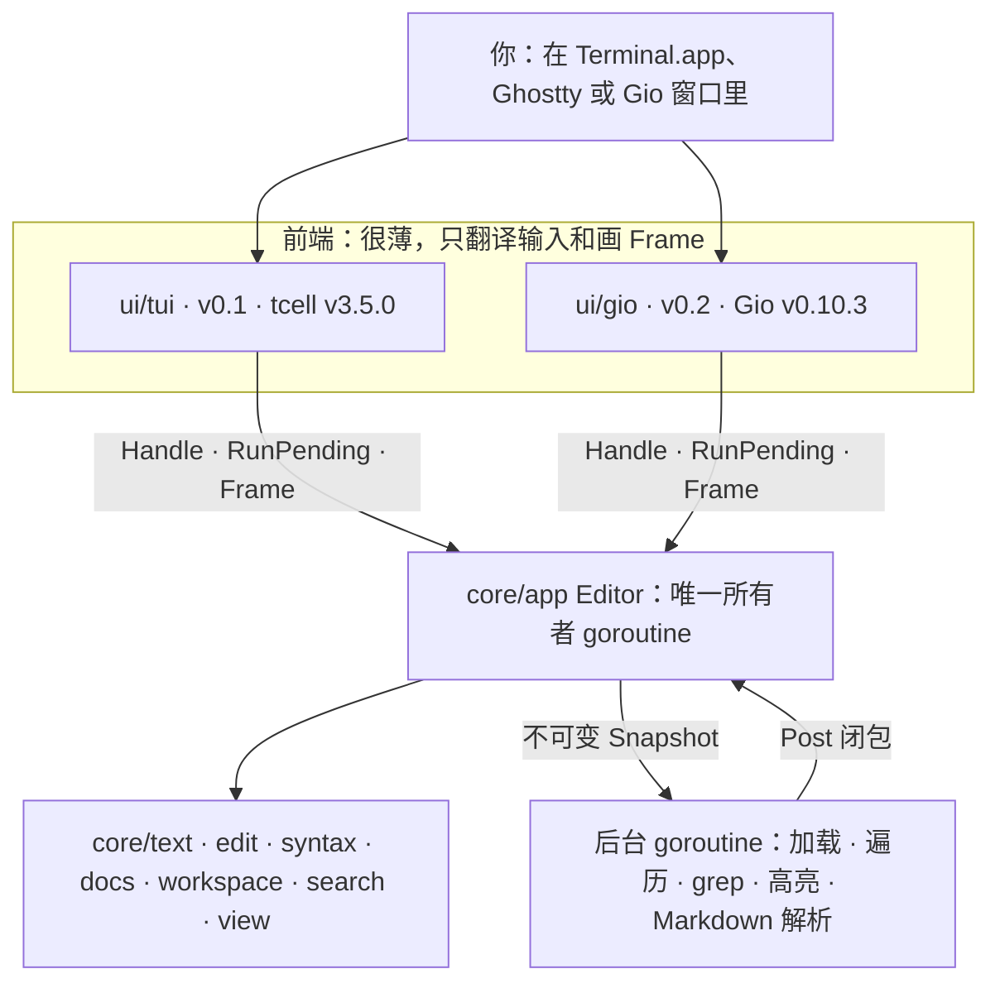

# Yan 砚 文档导读

当前 Mayoi 内化状态以 [功能台账](mayoi-feature-ledger.md) 为准；下方架构路线包含立项时的历史设计，当前 GUI 为 MyGo。

想按开发过程阅读，见 [掘金开发日志系列](./juejin/README.md)：从立项、内核到 macOS 预览版，共 14 篇，附提交时间线与功能覆盖索引。

> 三份设计文档合计四千多行，这一页帮你先抓住要点，再决定往哪读。

## 目录

- [一句话](#一句话)
- [关键决策一览](#关键决策一览)
- [架构一图](#架构一图)
- [路线图](#路线图)
- [键位速查卡](#键位速查卡)
- [阅读顺序](#阅读顺序)
- [等你拍板的问题](#等你拍板的问题)

## 一句话

**Yan 砚**（命令 `yan`）是一个用 Go 写的代码与中文文档阅读器兼轻量编辑器：操作手感像 VS Code（侧边栏、标签、快速打开、命令面板、查找框、多光标、VS Code 的快捷键和命令名），体积几 MB，启动几十毫秒，空闲时零 CPU。先做终端版，再做 Gio 原生窗口，最后加 LSP 与 git。

## 关键决策一览

| 问题 | 决定 | 详见 |
|---|---|---|
| 整体架构 | 纯 Go 的无头内核 + 很薄的前端；全部可变状态归一个所有者 goroutine，后台只读不可变快照 | DECISIONS.md ADR-001 |
| 前端顺序 | v0.1 终端（tcell v3.5.0，无 cgo）→ v0.2 Gio GUI（由 M0 Spike B 放行）→ v0.3 LSP 与 git | ADR-002 |
| 文本存储 | 2 KB 叶子的不可变 rope，先平铺数组（M1a）后 B+ 树（M1b），坐标一律 UTF-8 字节 | ADR-003，ARCHITECTURE.md §3 |
| 中文输入法 | 终端：真实光标永远在插入点，只收上屏文本；Gio：临时事务 | ADR-004，DESIGN.md §6 |
| 字符宽度 | 与 tcell 共用唯一宽度来源；歧义宽度经环境变量重新 exec 生效 | ADR-005 |
| 语法高亮 | 手写行状态词法器，零体积成本 | ADR-006 |
| Markdown | 前端无关的 RichDoc；终端阅读视图 +「在浏览器中打开」；v0.2 真排版 | ADR-007 |
| 大文件 | ≤8 MB 全功能；8–256 MB 只读；>256 MB 拒绝 | ADR-008 |
| 交互 | VS Code 式布局与命令 ID；`[keys]` 加只在终端加载的 `[tui_keys]` 回退键 | ADR-009、ADR-012，DESIGN.md §5 |
| cgo | 只有 `ui/gio` 用 cgo，内核和终端版都是 `CGO_ENABLED=0` | ADR-010 |

## 架构一图

完整的分层图和依赖规则见 [ARCHITECTURE.md §1–§2](./ARCHITECTURE.md#1-架构总览)。

## 路线图

| 里程碑 | 内容 | 累计兼职周 |
|---|---|---|
| M0 | 工具链与两个去风险 spike（终端输入法、Gio） | 2 |
| M1 | 文本内核 | 6 |
| M2 | 接缝与只读查看器（能代替 `less`） | 9 |
| M3 | 工作区与导航（资源管理器、快速打开、命令面板） | 12 |
| M4 | 语法高亮 | 15 |
| M5 | 搜索 | 17 |
| M6 | Markdown 阅读 | 20 |
| M7 | 编辑与输入法投产 | 23 |
| M8 | 加固 → **v0.1** | 25 |
| v0.2 | Gio GUI | 36 |
| v0.3 | LSP 与 git | 41.5 |

周数是估算，兼职项目常超期 1.5–2 倍；超期时按 DESIGN.md §4.1 的「超期先砍」清单砍范围。M0 照着做的步骤见 [DESIGN.md §10.1](./DESIGN.md#101-m0-第一周怎么做)。

## 键位速查卡

完整且唯一的键位表在 [DESIGN.md §5.5](./DESIGN.md#55-键位映射总表)。`†` 表示 Ghostty 默认占用这个 Cmd 键，在 Ghostty 里改按 Terminal.app 列的键。终端里每个 `Ctrl+K X` 也可以按成 `Ctrl+K Ctrl+X`（中文输入法处于中文模式时用）。

| 动作 | VS Code（macOS） | Yan · Ghostty | Yan · Terminal.app |
|---|---|---|---|
| 快速打开 | Cmd+P | Cmd+P | Ctrl+P |
| 命令面板 | Cmd+Shift+P | Cmd+Shift+P†、F1 | Ctrl+K P、F1 |
| 侧边栏 | Cmd+B | Cmd+B | Ctrl+B |
| 文件内查找 | Cmd+F | Cmd+F† | Ctrl+F |
| 项目搜索 | Cmd+Shift+F | Cmd+Shift+F | Ctrl+K F |
| 跳转到行 | Ctrl+G | Ctrl+G | Ctrl+G |
| 保存 | Cmd+S | Cmd+S | Ctrl+S |
| 撤销 / 重做 | Cmd+Z / Cmd+Shift+Z | Cmd+Z / Cmd+Shift+Z | Ctrl+Z / Ctrl+Y |
| 多光标 | Cmd+D | Cmd+D† | Ctrl+D |
| 行首 / 行尾 | Cmd+← / Cmd+→ | Cmd+← / Cmd+→ | Ctrl+A / Ctrl+E |
| 全选 | Cmd+A | Cmd+A† | Ctrl+K A |
| Markdown 阅读视图 | Cmd+Shift+V | Cmd+Shift+V† | Ctrl+K V |

> 终端：`` Ctrl+` `` 或 `Ctrl+K T` 切到项目目录下的 shell 运行项目，`exit` 返回（v0.0 已实现）；v0.2 加 VS Code 式底部终端面板（[DESIGN §4.2](./DESIGN.md#42-v02-gio-gui)、[ADR-013](./DECISIONS.md#adr-013-终端v01-切到-shellv02-内嵌面板)）。

## 阅读顺序

1. [DESIGN.md](./DESIGN.md)：做什么、长什么样、怎么用。先读开头的「速览」，再看 §5（交互）、§6（中文与输入法）、§10（路线图）。
2. [DECISIONS.md](./DECISIONS.md)：为什么这样选、放弃了什么。想推翻某个决定时，先读对应的 ADR。
3. [ARCHITECTURE.md](./ARCHITECTURE.md)：怎么造。开始写某个包之前，读对应章节和 §12 的类型定义。

## 等你拍板的问题

共 8 个，都不阻塞 M0 开工，详见 [DESIGN.md §12](./DESIGN.md#12-待确认问题)：Go 是否升级到 1.27.2；接受 Xcode license 还是用 `DEVELOPER_DIR` 绕过；是否需要 GBK/GB18030；最常读哪些语言；模块路径和名称；是否愿意安装 Ghostty；GUI 阶段 emoji 占位策略；Gio 文字在 13–14 px 下是否太细。
